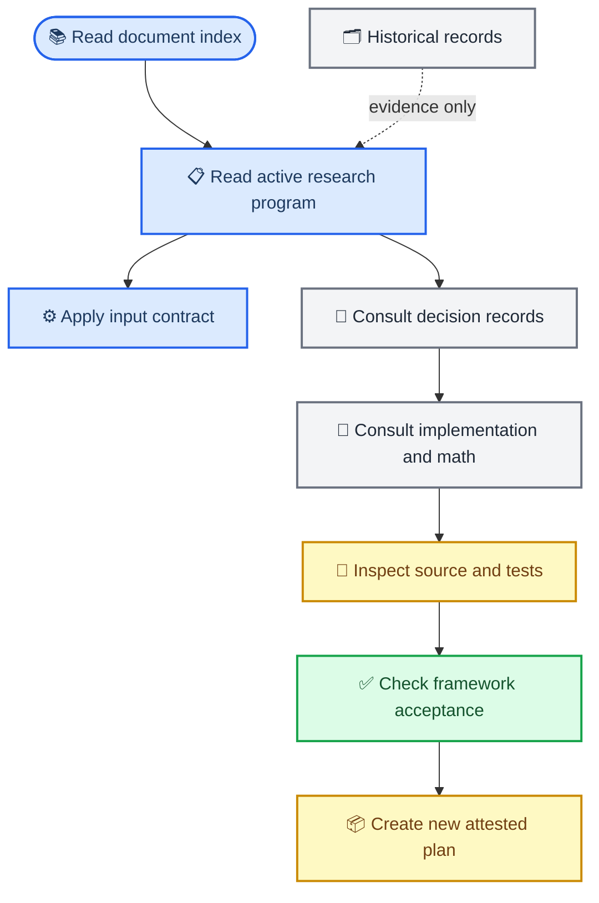

# N2P3-Net 文档控制索引

_版本：2026-09-04 · 活动源提交：`6fc1df1`（分支 `main`，集成工作区）· 用途：统一研究、工程与证据文档的权威层级_

---

## 📋 唯一活动入口

从本文件进入文档集合后，唯一可以改变新研究设计、代码任务或结论边界的规范是
[`research_program.zh.md`](research_program.zh.md)。
[`input_contract_math.zh.md`](input_contract_math.zh.md) 是其输入/时间轴的绑定补充合同。
其余文档提供决策理由、数学推导、实施验收或历史证据，不能单独授权新的实验或覆盖活动规范。

新工作按以下顺序阅读：

1. 本索引，确认文档角色与活动基线
2. 活动规范和输入合同，确认 estimand、数据边界与不可违反的约束
3. 与任务相关的决策、实施、数学或验收记录
4. 当前源码、测试和配置，核对文档陈述是否仍与实现一致

## 🔗 文档权威关系

## 📚 文档角色

| 类别 | 文件 | 权威范围 | 使用限制 |
|---|---|---|---|
| 活动规范 | [`research_program.zh.md`](research_program.zh.md) | 研究问题、估计量、门禁、反例和下一步 | 唯一活动指导文件 |
| 绑定合同 | [`input_contract_math.zh.md`](input_contract_math.zh.md) | EEG 时间轴、单位、预处理和分组 | 不得以实验便利绕过 |
| 项目章程 | [`mission.md`](mission.md) | 产品目标、适用人群和 GTN 边界 | 不作性能证明 |
| 工程环境 | [`techstack.md`](techstack.md)、[`device-portability.md`](device-portability.md) | 依赖、设备、调度与运行时约定 | 运行证据仍需 manifest |
| 工程流程 | [`CODING_WORKFLOW.md`](CODING_WORKFLOW.md) | 本地开发、测试与提交习惯 | 与活动规范冲突时以后者为准 |
| 决策与推导 | [`architecture_decision_20260902.zh.md`](architecture_decision_20260902.zh.md)、[`implementation_plan_20260902.zh.md`](implementation_plan_20260902.zh.md)、[`math_verification_20260902.zh.md`](math_verification_20260902.zh.md)、[`car_math_audit_20260904.zh.md`](car_math_audit_20260904.zh.md)、[`domain_alignment_replacement_20260904.zh.md`](domain_alignment_replacement_20260904.zh.md)、[`domain_transfer_revision_20260904.zh.md`](domain_transfer_revision_20260904.zh.md)、[`domain_transfer_mainline_v2_plan_20260904.zh.md`](domain_transfer_mainline_v2_plan_20260904.zh.md)、[`domain_transfer_chain_primary_source_audit_20260904.zh.md`](domain_transfer_chain_primary_source_audit_20260904.zh.md) | 方案为何成立、如何落实、反例为何必须保留；CAR 边界与旧 GALIA/AS-MMD/PDS 替代方案（历史背景）；域迁移机制批判与 adapter 剂量诊断（历史）；v2 主线实施/消融方案（当前权威） | 记录，不是新的派工单 |
| 框架验收 | [`framework_acceptance_20260903.zh.md`](framework_acceptance_20260903.zh.md) | `ef7a40e` 的代码链、测试和开放风险 | 仅 framework/contract evidence |
| 实证与外部依据 | [`research_evidence_ledger_20260903.zh.md`](research_evidence_ledger_20260903.zh.md) | 历史结果、机制推理、文献和统计/来源合同 | 不替代当前性能证据 |
| 论文文献底稿 | [`../Paper/literature_review_n2p3net_20260903.zh.md`](../Paper/literature_review_n2p3net_20260903.zh.md) | 论文 Related Work 与引用纪律 | 不作为活动规范 |
| 历史文档 | [`../frozen/document_history_through_ef7a40e_20260903.manifest.json`](../frozen/document_history_through_ef7a40e_20260903.manifest.json) | 已完成派工、旧 cloud staging 计划和集成前审计 | 仅证据，不得直接执行 |
| 已收敛报告 | [`../frozen/document_reports_through_6c4abe8_20260903.manifest.json`](../frozen/document_reports_through_6c4abe8_20260903.manifest.json) | 被台账吸收的 dated report、审计和候选综述 | 需要原文时从归档恢复 |

## 🎯 当前活动基线

当前代码活动基线为 `ae2706e`（分支 `main`）：已批准 v2 主线的首轮实施批次
（WP0/WP1 完成，WP0 含 negative-MMD ledger 与远距离 tie-break 反例；EA cache 带
`--reference-mode` 上游 provenance 门；WP2 faithful AS-MMD 适配路径、WP3 TSD schema
与 `tsd_dropped_*` checkpoint 计数、WP4 `source_selection_record` 部分完成，进度见
v2 计划文档头部）。前序批次 `326c8fd`/`352932b` 与历史集成基线 `6fc1df1`（domain-transfer-v2
的历史 P3 链：feature lift、本地 AJD 白化（旧名 GALIA Fast Alignment）、conditional
RBF-MMD inactive policy、checkpoint 分块、source selection（旧名 PDS）、valid-subject
hit@R 主口径；与 result-optimization 的 partition result batching、zero-shot feature
memo、CPU result-phase worker 预算合并，且 `epoch_selection` 合同已归位到 adaptation）
保留为历史记录，不因此重新训练或改写 E1 证据。
2026-09-04 起，域迁移主线的权威实施方向改为
[`domain_transfer_mainline_v2_plan_20260904.zh.md`](domain_transfer_mainline_v2_plan_20260904.zh.md)：
**EA 默认数据对齐 + ACW 辅助（仅 TSD 坐标/经典解码）+ faithful AS-MMD
（target-weighted CE + logit marginal RBF-MMD + Split-BN）+ TSD 选样**；旧的
GALIA/PDS 实现描述与旧 “conditional AS-MMD” 提法已退役（本地实现按 ACW/TSD/安全对照处理，
真 GALIA 与 Dense PDS 为可选对照）。
当前代码树物理冻结为 `frozen/active_source_ae2706e.*`（archive SHA-256
`cca169eda15cef9783e80557f00bf191a8c64f47f285d25d8bc6d854a74d6fa2`；
source_commit `ae2706e`，冻结对提交 `c3b7d10`）；前序批次
`frozen/active_source_326c8fd.*`、`frozen/active_source_352932b.*` 与历史集成基线冻结
`frozen/active_source_6fc1df1.*` 保留不覆盖。
E1 的训练/评估 source 不变：native=`b96a6af`、CAR=`b86d558`；valid-subject
官方 analysis 由分析源码 `6ec71b0` 生成，均不因本次实施重训或改写。

| 机制 | 当前软件状态 | 仍需的科研证据 |
|---|---|---|
| P0 Split-BN | source-domain buffer、目标 buffer selector 和 checkpoint 绑定已实现 | 成对 fold/seed、cluster CI 和 buffer-swap 机制证据 |
| P1 drop-to-consensus | source-only residual、counterfactual ledger 和 invalid-run gate 已实现 | 真实 source/target 迁移与 held-out valid-subject hit@R（operational 诊断并存） |
| P2 direct-decision loss | direct-membership metadata、完整 decision batch 与训练合同已实现 | 真实 direct timeline 训练；row/column protocol dispatch 仍未实现 |
| P3 域迁移主线（EA 默认 + ACW 辅助 + faithful AS-MMD + TSD） | 旧 GALIA/PDS 实现描述已退役；`6fc1df1` 仍含历史实现（本地 AJD 白化、conditional feature MMD、source sampling），只按 ACW/TSD/安全对照使用。新主线按 v2 计划实施：EA 默认数据对齐（不减均值，`(N,C,T)` 输出）、ACW 仅辅助坐标、faithful AS-MMD（target-weighted CE + logit marginal RBF-MMD + Split-BN 双 buffer）、TSD 选样 | 真实 cache 上的 EA/AS-MMD/TSD 验收、rank/condition/offdiag residual、row-identity/buffer digest、真实跨域数据和 paired valid-subject hit@R（operational 诊断并存） |

以下结论仍不得作出：feature transfer 有效、EA/ACW/faithful AS-MMD/TSD 主线有效、
旧 GALIA/PDS 链有效、decision learning 有效、成人 BrainSync 达到 90%，或 target-calibration 已可运行。

高负载测试异常已由受控实验定性为 WorkBuddy 会话环境故障，不是 EEG/契约源码缺陷；
bulk-delete、trash、symlink shim，以及被负载放大的 15ms 并发测试窗口共同造成异常。
因此 WorkBuddy 会话内的高负载 pytest 结果不作为验收信号；独立 shell/云端或 unset 守卫变量
后的复跑才可采信。详见 [`framework_acceptance_20260903.zh.md`](framework_acceptance_20260903.zh.md)
和 [`research_evidence_ledger_20260903.zh.md`](research_evidence_ledger_20260903.zh.md)。

## 🔄 下一步门禁

1. ✅ 已生成并跟踪 `frozen/active_source_a102467.*`；任何后续代码变更都必须生成新的 archive+manifest，且不得覆盖 `b96a6af`
2. 人工决定是否清理 `%TEMP%\pytest-of-chent`；WorkBuddy 会话内不采信高负载测试，清理前后的验收均使用空闲、单任务或独立 shell
3. 准备经验证的 active source/target cache，并按 direct 与 row/column protocol 分流
4. 按 [`domain_transfer_mainline_v2_plan_20260904.zh.md`](domain_transfer_mainline_v2_plan_20260904.zh.md) 依次执行 WP0（修 bug/命名：本地 GALIA→ACW、旧 PDS→TSD）、WP1（EA 数据对齐 cache）、WP2（faithful AS-MMD）、WP3（TSD 正式化 + ACW 辅助 + Dense PDS 对照）、WP4（matrix plan 字段/DAG）；未按该计划闭合前，不把旧 GALIA/PDS 实现描述当主线
5. 先完成 plan、environment、cache 与 checkpoint 的 attestation/dry-run，再启动单 worker CUDA smoke
6. 只在预声明的 matched fold/seed 后报告 paired `valid_subject_operational_hit_rate`（主指标）与 operational `hit@R`（部署诊断）及 participant-cluster CI
7. 在模型级 target-calibration collector、buffer provenance 与结果 ledger 闭合前，保持该 arm fail-closed

## 🗂️ 文档维护规则

- 重大架构或合同变动同时更新活动规范、实现/验收记录和本索引
- 新实验计划必须绑定当前 source archive、环境、cache、checkpoint 与计划 digest
- 过往派工、审计和结果保留为可复核证据，但不得以其旧状态覆盖当前规范
- 需要冻结的代码或结果使用 `frozen/` 下带 manifest 的压缩包；仅有文字标签不构成冻结
