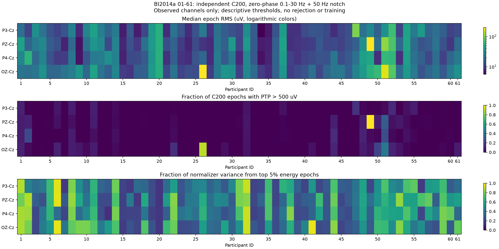

# BI2014a 61人独立C200波形质量与phase定位审查

2026-09-29。**61/61名准入参与者全部完成，0失败；零相与forward各自重建同一C200，共122份独立处理。** 原始MAT只读，无trial删除、阈值拟合、模型训练或AUC评分。完整逐人、逐导、逐epoch统计保存在Git忽略的`experiments/runs/deep_chain_audit_20260929/bi_quality/`。

## 主要发现

大幅度现象不限于01号，但程度差异很大。以任意实测导联PTP超过500µV为固定描述口径，34/61人至少有一次超过；被试内比例的participant宏均值为7.52%，中位数仅0.5%。49号200个epoch全部超过，26号89.5%，51号53%；这些持续异常不能全部归为最后几条epoch的边界问题。

末端集中也很明显：61人中36人的零相最大峰值在最后20个事件，34人在最后10个，26人恰在最后event199；但“最大值在末端”不自动代表幅度异常。在34名PTP>500µV者中，20人的最大峰值位于末20，17人位于event199。7人仅末20事件出现该阈值超限，前180完全未超限。

01号的局部定位与先前探针一致。event199的P3-Cz峰值零相3545.04µV，forward仅59.43µV；最后20事件占P3-Cz归一化前总体方差90.90%。不过01全C200的forward最大峰值仍有1404.88µV，不能把全部异常都解释成同一个末端现象。

## 输入、算子与资源身份

- 实际目录库存恰为`subject_01`至`subject_61`的61份MAT，无猜测路径、缺号或引入62–64号。每份原件SHA256保存在[provenance.json](provenance.json)，零相与forward两次读入的SHA完全一致。
- 逐record使用`read_source_record → _source_channel_admission → prefix_raw_scopes(K=Kmax=200) → build_subject → _subject_epoch_dataset → adapt_observed_montage(SIX,Cz)`，与输入分支`probe_public_raw.py`的generic C200路径一致。
- 固定0.1–30Hz、50Hz/Q30陷波、128Hz、−200至1200ms、179点、mean-only基线、FFT epoch重采样、独立raw C200范围。当前双向profile为`brainsync_bidirectional_v1`和`mne_reflect_limited`边界策略。
- 所有人均保留200个epoch，六槽顺序Fz/P3/Pz/P4/PO8/Oz，实际观测mask为`011101`：P3/Pz/P4/Oz为Cz差分；缺失Fz/PO8没有当作真实零幅值参与统计。
- 首次启动前可用RAM约2.70GiB，按授权串行执行、每个native库线程1，逐record释放EEG；只保存统计，不保存全61人EEG副本。处理时观察RSS约0.72–0.75GiB。进度每10人输出并保留全部失败分母。
- 01号MAT SHA256=`eecb29c236f21b5d8d1b8b3cc07e4aa96b107eeb29033201fcab407d94fdd759`；四实测导的峰值及median/p90/max RMS与先前输入探针逐项复现。

## 全61人零相幅度分布

以下“超限”仅表示固定诊断阈值的计数，**不是QC剔除规则**。一个epoch任意实测导超过即计一次，不能把四导相加扩大trial分母。

| PTP阈值 | 至少一个epoch超过的人数 | 被试内比例宏均值 | 被试内比例中位数 | 被试内比例p90 | target宏比例 | non-target宏比例 |
|---|---:|---:|---:|---:|---:|---:|
| >100µV | 59/61 | 46.93% | 42.00% | 97.00% | 47.49% | 46.81% |
| >500µV | 34/61 | 7.52% | 0.50% | 14.50% | 7.77% | 7.47% |
| >1000µV | 21/61 | 3.06% | 0.00% | 8.50% | 2.82% | 3.10% |

这些class比例是描述性汇总，没有独立事件假设或显著性结论；重叠epoch会重复包含同一物理信号。

| 实测差分 | 每人epoch RMS中位数的跨人中位数 | 全库最大绝对峰值 | 原population std跨人中位数 | 实际normalizer std跨人中位数 | top5%能量epoch贡献方差>50%的人数 |
|---|---:|---:|---:|---:|---:|
| P3−Cz | 15.09µV | 3545.04µV | 30.74µV | 31.74µV | 22/61 |
| Pz−Cz | 16.07µV | 5916.25µV | 34.69µV | 35.69µV | 30/61 |
| P4−Cz | 15.64µV | 7150.20µV | 27.79µV | 28.79µV | 24/61 |
| Oz−Cz | 21.84µV | 8849.56µV | 38.90µV | 39.90µV | 28/61 |

normalizer统计使用全部合法C200实测epoch/time样本的population variance，不加class权重；实际target-prefix标准差为`population_std + 1µV`后转float32，对应`SubjectAdapter._masked_stats`。二者单独报告，不能把裸std写成模型实际除数。top5%在每人200个epoch中恰为10个，以其对同一个全C200均值的平方离差贡献排序；没有因此删除这10个epoch。

逐人每导median/p90/max RMS、所有阈值/class分母、PTP与normalizer方差贡献见本地`participant_channel_statistics.csv`及`subject_XX.json`。原生Cz/各实测导的完整raw及C200范围峰值、相邻差分和原始参考下标准差也保存在每人的`native_raw_diagnostics`中；这些数值不能独自证明ADC clipping。

## 同一C200的forward定位对照

该对照保持raw文件、事件、scope、标签、通道mask、频带、陷波、窗口、采样和基线完全相同，并逐人断言配对。**它是完整phase处理差异，不是只改变因果性或边界。** 单程forward幅频响应为`|H|`，前后向零相为`|H|²`，所以全库差异不能一概归因于边缘。

字面合同有三个联动变化，已在[phase_summary.json](phase_summary.json)逐字段记录：`filter_phase: zero→forward`，`causal_iir_initial_state: not_applicable→steady_state_first_sample`，`zero_phase_edge_policy: mne_reflect_limited→legacy`。后两项为forward合同强制的初态/边界执行字段，不能留错误的zero-phase声明。未额外修改频率、滤波阶数、窗口或重采样。该对照不晋升forward为默认。

| 指标 | 当前独立C200零相 | 同C200 forward |
|---|---:|---:|
| 至少一个epoch任意导PTP>500µV的人数 | 34/61 | 33/61 |
| 任意导PTP>500µV的epoch总数 | 918/12200 | 985/12200 |
| 其中末20事件超限数 | 209/1220 | 125/1220 |
| 被试内超限比例宏均值 | 7.52% | 8.07% |

因此forward并未在全库减少全部PTP超限数；末端超限减少与其他时段超限增加同时发生。不能据此把所有大幅度都称为零相边界伪迹，也不能据其平均表现直接换默认合同。

| 导联 | 零相末20事件方差占比的跨人中位数 | forward对应中位数 | 零相末20贡献>50%方差人数 | forward对应人数 |
|---|---:|---:|---:|---:|
| P3−Cz | 17.12% | 5.86% | 13/61 | 0/61 |
| Pz−Cz | 24.26% | 4.90% | 15/61 | 2/61 |
| P4−Cz | 13.57% | 5.40% | 11/61 | 1/61 |
| Oz−Cz | 15.92% | 5.80% | 14/61 | 3/61 |

每人每导最大峰值和最大RMS对应原始event index、top10能量event及原始sample、前180/末20/末10的PTP/class比例与方差占比全部保留在本地`phase_comparison_XX.json`，不会只展示末端异常者。

## 01号与持续异常者需分别解释

01号event199的四导零相峰值依次为3545.04、2184.47、2845.26、2926.91µV，forward为59.43、87.38、56.93、72.68µV。P3−Cz末20的pooled RMS为636.73→67.36µV，裸population std为207.66→81.89µV，含epsilon的实际normalizer std为208.66→82.89µV。这一原事件的完整定位还需结合输入分支的**同一zero-phase full-context对照**及纯50Hz多相位反例；这些额外控制才把01的局部边界放大与一般phase幅频差异区分开。本61人forward对照本身不完成全库边缘因果归因。

另一方面，26号零相有164/180个前段epoch超过500µV，forward为161/180；49号两种phase全部200个epoch均超过；51号前180零相86个、forward103个。因此至少存在无法靠“只处理末端”解释的持续高幅度记录。这里只将其列为继续原件定位的对象，没有判废、删除记录或认定迁移性能病因。

## 复现与交付边界

脚本：[audit_bi61_c200.py](audit_bi61_c200.py)、[compare_forward_c200.py](compare_forward_c200.py)。小型证据：[summary.json](summary.json)、[phase_summary.json](phase_summary.json)、[temporal_aggregate_summary.json](temporal_aggregate_summary.json)、[provenance.json](provenance.json)。完整结果与任何逐epoch统计留在本地忽略目录，不随Git分发。

本轮回答“61人的同合同C200是否也有大幅度及是否末端集中”。没有回答全部录制是否合格、某个固定PTP阈值是否应剔除EEG、哪种phase更有AUC收益，亦没有把波形异常直接解释成A1/Q1负收益的原因。

## 最后扩展：实际test raw有限支持也影响测试端

**全61人已完成，0失败、0缺失，共16,499个物理test epoch。** 本项另按当前`prepare_source_record_prefixes`的scope/builder逻辑和实际`resolve_calibration_splits`解析`budgets=(0,200,800)`、`minimum_test_trials=200`，没有将前面的C200校准视图误当测试视图。

每人分别从原始record重建：①正式规则给出的独立test raw scope；②同record全长zero-phase上下文。随后仅取②中与①**原始event sample、label、observed mask完全相同**的test事件逐点相减。两边使用同一zero-phase算子，频率响应没有像前节forward比较那样改变；差异来自有限raw支持及其边界执行。全长处理仅为oracle诊断，**没有送进拟合或新评分，也不是合法修复方案**。

### 实际预算与test长度

20人实际maxK为800，其余41人按当前有限数据规则回退至355–796。test长度85–948，中位175；41/61人的实际test不足声明的200。该现象与输入分支的minimum-test反例一致：当前fallback只保证仍有test行，没有继续满足`minimum_test_trials=200`。本审查按实际程序保留这些人和真实长度，没有修改规则、静默补样本或失败分母。

01号的正式test范围为原始sample `[279286,417925)`，386个test事件、65个target，对应原event802–1187；四导label/mask/sample严格匹配。P3−Cz的独立test减full-context差值RMS为74.35µV、最大绝对差1495.97µV，最大差出现在test第0条；首20条占全部差能量99.9965%。Pz/P4/Oz最大差分别1087.52/1318.97/1333.51µV。

### 全61人差异集中于test起点

| 导联 | 每人全test差值RMS的跨人中位数 | 最大单人差值RMS | 全库最大绝对差 | 首20差能量占比的跨人中位数 | 最坏差位于首20的人数 |
|---|---:|---:|---:|---:|---:|
| P3−Cz | 2.17µV | 115.89µV | 1495.97µV | 99.9269% | 61/61 |
| Pz−Cz | 3.16µV | 177.45µV | 1721.81µV | 99.9471% | 61/61 |
| P4−Cz | 2.34µV | 348.93µV | 3389.91µV | 99.9468% | 61/61 |
| Oz−Cz | 4.76µV | 319.34µV | 3665.03µV | 99.9447% | 61/61 |

每人跨导最大绝对差的中位数93.26µV，p90为1082.16µV，13人超过500µV、7人超过1000µV。最大者为26号3665.03µV、44号3389.91µV。差值本身的阈值只用于描述幅度，不等同PTP诊断或数据剔除规则。test末20的差能量占比中位数约1e-18，接近数值零；两视图共享真实record末端，主要改变的是test起始边界。

### 同一批test事件的PTP诊断

表中任意实测导超过即记一个epoch，不混淆trial和通道分母。

| PTP阈值与位置 | 独立test scope | full-record oracle上下文 |
|---|---:|---:|
| >500µV，全test | 680/16499；23人出现 | 635/16499；19人出现 |
| >500µV，首20 | 96/1220 | 50/1220 |
| >500µV，中间段 | 494/14059 | 495/14059 |
| >500µV，末20 | 90/1220 | 90/1220 |
| >1000µV，全test | 138/16499；16人出现 | 114/16499；10人出现 |
| >1000µV，首20 | 37/1220 | 13/1220 |
| >1000µV，中间段 | 59/14059 | 59/14059 |
| >1000µV，末20 | 42/1220 | 42/1220 |

这证明当前独立raw支持处理的影响同时出现在校准末端与测试起点，并非只发生在C200校准端。仍不能由波形差直接断言AUC下降多少或解释A1/Q1交互；也不能通过把全record一起处理来修复，因为那会改变授权拟合范围和输入身份。

复算脚本：[audit_bi61_test_support.py](audit_bi61_test_support.py)，小型总表：[test_scope_summary.json](test_scope_summary.json)。完整`test_scope_subject_XX.json`和`test_scope_all_participants.json`位于本地忽略目录，保存实际maxK、scope起止、原始event index/sample/label、每导逐epoch的两侧RMS/PTP、逐点差RMS/max及首末20差能量。原始EEG与全长处理后的EEG均未另存。串行native线程1，观察RSS约726–786MiB；单record保守额外内存估算未触发预算门禁，61人均无内存失败。源码SHA在扫描前后核对一致，后续若修复resolver或边界执行，须保留此份旧执行诊断身份。
