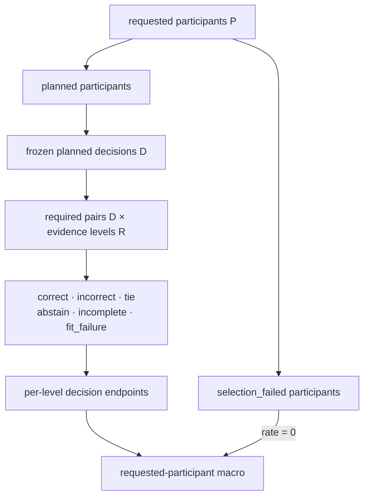

# V05.a：完整请求分母、终态分区与指标规格

2026-10-18；源码要求与独立反例先固定，再编写对应 Lean 实现。本件是专题证据，活动指导仍由六份项目指南负责。

## 🔬 范围与实际入口

本项覆盖数学规格和源码审查，不将 Python、NumPy、sklearn、IEEE 或科研效能的全栈 refinement 纳入预算。机器清单绑定本轮实际源码哈希。以下为已检查的语义入口；全文件已列清单不等于每个分支已验收。

| 层 | 实际源码 | 本轮需验证的关系 |
|---|---|---|
| 冻结请求计划 | `src/research/contracts.py` 的 `DecisionPlanContract` | 每个 requested participant 必须且只能是有 planned decision，或有一条 selection failure |
| 原始终态 | `src/transfer/outcomes.py` | 六种 decision 状态、覆盖/真值/预测约束、逐证据等级的完整请求交叉积 |
| 评分侧生成器 | `src/transfer/evaluation.py`、`src/transfer/candidate_decision.py` | 可评分项产生终态；仅遍历 surviving groups 的 helper 不能独自证明完整 requested 分母 |
| 失败项补齐 | 两个 cross-decision runner 的 `_failed_decision_outcomes`、`_fit_failure_decision_outcomes`、`_accounting_record` | requested 中的数据不适格/拟合失败项均显式补齐全部要求的证据等级 |
| 独立分析器 | `experiments/analyze_candidate_cross_decision.py` | 从冻结计划重建 keys、状态计数、失败账本和 participant endpoint，拒绝缺失/多余/重复项 |
| 其他指标消费者 | `src/baselines/evaluate.py`、连续研究 runner、`src/stats/transfer.py`、实际 analyzer | 区分 decision-pool、participant-macro、study-equal；AUC/NLL 的实际可定义域与缺失项另报 |

`selection_failed` 是参与者层终态，六种 `DecisionStatus` 属于 decision 层。不能把选择失败的参与者虚构成若干已计划 decision，也不能从 participant 分母移除。[^plan]

## 📐 完整终态分区

设有限请求参与者集合为 (P)，有计划项的参与者为 (P_D)，选择失败集合为 (F)。实际计划构造器检查：

$$
P_D\cap F=\varnothing,\qquad P_D\cup F=P.
$$

令 (D) 是冻结计划中的唯一 `(participant_key, decision_id)` 集合，(R) 是规范化后非空、正整数且无重复的 evidence-level 序列。实际 `outcomes` 输入是序列 (O)，每项含 key、level、status。必须从显式检查推出：

$$
\operatorname{Nodup}(\operatorname{keys}(O)),\qquad
\{\operatorname{keys}(o):o\in O\}=D\times R.
$$

源程序依次拒绝 requested 重复、无效 evidence levels、outcome key 重复，再拒绝 missing/unexpected。仅行数相同或 `accounted == requested` 不能替代这些集合检查。缺失行会被拒绝，核心 accounting helper 不会自动把它补成 miss；失败项由实际 runner 生成。[^outcomes]

对每个 (r\in R) 和六种状态 (s)，定义：

$$
D_{r,s}=\{d\in D: \operatorname{status}(d,r)=s\}.
$$

需要从前述 key 检查和逐项状态投影证明这些集合两两不交、并集为 (D)，以及

$$
C_r+I_r+T_r+A_r+M_r+F_r=|D|.
$$

计数必须是实际 outcome 序列的 status `Counter` 投影所生成的自然数；不能输入一组已经满足上述等式的六个自由计数，再把分区等式当作新证明。逐等级分母是 (|D|)，全部交叉积大小才是 (|D|\,|R|)。源程序保留调用者给定的 level 顺序，不应额外要求排序。

状态合法性也要保留源码边界：correct/incorrect/tie 要求 coverage.complete；correct/incorrect 约束 target/predicted 的相等关系；tie 无唯一 prediction。incomplete/fit_failure 要求 reason 且无 prediction。`abstain` 没有同样的 prediction/coverage 限制。源码没有要求 `incomplete` 的 coverage 必须不完整，也没有要求任意 complete coverage 对应完整的外部 candidate task；后者由 task/plan gate 检查。[^outcomes][^analyzer]

## 📊 指标与零分母

记 (N=|D|)，`valid` 为 (V_r=C_r+I_r+T_r)。tie 进入 valid 分母，同时属于 operational 非正确项。

| 指标 | 公式及适用条件 | 源码约定 |
|---|---|---|
| decision operational hit | (C_r/N) | `EvidenceOutcomeCounts.to_record` 在 (N=0) 时给 0 |
| conditional valid hit | (C_r/V_r) | 同一 helper 在 (V_r=0) 时给 0 |
| coverage | (V_r/N) | 实际消费者计算；需分别记录分母及空集策略 |
| analyzer planned/eligible/successful endpoint | correct 除相应真实分母 | `_decision_endpoints` 的零分母给 `None` |
| requested-participant endpoint | selection failed 给 0；其他 (h_{p,r}=C_{p,r}/N_p)，(N_p>0) | (rac1{|P|}\sum_{p\in P}h_{p,r})，不是 pooled decisions |

在自然计数域、(C_r\le V_r\le N) 下证明数值界；在 (V_r>0,N>0) 下证明

$$
H^{\rm operational}_r=\operatorname{coverage}_r\,H^{\rm valid}_r.
$$

零分母给 0 的 helper 可另证其扩展恒等式；不能将它直接套到返回 `None` 的 analyzer。全部参与者 selection failed 时，planned decision 集合可以为空，而 requested-participant operational 仍是 0。[^analyzer][^runner]

`data_eligible`、`evaluation_successful` 来自 eligibility/失败账本；它们与逐等级的 (V_r) 分母分别计算，不能重命名后互换。一个 decision 可以在浅等级有效、深等级 incomplete，失败账本的 incomplete 记录只需覆盖它的 incomplete prefixes。source 的 fit_failure 失败账本分支则要求其匹配项全为相同失败。更强的跨等级限制须从实际 producer 补证，不能仅由 analyzer 的一个 helper 假设。[^analyzer]

AUC 的数学对象为实际 scored trials 中的正负样本对：

$$
\operatorname{AUC}=\frac{\sum_{i\in Y^+}\sum_{j\in Y^-}
 [\mathbf1(s_i>s_j)+\tfrac12\mathbf1(s_i=s_j)]}{|Y^+||Y^-|}.
$$

两类都非空才定义；participant-macro 与 pooled-trial AUC 分开。`baselines.evaluate` 的 `nanmean` 是实际已给出的 fold 读数汇总，不能当作整个 requested cohort 的无缺失估计。`stats.transfer` 保留失败/缺失 seed 与参与者，并在声明库缺失时关闭 full-study estimate；缺失结果识别界与 bootstrap confidence interval 分开。[^baseline][^stats]

NLL 的集合 (Q\subseteq D) 是实际输出概率的项，所报条件读数为

$$
\operatorname{NLL}_Q=-\frac1{|Q|}\sum_{d\in Q}\log p_d(y_d),
\qquad |D\setminus Q|\ \text{另报}.
$$

continuous runner 也单列 `requested_nll_with_explicit_uniform_abstention`。用 (log K) 填补未输出概率的项，是这个有明确名称的报告约定；不能把它称为模型实际给出的 NLL。[^continuous]

## 🧪 固定独立反例与错误替代

| ID | 待推翻的错误替代 | 预先固定的反例 |
|---|---|---|
| C01 | 只检查行数即可保持请求分母 | requested={a,b}，observed={a,c}，行数相同但 b 缺失/c 多余 |
| C02 | 去重 observed 后计数即可 | requested={a,b}，observed=[a,a]；重复应先拒绝，b 仍缺失 |
| C03 | 每个 outcome 都有合法状态就自动穷尽请求 | 从 (D\times R) 删除任一项；accounting 必须拒绝 missing |
| C04 | 所有 evidence prefixes 可合并后仍除 decision 数 | 一个 decision、两个等级、均 correct；错误比例为 2，逐等级比例均为 1 |
| C05 | tie 可从 valid 分母移除 | 一个 correct、一个 tie；正确 valid hit=1/2，移除 tie 得 1 |
| C06 | noncorrect/失败项不必进入 operational 分母 | 六个不同 decision 各取一种状态；correct=1、requested=6、valid=3 |
| C07 | `coverage.complete` 已证明外部 candidate task 完整 | expected={}、observed={} 给 complete=True；它没有证明 candidate vocabulary 大小或冻结任务匹配 |
| C08 | `accounted=requested` 已保证直接构造的 rates 在 [0,1] | 直接 counts=(-1,2,0,0,0,0)，requested=1；source class 不做非负构造检查。factory Counter 的自然域另证 |
| C09 | pooled decision hit 等于 participant-macro | 两人 ((C,N)=(1,1),(0,9))：macro=1/2，pool=1/10 |
| C10 | selection failure 可从 participant-macro 移除 | C09 再加一个 selection-failed requested participant：macro=1/3，移除失败得 1/2 |
| C11 | 零分母在所有接口都表示 0 | 空 requested accounting helper 给 0；analyzer 的同类 endpoint 给 None |
| C12 | 随 evidence 增加正确率必不下降 | 同一 key 在第 1 级 correct、第 2 级 incorrect；coverage/timing 递增并不禁止预测翻转 |
| C13 | subject-macro AUC 等于 pooled AUC | A: positive=1,negative=0；B: positive=101,negative=100。macro=1，pooled=3/4 |
| C14 | 缺失概率项的 uniform NLL 是模型 NLL | 一项 (p_y=0.9)，另一项无概率；条件 NLL 为 (-\log0.9)，uniform 填补是另一个量 |
| C15 | 由 prediction==target 可重建 correct 数 | abstain 可以具有 complete coverage 与 prediction==target；accounting 必须服从原始 status |
| C16 | 核心 accounting 拒绝所有非整数 raw level | 源码先 `int(level)`；[1.1] 规范化为 [1]。数学输入域在该转换之后，analyzer 的 exact-int parser 另列 |

C07/C08/C16 限定各自 helper 的真实输入域，不自动指控实际冻结-plan消费者违约。不得据这些反例擅自修改生产算法或覆盖旧实验身份。

## 📋 实施和验收顺序

1. 从实际 requested/level/outcome-key 检查构造完整六终态分区，证明每一级自然计数与全部交叉积大小。
2. 从 `DecisionPlanContract` 的显式集合检查证明参与者 planned/selection-failed 分区，再证明 requested-participant macro 保留失败项及其与 pooled 的区别。
3. 证明 coverage/count/rate 的自然域、零分母接口差异、valid/tie 分母及空 cohort 行为；关联实际 runner 的补齐和 analyzer 的重算检查。
4. 继续 AUC pair、NLL 真实定义域、study-equal/缺失识别界的数学与源码关系。统计区间覆盖保证与重采样实现另列，不用数学恒等式声称推广有效性。

每个切片须完成构建、独立进程检查、标准公理审计、能实际拒绝错误命题的严格负控和源码身份检查。只有需求表中的整个 V05.a 范围和消费者均有对应证据才更新为完成；当前只固定规格，尚无新 Lean 验收或生产执行。

[^plan]: [contracts.py](D:/BCI/n2p3-net/src/research/contracts.py:303)，`DecisionPlanContract.__post_init__`。
[^outcomes]: [outcomes.py](D:/BCI/n2p3-net/src/transfer/outcomes.py:280)，`build_decision_outcome_accounting`；同文件的 coverage、outcome 和 counts 构造器。
[^analyzer]: [analyze_candidate_cross_decision.py](D:/BCI/n2p3-net/experiments/analyze_candidate_cross_decision.py:815)，task/plan、失败账本、重建 accounting、participant endpoints 与 decision curve。
[^runner]: [run_candidate_cross_decision.py](D:/BCI/n2p3-net/experiments/run_candidate_cross_decision.py:312)，failure factories、`_accounting_record`、requested participant endpoints；另审 BrainSync runner 的对应链。
[^baseline]: [evaluate.py](D:/BCI/n2p3-net/src/baselines/evaluate.py:247)，`hit_correct_total_by_repetition` 与 candidate summary。
[^stats]: [transfer.py](D:/BCI/n2p3-net/src/stats/transfer.py:178)，`_summary` 的 full-study 门槛、缺失识别界与汇总权重。
[^continuous]: [run_bnci_continuous_study.py](D:/BCI/n2p3-net/experiments/run_bnci_continuous_study.py:73)，`_cell` 的终态、概率缺失与单列 uniform 报告。
