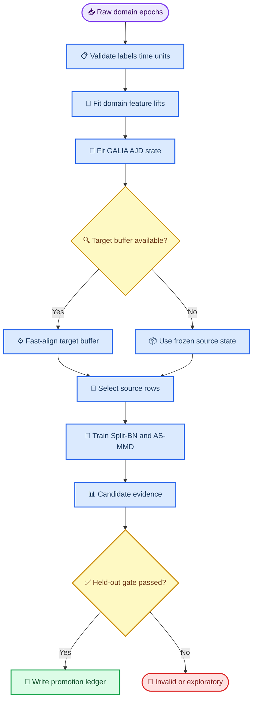

# CAR 退役后的异构域迁移方案

*N2P3-Net · 2026-09-04 · 方案记录；用于替换当前 common-CAR 活动路线，不直接授权性能晋升*

---

## 🎯 方案结论

建议将 `n2p3_common_channel_car/1` 从**活动跨域适配器**中退役，迁移到一个分层的
`n2p3_domain_alignment/1` 方案：

1. **数据级 GALIA/AJD**：对每个域单独估计线性变换，把已经构造好的同维特征向量
   联合映射到一个共同坐标系；
2. **特征级 AS-MMD**：在 GALIA 输出上按域使用 Split-BN，并以 target-weighted
   supervised loss 加条件 MMD；
3. **训练集主动采样**：只在 source train/calibration 可见范围内，用目标相似度和
   多样性选择 source rows，不改变 test 分母；
4. **时间延迟对齐**：作为独立的 latency-aware ablation，不嵌入 GALIA，也不允许
   离线未来信息进入 chronological inference。

### 当前裁决

- CAR 代码不再作为新实验的默认公共空间变换；已有 CAR cache、checkpoint 和结果进入
  物理冻结的历史层，不能混入新合同。对本方案的独立批判与 adapter 剂量诊断见
  [`domain_transfer_revision_20260904.zh.md`](domain_transfer_revision_20260904.zh.md)。
- **已落实最小代码修订（2026-09-04）**：builder 默认改为 `native_preserve`
  （只选公共通道、不重参考，fail-closed 要求显式共享 `source_reference`）；
  `common_average` 变为显式 opt-in，且默认 `--min-common-channels 3` 堵死 2 导 CAR。
  已落盘的 `src/data/domain_alignment.py` 另修复两个实现缺陷：显式 weights 在
  `rjd/uwedge` 下被静默忽略（现 fail-closed 只允许 `ajd_pham`），
  source-weighted fast alignment 未加正则化（现已统一加 epsilon）。
- **第一阶段主链实现（2026-09-04）**：`GaliaAdapter`、state digest、Fast Alignment scope
  门禁、conditional RBF-MMD、PDS-style sampler 已进入 `src/`；`run_pretrain_supervised.py`
  和 promotion plan 可显式选择 `conditional_rbf_mmd`。这些仍只有 framework/contract evidence，
  尚无真实跨域性能结论。
- GALIA 可以替代“固定公共通道 + CAR”的接口，但**不能凭空解决不同通道数**。它需要
  一个每域可审计的 `feature_lift`，且 `rank(feature_lift) <=` 该域实际通道数。
- BI 家族内部的 12--32 导配对是第一验证对象。BI2014a 16 导 → GTN 3 导仍然是
  rank-limited exploratory 路线，不能因为使用 GALIA 就恢复为 promotion 路线。

## 📚 外部方法核验

| 方法 | 原始证据 | 能支持的结论 | 不能直接支持的结论 |
|---|---|---|---|
| GALIA | Altındış et al., 2023，IEEE JBHI，6 个 P300 数据库、333 sessions、177 subjects；摘要报告非临床数据平均提升 `2.12 ± 1.88%`，临床数据库例外[^1] | 值得作为多域联合线性对齐候选 | 不能证明异构原始通道可无损对齐，也不能替代本项目的 participant-disjoint candidate evaluation |
| AS-MMD | Chen & Delorme，2025 BIBM / arXiv，5 个共享电极、target 10 trials/subject、source 80 trials/subject、5×5 CV[^2] | Split-BN、target weighting、RBF-MMD 的组合是可复现实验假设 | 不能把 AUC/accuracy 增益换算为本项目 `hit@R`；不能把 logit marginal MMD 当成 P300 充分条件 |
| Dense PDS active sampling | Flores et al.，arXiv 预印本；摘要报告 subject-adaptive 特定设置的 `5.36%` 结果[^3] | 可作为 source 选择和冗余压缩的候选 sampler | `5.36%` 不是普适迁移增益；论文正文存在不同比较描述，必须按原始 split 重算 |

项目本地文献台账将 GALIA 记为 metadata-only/未完成全文复核，将 AS-MMD 和 Active
Sampling 记为 D2/预印本级证据。上述方法只能进入候选 arm，不能直接写入产品结论。

## 🧠 为什么不能只把 CAR 换成 GALIA

### 原始观测和域专属 lift

第 `d` 个域的 epoch 为

\[
X_{d,i}\in\mathbb R^{C_d\times T},
\]

其中 `C_d` 可以随数据集变化。要使用联合 AJD，必须先得到统一维度 `p` 的 feature
vector：

\[
u_{d,i}=\operatorname{vec}\left(L_d X_{d,i}R_t\right)\in\mathbb R^p,
\qquad p=p_c p_t.
\]

`L_d` 是域专属空间 lift，`R_t` 是所有域共享的时间基或固定时间特征变换。`L_d`
可以来自已登记的头坐标基、固定物理 ROI 或训练期无标签空间基，但必须保存来源、
参数和 digest；不能按通道名字静默补零。

硬边界是：

\[
\operatorname{rank}(L_d)\le C_d.
\]

当 GTN 只有 3 个实际通道时，令 `p_c=8` 不会创造 8 个独立空间观测，只会产生奇异
或近奇异的 lift。GALIA 能改变坐标系，不能恢复没有采集到的空间自由度。

此外，不同原始 reference 仍必须进入 provenance。若观测为

\[
x_d(t)=s_d(t)-r_d(t)\mathbf 1+\epsilon_d(t),
\]

而 `r_d(t)` 是未知、时变且非标量的参考误差，仅凭 `x_d` 不存在一般性的无监督线性
变换可以唯一恢复 `s_d`。因此本方案把“参考相容性”作为输入门禁：静态参考差异可由
已冻结的 trial baseline 或域专属 nuisance calibration 处理，动态参考不一致必须标记
为未解决域漂移，不得声称 GALIA 自动消除。

## 📐 GALIA/AJD 数学合同

### 训练期联合对齐

对每个域先用 source train 或 target calibration 估计均值：

\[
\tilde u_{d,i}=u_{d,i}-\mu_d,
\qquad
C_d=\frac{1}{n_d}\sum_i\tilde u_{d,i}\tilde u_{d,i}^{\top}+\varepsilon I_p,
\quad \varepsilon>0.
\]

联合近似对角化寻找一个共同 `Q` 和每域对角矩阵 `D_d`：

\[
\min_{Q\in GL(p),\;D_d\in\mathcal D_+}
\sum_d\omega_d\left\|QC_dQ^\top-D_d\right\|_F^2,
\qquad
\|Q\|_F^2=p.
\]

`D_+` 表示正对角矩阵；约束 `||Q||_F^2=p` 防止零矩阵成为退化解。实际实现可以
调用经过版本锁定的 AJD 求解器，但必须记录迭代次数、收敛状态、初始化、权重和
对角化残差，不能只保存最终 `Q`。

对域 `d` 的对齐输出定义为：

\[
z_{d,i}=\left(D_d+\varepsilon I\right)^{-1/2}Q\tilde u_{d,i}.
\]

若 AJD 近似足够好，则

\[
\operatorname{Cov}(z_d)\approx I_p
\]

在所有域共享的 `Q` 坐标下成立。该结论只约束二阶统计和线性坐标，不保证
`P(z|y)` 相同，也不保证 P300 的判别方向被保留。

强制记录：

\[
\eta_{AJD}=\frac{\sum_d\|\operatorname{offdiag}(QC_dQ^\top)\|_F^2}
{\sum_d\|QC_dQ^\top\|_F^2},
\qquad
\kappa_d=\operatorname{cond}(C_d+\varepsilon I).
\]

若 `eta_AJD`、`kappa_d`、`D_d` 最小对角值或 transform 输出有限性不达门禁，整个
alignment fit 进入 `evaluation_failed`，不能静默回退到 CAR 或 raw concat。

### Fast Alignment

对一个新目标域 `t`，不能使用完整 test 流估计 transform。只允许使用预声明的
target calibration/unlabeled buffer：

\[
C_t=\operatorname{Cov}(u_t-\mu_t)+\varepsilon I,
\qquad
D_t^{fast}=\operatorname{diag}(QC_tQ^\top),
\]

\[
z_t^{fast}=\left(D_t^{fast}+\varepsilon I\right)^{-1/2}Q(u_t-\mu_t).
\]

“无需训练 classifier”不等于“无需 target 数据”。若没有 target buffer，只能使用
source-weighted 的已冻结 `D_source`，并把 estimand 标为 source-mixture；不能临时
读取 target test 统计量。

### AJD 的反例

- 两个域的 covariance 完全相同，但 `P(z|y)` 的类别方向相反：AJD loss 为零，任务
  性能仍可为 chance。
- `C_d` 有重复特征值时，`Q` 的旋转不唯一；不同初始化可得到不同坐标，必须固定
  seed、初始化和 alignment state digest。
- 一个域的 `L_d` 秩为 3，另一个域的 `L_d` 秩为 16：统一 `p=16` 只会把低秩域的
  缺失方向变成正则化后的伪维度，不能称为 16 维证据。
- 用全 target test 估计 `C_t` 再报告 test hit，会把 test 分布用于模型输入变换，
  即使没有使用 test label，也不是本项目预注册的 zero-shot 估计量。

### 数学 sanity check

在 `.venv` 中用固定 seed 做了三条最小数值检查：

- 构造共享 `Q` 和对角 `D_d` 的 SPD 协方差后，`D_d^{-1/2} Q C_d Q^T D_d^{-1/2}`
  逐域恢复为单位阵（AJD whitening：PASS）；
- 构造 3 输出、2 秩的 `feature_lift` 后，数值秩保持为 2（lift rank bound：PASS）；
- 构造 source/target 边际 logit 分布相同但类别语义不一致的样本，说明 marginal
  MMD 可以为零而 task alignment 仍失败（class-collapse counterexample：PASS）。

这些检查只验证公式和反例，不构成真实 EEG 增益证据。

## 🔬 AS-MMD 深度适配合同

### 推荐目标

在 `z` 或 `Z_inv` 上使用有标签的条件 MMD。对 source/target calibration 中的类别
`c∈{0,1}`：

\[
L=L_s^{CE}+w_t(e)L_t^{CE}
 +\lambda_M(e)\sum_{c=0}^{1}\operatorname{MMD}^2_k(Z_s^c,Z_t^c).
\]

RBF 核为

\[
k(a,b)=\exp\left(-\frac{\|a-b\|_2^2}{2\sigma^2}\right),
\]

其中 `sigma` 只能由当前训练/calibration batch 的 median heuristic 得到。无偏
MMD 估计为

\[
\widehat{MMD}^2=
\frac{1}{n(n-1)}\sum_{i\ne i'}k(s_i,s_{i'})
 +\frac{1}{m(m-1)}\sum_{j\ne j'}k(t_j,t_{j'})
 -\frac{2}{nm}\sum_{i,j}k(s_i,t_j).
\]

target weighting 可以采用论文中的 warm-up 形式：

\[
w_t(e)=1+\alpha_e\left[\operatorname{clip}\left(\sqrt{N_s/N_t},1,6\right)-1\right],
\qquad
\lambda_M(e)=\alpha_e\lambda_0.
\]

`N_s,N_t`、`alpha_e`、`lambda_0` 必须在 plan 或 calibration/meta-validation 中冻结。

### 为什么不把论文的 marginal logit MMD 直接设为默认

论文的 faithful replication 是在 source/target logits 上做 marginal RBF-MMD。它可能
把 target/non-target 的判别结构一起压近，尤其在 target 样本极少时产生类条件塌缩。
因此本项目拆成两个 arm：

| Arm | MMD 输入 | 标签要求 | 研究地位 |
|---|---|---|---|
| `as_mmd_conditional` | `Z_inv` 或 logits，按 `y=0/1` 分层 | target calibration labels | 首选机制 arm |
| `as_mmd_logit_marginal` | logits，不分层 | target labels 可选 | faithful replication / exploratory |
| `no_mmd` | 无 | 无 | 必须的消融对照 |

最终晋升只看 requested-denominator 的 operational `hit@R`，不看 MMD 数值下降。
target test truth 不得用于 pseudo-label、bandwidth、权重、温度或 early stopping。

## 🎲 主动采样合同

主动采样只负责 source row 选择，不能改变 evaluation 的 requested denominator，也不能
把 target test 当作 source selection feedback。一个可审计的两步实现是：

1. 用冻结的 GALIA feature 计算 source row 与 target calibration prototype 的相似度
   `q_i`；
2. 在每个 domain/class/participant quota 内用 PDS 风格排斥项保留多样性：

\[
S^*=\arg\max_{S:|S|=m}\left[
\sum_{i\in S}\log q_i
 -\gamma\sum_{i\ne j\in S}
 \exp\left(-\frac{\|z_i-z_j\|_2^2}{2\sigma_S^2}\right)
\right].
\]

强制约束：

- source selection 只看 source train 与 target calibration/unlabeled buffer；
- source participant、class、decision/row-column coverage 不能被选择器删除；
- PDS seed、`m`、quota、distance feature、bandwidth 和 selected-row digest 写入 manifest；
- `PDS` 与 `uniform source sampling` 成对比较，不能把选样后性能差异单独归因于
  alignment；
- 选样器失败时回退为预注册的 `uniform`，不能按 test hit 自适应换回 source。

## ⏱ 可选时间对齐

固定窗口和单一 temporal kernel 可能受 P300 latency jitter 影响，但时间对齐是另一个
估计量。离线候选形式为：

\[
\hat\tau_i=\arg\max_{\tau\in[-\tau_{max},\tau_{max}]}
\operatorname{corr}\left(h(X_i),h(T_{source}(\cdot-\tau))\right).
\]

`T_source` 只能由 source train 或 target calibration 构造；chronological test 中不得
使用当前 trial 的未来样本估计 `\hat\tau_i`。因此 `latency_align` 单独作为 offline
ablation，不能与 zero-shot online 结果混报。

## 🔗 新代码 seam 与调用链

目标是提供一个深模块，让 builder、runner、checkpoint 只需要理解一个小接口，而不把
AJD、Fast Alignment、MMD 和 PDS 细节散落到多个调用点。



建议的接口（待实现）如下：

```python
class DomainAlignmentAdapter(Protocol):
    def fit(self, domains: Mapping[str, np.ndarray], *, weights: Mapping[str, float] | None = None) -> "AlignmentState": ...
    def transform(self, features: np.ndarray, domain_id: str, state: "AlignmentState") -> np.ndarray: ...
    def record(self, state: "AlignmentState") -> Mapping[str, object]: ...
```

推荐模块划分：

| 模块 | 责任 | 不负责 |
|---|---|---|
| `src/data/domain_alignment.py` | `DomainAlignmentAdapter`、feature lift、GALIA state、Fast Alignment | classifier loss、candidate aggregation |
| `src/transfer/alignment.py` | conditional mean/CORAL/RBF-MMD、Split-BN 交叉诊断 | 通道选择、target test 统计 |
| `src/train/source_sampling.py` | uniform/PDS sampler、quota、row digest | 变换 feature、评估指标 |
| `src/transfer/checkpoint.py` | alignment state digest、fit scope、buffer provenance、rank/condition gate | 重新拟合 alignment |
| `experiments/prepare_multidomain_source.py` | 调 adapter、保存 derived cache 和 manifest | 在 runner 内私自实现 AJD |

新合同至少要绑定：

- `alignment_schema = n2p3_domain_alignment/1`；
- 每域 `feature_lift` 类型、输入通道/坐标、输出维度、rank、condition number；
- `Q`、`D_d`、`mu_d` 的 digest 及 AJD solver/version/seed；
- `fit_scope`：source-only、target-calibration 或 source-weighted；
- `target_buffer_source` 与 estimand；
- `eta_AJD`、每域 covariance rank、transform finite check；
- 原始 `source_reference`、单位、causal state、preprocessing contract；
- sampler quota、selected-row digest、MMD mode、bandwidth、weights；
- old `n2p3_common_channel_car/1` cache 的拒绝原因。

## 🧪 分阶段实验矩阵

所有 arm 使用同一 outer participant/session/decision split、同一 seed 集合和同一
requested denominator：

| Arm | 数据变换 | 深度机制 | 目的 |
|---|---|---|---|
| `B0_native` | native/reference-preserving + fixed lift | pooled BN, no MMD | 新路线基线 |
| `G1_galia` | GALIA group alignment | pooled BN, no MMD | 数据级对齐单独效果 |
| `G2_fast` | GALIA + target Fast Alignment | pooled BN, no MMD | 新目标无 classifier retrain |
| `G3_galia_splitbn` | GALIA | Split-BN | 分离 BN 机制 |
| `G4_galia_cond_mmd` | GALIA | conditional AS-MMD | 首选深度适配 |
| `G5_galia_pds` | GALIA | AS-MMD + PDS | 检查选样是否降低负迁移 |
| `G6_latency` | GALIA + fixed lift | latency alignment ablation | 检查潜伏期机制，不能替代主 arm |

每个 arm 必须报告 trial AUC/BACC、candidate operational `hit@R`、coverage、failure、
MMD/AJD diagnostics、participant-cluster paired CI 和真实刺激/时间成本。只报告
`accuracy` 或 `AUC` 不能晋升 P300 candidate decision。

## 🚪 Promotion gates 与失败条件

### Gate A：数据和表示

- label、candidate/event contract、单位、时间轴、causal state、participant identity
  全部兼容；
- feature lift 没有隐式补零，输出有限，rank/condition 在声明范围；
- 任何 target transform 只使用预声明 calibration/buffer；
- transform state 与 source/cache/checkpoint/environment digest 绑定。

### Gate B：数学和实现

- AJD 对角化残差、covariance rank、Fast Alignment 的 buffer digest 可重建；
- AJD 初始化、置换/符号 ambiguity 和正则化固定；
- MMD 在 batch 太小、某类缺失或 target label 不可用时 `alignment_inactive` 或
  fail-closed，不能把空 cell 记为零距离；
- Split-BN 的三处 normalization、target buffer 来源和 batch 顺序全部进入 ledger。

### Gate C：反例

1. 共模/参考变化不能被错误宣称为任务恢复；
2. `rank(L_d) < p_c` 必须被检测；
3. covariance 相同但类别方向不同，GALIA 不能伪造 task alignment；
4. AJD 重复特征值下不同初始化不能静默产生不同 checkpoint；
5. Fast Alignment 读取完整 target test 统计必须被拒绝；
6. marginal logit MMD 造成 class collapse 时不能以 MMD 下降晋升；
7. PDS 删除某 participant/类别/decision coverage 时必须失败；
8. trial AUC 提升但 operational `hit@R` 下降时判为 negative transfer。

### Gate D：活动路线

先在 BI 家族内部进行同范式、跨年份/电极类型的 GALIA 验证；只有在 matched
participant/session split、source/target identity、真实 evidence depth 和 paired
operational endpoint 均闭合后，才考虑扩展到 GTN 或 BrainSync。BI2014a → GTN 的 3
vs 16 通道路线即使使用 GALIA，也只能作为 rank-limited 方法研究，不能直接支持成人
产品结论。

## ✅ 最终建议

推荐的主线是：

\[
\boxed{\text{native reference + audited feature lift}
\rightarrow \text{GALIA group alignment}
\rightarrow \text{conditional AS-MMD}
\rightarrow \text{PDS source selection}}
\]

CAR 不是必须保留的数学组件；但删除 CAR 后，reference compatibility、feature lift
rank、target buffer leakage 和 class-conditional preservation 必须显式承担起来。
GALIA 是更有希望的**数据级联合坐标系候选**，AS-MMD 是更有希望的**监督深度适配候选**，
PDS 是**训练样本策略**，三者不能合并成一个无法归因的“大迁移方法”。

---

## References

[^1]: Altındış F, Banerjee A, Phlypo R, Yılmaz B, Congedo M. (2023). “Transfer Learning for P300 Brain-Computer Interfaces by Joint Alignment of Feature Vectors.” *IEEE Journal of Biomedical and Health Informatics*. https://doi.org/10.1109/JBHI.2023.3299837
[^2]: Chen W, Delorme A. (2025). “Adaptive Split-MMD Training for Small-Sample Cross-Dataset P300 EEG Classification.” *arXiv preprint* and IEEE BIBM 2025 record. https://arxiv.org/abs/2510.21969 ; https://doi.org/10.1109/BIBM66473.2025.11356119
[^3]: Flores C, Contreras M, Macedo I, Andreu-Perez J. (2024). “Transfer Learning with Active Sampling for Rapid Training and Calibration in BCI-P300 Across Health States and Multi-centre Data.” *arXiv preprint*. https://arxiv.org/abs/2412.17833
