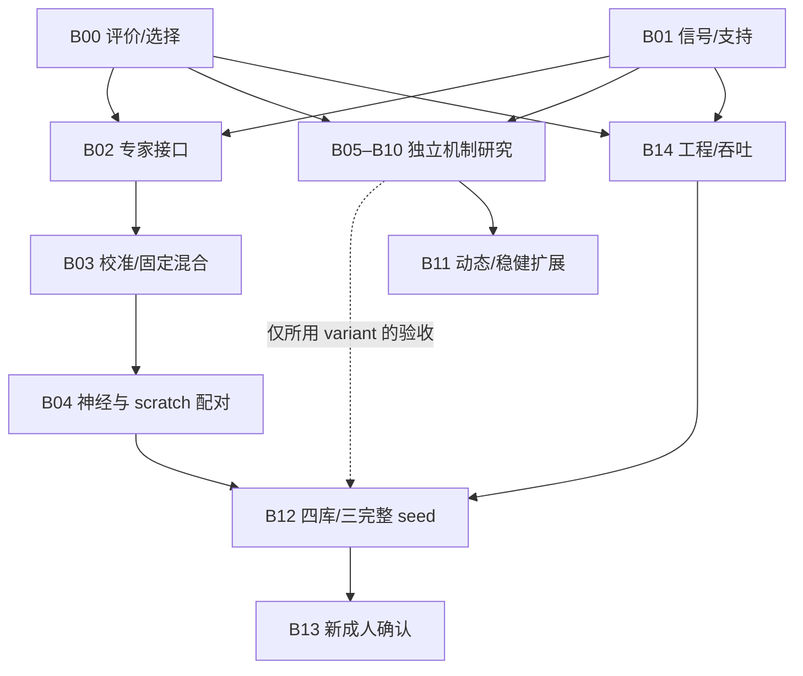

# 愿望清单与优先任务：分块深度科研方案

日期：2026-10-05。范围：研究设计、数学核查、当前源码与已有证据核对。原愿望清单 123 项逐条恢复，归入 15 个研究块；原四周路线保留为来源，经过依赖和反例审查后重写。方案层完成与模型实施、公开矩阵执行、成人确认分开记账。

本轮使用 `astra-research-workflow`、`eeg-p300-research`、`research-architecture-decision`、`experimental-design`、`codebase-design`、`performance-optimization` 与 `get-available-resources`。主线负责合约、完整覆盖、依赖与验收；三路独立研究分别核查专家/评价、潜变量模型、信号/边界。文献、公式、数值反例和真实代码入口相互核对，不把历史文档或技能内的模型结论当作当前事实。

## 1. 来源、当前状态与交付物

原文来自聊天 `01a0eb70-bcfb-7a92-b22b-1bfd6b541ddc`：愿望清单 turn `01a10a3c-0b62-7213-8602-c4373d27a36c`，四周路线 turn `01a10a47-eeac-77a2-9dfa-14e48fb7e48f`。来源文本、逐项覆盖和机器可读计划分别见：

- [原愿望清单](../assets/deep_research_plan_20261005/wishlist_source.zh.md)、[原四周路线](../assets/deep_research_plan_20261005/four_week_source.zh.md)。
- [123 项覆盖表](../assets/deep_research_plan_20261005/coverage.zh.md)、[任务与实验合同](../assets/deep_research_plan_20261005/research_plan.json)。
- [专家、评价与神经贡献研究](../assets/deep_research_plan_20261005/ensemble/research.zh.md)。
- [ERP、噪声、先验与空间研究](../assets/deep_research_plan_20261005/latent_models/research.zh.md)。
- [信号、边界与可识别性研究](../assets/deep_research_plan_20261005/signal_boundary/research.zh.md)。
- [覆盖、依赖与评价反例检查](../assets/deep_research_plan_20261005/design_checks.json)。

当前 `src/` 已有经典 ERP、membership 聚合、条件/平稳 AR、有限滤波、连续 AR1 候选模型、精确协方差和研究 runner。高阶 `OperatorGLS` 仍在原工作树 `doc/assets/operator_research_20261004/continuous_model.py`；不能因为研究脚本可执行，就认定生产已有相同高阶实现。源码位置和摘要由各研究报告记录。

隔离分支从当前工作字节构造，基础快照 commit 为 `dc506ca0c90f9e6904376bfdb5ae5f2f8ebc7493`；原 Git HEAD 只表示父版本，不能替代该快照。[物理源码归档清单](../../frozen/deep_research_20261005_before/manifest.json)绑定原始归档成员，压缩包留在本地。原工作树有此前改动与另一条活跃边界研究，本轮保留其状态，在 `codex/deep-research-plan` 交付和逐块提交。

### 历史基线的纠正

Phase 4 的三专家是 `raw_ar8_lambda_1 + Toeplitz + xDAWN`，不是 raw lambda-mixture。保存概率可复算的 hit 为 `0.770833…`，NLL 为 `1.069454…`。这是 8 人、每人 6 个完整 selection 的校准内留一组开发：每折拟合 5×120=600 标签，held 120 标签，C800 中 720 用于六组，80 不用，共 48 个相关折。

该数值不能直接作为新 K800、未知 test 或四库的常数门槛。当前历史 manifest 还未完整覆盖实际 Phase 4 入口，计划里的 mixture 列表与脚本臂也不完全一致；只能说明保存预测可复算、执行源绑定部分可核，不能据此追认完整预声明。旧原文保留，新运行重新冻结入口和实际研究 helper，并同批重建三专家锚点。

等权混合与 Toeplitz 的同一组总体 hit 相等，不代表逐 decision 相等；独立复算发现既有被挽回项，也有被新混合损害的项。四专家应接受相同检查，不能承诺“多一个专家只会更好”。参数量也按实际架构/recipe 记录，不将历史“含残差 1279”当所有 `N2P3Net` 构造的常量。

## 2. 从愿望到研究块

P0 表示主线必要能力；P1 表示可并行的高价值机制研究；P2 表示在失配证据或前置验收成立后扩展。优先级不表示所有 P0 都能立即执行，真正阻塞由依赖决定。每块的设计已交付，JSON 中的 implementation/execution 均为 `not_started`。

| 块 | 优先级 | 要回答的问题 | 真正前置 | 出口证据 |
|---|---|---|---|---|
| B00 比较、评价与选择 | P0 | hit 优先时怎样保留失败、概率风险和选择偏差？ | 已恢复目标和身份 | requested roster、配对规则、nested OOF、统计与门槛 |
| B01 信号履历与支持 | P0 | 模型实际看到了哪段已观测信号与事件？ | 数据与协议证据 | 层级、参考、单位、时钟、左右边界及可用时间 |
| B02 专家 Interface | P0 | 如何产生同一候选任务上的可比较概率？ | B00、B01 | NN/经典/raw 三种真实 Adapter、完整 membership、重载 |
| B03 校准和混合 | P0 | 等权及训练内 gating 是否具有互补性？ | B02 | 无 held 选择的温度、OOF、固定三/四专家锚点 |
| B04 神经贡献归因 | P0 | 收益来自迁移、剂量还是模型互补？ | B03 | matched full-fine/scratch、六个混合臂、失败/负迁移 |
| B05 AR 与噪声 | P1 | 白化是否同时消掉判别方向？ | B00、B01 | 公平 hold-back、启动面板、残差及判别诊断 |
| B06 边界条件模型 | P1 | 未观测外部状态能识别到什么程度？ | B00、B01 | 条件均值/协方差、完整 ERP 增量、噪声倍率 |
| B07 ERP 字典/事件历史 | P1 | 潜伏期和相邻响应是否解释设计失配？ | B00、B01 | 自由度匹配的字典、共同/目标/selection 可识别性 |
| B08 灵活先验 | P1 | 能否消除人为尺度差异而保留真实信号差异？ | B00、B01 | C 内固定 g-prior、秩、gauge 和模型平均检查 |
| B09 空间模型 | P1 | Pz 信息应进入均值/判别还是噪声？ | B00、B01 | 原生布局、reference 秩、空间锚点、跨人稳定性 |
| B10 输入算子/污染 | P1 | 改输入是否提高任务表现并满足可用时间？ | B00、B01 | 分污染挑战、因果/双向对照与输入 ContrastPlan |
| B11 动态/稳健联合模型 | P2 | 已证的可分离噪声失配由什么模型解决？ | B05–B09 | observability、noise/ERP 辨识、私有谱/重尾层级 |
| B14 工程与吞吐 | P0 | 怎样精简内部防御并兑现 worker 资源？ | B00、B01 | 一次 ingress 验证、实际源绑定、复用/吞吐/净树 |
| B12 全流程复核 | P0 | 候选在新配对支持和完整随机流程中是否复现？ | B04、B14 | 四库 binary＋合法 candidate 面板、三完整 seed |
| B13 成人确认 | P2 | 冻结程序在新成人九选一上的效能和成本？ | B12、新数据协议 | 新独立记录、样本量、产品 hit@all 和实际成本 |



B05–B10 不需要等 N2P3Net 混合实现，也不要求先接完 EA。B12 的基础四专家路线不等待全部新机制；采用边界、g-prior 或动态变体时，分别追加 B06、B08 或 B11 的验收依赖。源码共享入口和数据支持是共同依赖，不能把“分脚本”误称为数学或文件所有权完全独立。

## 3. B00：hit 优先的评价、选择与统计合同

令参与者 s 的预声明 requested decisions 为 `R_s`，`a_sd` 表示模型是否提供合法完整概率，`c_sd` 表示是否正确。操作主指标与 coverage 为

\[
H_s=\frac{\sum_{d\in R_s}a_{sd}c_{sd}}{|R_s|},\quad
A_s=\frac{\sum_{d\in R_s}a_{sd}}{|R_s|},\quad
H=\frac1S\sum_s H_s.
\]

失败、弃权、不完整 schedule、不可达 K 都留在 requested 账本；不能用 valid-only hit 代替 H。trial 多的人不能支配 participant-macro 指标。`hit@all` 使用每个完整 decision 的全部合法重复，R1/R5 等另作次级读数，不改产品主定义。

NLL、Brier 在明确的合法概率输出上计算。配对 NLL 使用同一预声明 roster 的 paired-complete 子集并保存缺失清单；同时列全 requested 的覆盖与失败，不允许因掉了困难项就宣称概率风险下降。若另报均匀拒判填补 NLL，必须写成报告约定；它不是模型实际输出。预测概率为零而真值发生时 NLL 为无穷，不用消费端剪裁伪造有限概率。

开发候选进入下一阶段采用同批点估计门：`ΔH>=0`、`ΔNLL<=0`、不减少 baseline 已成功 decision 的合法输出、不增加逐人失败。先检查比较有效性与支持，再按 hit 排序，NLL/Brier/错时最大置信度检验过度自信。margin=0 是本轮清楚的开发比较规则，不是成人非劣效确认；成人效能差值、风险 margin 和独立人数另在新协议预声明。36 候选均匀 NLL=`log(36)` 只是一条参照，不能当普遍效能阈值。

参数、温度、lambda、AR 阶数、basis 自由度、gating 和距离 schedule 全部只在合法 C/source 内选择。每个 outer held selection 仍被视为开发评价组：inner group OOF 选择，outer training groups 重新拟合，再只评分该 outer held。任何从已看过的 48 折中选出的新方向，下一批仍属于开发复核；不能追称旧 C800 是未碰过的确认集。

小K不足以形成独立完整组时，不按随机trial切分制造OOF。使用已经由source/预声明固定的校准程序，或将学习温度/gating臂记为unavailable；保留固定等权与未认证概率诊断。K200的额外标签不能偷接未来完整selection，requested/实际训练/可用于选择的独立组数分别记录。

统计单位是参与者。先在每人内合并 selection、预算与 seed 的预声明估计量，再按参与者 bootstrap 配对差值。三 seed 复核训练随机性，不增加独立参与者人数；完整流程 seed 应重做 source 初始化、source 选择和 target 拟合，不能只抖 target seed。分别报告目标库效应、seed 效应、逐人负迁移及失败；主/次级 contrasts 固定，多重探索性结果保留探索标签。

四库 binary AUC 保留既有“目标库等权 paired mean ΔAUC≥0.01”路线门槛，及匹配 scratch/波形 LDA。candidate hit 另用真实 membership 与决策边界，不能平均不同候选数/人群的 hit 后解释成成人产品效果。

## 4. B01/B02：合法观察和小而深的专家 Interface

一个 `DecisionViews` 应保存共同的物理记录/事件/候选身份、授权标签预算和 actual raw 支持；内部提供各专家自己的数值视图。例如 raw AR 不新增滤波，Toeplitz 无 trial baseline，xDAWN/NN 可以消费自己的冻结预处理。这些视图数值 digest 可以不同，比较由预声明 ContrastPlan 允许其变化；物理 decision/真值/可用时间必须一致。结果复用继续要求各臂自身的真实数值身份和执行来源一致。

比较同一 deadline 的方法时，epoch view 不能取得 raw 专家没有的更长未来尾部；若支持不同，应另列输入/延迟 route 对照。保留因果、双向、逐 selection 三种协议与左右端点类别，不把它们混成算法差值。BI2014a 原 CSV 可以恢复 row/column membership；BNCI MAT 已有连续和 epoch 入口；其他库逐项核查真实 metadata，不能从 binary label、AUC 或文件名猜出最终选择。

拟议新增生产 owner 是一个 `transfer.ensemble` Module；现有 `candidate_evidence` 保持 membership 数学 owner，`calibrated` 保持个人包/只读推理 owner，不建设平行的评价框架。

```text
FittedEnsemble.fit(authorized_calibration_views, frozen_program)
FittedEnsemble.score(unlabeled_decision_views) -> CandidateEvidence
FittedEnsemble.save/load(existing personal artifact machinery)
```

`CandidateEvidence` 只承载 frozen vocabulary、probability/log-probability、共同物理 decision 身份、专家自己的输入/model/source 身份、coverage 和明确失败；不含真值。fit 消费授权标签，score 的类型不提供目标真值。候选排序、shape、有限性、归一化和完整性在该 Interface 集中验证一次。具体 Adapter 处理 NN trial logits、经典 trial scores 和连续候选 likelihood，调用者不猜专家内部字段。

二类预测的 candidate Adapter 推导在专家报告中核查。完整候选 membership M 与 binary log-odds `l_i` 给出独立 trial 模型下 `e_q=Σ_i M_iq l_i` 加候选先验；二类 class sampling prior、尺度和温度须显式。等曝光时公共 offset 会抵消，不等曝光时不能假定抵消；当前 EEG 时间重叠还违背独立假设，因此这是需要 C 内概率校准的评分模型，不是自动认证的生成后验。保留实际软件的 logit 约定，不能偷偷改现有分数乘数而沿用旧 temperature。

K0 为 source-only/no-label 协议：不能拟合 target normalizer、温度、gating、AR、ERP 核或质量阈值。没有独立源模型的 target-only 经典/raw 专家在 K0 不可达，保留 unavailable；另立 source-pretrained 专家后才能组成预声明 K0 mixture。不得在运行时按可用专家数重新归一化，然后仍标作同一个四专家模型。

## 5. B03/B04：混合、校准与神经贡献

固定概率混合为

\[
p_{mix}(q)=\sum_m w_m p_m(q),\quad w_m\ge0,\quad\sum_mw_m=1.
\]

这对应模型概率平均；直接平均未统一尺度的 logit 属于另一模型。算术混合的 NLL 有 Jensen 上界，但不保证优于最强专家，也不保证 argmax 命中单调。专家失效时默认该预声明 mixture cell 失败；如研究 uniform fallback 或 C 内质量 gating，它们是明确的新 arm，另写失败/拒判和权重公式。

先实现四个冻结单专家，再冻结三专家和四专家等权程序。温度只在 inner C OOF 预测中拟合；classic scores 转 posterior 与 NN 聚合均独立 calibration。gating 的输入限定为 K、真实 mask、边界距离、C 内质量/证据和预声明未标记观察；实际 test 的目标、正确性或 arm 排名不可访问。小样本先固定等权，只有 OOF 支持和同批复杂度对照成立时进入低维 gating。不得把使用 test 无标签分布调整权重的 transductive 路线称 strict frozen inference。

核心混合臂固定为：NN alone、classic-three、NN+Toeplitz、NN+xDAWN、NN+classic-three、same-structure scratch+classic-three；同时保存 raw、Toeplitz、xDAWN、waveform LDA 和 scratch alone。full-fine 与 scratch 使用同一输入、结构、监督、K、更新/epoch dose、BN/dropout、停止规则与目标 seed。混合的 classical component 复用同一已拟合冻结状态，以配对差值识别神经增量；不用更大 source 池或更长 raw 支持掩盖增量来源。

“新救回/新损害/两者都对/两者都错”及错误置信度，比总体同 hit 更能解释互补性。另报 NN 移除、NN 替换 scratch、输入一致/允许路线差异两类 contrasts。source-trained NN 对外层整目标库排除，源内选择也不能触及目标库；家族排除属于另一个敏感性面板。独立研究认为合理的专家不等于已证有正增量。

## 6. B05/B07/B08/B09：噪声、字典、先验和空间

### 公平 AR 与条件前缀

阶数面板为 AR0/1/4/8/16/32，统一 hold-back 32 个源采样点，并记录该点数对应的物理秒数。Y 和 D 经同一个 whitening 后在共同评分行上取值，前缀真实作为条件信息保留于预算和支持，不从 requested 账本删除。平稳边际启动与实际 prefix 条件 likelihood 是不同面板，不能仅把低阶前 32 行删掉就宣称计算了条件模型。

更强的条件反例是：即使 prefix 不区分 q，它也可能更新不确定 common ERP 系数。完整 `p(Y_tail|Y_prefix,C,q)` 必须对相关 ERP/kernel latent posterior 一并条件化；只做 AR 创新并继续使用未条件化 kernel posterior，不是该联合模型的精确条件 likelihood。前缀包含已知相邻响应时，onset 位于 p 之后也不能证明 prefix 是纯噪声。

报告训练和 held 的逐导 residual ACF、PSD、创新协方差、posterior predictive quadratic、有效秩/condition、PARCOR 稳定性、dtype 与判别方向能量；所有诊断与 hit/NLL 分栏。Burg/PARCOR 解决稳定参数化和初始化，不能解决跨导共享单一谱的模型错误。逐导 AR、共享动态因子和 VAR 分别有不同协方差层级，先用小矩阵和模拟辨识其区别，再进入真实开发比较。

可逆白化在均值、协方差、字典及先验同步变换且精确计算同一模型时，不降低Bayes可用信息；Mahalanobis判别距离不变。真正需要挑战的是截断/投影、错误噪声模型、有限估参、先验未同步和条件后验遗漏。候选方向能量变化只是一条机制诊断，不能把坐标范数下降直接称信息丢失。

### ERP 字典及可识别性

令完整允许事件历史的 common、target 和 selection 设计为 `D_common,D_q,D_sel`，响应可写

\[
X=D_{common}\beta_0+D_q\beta_\Delta+D_{sel}b_s+\eta.
\]

字典比较固定 physical response 支持、实际自由度和先验预测幅度：Gaussian、B-spline、raised cosine、wavelet、多尺度、零/软/非零端点，另加一/二阶导数表达小潜伏期变动。基函数数相等不代表有效自由度相等。selection 随机效应必须零均值/独立层级约束，不能任意吸收候选差异；大潜伏期变化要检查 Taylor 近似失效。未知邻近 target 只允许边缘化或声明 nuisance，不能使用真实 held 标签当 oracle。

滤波路线应将 D 与噪声同步传到实际 F 输出；raw 与 filtered 字典是两个观测模型对照，不能只改 D 就归因给算子。保留早期、P300、晚慢波和邻近响应保护方向，以未参与拟合的新 ERP 形态挑战泛化。

### g-prior 的准确定义

在授权 calibration 的白化设计 `A_C` 上定义信息矩阵 `G_C=A_CᵀA_C`，g-prior 在可识别预测子空间使用 `g G_C^{-1}`，column covariance 与矩阵正态噪声一致；秩亏通过 rank-revealing QR/SVD 报告子空间，未识别方向另给真实 prior 或从可识别模型中移除，不能靠无说明 pinv。

关键限制：G_C 必须在 source/C 内固定。不能在每个 held 候选的设计上重建 g-prior；独立反例显示这会把幅度不同的假设归一化成相同证据。common 与 selection 系数用不同层级强度，但须报告其尺度/单位、协方差 gauge、潜变量自由度和 posterior predictive。物理电压变化、basis 坐标变化与改变 AR 噪声模型是三件事。

预声明 lambda posterior 平均 `Σ_λπ_λ p(q|Y,λ)` 与生成 Bayes mixture `p(q|Y)∝Σ_λπ_λ p(Y|q,λ)p(q)` 权重不同，前者固定混合归一化概率，后者依 evidence 更新模型权重。二者分别预声明，不能都叫同一个灵活先验。若用经验 Bayes估超参数，fit scope 仍是 source/C，并做弱/重尾先验敏感性。

### 空间 ERP 和 reference

Pz 等通道的 d-prime 只由训练组估计并收缩，可进入 ERP 均值 prior、xDAWN、空间 LDA、ERP 原型几何和 graph smoothness。把 Pz 的噪声 precision 人为放大是不同模型，不能以“信号重要”论证“噪声更小”。同时估计通道噪声时须独立说明模型与相应不确定性。

空间信号先验H_signal若不与噪声Σ_noise成比例，原矩阵正态共轭公式一般不能继续使用。应在vec坐标计算完整Gaussian块后验/边际协方差，或明确可分离近似并以small-matrix oracle检验；不把“仅改均值prior”视为只换一行权重的实现。

实测 native layout、reference、gain 和 missing channels 组成观测映射。reference 可降低秩，car/差分后的 null-space 与 covariance 需要 range 模型；完整零填槽不等于实测导。空间×时间模型先检查 Kronecker 可分离假设，每通道不同谱时一般不成立。source temporal basis 保留在时间信息迁移，target head 只用 target 实测布局，EA 不成为所有路线的强制前置。

## 7. B06/B10/B11：边界、污染与动态扩展

### 确定后处理不产生第二份独立证据

固定 padding 是 X 的确定函数；`Z=F_pad X` 给出 `p(X,Z|q)=p(X|q)δ(Z−F_pad X)`，不能把 X 与 Z 的 likelihood 当独立证据相乘。分解 `FX=QX+B a(X)` 时，`a=LX` 与 X 相关，传播要保留交叉项；完整 `FΣFᵀ` 与其展开一致，额外独立 Γ 是双计。

真实外部 latent a 与已观测 X 的 Gaussian 条件模型应同时包含

\[
E[a\mid X,q]=\mu_{a,q}+\Omega_{aX}\Sigma_X^{-1}(X-\mu_{X,q}),\quad
Cov[a\mid X,q]=\Gamma-\Omega_{aX}\Sigma_X^{-1}\Omega_{Xa}.
\]

只换 Schur covariance 而保留错误无条件均值，可以翻转候选 Bayes factor。还须证明联合 covariance可识别/PSD，不能把某个可执行数值 solver 当识别性证据。真实生理 latent 应进入 raw 观测模型，例如 `X=D_qβ+H_s a+η`，再在允许范围边缘化；条件预测外部状态本身不会凭空增加新的 q 信息。

同 short、不同未观测外部延拓可产生不同 long-short 差值。长上下文参照仅用于合法诊断；不能用 test 未来上下文修正并称同 deadline 的算法。完整 Kalman 路线先检查 observability、ERP/外部态/噪声分辨、可用时间，再决定 filtering 或 smoothing。

### 完整映射的 ERP 与噪声门

对实际校正映射 T，独立测

\[
E_{ERP}(h)=\frac{\|T(X+h)-T(X)-F_{short}h\|}{\|F_{short}h\|}.
\]

若目标为 long 参照，应另用合法 common-grid `R_lF_long h` 定义误差。输出校正 δ 与 ERP 子空间的 overlap 不等于上述增量损伤；零 overlap 也不自动保证安全。噪声倍率来自完整 T 对独立白噪声的作用，例如线性 T 的 `tr(TTᵀ)/tr(F_short F_shortᵀ)`，不能由 δ 能量代替。非线性 harmonic/动态拒绝/换 penalty 必须攻击切换点和局部 Jacobian/有限增量。

先保留固定 penalty 扫描，再在 C 内按距离、context 长度/质量、刺激密度和可观测性学习低维 schedule。0/2/8 秒是研究分层，不是启用规则；距离不是条件充分性。近端保护的 penalty 与约束半径方向不同，不能沿用旧数值解释；MSE、ERP 注入、noise gain、condition 和 hit/NLL 必须共同形成 Pareto 与失败清单。

### 污染和动态研究的进入条件

工频漂移、幅相调制、持续污染、glitch、慢波、EOG、坏导与参考污染分别定义 mechanism challenge。固定 F 的 Gaussian 传播不包含从当前信号估频/估幅的不确定性。自适应 harmonic 已能用叠加反例证明非线性，后续需 parametric/bootstrap 或明确层级模型，不能套一个冻结 F 作完整概率解释。

动态因子/VAR/graph AR、非平稳/change-point、Matérn GP/状态空间、Student-t/scale-mixture/matrix-t 都保留在清单；按层级、单位、可识别参数和 C 内有效独立组数选择进入。算力不受限也不能增加生理独立样本。明确 separable 模型残差失配后，先以新模型作可证伪模拟和配对诊断，再以相同预算比较真实任务；不一次引入所有自由度后归功于某一机制。

## 8. B12：明确规模的公共复核

公共主 source 池为 `B7_plus_three` 十二库，B7 九库作为 source 剂量敏感性；成员来自现有 `configs/source_pool_expansion.example.json`，不静默删除缺导源。每个外层目标库整库排除，source prior/temperature 选择也在剩余源内。三 seed 复用现有 `[20260918,20260919,20260920]`；source checkpoint 复用须是该新程序允许的身份，旧 artifact 不能只改标签充数。

两个评价面板分别保留：

| 面板 | 请求矩阵 | 基线与用途 | 可达性 |
|---|---|---|---|
| binary 四库 | BI2014a/BI2015a/BNCI2014-008/Huebner2017 × 每个 requested participant × K0/200/800/2000 × 3 seed | neural full/scratch/waveform LDA/Toeplitz/xDAWN等合法 trial 对照；四库宏 AUC | 各 participant/预算按真实清单，不以历史123人作固定常量 |
| candidate | 每个有合法 membership/decision 边界的库 × requested decision × 合法 K × 3 seed × 单专家/6混合臂 | 操作 hit、概率风险、神经增量/互补性 | BNCI已接；BI2014a raw CSV可恢复，continuous消费另验；其余不猜 |
| BNCI 机制开发 | 历史 C800：8×6 outer group，fit600 | 同组新锚点的开发检查；各机制额外 arms | 已观察资料不作新独立确认 |
| 成人九选一 | 新协议确定的独立 participant/session/decision | 冻结程序的产品效果与真实成本 | 新数据、身份/时钟和样本量单独验收 |

若仅运行一个 source 池，四外目标库×三 seed 产生 12 个 source fit/selection 流程；两池都作为完整比较则24个。实际 physical refit/reuse由排除后的训练支持与程序 digest 决定，不能把名义12/24作为必然重训次数。令 `N_d` 为当前目标库 requested participants、`A_dsk` 为该单元预声明 arm 数，评分单元总数由 `Σ_dsk 3 A_dsk` 展开，所有 unavailable/failed 项仍有记录。共享经典状态/确定性 LDA可合法复用，但不把逻辑评分单元数叫独立拟合次数。

机制网格不做盲目全乘积：B05阶数×启动模式；B06距离/context×penalty×新ERP挑战；B07等自由度basis；B08先验族/层级强度；B09均值先验与空间模型；B10滤波/支持轴。各自先回答预声明机制问题。集成只加入通过其机制验收的 variant，并保留固定四专家主臂；负迁移、不可达K、数值失败与无增益均是正式出口。

## 9. B14：减少防御性编程并完成真实工程联动

外部输入一次解码/验证后转换成具名的不可变内部状态，纯数值核使用该状态；保存、加载、跨进程恢复和复用仍各自在真正信任变化处验证。减少内部重复 `isinstance`、形状推断、参数别名、缺字段默认、重复文件hash与异常吞并，依据实际重复调用/性能轨迹删除，不用行数或“检查多”作为删守卫理由。

| 知识与检查 | 保留位置 | 精简方向 | 不能删的行为 |
|---|---|---|---|
| shape/vocabulary/schedule | DecisionViews/CandidateEvidence ingress | Adapter内转一次，不让analyzer再猜tuple或dict | 未完整组不能缩词表后出高概率 |
| covariance/rank/scale | fit/load state与factorization | 内核共用一次分解；显式rank模型 | null-space不能静默ridge后仍称exact |
| source/fit/raw身份 | artifact边界、run/resume/reuse | 验证同一份bytes后直接decode和使用；共享只读attestation | 不能consumer补签旧模型/补造source身份 |
| failure/availability | execution owner与requested ledger | 实验只返回具名失败；不多层catch-continue | 缺GPU/不识别/模型损坏不能返回空成功 |
| temperature/权重/阈值 | frozen ProgramRecipe | 一个解析器，固定值与C内选择明确区别 | score不能重新读test标签选参数 |
| docs/代码导航 | 六指南和证据索引 | 更新现有owner，不增加竞争规范或兼容空壳 | 历史数据与执行来源保持原字节 |

联动清单为：合同/plan解析 → builders与物理views → experts fit/score → source exclusion/checkpoint → requested结果与reuse → analyzer/统计 →个人save/load/read-only推理 →实际CLI →六指南/证据。B02拟议新 `transfer.ensemble` 由多个实际Adapter证明seam需要；不为每个wish创建通用插件层。高阶研究helper迁入生产时必须消费已有 `TemporalNoise` 与 covariance owner并删除重复数学实现；迁移不是复制第二份研究框架。

性能按真实end-to-endprofiling推进：按 participant/raw-view/input digest 分块共享只读数据，source fit完成后解锁对应target，不等整个source池结束；准备、source、C内拟合与评估的资源需求独立记账。缓存key含输入/行/变换/模型digest，确定性派生缓存损坏可重算，科学原件/模型损坏则拒绝复用并保留失败证据。GPU任务容量和HostMemoryAdmission统一约束并发，避免嵌套worker各自拿25线程。

云端每次launch/resume先重新加载性能/资源技能，实际CPU总预算≥25、GPU worker容量≥4。四个fit worker各6线程，加1调度线程；准备和CPU评价占用须从同一个总预算调度，不再额外各拿25。`configs/cloud_training_resources.json`的源常驻与共享暂存预算可能需要显著超过本地内存，按实际峰值 admission；不能静默降为单worker。依赖尾部少于4个ready fit时记录 capacity/ready/active三个数。warm-up、cold load、peak RSS/VRAM、任务/小时、完成/失败速度与GPU实际利用率一并保存，配置worker数不算吞吐证明。

本轮环境检查为32逻辑CPU、项目venv Torch `2.13.0+cpu`、`torch.cuda.is_available=False`；设备管理工具虽能看到本地GPU，不能当该venv可CUDA训练的证据。该观察仅用于本轮数学/合同验证。云端资源未在本轮启动或验证，不把“算力无限”转写成当前资源已无限可用。

每块在独占路径落盘，通过相应反例和Ruff后提交；整合只在隔离工作树完成。并发原树不做 `reset --hard`、`clean`、自动stash或替他人提交。交付时验证分支净树和原工作状态保留；公开源码、证据清单与本地数据/压缩包分发规则沿用 `frozen/README.md`。

## 10. 四周里程碑与科研退出条件

原四周路线按验收里程碑重排，不用日历替代依赖：

1. 第一里程碑：B00/B01先固定，B02/B03/B04贯通；同时B14完成实际源绑定和资源预检。交付四专家接入及同组配对读数，拒绝用历史0.771常数判定。
2. 第二里程碑：B05/B06并行，B07/B08/B09/B10同样可独立推进；source-fit/成熟基线不等待全部机制研究。每线交付推导、独立反例、预声明arms和失败清单。
3. 第三里程碑：冻结基础混合程序；B12三完整seed与四库/candidate面板按资源DAG执行。已验证variant有自己的依赖和contrast，不用临时结果换主路线。
4. 第四里程碑：逐模型重放、输入/执行身份核验、参与者级效应/风险、不确定性与Pareto失败报告；B14精简重复实现和临时路径，活动指南/证据一致。B11/B13按科研前置继续，不承诺在四周内得到新成人确认。

每块至少写“入口、上游证据、实际动作、出口及局限”。本轮方案模块可记 `complete`；未来implementation/实验尚未执行。假设被反例推翻可记机制 `failed`并保存负证据；工具缺失与模型识别失败不能写“通过”。参数或适用条件待决定时继续独立任务，不把全部矩阵卡在一个未知问题。

## 11. 本轮验收与复现

本轮实际运行的是数学反例、历史保存预测复算和当前隔离源码合同测试。未运行新source/target training、公共效能矩阵或成人数据确认；该范围是用户本次要求的深度方案交付，不把未来任务冒充已落实能力。

主线命令（在隔离树，使用项目原venv）：

```powershell
$env:PYTHONPATH='<isolated-worktree>/src'
D:/BCI/n2p3-net/.venv/Scripts/python.exe doc/assets/deep_research_plan_20261005/build_plan.py
D:/BCI/n2p3-net/.venv/Scripts/python.exe doc/assets/deep_research_plan_20261005/verify_design.py --output doc/assets/deep_research_plan_20261005/design_checks.json
D:/BCI/n2p3-net/.venv/Scripts/python.exe -m pytest -q tests/research/test_research_contracts.py tests/research/test_comparison_identity.py tests/transfer/test_exact_covariance_and_bounds.py tests/transfer/test_temporal_noise.py tests/data/test_finite_filter_operator.py tests/models/test_membership_decision.py tests/models/test_structured_erp.py
git diff --check
```

主线136项合同测试通过，现有病态协方差反例产生一条SciPy condition warning，未失败。三路数学与来源验证各自记录命令、源码摘要、结果与证据层级；最终整合验收清单见 [validation.json](../assets/deep_research_plan_20261005/validation.json)。从项目外目录重跑与源归档核验写入同一清单；本轮方案没有新的效能或训练吞吐结论。
