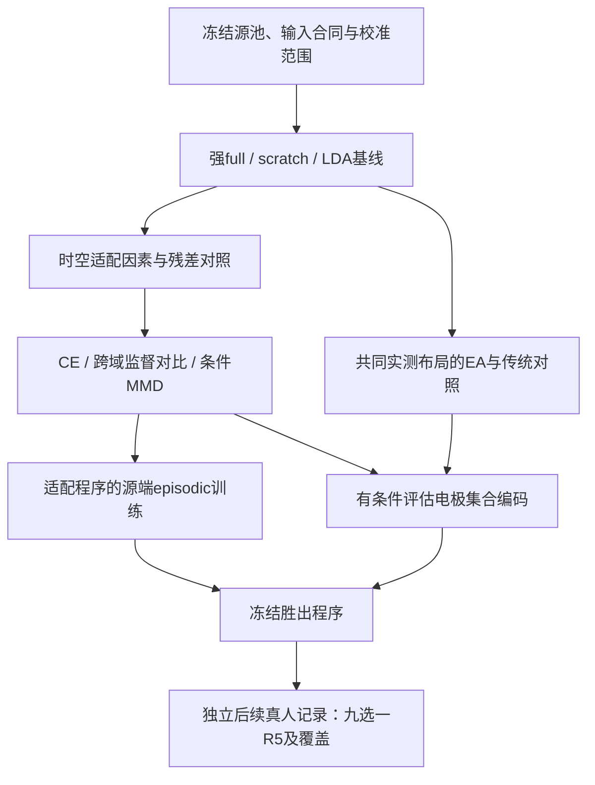

# 域迁移改进：文献证据、机制设计与验证方案

> 导航副本：历史失效链接现指向[持久来源索引](../assets/repository_audit_20261019/docs_historical_index.json)。原文以原SHA保存在本地归档；本次只改定位入口，原结果、执行producer与未找到凭证的边界保持。

日期：2026-09-15；2026-09-16按用户要求分步实施并取消蒸馏。
状态：**P1/P2首批软件实施见[验收记录](domain_transfer_implementation_20260916.zh.md)；完整公开数据开发矩阵已完成，见[执行与结果](domain_transfer_cloud_20260916.zh.md)。**
修改前完整方案已[压缩并逐成员核验](../assets/repository_audit_20261019/docs_historical_index.json)。
活动排程入口仍为[执行计划](domain_transfer_major_20260920.zh.md)。

建议主线是：**固定已验证源池，学习更适合目标校准的表征，验证有限自由度的时空适配，再评估电极集合编码。**
几何对齐作为低成本独立对照；元学习和基础模型保留为后续候选。每个阶段都有同预算完整微调、scratch、波形收缩LDA，以及停止扩展的条件。

## 1. 先依据当前结果修正问题

本次核对了活动六指南中的研究/输入/结构/工程相关部分、当前源码和以下完成报告。
数值来自已有报告及结构化结果入口，本次没有重新计算全量真实预测；历史成绩绑定原执行快照。

| 已有证据 | 实际含义 | 对本方案的约束 |
|---|---|---|
| [完整训练链](training_chain_results_20260907.zh.md)：六导full在K200/800/2000相对scratch为+0.0493/+0.0246/+0.0045 AUC；K2000负迁移率51.0% | 小K有平均初始化收益，高K优势弱且逐人不一致 | 以同K增益、尾部风险和校准成本评价新方法 |
| 同报告：trunk更新主效应大于仅输入统计/BN重估；六导相对三导约+0.037至+0.044 AUC | 只修统计可能不足；缩小共同通道会损失可用信息 | 不把纯白化或冻结全部表征设为唯一主线 |
| [新增源三seed矩阵](source_eog_training_20260909.zh.md)：全量B7−B0总体ΔAUC −0.000468，95%区间[−0.003218,+0.002324] | 九库未稳定优于四库 | 首轮固定B0，不重开单纯扩源大网格 |
| 同矩阵：B0−scratch总体+0.006289；K200为0.72733对0.71703，K800为0.78048对0.77708 | 强目标训练后，源预训练剩余收益已经较小 | 新方法必须超过强基线；不能仅与欠训练scratch比较 |
| 同矩阵：正K本人模型严格operational R5均0/10 | 条件事件AUC与可交付九选一差距很大 | 同时检查完整45闪烁证据覆盖；不能靠改分类器解决全部不可用输入 |
| [双向滤波](bidirectional_qc_20260909.zh.md)、[预处理执行器](preprocessing_execution_20260915.zh.md)已有新合同 | 现行工作站与上述单向公共源实验并非同一输入程序 | 新旧滤波、fit范围和模型签名不能混用 |

两份迁移成绩的训练剂量、源模型和预处理不同。**不能把+0.0493到约+0.0103的变化全部归因于某一次优化**。
K是有标签闪烁数；K200约有多少正例由实际协议决定，不是200个P300，也不是200个独立decision。
K800精确档59人、K2000精确档21人/2库属于历史队列事实；新实验按冻结manifest重新确认。

本次仅实例化当前默认`N2P3Net(n_channels=6,n_times=179)`：总参数1202，分类头354，读出特征176。
这是当前默认实例的计数，不覆盖所有旧checkpoint/扩展架构。如此小的网络没有天然的大模型参数冗余：
FiLM、LoRA的价值必须来自适配约束或跨人共享结构，不能只靠“参数高效”论证。

## 2. 检索范围与证据等级

结合`eeg-bci-transfer-learning`、`literature-review`、`paper-lookup`、`experimental-design`、
`scientific-critical-thinking`；读取`parallel-web`及`scientific-schematics`的工具要求。
检索截止2026-09-15，覆盖2009年至当日的EEG/ERP方法和相关机器学习基础方法。

这是**面向方案的范围检索与重点精读**，不是穷尽性系统综述，也不做跨论文准确率的元分析。
纳入P300/ERP直接研究，以及能解释本项目具体缺陷的跨范式/通用方法；优先原论文、作者代码和出版元数据。
排除同名p300蛋白研究、未核实的营销描述，以及只有标题却被赋予具体效果的推荐。

首轮完成Europe PMC六组、Crossref八组、OpenAlex三组主题检索，返回291条未去重记录。
各查询只取前25/12/15条，不把数据库总命中数当成已筛读文献数。随后定向核验标题、DOI、arXiv和公开全文。
主要检索式包括：

| 概念 | 查询核心 |
|---|---|
| P300迁移 | `(P300 OR "event-related potential") AND (EEG OR "brain-computer") AND ("transfer learning" OR "domain adaptation" OR "cross-subject")` |
| 空间对齐 | P300 / ERP + Riemannian / Euclidean alignment / xDAWN / Procrustes |
| 有限校准 | EEG / P300 + few-shot / meta-learning / FiLM / calibration |
| 负迁移 | EEG / P300 + negative transfer / source selection / conditional alignment |
| 源预训练 | EEG + foundation model / heterogeneous channels；P300 + supervised contrastive |
| 新近研究 | 上述ERP方法另限2025-01-01至2026-09-15 |

Parallel CLI及其凭据未配置，采用公开API替代。arXiv搜索API三次返回429，已保留失败记录；
改用已确定标识的论文页面和全文，不能据此声称覆盖了全部新arXiv论文。
OpenAlex宽泛检索有较多非目标命中，因此主要作为补充发现渠道。
图像生成凭据未配置，下面使用可审查的Mermaid方法图。

完整查询、返回数、摘要、原网页/XML与检查脚本保存在本地
`experiments/runs/domain_transfer_research_20260915/`；可分发的精简检索/文献核查记录见
[检索清单](../assets/domain_transfer_research_20260915/retrieval_manifest.json)。

证据等级表示**本次读取深度和适用范围**，不表示论文总体质量评分：全文核查、摘要核查、仅元数据；
P300直接证据仍须区分同会话、跨人、跨库和真实在线实验。

## 3. 文献如何改变优先级

| 技术 | 核查依据与适用性 | 本项目判断 |
|---|---|---|
| EA与收缩协方差 | He & Wu [1]含ERP；Wu [2]详述使用条件 | 保留低成本空间对照；只对齐二阶矩，不等于消除域差异 |
| xDAWN/Riemannian/RPA | [3–4]包含ERP/P300，RPA使用平移/缩放/旋转；本地已有xDAWN基线 | 补强传统迁移基线；标签和原型只来自合法校准 |
| Latent Alignment | Bakas等[6]含P300；摘要明确指出后层对齐与类比例敏感性的权衡 | 有价值的特征统计对照；现有BN归因已完成，应证明额外收益 |
| 监督对比学习 | Yu等[7]的SCL-EEGMixer是少校准P300直接证据；其摘要明确为within-session | 优先研究源端跨域同类正对；这是本项目扩展，不能引用同会话结果证明跨库效果 |
| 条件MMD与边际对齐 | Zhao等[11]指出条件/标签分布变化下的不变表征限制；本地已有条件MMD | 与新对比损失做共同对照，不默认DANN/边际MMD越强越好 |
| FiLM/条件调制 | [9]为通用方法；[10]在MEG语音解码使用subject conditioning | 小规模验证。没有已核查证据证明它优于当前1202参数P300完整微调 |
| 源选择/样本选择 | Kilani等[5]为P300/RSVP；Shen与Degras[18]为MI同人跨会话 | 保留受限候选；不能无视本项目S1/E2/S2已完成且回报有限的结果 |
| MAML式适配训练 | Finn等[13]提供任务级支持/查询优化框架 | 适配目标对齐以后再做；避免先引入昂贵二阶元学习 |
| 电极集合编码及基础模型 | CBraMod[14]提供异构空间/时间建模；SAMBA[15]含短ERP测试 | 借鉴可变电极集合与短时波形设计；完整基础模型只留一个挑战者 |
| 自蒸馏/P3-FSLNet | [16–17]已核对DOI、标题、作者和出版时间；本次未取得足够正文 | 记录为待精读线索，不引用其未核实成绩，不据标题晋升主线 |

三处需要修正的既有概括：

1. 迁移skill所列`arXiv:2411.09789`实际是*Can EEG resting state data benefit data-driven approaches for motor-imagery decoding?*，
   并非其声称的HyperEEGNet。该条不能支持“已有HyperEEGNet证据”；本次不修改skill文件。
2. `arXiv:2406.04328`确实使用FiLM，但研究是MEG语音解码。本次全文没有提供足够依据支持
   “FiLM已优于本项目P300全网微调”或将旧skill排序当成定论。
3. SAMBA全文指出P300-A/B/C各来自一个受试者；表5是特定linear-probing协议。
   CBraMod所读全文没有P300评测。基础模型的跨格式能力不能自动升级为跨库ERP证据。
   历史BIOT评估中“唯一技术解”“时域信息完全抹除”等概括也不宜泛化到全部架构；
   新候选按实际tokenizer、相位保留、时窗、参考与checkpoint逐一判断。

Kilani等[5]全文中的97%来自两人的36选一、15次重复；其40个校准字符对应大量闪烁。
不能将其直接对比BrainSync九选一、5轮45闪烁，或本项目K200。其离线/在线统计使用范围也不同。

## 4. 方案A：先让目标适配具有明确的时空结构

问题不是抽象地“冻结越多越好”，而是：**新人的差异主要需要空间混合变化、时间滤波变化，还是二者都有？**
当前`st_spatial`跨全部输入导，`st_temporal`及MST分支负责时间表征；现有E1尚未把这两类权重分开归因。

第一组采用空间权重可训练/冻结 × 时间权重可训练/冻结的2×2设计。
四格均允许分类头训练、采用相同目标校准统计与在线BN缓冲更新，并冻结原BN affine以便解释。
另保留当前BN affine可学习的完整微调及scratch原配方作为强基线；不能把这个机制矩阵的成绩冒称原配方成绩。

新增两个有针对性的候选：

- **仅BN affine与head适配**：作为便宜的缩放/平移基线。紧接可学习affine BN再放一个自由FiLM，
  两个仿射映射可以合并，因此不能将重复参数化视为新域迁移机制。
- **已有有界时序残差adapter与head**：复用`FeatureResidualAdapter`，与相同BN政策的head-only比较；
  再与完整微调比较最终效用。门控为零时恢复原特征，但有界门控系数不等于整个残差输出幅度有界，
  应保留现有残差比率诊断，不声称已有全局鲁棒性保证。

若空间/时间有限适配有信号，再做二次锚定：

\[
\mathcal L_T=\mathcal L_{CE}(C_u)
+\lambda\sum_{b\in\mathcal B}w_b\|\theta_b-\theta_{S,b}\|_2^2.
\]

`C_u`仅为当前校准训练支持；`lambda=0`必须精确恢复普通微调。
权重组来自显式模型结构，不按参数名猜测。候选强度在源内伪目标或目标校准内选择；
source错误时强锚定也会加重负迁移，故零惩罚始终是候选。

条件FiLM作为下一小步：

\[
h'_\ell=(1+\Delta\gamma_\ell(z_u))\odot h_\ell+\beta_\ell(z_u).
\]

先用直接逐特征系数，并冻结同位置原BN affine。若在8/16/4个特征通道各设一处，则额外系数为56，
并非含head/BN/生成器的全部可训练参数。**后MST的4个系数太少、过晚时可能无法修复早期空间损失**，
所以位置应由上述时空实验决定，不直接使用默认64维subject embedding。
真正条件化源训练需要共享生成器、训练被试/域的embedding和未见者初始化规则；这是独立新源配方，
不能只在旧源后面加一层就声称源训练已学会适应新被试。

判定：完整微调持续优于有限适配，则保留全网更新，将研究重心转向源表征；
不因为有限适配更便宜而自动取代它。

## 5. 方案B：将源表征训练从二分类扩展为跨域同类结构

保留四库B0和现有CE输入采样，首先比较`CE`、`CE+跨域监督对比`、`CE+既有条件MMD`。
不同时改变源池、预处理、源统计权重和目标预算。

令归一化投影特征为`z_i`；正对必须满足同一真实二分类标签，且来自不同真实source域和不同参与者：

\[
P(i)=\{p:y_p=y_i,\ d_p\ne d_i,\ u_p\ne u_i\},
\quad
\mathcal L_{XD}=-\frac1{|I|}\sum_{i\in I}\frac1{|P(i)|}
\sum_{p\in P(i)}\log\frac{\exp(z_i^Tz_p/\tau)}
{\sum_{a\in A(i)}\exp(z_i^Tz_a/\tau)},\quad
A(i)=P(i)\cup\{a:y_a\ne y_i\}.
\]

`I`只包含有合法正对的anchor，报告其比例和域/类别覆盖；无正对不制造同trial增强的伪跨域证据。
2026-09-16首批实施明确采用无参数L2归一化投影，保留原176维时序读出，
不额外引入投影头容量。重复抽样行在辅助损失中仅保留第一次；CE仍使用全部原抽样行。
同人/同域的同类行既不作合法跨域正对，也不当作假负对；该分母约定已进入版本化合同。
首批SupCon与MMD都在归一化后的post-MST展开特征上计算；这与旧raw-feature MMD配方分开记账。
初始不引入跨step特征队列，避免额外陈旧特征/身份去重因素。

\[
\mathcal L_S=\mathcal L_{CE}+\lambda_{XD}\mathcal L_{XD}.
\]

一个小型预声明开发网格可取`lambda_XD ∈ {0,0.05,0.2}`、固定`tau=0.1`；
这些是候选起点，没有本项目效果保证。查看源内损失和梯度尺度后若需调整，必须在外层测试前冻结并登记。
条件MMD使用相同特征层和合法source标签，保留原实现定义；不将它改名为对比学习。

关键限制：同为target的P300也可能包含范式特有成分，跨域强制拉近会消掉有用结构。
因此先用软正则，不把所有源表征收缩成两个点；检查各库类内方差、类间间隔、域可识别性和ERP保真。
域分类器更难识别只能作诊断，不能作为迁移成功指标。

后续可把已胜出的有限适配程序放入源端episodic训练：

\[
\min_\theta\ \mathbb E_{(d,u)}
\mathcal L_{Q_{d,u}}
\bigl(A(\theta;C_{d,u})\bigr).
\]

每个episode用真实参与者/记录早期支持与后续查询，按真实时间支持purge；
不能随机拆相邻重叠epoch模拟独立任务。优先一阶近似和固定小步数，
同时保留同source更新数的CE训练、普通微调和无元学习的同adapter对照。
先做这一点是为了让“预训练什么”和“之后怎样校准”一致，而不是因为MAML本身保证泛化。

## 6. 方案C：几何对齐要保留空间信息和合法数据范围

对完整观测的公共子布局，用已存在的收缩EA：

\[
R_u=\frac1N\sum_{i\in C_u}\frac{X_iX_i^T}{T},\quad
R_{u,\rho}=(1-\rho)R_u+\rho\frac{\mathrm{tr}(R_u)}C I,\quad
\widetilde X_i=R_{u,\rho}^{-1/2}X_i.
\]

每个source参与者只用source合法训练行拟合；目标只用当前校准训练行拟合并冻结。
协方差估计不得隐式中心化、按trial归一化或更换单位；正则必须声明输入单位和尺度。
非零shrinkage/特征值正则下，变换后原经验二阶矩不严格等于I，不能误写成精确白化。
输入标准化、EA、网络的先后顺序一并冻结。

现有EA函数没有接收逐trial通道mask。六导公共数据中Huebner存在缺导，
**首轮不能直接把补零矩阵送进完整六导白化**。可先使用已验证的P3/Pz/P4共同实测布局，
比较identity/EA × transfer/scratch，同时保留六导完整微调的总效用锚点。
三导EA必须先胜过三导identity，才能声称EA有作用；若仍明显落后六导，不能成为默认方案。

逐mask分块白化是后续候选，需要分别记录拟合支持、子矩阵和混合后的通道依赖，
验证不同mask下坐标含义一致，不能通过“对协方差补一个epsilon”绕过观测缺失。
更稳妥的高导信息利用见下一节。

xDAWN+收缩协方差+切空间分类作为传统强对照；xDAWN模板、参考协方差、切空间原点和分类器
均在对应fit范围重拟合。当前`XdawnRiemann`可复用，但它并不自动成为跨域RPA实现，
也不等价于所有ERP原型增广协方差方法。

Latent Alignment只比较**校准内统计冻结**版本，明确这与使用全目标trial集合的transductive版本不同。
若卷积参数在适配中改变，旧特征统计会失配：须声明逐步重估或最终校准重估的具体程序及成本。
K0仍只使用源统计；任何额外无标签目标buffer是新的有成本估计量，不标为当前K0。

## 7. 方案D：电极集合编码（有条件后续）

蒸馏已按用户要求取消。保留的后续候选为**电极集合编码**：用共享短时波形编码器`phi(x_c)`
加明确电极位置/参考描述，通过观测mask聚合：`h = Σ_c m_c a_c phi(x_c) / Σ_c m_c a_c`。
可进一步做空间注意力，但先与同参数量、同输入的固定空间卷积比较。
mask始终来自实测/QC，不由得分反向挑导；EOG仍在分类器之外。

坐标是模板时必须标记模板，不能当真实个体电极定位。坐标编码不能自行解决参考电极不同。
共享时间算子仍覆盖真实−200至1200 ms支持，保留事件锁相和相位；不能为适配某个预训练tokenizer
将缺少的时间/通道补成“实测”，或拿测试标签进行潜伏期对齐。

Cz差分是秩受限投影；把六导Cz差分重命名为七导左耳参考，不能恢复丢掉的信息。
BrainSync原生七导target-only继续作为实际产品候选；它与六导迁移的差不能单独归因于预训练。
七导迁移模型若被引入，须有自己的源/目标参考合同和同七导scratch。

基础模型挑战者只选一个与实际短ERP和电极合同兼容的模型，例如精读SAMBA后再决定是否准入。
先核对公开checkpoint、许可、预训练数据与四库/相关受试者的重叠、真实输入转换，再做冻结表征+同标签预算head。
来源重叠未知时只能报告“预训练暴露未知的benchmark”，不能列作严格source-excluded收益。
本阶段不预设训练大模型，也不因CBraMod/SAMBA标题就替换N2P3Net。

## 8. 决策目标与负迁移控制

公共二分类先做上述机制实验。仅对真实candidate membership成立的资料，追加
`trial CE + η decision NLL`：按本协议定义将各候选证据聚合，再对真实目标做softmax损失。
BrainSync固定9候选、R5；row/column数据保留其真实交集规则，不能构造不存在的九数字身份。
复用`DecisionLevelLoss`和`candidate_set_loss`的词表、覆盖与跳过诊断；
BNCI的row/column损失不能直接当作BrainSync的已实现九选一目标。

候选回退保留完整微调、scratch、LDA三类，用校准内部组/时间划分选方，最后对完整校准refit。
“验证集上优于scratch”没有逐人不伤害保证。校准不够分出可靠内部验证时，采用预声明的固定候选，
不按后续测试挑赢家；按源内开发建立的规则也必须对新受试者再次验证。

回退策略评价对象包括：相对固定full的效用、选错概率、负迁移比例、p10和最差人、额外拟合成本；
只要没有证据胜过既有E3，就不再扩大选择器搜索空间。
温度/偏置校准主要检查NLL、Brier和概率可靠性。在每候选覆盖相同时，统一正仿射logit变化不会改变argmax，
不能把它列作无需新证据即可提高R5的办法。

## 9. 分阶段矩阵与推进门槛

| 阶段 | 预声明实验 | 推进条件及未通过时的处置 |
|---|---|---|
| P0 合同与基线 | 固定四库、整库排他/BI家族排除；确认新执行器和拟合范围；复核强full/scratch/LDA任务身份 | 同行、同K、同输入及保存重载一致；不满足时先修合同，不解释方法差 |
| P1 目标时空适配 | 2×2空间/时间更新四格；原full、scratch；affine+head、既有残差+head；LDA | 明确哪类自由度值得限制；劣于强full就保留全网，不自动进入复杂adapter堆叠 |
| P1-G 几何旁线 | 三导identity/EA × full/scratch；同三导传统基线；六导锚点 | 先证明布局内附加收益；总效用不足则只保留诊断 |
| P2 源目标函数 | CE / CE+跨域SupCon / CE+条件MMD；目标固定full及P1一个预声明候选 | 单组件先成立，再做“源损失×目标适配”交互；不把所有机制一次组合 |
| P3 有条件扩展 | 一个一阶episodic候选；电极集合编码；必要时一个基础模型挑战者 | 必须比最强已验证基线带来实际收益，记录全部训练成本；失败保留结果，不继续盲扩源池 |
| P4 新成人确认 | 冻结最多两种最终程序及target-only对照；已知目标校准后独立、目标切换的新记录 | operational hit@R5、覆盖、校准时间和跨日表现达到预声明标准；已看过的P001不能充当确认 |

所有公开阶段请求K=0/200/800/2000，保留80%回退规则及共同later test；三个完整流程seed，
源训练和目标训练都随seed变化。不能把只改变目标seed称为三次源重复。
K0单列源推理，不拟合目标统计；无法合法定义K0的候选仅报告正K，不伪造空校准模型。
对每个实际K保存校准正例、完整decision数、purge损失、QC后训练行与请求量。

公共基线以最新A/B/C使用的源4000 updates、目标200 updates、batch上限512作为首个冻结对照配置；
它是方案选择而非新的已验证最优。对目标有限适配同时报告相同updates的科学比较和相近墙钟的成本比较，
二者不可互相替代。source SupCon的额外配对不允许暗中增加独立数据剂量。
若新manifest仍为305个去重正K单元，P1八个NN臂×三seed约7320次目标拟合，
LDA确定性相同fit范围可去重；**实际任务数由编译后的任务图决定，不能把历史人数当当前保证**。
源轨迹、相同校准处理和不变基线只核验复用，避免每次机制比较重复训练。

阶段推进使用预声明门槛，建议开发门槛为K200相对强full库等权ΔAUC至少+0.01，
且95%配对区间下界大于0；相对scratch至少持平，并报告相对LDA结果。
同时要求K800差值区间下界不低于−0.005、相对scratch负迁移率不增加超过5个百分点，
报告这些差值的不确定性。以上是**建议的最小效用/容忍界限**，尚未由真人先导认证。
若主要收益是同精度缩短校准或计算，可走事先声明的非劣效成本分支；不能看到结果后改门槛选赢家。
门槛仅用于规划后续研究，不用于中途截断已授权的完整矩阵或隐去不利结果。

每个outer目标库均排除其全部资料；源端超参数在剩余源内的伪目标组/库验证。
目标本人选方只用校准内部；所有新统计、xDAWN、normalizer和对齐状态在相应内层重新拟合。
已经反复观察的四库和P001始终是开发资料；新增seed、重新划分、改名都不能恢复其独立确认身份。

分析先逐人配对、seed内配对后在个人内汇总，再库内人均、固定库间等权。
主要报告K200及共同队列学习曲线，K800/2000/回退档全部保留；三个seed不是三个新人。
按参与者成组bootstrap，保持其所有K/seed/会话配对，区间只条件于这些固定库；
源模型随机性另给逐seed结果，不用仅三seed拟合精确新库风险。
主对比族预声明并用Holm等控制多重比较，探索性对比明确标记。
完整请求、失败、abstain及incomplete_pair不从分母消失。

真人样本量根据冻结方案的跨人方差、每人decision数及目标精度预先计算；
当前一个P001不足以给出可信功效估计。初始新采集先导用于设计时，后续确认需另留独立记录/参与者，
不能把先导和确认一并当成从未看过的测试。

## 10. 时间边界、反例与代码联动

公共同记录early/later实验先沿用显式单向预处理基线。若引入双向滤波，必须先切定允许读取的raw范围，
各支持独立执行并处理边界；全记录filtfilt后再切epoch会让later样本进入early校准，purge几条epoch不能自动修复。
工作站完整记录后的双向推理是另一合法服务模式：每份校准/测试记录独立处理、测试不更新模型。
换输入算子时重新声明source/target合同，旧源模型只有完全满足复用门禁才能沿用。

| 联动位置 | 需要的变化/核验 |
|---|---|
| `src/models/n2p3net.py`、`src/models/adapters.py` | 显式空间/时间参数组；复用残差结构；FiLM位置、identity和参数计数进入架构合同 |
| `src/models/splitbn.py`、`src/transfer/subject_adapter.py` | BN参数/缓冲与权重组分开；目标统计fit支持及保存重载；避免重复affine和测试状态更新 |
| `src/transfer/alignment.py`、`src/baselines/deep.py` | 复用条件MMD；加入跨域正对时核对participant/domain/label及锚点账本 |
| `src/data/euclidean_alignment.py`、相关cache准备入口 | 首先限定完整实测布局；对齐状态的单位、顺序、fit支持、mask依赖与摘要贯穿 |
| `src/baselines/riemann.py` | 复用xDAWN/协方差计算；需要RPA/ERP原型时分别声明，不能复用旧名称冒称新方法 |
| `src/transfer/recipes.py`、`target_experiments.py`、`src/research/source_execution.py` | 扩展规范配方和任务图；源/目标预算、嵌套验证、失败、复用键同步，不另写平行runner |
| `src/transfer/checkpoint.py`、`calibrated.py`、`result_reuse.py` | 新结构/适配/对齐签名；测试禁止fit；个体包可重载；旧模型不得被默认参数重解释 |
| 现有contract/counterexample测试和六指南 | 参数组覆盖、来源排他、K0、时间边界、mask、正对身份、缓存身份、评分分母一起更新 |

计划中的关键反例：

1. **相同边际不等于可迁移。** 源四点`(±1,±1)`，标签由第一坐标决定；目标旋转90°并保留标签。
   两域边际和二阶矩均相同，源第一坐标分类AUC=1，目标AUC=0.5。EA/边际MMD无法仅凭边际识别这个问题。
2. **自由度不足。** 一般旋转矩阵不能被单个逐维FiLM代替；本次90°例中最优对角近似平方Frobenius误差为2。
   这只说明线性映射表达范围，不意味着有可训练head的完整FiLM网络必然失败。
3. **缺导补零。** 双导中删掉一导的二阶矩秩从2降到1；加epsilon只使数值可逆，不制造实测信息。
4. **重复affine。** 同位置BN affine与自由FiLM可合并；检验固定缓冲下函数等价，避免把它们当独立机制。
5. **标签/未来污染。** 置换outer测试标签、替换其未来raw、打乱测试批次，不应改变任何校准模型/统计/选择；
   对bidirectional已完成记录的合法回顾性推理另按保存算子的支持检查。
6. **伪跨域正对。** 同trial重复、同人别名、BI家族相交、不同标签的高相似波形不得成为合法跨域同类正对。
7. **概率变换和分母。** 等覆盖候选统一正仿射logit保持argmax；不完整block不能通过求均值/缩小词表转成完整成功。
8. **生理保真。** 注入已知P300幅度/潜伏期变化与独立污染，分别观察方法对有用信号和污染的作用；
   不使用无生理依据的任意极性翻转/大幅时间扭曲作为默认标签保持增强。

本次只运行了1/2/3/7的最小数值说明及模型计数，结果见本地`design_checks.json`。
这些是数学/软件说明，不是方法胜出的实测证据；其余反例列入实施验收。

执行时继续使用仓库虚拟环境、Ruff、相关合同/反例及`git diff --check`，广泛源码修改跑全套。
每次云训练启动/续跑前按工程指南应用`performance-optimization`和`get-available-resources`，
对准备、source、目标校准和评估实施资源感知并发；源数据常量、采样CDF、验证快照和可复用特征按合同缓存。
特征发生变化的适配不能错误复用冻结特征cache。以端到端秒数、GPU/CPU实际利用、完成单元率、
冷/热编译、峰值内存和I/O分别计账，不在本方案中假定旧5090吞吐仍可用。

## 11. 核查文献

下列日期/出版年以原站及Crossref/Europe PMC元数据为依据；预印本另行标明。
原论文报告的表现只支持其原协议，本文未引用无法核实的提升百分比。

1. **He H, Wu D. (2020).** *Transfer Learning for Brain–Computer Interfaces: A Euclidean Space Data Alignment Approach.*
   [DOI:10.1109/TBME.2019.2913914](https://doi.org/10.1109/TBME.2019.2913914)。本次摘要及DOI核查；ERP/MI，含离线与模拟在线。
2. **Wu D. (2025).** *Revisiting Euclidean alignment for transfer learning in EEG-based brain–computer interfaces.*
   [DOI:10.1088/1741-2552/addd49](https://doi.org/10.1088/1741-2552/addd49)，[全文](https://arxiv.org/html/2502.09203)。全文核查；方法回顾，不是新的本项目重复实验。
3. **Rodrigues PLC, Jutten C, Congedo M. (2019).** *Riemannian Procrustes Analysis: Transfer Learning for Brain–Computer Interfaces.*
   [DOI:10.1109/TBME.2018.2889705](https://doi.org/10.1109/TBME.2018.2889705)。摘要及DOI核查；243人/8数据集/3范式为原文摘要范围，不等于全部为P300。
4. **Li F et al. (2020).** *Transfer Learning Algorithm of P300-EEG Signal Based on XDAWN Spatial Filter and Riemannian Geometry Classifier.*
   [DOI:10.3390/app10051804](https://doi.org/10.3390/app10051804)。出版摘要核查；P300跨人，具体fit范围实施前需精读。
5. **Kilani S et al. (2024).** *Optimization of transfer learning based on source sample selection in Euclidean space for P300-based brain-computer interfaces.*
   [DOI:10.3389/fnins.2024.1360709](https://doi.org/10.3389/fnins.2024.1360709)，[全文](https://pmc.ncbi.nlm.nih.gov/articles/PMC11272559/)。全文方法/结果核查；2人speller+11人RSVP，重复成本不同。
6. **Bakas S et al. (2025).** *Latent alignment in deep learning models for EEG decoding.*
   [DOI:10.1088/1741-2552/adb336](https://doi.org/10.1088/1741-2552/adb336)，[作者项目](https://github.com/StylianosBakas/LatentAlignment)。摘要及README核查；包含P300，强调类比例限制；未逐行审计作者训练代码。
7. **Yu T et al. (2026).** *Supervised Contrastive Learning Enables High Performance P300 Spelling with Minimal Calibration.*
   [DOI:10.1109/JBHI.2026.3712320](https://doi.org/10.1109/JBHI.2026.3712320)。Europe PMC摘要/Crossref核查；within-session，公共与自采数据；本次未取得正文，不报告未核实准确率。
8. **Khosla P et al. (2020).** *Supervised Contrastive Learning.*
   [arXiv:2004.11362](https://arxiv.org/abs/2004.11362)。原站摘要核查；通用目标函数，非EEG特定效能证据。
9. **Perez E et al. (2017预印本；AAAI 2018).** *FiLM: Visual Reasoning with a General Conditioning Layer.*
   [arXiv:1709.07871](https://arxiv.org/abs/1709.07871)。原站核查；通用条件调制机制。
10. **Jayalath D et al. (2024预印本).** *The Brain's Bitter Lesson: Scaling Speech Decoding With Self-Supervised Learning.*
    [arXiv:2406.04328](https://arxiv.org/abs/2406.04328)，[全文](https://arxiv.org/html/2406.04328)。全文架构/训练核查；MEG语音，不是P300。
11. **Zhao H et al. (2019).** *On Learning Invariant Representation for Domain Adaptation.*
    [arXiv:1901.09453](https://arxiv.org/abs/1901.09453)。原站摘要核查；域不变表示的条件分布/标签偏移限制，非本项目失败原因的实证证明。
12. **Gulrajani I, Lopez-Paz D. (2020预印本).** *In Search of Lost Domain Generalization.*
    [arXiv:2007.01434](https://arxiv.org/abs/2007.01434)。原站摘要核查；强调公平基线和源外选模，非EEG实验。
13. **Finn C, Abbeel P, Levine S. (2017).** *Model-Agnostic Meta-Learning for Fast Adaptation of Deep Networks.*
    [arXiv:1703.03400](https://arxiv.org/abs/1703.03400)。原站核查；通用适配训练原理，不作为P300验证。
14. **Wang J et al. (2024预印本).** *CBraMod: A Criss-Cross Brain Foundation Model for EEG Decoding.*
    [arXiv:2412.07236](https://arxiv.org/abs/2412.07236)，[全文](https://arxiv.org/html/2412.07236)。全文架构/评测范围核查；所读文中无P300评测。
15. **Hong J, Mackellar G, Ghane S. (2025预印本).** *SAMBA: Toward a Long-Context EEG Foundation Model via Spatial Embedding and Differential Mamba.*
    [arXiv:2511.18571](https://arxiv.org/html/2511.18571)。全文数据划分、短ERP和表5核查；P300-A/B/C为单人数据，不能外推跨人/跨库胜出。
16. **Li S et al. (2025出版).** *Self-distillation with beta label smoothing-based cross-subject transfer learning for P300 classification.*
    [DOI:10.1016/j.patcog.2024.111114](https://doi.org/10.1016/j.patcog.2024.111114)。仅Crossref元数据核查，待精读。
17. **Bhandari V, Londhe ND, Kshirsagar GB. (2026出版).** *P3-FSLNet: A Compact Spatio-Temporal Model With Contrastive Few-Shot Learning for Subject-Independent P300 Detection in Devanagari Script-Based P300 Speller.*
    [DOI:10.1109/THMS.2025.3639248](https://doi.org/10.1109/THMS.2025.3639248)。仅Crossref元数据核查；DOI中的2025不是本次核对到的卷期出版年。
18. **Shen Y, Degras D. (2026).** *A confidence-gated source selection strategy for cross-session transfer in brain-computer interfaces.*
    [DOI:10.3389/fnhum.2026.1895016](https://doi.org/10.3389/fnhum.2026.1895016)。摘要核查，OA全文已保存；MI跨会话，最优配置排名不等于数据驱动选模排名。

本方案的首要可执行选择是P0→P1/P1-G→P2。电极集合编码、episodic和基础模型依据前面结果与数据准入再推进；
每一次实施均需把公式、真实调用链、反例、配对结果和结论边界闭合。
