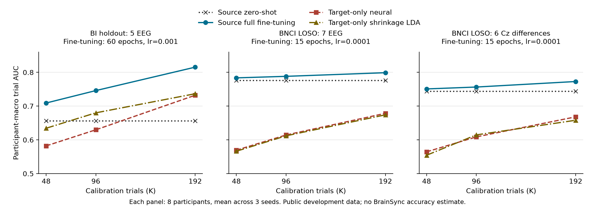

# 公开ERP预训练辅助猜数字：执行结果与下一阶段

> 历史证据：正文保留写作时的实验口径、状态和路径，不作为当前执行指令。
> 当前任务以[执行计划](../roadmap.zh.md)为准；原文压缩快照和迁移说明见[证据索引](README.md)。

日期：2026-09-06。研究主线为公开ERP源训练降低BrainSync九选一校准成本。
本轮只有公开数据development与软件验证；用户确认尚无正式BrainSync数据。
后续[64人配对复核](bi64_protocol_factorial_results_20260906.zh.md)已完成：同一63→1源LOSO下，
192trial强微调全64人五导0.7297、16导0.7681。本文0.8153仅是8人pilot，不能外推全队列；
trial替代selection的共同test增益约0.003，16导实际优于5导。以新报告裁定这些比较。
执行计划见[全局计划](p300_transfer_execution_plan_20260906.zh.md)，所有候选方向见
[72项实验目录](research_experiment_catalog_20260906.zh.md)，外部论据见
[原文与查询核查](research_evidence_audit_20260906.zh.md)。

## 1. 本轮裁决

1. **继续公开ERP预训练→少量目标校准主线。** 两个公共目标场景均观察到相对合理
   target-only方法的收益，但不能外推成BrainSync收益已成立。
2. **保留源分类头，先校准优化配方。** 强微调在BI改善，在BNCI反而伤害；不能统一大LR。
   随机线性头不能作为证明迁移有效的唯一对照。BrainSync runner已加入完整scratch和收缩LDA。
3. **暂不加宽主干或默认使用ERP先平均。** 当前宽度扩大没有稳定收益，ERP平均探针也未优于
   sum-logit。已有迁移模块保留为有条件对照，没有被本轮证明无效，也没有默认叠加。
4. **参考电极是明确的部署问题。** BrainSync配置REF=T7(T3)，公开BNCI声明right earlobe。
   共同实测Cz可消除共同采集参考，但损失一维共模信息，BNCI内有实测代价；保留为研究桥接。
5. **真实目标数据是下一阶段的信息瓶颈。** EOG读取/校准回归、七导及六差分模型接口、
   source权重前向链已经可用；伪迹清理收益、成人准确率、跨日与停止阈值都尚未验证。

## 2. 数据与估计量

| 实验 | source | target与切分 | 解释范围 |
|---|---|---|---|
| BI留出校准 | BI2014a 09–61，共53人、50189 trial | 01–08；前48/96/192 trial；同一purged后缀 | 已多轮观察的公共development |
| BI→BNCI | 同上，共同Cz/P3/Pz/P4/Oz五导 | BNCI2014-008八人；相同预算与固定后缀 | 数据集、被试人群、幅值与协议同时变化 |
| BNCI LOSO | 每折另外7人，29400 trial | 全8人轮流留出；3个seed；七导或六Cz差分 | 公共ALS队列development，不是健康成人确认 |
| 联合source pilot | BI加BNCI A03–A08 | BNCI A01/A02两人 | 探索性；source数量/updates等仍影响比较 |
| 同session诊断 | 无预训练 | BI01–08；随机五折与连续块purged五折 | 五导当前causal管线，不是原版MOABB复现 |
| ERP平均探针 | 冻结BNCI七导LOSO模型 | 每人33个完整selection，共264个；3seed | BNCI 36选一行列任务，非九选一 |

公共binary输入：128Hz、V、连续0.1–30Hz四阶Butterworth forward、steady-state初态、
[-200,1200)ms、mean-only baseline、179点。不同K的共同test从最大192trial校准预算
之后且无raw epoch支持重叠的时刻开始。因果IIR保留过去状态，不宣称统计独立。
BNCI K48/96/192对应8/16/32个target flash；这不是BrainSync同等时长或同等决策数量。

seed为20260906/07/08。先在每个participant内平均seed-specific AUC，再平均participant。
确定性的raw收缩LDA只在必要时运行一次，并显式共享为各seed的同一对照。
3个seed不增加participant样本量；LOSO训练集合重叠，其participant重采样区间仅作描述性摘要。
全部多轮选择均为development，不把最优配方或本轮区间称为确认性发现。

## 3. 校准曲线

图为均值，非置信带。完整逐participant/seed值、配对区间在结果包与分析JSON中。
“轻微调”=15epoch/lr1e-4，“强微调”=60epoch/lr1e-3；均保留源统计并冻结BN。
合理scratch=同结构随机初始化、目标校准统计、60epoch/lr1e-3、更新BN。

| 数据/方法 | K48 AUC | K96 AUC | K192 AUC |
|---|---:|---:|---:|
| BI zero-shot | 0.6565 | 0.6565 | 0.6565 |
| BI 强微调 | 0.7091 | 0.7459 | 0.8153 |
| BI 冻结源feature+收缩LDA | 0.7050 | 0.7376 | 0.7854 |
| BI 合理scratch | 0.5821 | 0.6298 | 0.7322 |
| BI raw收缩LDA | 0.6344 | 0.6800 | 0.7366 |
| BNCI七导 zero-shot | 0.7760 | 0.7760 | 0.7760 |
| BNCI七导 轻微调 | 0.7836 | 0.7881 | 0.7989 |
| BNCI七导 强微调 | 0.6881 | 0.7105 | 0.7364 |
| BNCI七导 冻结源feature+收缩LDA | 0.6086 | 0.6698 | 0.7176 |
| BNCI七导 合理scratch | 0.5694 | 0.6144 | 0.6786 |
| BNCI七导 raw收缩LDA | 0.5663 | 0.6119 | 0.6741 |
| BNCI六Cz差分 zero-shot | 0.7440 | 0.7440 | 0.7440 |
| BNCI六Cz差分 轻微调 | 0.7509 | 0.7564 | 0.7728 |
| BNCI六Cz差分 强微调 | 0.6588 | 0.6996 | 0.7154 |
| BNCI六Cz差分 合理scratch | 0.5645 | 0.6087 | 0.6681 |
| BNCI六Cz差分 raw收缩LDA | 0.5544 | 0.6146 | 0.6581 |

K192 BI强微调相对scratch平均+0.0832，8/8人seed均值为正；20,000次participant bootstrap
95%区间[0.0502,0.1266]，条件于本轮冻结source。相对raw LDA为+0.0787，区间[0.0391,0.1269]。
BNCI七导轻微调相对scratch为+0.1203，描述性重采样区间[0.0692,0.1721]；轻微调相对
强微调为+0.0625，区间[0.0167,0.1288]。这支持校准配方分域验证，不支持挑每人test最优方法。
七导轻微调相对Cz六差分为+0.0261，描述性区间[0.0148,0.0378]。参考一致性有成本，
源内高分与跨设备可用性必须分开选择。

## 4. 源选择、幅值与容量

BI→BNCI五导原配方zero-shot约0.5075、K192微调0.5276，低于合理scratch0.6357和
raw LDA0.6486。两域channel std中位量级分别约29–53uV与7–8uV。
只改为target-prefix统计并更新BN的强微调，K48/96/192达到0.5802/0.6143/0.6688。
这是单seed配方诊断，不证明幅值是唯一根因，也不证明简单标准化已解决真实跨设备迁移。

MST每尺度宽度2→4，BI强微调K192约0.8138，跨BNCI约0.6444，未稳定优于对应窄模型。
当前五导模型只有1186参数，但同session诊断可达到约0.80；参数少本身不足以判欠拟合。

两人pilot中，native联合七导plain zero-shot约0.6870；SplitBN约0.7167，轻微调K192约0.7377。
联合六Cz差分SplitBN zero-shot约0.7283、轻微调约0.7456；BNCI-only六Cz差分约0.7249/0.7394。
该小样本不足以确定联合源最佳权重。暂不将BI加入所有产品候选的默认source；继续保留
BI预训练权重及联合源候选，用未来目标开发数据比较，不能用两人排名决定最终方案。

## 5. 基线锚定与证据聚合

| 当前BI五导诊断，8人，1seed，5折均值 | N2P3Net | EEGNet | raw收缩LDA |
|---|---:|---:|---:|
| session内随机分层五折 | 0.8032 | 0.7346 | 0.7824 |
| 连续时间块五折，purge raw epoch重叠 | 0.8015 | 0.7384 | 0.7932 |

NN均固定60epoch、lr1e-3，训练折内统计和类别权重；N2P3Net1186参数，当前EEGNet1346参数。
这是完整方法在同一固定预算下的诊断，不宣称EEGNet已充分调优或原论文被复现。
随机折平均约67.5%的训练epoch与test epoch共享原始时间窗；连续块此比例为0，但仍有IIR过去状态。
本结果不支持用0.82/0.75两条阈值裁定管线无缺陷或有缺陷。原版MOABB64人16导复现仍未完成。

ERP平均使用可靠BNCI membership，不用target标签决定平均组：

\[
s^{logit}_{d,c}(R)=\sum_{r=1}^{R}f(X_{d,c,r}),\qquad
s^{ERP}_{d,c}(R)=f\left(R^{-1}\sum_{r=1}^{R}X_{d,c,r}\right).
\]

两法在相同264个完整decision上比较；33/35选择规则来自共同binary test后缀，选择前2个
包含校准/purge行，不作事后按正确率删选。R1逐group分数数值一致，tie保留为非命中。

| R | sum-logit准确率 | ERP先平均准确率 | ERP减sum的描述性95%区间 |
|---|---:|---:|---|
| 1 | 0.1957 | 0.1957 | [0,0] |
| 2 | 0.3573 | 0.3371 | [-0.0455,0.0051] |
| 3 | 0.4331 | 0.4167 | [-0.0404,0.0076] |
| 5 | 0.5631 | 0.5417 | [-0.0429,-0.0025] |
| 10 | 0.7412 | 0.7146 | [-0.0543,0.0000] |

不据此宣判ERP平均永远无效；支持保留sum-logit默认。非线性不提供优效方向，
`f(x)=x², x=(-1,+1)`即可让平均丢掉可用信息。共享噪声模型的
\(R_{eff}=R/[1+(R-1)\rho]\)也不能证明平均会恢复独立样本效率。
R8、Reff4.2对应rho约0.129，不是“一半单trial方差共享”；跨不同完整cohort不能直接估计rho。

## 6. BrainSync软件链与采集入口

原始八ADC槽：Fz/Cz/P3/Pz/P4/PO8/EOG/Oz；分类默认七EEG，EOG不进入卷积、CAR或头皮坐标。
共同Cz分支输出Fz/P3/Pz/P4/PO8/Oz六个差分；raw保持七EEG+一路EOG。
单路EOG的放置方向尚未知，不能擅称VEOG/HEOG或已消除全部眼电。

回归只拟合明确的同participant校准session，固定校准中心逐样本应用，禁止未来session或
超出head校准预算的拟合。共同参考必须先作用于EEG与EOG，再拟合回归：
\(X_c-X_{Cz}\)、\(EOG-X_{Cz}\)。无清理与回归清理是待真实数据比较的两个分支。

真实公开源权重→合成BrainSync BIDS→缓存→checkpoint门禁→前向探针发现并修复：
采集端原standard模板坐标处于MRI框架，却标为head。MNE `standard_1005.get_positions()`
实测返回`mri`；现默认值经过fiducial配准，与项目`build_channel_identity`一致。
此坐标是标准头模板，非个体实测。原生参考不匹配拒绝、共同Cz后可加载、Cz再EOG回归后
可加载三项均通过。旧记录不自动猜测重标；旧采集端代码已压缩归档。
官方语义参见[MNE传感器位置教程](https://mne.tools/stable/auto_tutorials/intro/40_sensor_locations.html)。

BrainSync runner现支持zero-shot、保留源head微调、full-fine、target-only tuned和raw收缩LDA。
后两者使用target-prefix统计并记录scratch origin；反例测试把源权重和源统计改成巨大常数，
target-only预测逐位不变。训练/评估源码各自绑定快照；每个结果报告真实校准trial/正例数。

采集模板：[brainsync_collection_plan.json](../../configs/brainsync_collection_plan.json)。
本轮实验结束时曾规划135trial/15target校准、18次后续test；该旧模板未实际采集，
现已冻结。用户随后明确九数字各450刺激校准，共4050trial/450target；新test每次45刺激，
主R5，R1/2/3/4诊断。模板变化不改写上述公共数据实验结果。
软件默认的10block×45刺激长session仍是单一target，不可拆称多个独立decision。
实际眼电放置、有效参考、接触与光学时序由采集记录确认；旧EXE没有本轮修改，应使用当前源码。

## 7. 性能、验证与物理产物

RTX5090 32GB，云端`.venv` Torch2.8.0+cu128；cgroup25CPU。
source沿用BF16/fused Adam/compile，源批任务2workers、每worker4线程；小目标任务4workers。
BNCI七导24个源模型批处理173.1秒，48个评估进程138.2秒；Cz对应161.8/139.0秒。
同session160次NN fit及80次LDA fit合计190.6秒，采样GPU利用率中位80%、P90 99%，最高显存约2.8GB。
source/短目标任务GPU利用率间歇性较低，启动、解压、CPU估计和任务切换开销仍存在，不宣称持续满载。

发现SplitBN在CUDA Graph reduce-overhead下域buffer更新丢失；eager/default路径验证通过，
已对SplitBN降为compile default并保留requested/effective/fallback。原失败任务日志保留，
不是成功实验。普通主干仍沿用已验证快路径。target fused Adam三次探针中位2.143→1.802秒，
但最大score差0.00219且样本少，未据此修改目标适配默认。

云端结果根：`/root/autodl-tmp/n2p3-runs/p300_mainline_20260906`。
本地镜像：`experiments/runs/p300_mainline_20260906/retrieved/p300_mainline_20260906`。
最终云端结果压缩包约33.9MB，不含raw/大cache；两端SHA256：
`23c368de44a54dbf9534c0e5655f663774438f9f8a7dbd3666f713e0badff1b3`。
共72个source checkpoint文件、2400个binary评估单元、240个同session评估单元、
240个ERP聚合汇总单元/7920条逐decision结果。它们包含重复seed/预算/对照，不是独立样本数。
逐预测重算AUC、合同digest、源被试排除、共同test row和标签、候选coverage均复核。
分析脚本与JSON/CSV在`experiments/runs/p300_mainline_20260906/analysis`及其上级目录。

6个全8人公开source候选命名为`public_candidate_bnci8_{native7,cz6}_s{20260906,20260907,20260908}.pt`。
没有按test选最佳seed，没有声称ensemble验证；当前T7 BrainSync只可经明确参考适配后尝试。
训练源码冻结A–E保留各自身份；E的SHA为
`f3267cd466efac946ee4a79ababa11a79472ba78119694e641cc592940ac05e4`。
本轮最后的runner对照和坐标修正属于收尾源码快照，不改写先前模型的执行身份。

针对性验证包括220项用例的219通过/1可选集成跳过，随后独立producer集成通过；
新增BrainSync对照/坐标后49项全部通过（显式加载真实producer源码）。
采集端原16通过/5个SDK依赖跳过的边界仍在；未进行真实设备采集或重打包EXE。
本轮改动文件的ruff与正常`git diff --check`通过；全库ruff另有未改动candidate batch文件的
导入排序/未使用导入问题，不把它们冒称本轮通过。工作树未提交，保留用户原有文档。

## 8. 后续顺序与未执行项

| 顺序 | 具体动作 | 触发与验收 |
|---|---|---|
| 1 | 按7EEG+EOG模板做短设备采集，验证实际slot、参考、BIDS、目标切换、时间与丢包 | completed+已确认标签；真实raw replay闭合 |
| 2 | 同participant比较无清理/EOG回归，native七导/Cz六差分 | 清理fit只在校准内；报告伪迹残留、任务损失与失败分母 |
| 3 | 固定独立后续决策，比较source zero/head/full、合理scratch、raw LDA | 校准trial/正例/分钟和九选一operational hit@R3；禁止test选配方 |
| 4 | 开发内固定source候选和轻/强配方，再做新session/跨日确认 | 分开源收益、参考变换成本、统计/BN效应；不使用本轮dev作确认 |
| 5 | 在明确剩余缺陷后做时间窗raw重建、source剂量/等更新、多源权重/选择 | 600/800/1000/1200ms必须按允许截止重建，不能裁FFT cache宣称提前可用 |
| 6 | 仅对有追加收益迹象的既有EA/SplitBN/AS-MMD/选择模块扩展验证 | 相同source人数/updates、目标预算和失败成本，独立确认后简化 |

尚未完成：原版MOABB64人16导E0-A、成对去额/ICA的完整E1、EOG生理归因、窗口/滤波全扫描、
BI候选membership历史冲突恢复、ITR及动态停止的真实目标验证。原有BI长R指标不得继续作为
binary source学习门槛；没有这些资料也不能宣称全部伪迹或迁移机制已经被裁定。
文献中的P300也不意味着网络只利用250–600ms；相关外部证据与数学反例已经列入核查文档。
