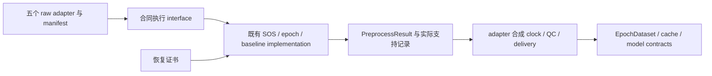

# 预处理合同执行：科研裁决、数学与实施清单

> 导航副本：历史失效链接现指向[持久来源索引](../assets/repository_audit_20261019/docs_historical_index.json)。原文以原SHA保存在本地归档；本次只改定位入口，原结果、执行producer与未找到凭证的边界保持。


2026-09-15。状态：**科研裁决完成，生产重构待实施**。本轮研究此前架构报告的第三项，
交付范围为现行源码审计、文献核验、数学反例和有序代码清单。
未更改生产源码或正式测试，未重训模型、重建真实缓存或启动云端实验。

## 1. 理念裁决

接受：深化现有预处理module，使冻结声明经同一interface完成执行前验证、数值处理与支持时间记账。
理由不仅是减少重复代码：目前参数声明、低层执行和时间账本存在可实测的不一致。

| 对“统一预处理”的解读 | 裁决 | 理由 |
|---|---|---|
| 抽取一份kwargs字典 | 可作为内部implementation，不能作为最终方案 | 只消除字段转写，没有统一执行合法性、源采样率约束或证据可用时间 |
| 统一合同解释与执行 | **推荐，Strong** | 将调用者必须记住的算子顺序、验证、支持与记录收回module，产生locality和leverage |
| 合并所有数据入口/QC/清理器 | 拒绝 | 身份、候选含义、单位转换、参考、拟合范围和采集时钟各有真实差异，不能变成一个按库名猜测的implementation |

seam位于adapter已完成来源、单位、事件和空间角色核验之后。五个真实raw adapter和manifest入口
提供实际变化需求；无需为尚不存在的后端构造插件注册体系。
depth体现在caller只声明所需处理、提供已核验输入，就得到可核对的张量与事件证据。
deletion test：删除深化后的module会使同一批执行规则重新散落到六个caller；
单纯增加转发函数则只移动代码，没有获得这种depth。

本轮采用六份现行指南为领域权威。技能中的旧模型路线、旧Torch版本和顶层三件套文档模式
不覆盖当前仓库；当前BrainSync默认已是完整记录双向滤波，不能恢复到最初报告时的单向默认。

## 2. 当前实现与证据分层

核验HEAD为`f1a303c42c68173e8b1452ceb26bd84923b8a6aa`，工作树含大量未提交内容。
实际受审源码逐文件摘要保存在本轮归档清单；HEAD不能代替这些字节。
实测环境：Python3.14.3、MNE1.12.1、NumPy2.5.2、SciPy1.18.1、Torch2.13.0+cu130。
反例使用CPU和合成信号；安装CUDA版Torch不等于本轮完成GPU验证。

### 2.1 真实调用摩擦

| 调用者与定位 | 重复知识/当前行为 | 裁决 |
|---|---|---|
| `src/data/brainsync.py:393` | 手写23个执行字段后调用build_subject；还持有参考/EOG/QC、clock、休息及完整排程 | 迁移数值合同转写；保留录制与拟合范围职责 |
| `src/data/moabb.py:1035` | raw路径同样手写23项；受物理attestation和真实身份核验约束 | 复用执行interface，保留来源与多进程接入 |
| `src/data/gtn_dataset.py:193` | 同样23项；cohort bridge另手写部分合同字段 | 用已有contract转换函数消除后者重复，保留NIX身份/九候选 |
| `src/data/bi2014a_candidate.py:297` | 同样23项；源512Hz、CSV μV转V和candidate排程恢复 | 数值执行统一，单位转换与恢复留在adapter |
| `src/data/bnci2014_008_candidate.py:529` | 同样23项；源256Hz、MAT单位与row/column membership | 保留字符决策语义和原始行映射 |
| `src/data/manifest.py:291` | 第六处同构字典，经load_dataset/build_subject再执行 | reader、union/intersection和坐标汇总仍属于入口 |

23项为采样/频带/时间6项、基线4项、滤波7项、重采样5项，以及历史reject字段1项。
`name`和`signal_unit`有合同意义，但不是可直接传入数值kernel的同名参数。
本次AST检查确认五个raw入口的notch与edge字段均已传播，**没有发现当前漏传这两项**。
GTN四个cohort bridge与共享转换当前也相等；两者是维护风险，不是已证实错误。

更实质的问题：

1. `PreprocessingSpec.validate()`要求半开窗口推导的样本数，`preprocess()`却能接受任意正截长。
   声明100Hz、[-200,800)ms而n_times=10会被Spec拒绝，低层却产生10点。
   这是验证域不同；最终EpochDataset.validate还会复查，不能据此声称现有五入口已发布非法cache。
2. 历史正电压reject字段可通过Spec读取，但实际执行已明确拒绝。应区分“历史记录可解释”与“新输入可执行”，
   不应为了统一而让所有历史记录失去可读性。
3. `load_preprocessing_spec`宣称完整JSON，但`{}`会补通用无陷波legacy默认；它不是当前BrainSync默认。
   显式新配置解析与旧包解码需要不同的缺字段规则。
4. `dataset.py:350`的timing_source固定写`epoch_right_edge`，即使双向数值availability已取完整raw末尾。
5. 通用forward入口的`onset+tmax`在非源采样网格对齐的合法窗口下，可能早于实际消费的闭端源样本，见反例11。

### 2.2 文献与实际核验层级

| 来源 | 本轮读取层级与事实 | 本项目能采用的结论 |
|---|---|---|
| Widmann、Schröger、Maess，2015，[Digital filter design for electrophysiological data—a practical approach](https://doi.org/10.1016/j.jneumeth.2014.08.002) | Europe PMC摘要/元数据；卷期2015、在线2014。讨论响应、阶数、延迟、因果性及软件实现 | 频带和阶数不是完整算子；不声称该摘要证明全部具体顺序 |
| Tanner、Morgan-Short、Luck，2015，[How inappropriate high-pass filters can produce artifactual effects and incorrect conclusions in ERP studies of language and cognition](https://doi.org/10.1111/psyp.12437)；[PMC正文](https://pmc.ncbi.nlm.nih.gov/articles/PMC4506207/) | 子代理核验方法及Fig.7正文：同0.1Hz高通应用于连续EEG或分段平均ERP，效应不同；33人采集、24人分析 | 同参数不能证明相同支持域；该语言ERP结果不是P300统一截止阈值 |
| [MNE1.12重采样教程](https://mne.tools/1.12/auto_tutorials/preprocessing/30_filtering_resampling.html)、[Epochs](https://mne.tools/1.12/generated/mne.Epochs.html) | 对应版本官方文档；FFT按整个输入块，影响不保证时间局部；MNE epoch包含左右端点 | 保留源事件切片、epoch重采样、合同截长和半开基线；不能换成raw重采样后仍称纯重构 |
| [SciPy sosfiltfilt](https://docs.scipy.org/doc/scipy/reference/generated/scipy.signal.sosfiltfilt.html)、[resample](https://docs.scipy.org/doc/scipy/reference/generated/scipy.signal.resample.html) | 官方文档；双遍SOS、延拓和padlen；FFT谱截短/补零与周期假设 | 同SOS在不同段长/边界上不是同一有限算子；FFT输出可能依赖最终截长以外的源样本 |
| [BIDS派生数据描述](https://bids-specification.readthedocs.io/en/stable/modality-agnostic-files/dataset-description.html) | 官方规范GeneratedBy与SourceDatasets，区分来源数据和生成流程 | 分别记录来源与执行，字段存在本身不证明无泄漏或等价 |
| [scikit-learn Common pitfalls](https://scikit-learn.org/stable/common_pitfalls.html) | 官方文档：fit仅在训练集，测试只transform；Pipeline帮助保持CV隔离 | 学习型EOG/QC/归一化状态必须绑定fit范围；不能将此机械解释为逐epoch单独滤波 |

Tanner正文的原HTTP响应未存档，已保留子代理实际工具输出的短摘录与检索说明。
主代理后续请求得到HTTP200但无正文关键词，未将其当成全文证据；Europe PMC全文XML为404。
其余列入来源JSON的官方页面/摘要已由主代理读取并记录摘要与相关文本片段。
这是围绕本裁决的有限检索，不是系统综述。

## 3. 数学检验与公式落实

### 3.1 必须先说明线性条件

令原始数据为`X∈R^(C×N)`，拟合状态为`φ̂_F=Fit(X_F)`，其中F是明确的合法拟合范围。
原始QC按冻结参数产生分段/掩码`Γ=Q(X;φ̂_F)`。一般Q仍依赖当前数据，所以完整流程并非全局线性。
只有固定Γ、固定拟合状态、采用线性均值基线后，数值部分才可写为有限仿射映射。
固定EOG中心可产生常数项，不能不加条件写成纯线性。

对事件i、固定输出导和已经确定的空间变换W，概念表达为：

```text
Y_i = B_T P_T R_(fs→fm) E_(i,fs) F_(θ,e,N,Γ) (W X + b)
```

- θ为声明：phase、频带、notch、epoch、基线和重采样规则。
- e为实际implementation及解析出的参数：后端/版本、SOS、padding、初态和重置策略。
- E按源sample轴切出**闭区间**，R处理整个源epoch，P取前T点；`T=floor((tmax−tmin)fm)`。
- B使用模型时间轴的半开基线；W的位置必须与真实参考/EOG/QC依赖一致，不强行提前。

这个表达不是强制全流程统一顺序的许可：当前不同通道的Γ可能不同，空间混合与时间算子未必交换。

### 3.2 三个不可省略的交换条件

连续滤波与切片一般不交换：`E_i F_N ≠ F_(N_i) E_i`。
被裁掉的脉冲仍可经连续滤波响应进入epoch；裁剪还改变有限初态和延拓。

对空间变换，若所有参与导使用同一个有限时间矩阵F，则
`W(XFᵀ)=(WX)Fᵀ`。当各导因局部伪迹采用不同F_c时，此式没有共同的F可用。
不能将“先减Cz再按依赖并集分段”替换为“各导独立分段滤波后相减”。

均值基线写作`B=I−1 bᵀ`，b为选中基线样本上的归一化权重，`bᵀ1=1`。
因此`B(x+c1)=Bx`，且对`L=1/2‖Bx‖²`有`∂L/∂x=BᵀBx`；本轮已与autograd核对。
这只是算子检验，未新增模型优化目标。

若重采样R保持常数，`R1_S=1_T`，则：

```text
B_T R − R B_S = 1_T (b_Sᵀ − b_Tᵀ R)
```

只有`b_TᵀR=b_Sᵀ`才可交换基线和重采样。刺激前窗口在两种网格中各取均值，不足以满足此式。
median基线不满足加法线性；线性恢复证书及矩阵缓存必须保留能力门禁，不能套用于所有合法baseline模式。

### 3.3 支持样本与可用时刻

令e_i为绝对源sample索引，源epoch实际端点为：

```text
p_i = e_i + round(tmin * fs)
q_i = e_i + round(tmax * fs)
s0 = raw.first_samp
source_epoch = X[:, p_i-s0:q_i-s0+1]
```

MNE使用的实际取整/闭端规则应从执行中获取并核验，不能由caller另行猜测。
FFT处理后即使只保留前T点，输出仍可能依赖q_i；半开输出标签不证明源支持也是半开。
令S_i为最终证据实际或保守上界的样本依赖集合，τ_r为adapter提供的真实sample到时钟映射：

```text
a_i >= max(max_{n in S_i} τ_r(n), a_QC,i, a_delivery,i)
```

forward指连续滤波的方向；epoch FFT和基线仍需要事件后的完整输入窗。
完整记录双向处理继续保守使用记录结束。BrainSync的QC确认、finalized clock和交付时间
可进一步提高a_i，不能被通用kernel的结束样本覆盖。非零first_samp不能重复加或忽略。

反例11：250Hz、onset=4秒、合法tmax=1.199秒；闭端取整消费5.200秒样本。
只修改该样本就改变最终179点输出，但当前低层availability为5.199秒，少计1ms。
这是通用配置边界的实测缺口；现行BrainSync1200ms默认及完整记录交付并未在此被证明错误。

### 3.4 四种身份不得混成一个判据

| 身份/判据 | 回答的问题 | 不应推出的结论 |
|---|---|---|
| 规范化声明θ与输入语义 | 要执行什么，单位/空间/时间是否兼容 | 相同参数不保证相同有限算子 |
| 执行e与支持上下文N、Γ、事件网格 | 这次实际如何计算、最早何时可用 | 版本字符串相同不替代数值和反例核验 |
| raw/cache/模型字节与谱系 | 哪些输入和输出被使用、是否被改动 | 字节封存不证明生成者执行了声明 |
| fit范围F与冻结φ̂_F | 哪些数据有权影响学习型处理 | 有统一Pipeline不代表未泄漏 |

source与target本来应使用不同参与者和原始数据，绝不能要求二者数据摘要或fit范围相等。
参数语义兼容、对指定实现范围的数值等价、同次运行的字节复现是三个不同层级。
后端升级是否兼容应由验证范围决定，不能既机械拒绝所有版本差异，也直接忽略实现差异。

## 4. 已执行反例

本轮独立脚本14项断言全部通过；以下“通过”指观察符合独立预期，包含主动揭示当前缺口的反例。
信号幅度为合成注入尺度，不是生理阈值或质量容差。

| 编号 | 检验 | 实测结果/解释 |
|---|---|---|
| 01 | 固定声明的临时参数lowering与手写原调用 | 179点逐位一致，最大误差0；只证明所测kernel调用，不证明六个adapter已迁移 |
| 02 | 非法n_times | Spec拒绝100点，低层仍输出100点；正式合同应为179点 |
| 03 | 历史reject字段 | 可读取/验证历史记录，但新执行明确拒绝 |
| 04 | 均值基线线性、常数不变与梯度 | 最大误差分别4.44e−16、8.88e−16、1.78e−15 |
| 05 | median基线加法性 | 反例差2，不能套用线性矩阵证书 |
| 06 | 连续滤波与先裁剪 | 1mV窗外脉冲导致最大差6.744μV |
| 07 | 空间变换与时间滤波 | 相同分段误差9.12e−18 V；不同重置段差8.730μV |
| 08 | 相同SOS、不同padding | legacy与mne_reflect_limited差9.315μV |
| 09 | 双向未来依赖与采集段隔离 | 后缀阶跃使前段变化496.643μV；显式断点隔离后前段变化0 |
| 10 | 恢复证书epoch映射与生产链 | 351源点→179模型点逐位一致 |
| 11 | 闭端取整与availability | 5.2秒端样本使输出变化76.171μV，账本却报5.199秒 |
| 12 | 历史省略字段 | 旧无notch/legacy记录往返不变，不继承当前zero默认 |
| 13 | 基线与FFT重采样交换子 | 公式误差1.01e−15；随机输入的实际次序差0.0112μV，非零即反证普遍等价 |
| 14 | 非零first_samp与源切片 | 同一物理事件的输出逐位一致；绝对索引与数组内偏移明确分开 |

另一个独立代码轴探针确认：无实际滤波时不合法forward初值可绕过低层检查，
`{}`显式配置会继承通用默认；这些与主探针一起归档。
93项现有预处理/notch/filter-phase/双向恢复/冻结输入重放测试通过，4条sklearn小样本警告。
它们是当前基线证据，不能当成尚未实现重构的验收结果。
308份活动Python文件Ruff、本轮主探针Ruff和`git diff --check`通过。
本轮未改生产实现，因此未重跑全套训练/科研测试；正式重构验收仍需完整suite。
独立审阅纠正了绝对sample索引切片需减`first_samp`的公式，反例14已验证相同物理输入输出一致。

首次数值脚本曾让MNE原地操作复用输入数组，造成断点隔离探针误失败；
修正造数为独立copy后全项重跑通过。未据该探针错误修改生产代码或放宽数值断言。

## 5. 拟实施interface与代码清单

推荐深化现有`data.preprocess`，新增明确的合同执行入口（候选名`execute_preprocessing`），
消费`PreprocessingSpec`和已核验raw/events/layout，返回扩展的`PreprocessResult`。
数值kernel仍由现有preprocess/SOS/epoch实现承担；字段翻译留在内部。
这是拟议接口，不是本轮已发布能力：

```text
adapter: decode source → verify identity/units/roles/events/fit scope
executor(raw, events, spec, layout):
    validate executable spec and actual raw context
    resolve actual filter/epoch/resample/baseline operation
    execute existing numeric implementation
    return X + masks + event mapping + support/availability + execution record
adapter: combine delivery/QC/clock dependencies → validate/persist EpochDataset
```



顺序必须按下表推进；不能先批量替换调用，再用测试失败反向决定科学语义。

| 次序 | 代码范围 | 明确动作与验收 |
|---|---|---|
| 1 | `epochs.PreprocessingSpec`、显式JSON loader、`preprocess.PreprocessResult` | 区分历史解码、严格新执行和低层研究kernel；新显式文件必须完整或引用明确profile，禁止`{}`静默补默认；旧record合法省略规则继续可读 |
| 2 | `data.preprocess`、`dataset.build_subject/load_dataset` | 完整Spec入口前置验证，源采样率/Nyquist、闭端与实际输出轴集中；先补反例11。保留已有`n_times=None`低层研究能力，但其产物不能冒充已满足严格Spec |
| 3 | `brainsync/moabb raw/gtn/bi2014a/bnci2014_008/manifest` | 六处参数转写迁入同一implementation；各自身份、单位、candidate、QC和交付职责保留；GTN bridge复用已有`preprocessing_spec_from_contract` |
| 4 | `recovery._epoch_map`、`bidirectional._epoch_projection`、`continuous_qc` | 实际数值映射与证书共用同一解析结果；只对合法线性基线提供矩阵能力；维持有界缓存和双端耦合项 |
| 5 | `events`、`dataset`、`brainsync` | 写实际源样本支持/网格与真实timing_source；通用算子支持和adapter交付依赖取最大；不擅自缩短完整记录可用时间 |
| 6 | `epochs`保存加载、manifest、lineage、checkpoint、calibrated、完成产物准入 | 声明record保持历史身份；新执行凭证单独版本化，绑定有效参数与实际源码/后端；旧缺证据不补造。语义兼容不要求source/target数据摘要相同 |
| 7 | `tests/data`、`tests/brainsync`、`tests/transfer`、六份指南 | 真实小型adapter对照、异常与保持行为逐项验收；冻结前后源码、完整suite、Ruff、CLI外目录与diff检查，源文件固定后再跑含快照测试 |

MOABB高层P300单独裁定：当前epoch resample默认恰与显式参数相同，不应写成已算错。
但高层filter的annotation/phase/order依赖库默认，且现有入口拒绝新的edge/notch请求；
必须保留能力门禁和独立执行身份。只有独立证明后，才允许某个声明进入共同等价范围。

## 6. 接受条件、反证门槛与收尾

实施必须同时比较X、dtype/shape、通道顺序/位置/mask、event_indices、不可用原因、原始分母、
actual支持时间和历史record，而不是只比较kwargs或AUC。
对同环境同算法纯重构优先逐位等价；若更换计算顺序，先给出物理单位误差预算和证书影响，
不得事后调大容差。字段变化但实际语义不变时也不得随意重标历史模型。

以下任一情况否决“纯重构完成”：漏掉一个caller；改变休息/暂停/局部伪迹支持；
重采样前后或基线顺序被换；反例11仍早报；旧记录继承新默认；median被当成线性；
QC/EOG在新入口重新fit或使用测试统计；MOABB高层被静默宣称同算子。

时间账本修正如改变purge/划分，即使X相同，也会改变估计量或可用队列；
必须另建派生cache和执行记录，既有成绩保留原义。只有参数转写的等价迁移不需要以重训证明正确，
也不能声称提高AUC、hit@R5或训练吞吐。任何性能主张另做条件配对与实测。

研究产物见[结构化验证](../assets/preprocessing_contract_research_20260915/validation.json)及
[源码、探针与文献核验归档](../assets/repository_audit_20261019/docs_historical_index.json)。
归档是列明范围的科研证据，不是新的训练执行快照。生产实施状态只在roadmap中维护。
