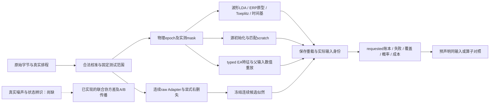

# 2026-10-04 全链路线实施与验证

状态：本轮实施、独立复审、真实诊断及最终软件验收完成；未完成的科研效能验证单独列明。
规格为[全链科研重审](system_research_20261004.zh.md)，本记录不把可执行研究接口等同性能结论。

## 1. 冻结与实施范围

按用户要求先冻结实际dirty tree：

- [主源码清单](../../frozen/system_implementation_20261004_before/source.manifest.json)：353个成员，源码archive SHA256 `e17eef169319ac18ce8f97a02d1088a566337e5a99280c2ed38c7fb94fad2250`。
- [资源/研究补充](../../frozen/system_implementation_20261004_before/resources.manifest.json)：88个成员，archive SHA256 `6f87c7d1cd30f410e102f8508fa3911129c82e8e7e8dc8150c71854675941d13`。
- 包含当时未提交与未跟踪的活动源码、测试、配置、指南，额外包含运行资源/研究依据。原始数据、旧模型和实验结果原位保留；commit仅为base identity，不能代表此快照。

改后[源码清单](../../frozen/system_implementation_20261004_after/source.manifest.json)共386成员，archive SHA256
`043893ac95e4ff8e9b5f3db718e216ed6c33c4178af5a01e826f2237c4b3973a`，归档逐成员及最终全套结束后的工作树均核对一致。
相对改前实际字节共69个文件变化：20个src、12个实验入口、27个测试/共享造数、9个文档及pyproject。
完整清单见[changed_files.json](../assets/system_implementation_20261004/changed_files.json)，不把此前其他dirty改动计入。

使用astra-research-workflow、codebase-design、diagnosing-bugs、tdd、code-review、EEG科研及resource/performance技能。
Interface沿已批准规格的fit→freeze→save/load→unknown-label predict与真实runner验收；不再增设用户审批。
固定快照与新工作树的差异见[implementation.diff](../assets/system_implementation_20261004/implementation.diff)，避免把此前大量dirty改动归到本轮。

图中EA重放已有特征分类器证据，不代表普通N2P3入口已接受EA；R1的数值核也不能替代左侧尚缺的真实可识别估计。

## 2. E0：物理证据、数值输入与真实执行关系

`research.comparison`承担原来散落的配对关系。`evaluation_input_identity`分开fit/score物理事件/标签、实际X/mask、参考/通道角色、raw支持、预处理执行、完整候选排程与拟合context；`ContrastPlan`显式允许baseline/filter/window/resampling/spatial/raw-support/implementation变化。

相同输入模型对比要求完整数值身份相同；算子对比必须绑定原始raw且只改变声明轴；新统计不再把旧四个hash当作已证明calibration输入相同，历史未完整记录保持历史用途。只有events sidecar或部分已知父输入不能认证全部raw；DataLineage所有源叶必须有raw生产证据覆盖。

`execute_target_tasks`的外部compact导入和worker内复用绑定同一execution key，覆盖原fit/score、实际独立inner输入、recording_order、decision合同、recipe、source state、runtime、snapshot与evidence scope。改变任一真实拟合输入不能贴旧预测；未变化的合法重复仍可复用，回归明确证明两者。

预算账本从resolver传至source-prefix、普通binary、cross-dataset、source-pseudo-target和统一cell；strict与有限数据放宽分开。候选valid reducer先保留观察支持再取固定完整cohort，输出每arm/replicate缺失，空cohort不产NaN。原主requested指标不变。

本轮两次反方追出额外缺口：inner输入变化被复用、候选词表消失仍同digest、raw sidecar/混合父错误认证、baseline声明连带放过代码变化、P2两个contrast family混用配置。均以新行为反例修复。详见[独立E0评审](../assets/system_implementation_20261004/e0_review.md)。

最后闭合审查发现，初版`/1`身份缺少decision语义/fit context，两份同样缺字段的记录仍可互相配对。
当前身份已升`/2`，强制完整字段及子结构；缺字段重新摘要、旧格式完整重签都不能通过。五个新RED反例转GREEN，
不向旧预测补造当时未记录的拟合证据。[最终Standards复核](../assets/system_implementation_20261004/review_standards_closure.md)独立重放确认关闭。

## 3. E1：EA由实际父输入与调用者计划共同约束

`EAFitPlan`把原始授权行、参与者、scope、算子参数、reference与plan_id收敛为一份约束；它来自可信split/plan owner，不把hash声称为身份签名。

`fit_ea_feature_artifact→save→load`均核实际attested parent与expected plan，内部完成拟合、state路由、数值transform及输出验证；无域state、错fit rows/scope/参数/维度、重签任意输出均不能发布。parent载入后被原位改动会被实际decoded内容摘要拦截。加载消费同一份已核字节，数组/metadata所有权明确，不能锁坏调用者原数组。

产物仍为无量纲EA组件，`artifact.transform(new_attested_data)`只使用已验冻结state，支持无标签输入且不refit。普通物理EpochDataset/模型入口拒绝旧EA伪电压；`load_historical_epoch_dataset`只供离线审计，不能进入active checkpoint。

实际Huebner FZ/PZ小切片C8→16rows：平均二阶矩白化误差5.33e−9，feature重载逐位一致，LDA score差0；这是数值/重放证据，不是EA真实效能提升。[E1证据](../assets/system_implementation_20261004/ea.md)。完整N2P3双侧EA配套source checkpoint路线尚未训练/晋升。

## 4. E2/R3：成熟ERP基线和时间结构迁移

`XdawnRiemann`修正为训练ERP prototype增广协方差，保留模板与trial交叉块；旧裸covariance artifact不能解释成新schema。
`StructuredERP`集中ERPcov、标准ToeplitzLDA、pooled LDA与temporal LDA；模型只有纯数值state，接入 `TargetRecipe→fit_calibration_candidate→CalibratedPredictor`，并走真实BIDS未知label推理。

Toeplitz按官方收缩→恢复量纲→block lag平均→线性taper算法执行，Cholesky验证PSD/秩，严格无baseline/等宽bin/channel-prime顺序；与独立官方数值类三组scale/shape对照最大logit差1.07e−14。原BSD版权及免责声明在`src/baselines/structured_erp.LICENSE`并纳入wheel资源和改后freeze。

`TemporalBasis`明确fixed analytic与source supervised角色：各source participant实测电极上的ERP时间Gram归一化、参与者等权，学得固定时间子空间；空间判别留给本人实测布局。保存真实fit rows/labels/mask/events/身份，source producer数值重放，使用时整target study/participant排除；不补零白化，也不把固定基称为源学习。固定秩不够可识别则拒绝，不随机补维。

反方发现NaN mask会被视为True、fixed解析角色未独立核公式、失败refit残留可预测状态和xDAWN实测rank缺口；
均已通过原公开路径复验关闭。xDAWN按实测秩裁剪effective_nfilter并保存，重载核有效维数；不会把OAS正定化误作新增观测维。
成熟基线不因这些浅层实现问题被否决。

入口：`fit_source_temporal_basis.py`、`run_erp_comparator.py`；comparator接独立原始C/T前缀、预声明变化轴、原波形LDA桥接及NN锚点、数值保存重载与配对统计。各family、源角色和失败仍分别记录。[E2/R3证据](../assets/system_implementation_20261004/baselines.md)。

比较入口逐subject/arm预检再执行；只保留小身份记录，不同时持有四库EEG。缺请求K明确protocol_unavailable，合法K继续执行，
available fallback独立声明不冒充标准K。真实BDF容器八臂桥接、full-fine/scratch/waveform六cell端到端已过，
source权重及统计大幅改变后scratch逐score不变，整target study未排除则拒绝。这些容器内信号为合成，属于软件正确性。

## 5. S2：没有因初版失败淘汰工频路线

`data.harmonic.clean_harmonic_segments`实现明确离线、segment内部的稳健窄带回归，只减工频拟合分量。
参数固定后再验证：

1. 4s窗仿射包络不能处理连续频漂/幅相调制；
2. 1s三阶包络解决残留却在BI真实ERP注入中造成20.8%误差；
3. 增加低频保护字典，发现仅保护10Hz仍不足；最终保护完整0–30Hz通带，再对全部固定六人重跑。

| BI参与者 | 当前独立C200末事件峰µV | 最终研究cleaner后峰µV |
|---|---:|---:|
| 01 | 3545 | 70 |
| 02 | 7150 | 187 |
| 12 | 349 | 100 |
| 26 | 2883 | 322 |
| 49 | 569 | 569 |
| 60 | 283 | 42 |

最大注入ERP增量相对误差0.354%；任一导PTP>500µV事件总446→415，BI26仍173/200、BI49仍200/200，持续污染并未消失。另保留9种合成的频漂/调制/glitch/慢信号反例与全部初版失败材料。阈值是描述而非删样本策略；六人不是总体随机效能样本，不能据波峰下降声明AUC或hit提升。

该处理在每个test segment重估频率/robust权重，是显式离线自适应算子；不能直接当作R1固定线性A，不能声称因果实时滤波，未改生产默认。源/目标完整route比较必须绑定相应协议。[算子证据](../assets/system_implementation_20261004/operators.md)。

## 6. R1/R2：噪声传播与连续候选的可执行研究模型

`JointNoiseModel`从明确源训练/校准paired residual/state draws估联合PSD协方差，保留Ω与均值；堆叠A/B可保留raw重叠及共享state的跨epoch相关。常零state维不改变活跃维的Ledoit–Wolf估计。

`OperatorAwareLDA`消费已拟合joint noise与固定A/B，只在C估类均值，可识别子空间内加相对ridge；predict没有oracle state、标签或covariance更新入口。fit/save/load/predict和CLI全部可执行。真实Γ/Ω的自动识别、逐事件A_i/B_i构造及与连续decoder联合仍未自动完成，不因一个数值Module存在就宣称这些科研问题已解决。

`ContinuousDecisionModel`从合法标注records拟合低维ERP核、AR(1)、channel shrinkage covariance和条件核后验V_h。对每个公开membership候选计算含V_h的Woodbury二次型与候选logdet，每raw sample一次；调用需sfreq、通道顺序、候选词表、record_id和operator_identity，真目标不进入score。保存重载、white/AR=.7与独立dense Gaussian公式对照均通过。

噪声、核和假设都是明确研究模型；经验noise/AR超参数不确定性尚未积分，恒定/线性nuisance投影仍可移除真实慢ERP。假设记录不能成为无条件性能保证。

反方发现provenance的scope/训练records可原位改写并重新保存、CLI在fit后重新hash可绑定错误文件；已通过深冻结与消费同字节snapshot修复，
公开写入和强行替换均有反例。连续模型格式升`/2`，校准右删失只对拟合开放，预测仍要求完整尾部。
最终源码又执行七条真实CLI子进程，全部exit=0，见[七入口记录](../assets/system_implementation_20261004/operator_cli_demo_postreview/validation.json)。
没有把“只读dataclass”误作嵌套dict不可变。

## 7. 真实BNCI连续Adapter和有限decision归因

新增独立raw→continuous研究Adapter，固定native八导、256Hz、0.1–30Hz/50HzQ30、8个时间基、1.2s核、ridge1及K200/800；逐人串行native2线程，使用同一Kmax后的固定T。单个selection之间实际gap核查，不假定所有库有相同间隔。

实现中确认K200/800末端后的1.2s往往还包含3–4个未授权flash。连续建模既不能忽略它们又不能偷读标签，因此新route把C截止到下一未授权flash onset，保留全部K已知标签，但末ERP核**显式右删失**；fit-only支持此条件、predict仍检查完整响应。它是新raw支持协议，不能直接与旧epoch成绩作算法单因素因果差。

测试partial decision保持requested/incomplete，完整词表与隐藏真目标分离；原始MAT字节、分割、实际连续处理、保存model与scorer账本同链绑定。
全部八人×两K共16cell完成，0拟合失败；464请求中448评分、16不完整。所有448份36维log_evidence保存重载逐值相同，
另由两份独立复算核softmax/NLL/argmax、计数及model/prediction/source SHA。原v1结果保留，补完整log_evidence的v2同配方重跑指标完全相同。

| K | 八人平均requested hit@all | 平均coverage | 可评分decision条件NLL |
|---:|---:|---:|---:|
| 200 | 0.4051724 | 0.9655172 | 6.9018254 |
| 800 | 0.5905172 | 0.9655172 | 3.2426752 |

K200 NLL差于均匀36候选的log(36)=3.5835；A02 K200为33.1674，概率过置信问题明显。
完整T双向处理实际平均等待576.73s，有限核本身约30.95s，不能把后者当在线延迟。
无matched anchor，不能从这组数字声称优于原方法；新raw输入协议也不能与历史epoch分数直接相减作因果效应。
见[完整真实Adapter与结果](../assets/system_implementation_20261004/raw_continuous.md)、[独立复算](../assets/system_implementation_20261004/bnci_continuous_verification.json)。
这是本地公开开发诊断，不是三seed十二库迁移矩阵，也不是成人确认。

`decision_experiments.expand_decision_diagnostics`另外复用统一executor，显式构造trial/prior/decision/joint以及匹配head/scratch对照；G、target coverage、重复优化不增加独立样本的事实入账。选出的prior λ=0时记录degenerate，不伪造正λ；小G full-joint只作为显式探索处理，未改产品默认。

## 8. 验收与尚未完成的科研

第一版冻结全套：2225通过、8跳过，见[JUnit](../assets/system_implementation_20261004/full_suite_pass1.xml)。后续独立双轴评审仍发现真实缺口，因此该次全绿不当作最终完成证据。

规格轴：[review_spec.md](../assets/system_implementation_20261004/review_spec.md)；标准轴：[review_standards.md](../assets/system_implementation_20261004/review_standards.md)。原RED证据保留，修复/最终测试/模型重放在最后验收记录另列。

第二版全套2256项：2248通过、8跳过、0失败，403.93秒；对应物理快照`validation_pass2`，
见[JUnit](../assets/system_implementation_20261004/full_suite_pass2.xml)。同期Spec又用真实runner复现迁移臂可缺scratch、
或scratch架构/训练预算不同而仍完成。这证明全套通过也不能代替规格审查；该项已另修matched-control准入：
每个可执行full-fine拟合前必须有同实际输入、K、seed、真实架构及训练配方的scratch与原波形LDA，
正常源统计/目标统计角色差异显式保留；失败配对不生成差值。矩阵里另有合法scratch也不能放行使用不匹配scratch的统计contrast。
原攻击和BN策略、显式contrast绕过均有回归，最终全套针对修后的源码重跑。
第一版差异另保留为`implementation_pass1.diff`和`changed_files_pass1.json`，不拿后来修改覆盖当时审查范围。

**最终验收：2263项，2255通过、8跳过、0失败/错误，450.11秒。**
见[最终JUnit](../assets/system_implementation_20261004/full_suite_final.xml)及[结构化验收](../assets/system_implementation_20261004/final_validation.json)。
8个跳过分别为4个CUDA、2个独立采集端集成环境、2个Windows符号链接权限；不记作通过。
最终Ruff、`git diff --check`通过；五条新CLI从仓库外cwd启动帮助成功；七条算子CLI真实子进程执行成功。
完整测试结束再次核对改后386文件与物理快照一致，后续只整理本证据及验收产物。

最终[Spec闭合](../assets/system_implementation_20261004/review_spec_closure.md)与
[Standards闭合](../assets/system_implementation_20261004/review_standards_closure.md)保留原始反例并分别重放；
当前审查范围没有未关闭的已确认P1，不等于证明仓库不存在未知漏洞。
新增非法对照逐项拒绝且其他对照保持合法，避免由同一个缺字段遮住多条未实际触发的路径。
六活动指南已更新，跨测试造数集中到support；没有替换工作站默认或改写旧成绩。

本轮交付涵盖大块成熟工程/算法能力及真实本地诊断，仍不声称：找到A1/Q1唯一病因、R1未知state统计已自动识别、R1/R2完整联合已验证、十二库三个seed性能复核已跑、成人设备准确率已确认。已知原始污染和模型假设是研究剩余，不应藏在“全链完成”一句话中。

## 9. 后续优化以本轮反证为依据

1. **先给成熟方法公平机会。** 用合法raw重建的baseline/无baseline波形LDA桥接区分输入效应与Toeplitz估计效应；
   ERP原型几何保留极性/时间信息，同输入NN源初始化与scratch严格配对。固定共同测试队列、真实K和拟合机会，报告失败配对及负迁移。
   这些方法的错误实现已经纠正，不能继续用旧裸covariance、错baseline或不同scratch的结果将路线排除。
2. **R1先解决参数从哪里来。** 在源训练或合法C的长连续段构造预声明伪截断，结合合法残差估计raw/state联合协方差；
   同一record的多个截断不得冒充独立样本。用留record/decision组验证Γ/Ω及传播协方差，再接逐事件A/B。
   若获准C无法识别该结构，保留普通收缩锚点，不能拿真实未知state作为预测输入换取“改进”。
3. **R2先检验失配，再增加复杂度。** K200极差NLL可能来自有限因果核与双向滤波失配、残差AR1不足、或经验噪声参数不确定性被低估；
   本轮数字不能区分这些竞争解释。下一轮应在源内/合法C的独立物理组检验双侧响应或显式因果算子、残差相关和预测覆盖，
   再考虑噪声尺度边际化或概率校准。不能直接用已观察T调温度，使NLL变好后把同一T当独立确认。
4. **R3避免共同空间瓶颈，也保留反例。** 源时间Gram路线不要求十二库共同六导，但可能偏向源高SNR或伪迹时间模式；
   对照必须包含固定cosine基、原生目标布局与源库完全留出，分清学到时间信息和仅仅减少维数的收益。

任何路线晋升前再做完整source→target配对seed复核。新的科学假设与仍待执行的性能比较在[活动路线图](../roadmap.zh.md)维护，
本证据记录不把软件闭合或单条真实诊断重新包装为全局最优解。
