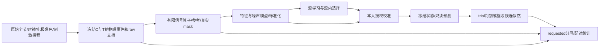

# 2026-10-04 全链科研重审：从物理观测到判别与决策

## 1. 本次裁决

**上轮“全链合同已经闭合”的表述过强，需要撤回。** 新增指纹、TestBudget、相对EA正则与requested默认确有价值，但它们没有解决跨模块关系，更没有形成改善A1/Q1的方法学闭环。本轮以实际源码、已保存开发证据、一手文献、独立反例和真实信号算子对照重新梳理。改进目标是：在同一合法观测/标签预算下保留可判别ERP信息，以可估计的模型处理不确定性；不以接通EA或继续增加损失项作为任务完成标准。

**推荐路线：先补齐正确的成熟强基线，并行研究“实际输入算子传播的噪声协方差”和“连续候选条件似然”；跨库先迁移时间结构，目标空间留在真实观测坐标。** 比较/拟合/执行身份是这些研究的基础设施，不是性能方案本身。十二库共同实测空间不足，否定的是统一完整六导EA的前提，不否定所有异构迁移。

本轮未修改生产算法、未启动公共性能矩阵。研究原型、6人真实C200信号对照、2人边缘模态探针、组合接口反例和方案已完成。未知的真实性能收益仍未知。交付与验证清单在 [validation.json](../assets/system_research_20261004/validation.json)。

## 2. 先还原真正的上下游问题

用一个观测模型理解各层：

\[
X_d(t)=H_d\left[\sum_j h_0(t-t_j)+y_jh_1(t-t_j)\right]
       +N_d(t)a_d+\epsilon_d(t).
\]

H_d包含该库**真实**电极观测和参考投影；h₀是共同诱发响应，h₁是目标增量；N_d含工频、漂移或滤波状态等可声明干扰。该表达是研究模型，不能把未知H_d或N_d当作已经被数据识别。实际模型输入为 `z_i=A_{d,C,i}X_d`，A还包含授权范围、有限滤波、epoch抽取、重采样、baseline、通道映射。

这条链不能被“每层各自合法”替代：baseline改变协方差，mask改变BN加权，归一化改变辅助损失约束的自由度，重叠改变决策证据相关性，缓存复用又可能把旧预测贴上新输入身份。核心问题是这些组合关系有没有被共同建模与验证。

### 2.1 保留的旧结论及其限度

- 旧LOSO约.74511与当前整库留出+本人前缀不是同一估计量；通道、频带、窗口、准入人员和test队列均有变化。原始.74511预测仍未在本轮找回，不补造。
- 先前对已存主AUC/AP/BACC的复算没有发现普遍算术/正类方向错误。本轮不重跑数万条相同算术来充当进展。
- 已核四库K200：A0Q0=.69949、A1Q1=.68948、交互−.00844；Q1在三个binary-only目标只有prior，在BNCI才同时包含decision。三库prior-only@A0约+.00273，不支持“一切prior均无效”。这些沿用 [09-29配对证据](unified_optimization_20260929.zh.md)，不是新性能结果。
- BNCI的加权项占K200负交互点估计81.05%，是算术分解，不能解释为decision的因果责任比例。输入边缘是四格共有暴露，可能与适配敏感性相互作用，但共同缺陷本身不能证明交互病因。
- 当前统一模型仅1279参数（当前构造器实测），并非巨大深网。更优方案必须靠更合适的结构/估计和可用信息，而不是套用“大模型过拟合”话术。

## 3. 新增实证：哪里使旧方案陷入局部修补

完整证据分三路：[接口](../assets/system_research_20261004/interfaces/report.zh.md)、[学习](../assets/system_research_20261004/learning/research.md)、[文献与方法](../assets/system_research_20261004/literature/report.zh.md)。下表是本轮新增，不能反推历史矩阵必然触发。

| 发现 | 本轮实际验证 | 整体含义 |
|---|---|---|
| 外部compact结果导入未核新scope/执行身份 | 真实executor接受取反test X，仍复用旧AUC=.49；直接新输入应=.51，却给复用cell新input digest | 必须先验证原执行关系，再复用；新增hash字段本身不证明计算来源 |
| EA授权/state/output只是分别自证 | 授权0、1行，却用2、3行×7及不同scope拟合，保存/加载/父验证全过；相对合法输出误差.8614 | 授权必须来自计划，fit与transform收进同一个Module，不让调用者自行拼证明 |
| per-domain遗漏域仍发布 | CLI只拟合A域，B域未写入内容依然保存；allocation sentinel反例确认 | 完整row→state路由是发布前置条件 |
| 旧EA伪物理输入普通checkpoint仍接受 | `save/load→PreparedTransferCheckpoint→trunk_for_target`实跑通过 | 单个promotion入口封堵不等于统一模型入口受保护 |
| valid共同cohort点估计正确，原支持原因丢失 | 左臂仅一个replicate缺失，被报告成两臂所有replicate缺失 | 先保存原支持账本，后选择analysis cohort，不能反推缺失原因 |
| 相同数值指纹被误作所有比较的必要条件 | 合法旧/新滤波对照同物理事件、不同X被统计器拒绝；旧helper又能接受不同test指纹 | 复用与科研对照需要不同等价关系 |
| 当前xDAWN几何基线缺ERP原型交叉块 | 实际类对X→−X及时间置换的score不变；构造ERP任务裸cov AUC=.5，官方增广及波形LDA=1 | 它不能代表正确的ERP模板增广成熟基线；合成能力差异不等于公共收益 |
| CE域等权不代表BN域等权 | 两域trial数相同、6导/+1与1导/−1，实测BN均值5/7，域均值0 | 域、参与者、trial和electrode trace的统计风险必须分开声明 |
| 辅助损失对齐角度，head读取未归一化特征 | 两域features×.25/×4，SupCon+MMD不变，head logit最大变化12.89 | A1没有约束径向自由度；不能据aux低值宣称决策表征域不变 |
| 决策标签支持远小于flash数 | BNCI单selection membership Fisher在evidence坐标秩10；K200只1个完整selection | 不能靠重复抽组或调γ补出独立decision信息；rank不是总模型样本量 |
| 成熟Toeplitz前提与当前baseline不相容 | 179点AR(1)经26点baseline后偏离Toeplitz .46034；普通Toeplitz投影还能破坏PSD | 需要重建输入或传播协方差，不能只替换classifier名称 |

现有相关测试通过的同时，接口组合反例仍成立。上轮测试结果保留其实际意义，但“测试全过→科研全链完成”的推断不成立。

## 4. 输入算子：本轮确实尝试并否决了简单替换

新的 [信号原型](../assets/system_research_20261004/signal/report.zh.md)保持生产epoch FFT/crop/baseline，比较相同无限传递函数的低通先行拆分、even边界及固定谐波特解。

| 候选 | 最关键的结果 | 本轮判断 |
|---|---|---|
| 同SOS因子低通odd先双遍 | 8mV/50Hz最坏末epoch仍5341.84µV，原5343.18µV | 没解决问题，不晋升 |
| 低通even先双遍 | 50Hz降到2376.09µV；BI02末事件7150→495µV，但BI26的2883→3264µV、BI49恶化 | 有局部效应，稳定性不足，不选它当“最佳算子” |
| 固定谐波特解 `F(I−P50)+g50P50` | 精确50Hz误差约1.6e−8µV；50.01Hz即4771.19µV | 只在窄假设成立，频漂足以否定通用部署 |
| 硬删边缘状态子空间 | 两人真实有限段误差能低秩表示，却删掉示例ERP约63%能量 | 不能把干扰不变性等同保真；转向软不确定性 |

六名BI的24条完整C200处理均保存，含固定编号对照而非只挑成功者。工频/ERP/慢波是分开的目标；全record参照只作诊断，不能作为未来信息注入源/本人拟合。

更合理的成熟起点是 **频率/幅相变化受检的工频专用回归**，如CleanLine类短窗估计、鲁棒sin/cos回归；适用时再比较ZapLine类空间清理。每段独立，窗口不能跨授权边界；频率规则与robust阈值源内冻结，若重新从test整段估自适应参数，必须显式归为相应离线/无标签自适应协议，不能混称冻结预测。少导、工频与ERP共空间、glitch、漂移均可使其失败。

**放弃“无假设复原无限上下文”这一不可能的统一目标。** 两个区间外不同、区间内相同的连续信号，有限算法无法区别；无限IIR结果却可能不同。应评价授权范围内的干扰误注入、ERP可区分性、后续风险和延迟。未来BrainSync可真正采集pre/post-roll或保留因果过去状态，另建协议计等待成本；不改写旧独立scope结果。

## 5. 成熟方法应先成为端到端强对照

### M1：ERP原型增广几何，而非裸trial协方差

在合法训练范围计算ERP原型P和xDAWN变换，构造 `C_i=Cov([P; WX_i])`，保留`P(WX_i)ᵀ`交叉块，再做收缩/切空间/判别。复用官方 `XdawnCovariances` 的真实语义，不自行删掉关键交叉块后沿用相同名义。模板、空间滤波、几何原点与head必须共同保存/重载，test不能更新。

先做target-native target-only，与同布局SLDA匹配；无需等待十二库公共六维空间。小K/少正例/缺导可让它变差，nfilter不得超实测秩。相同物理输入上比较模型，不能把新增原生通道的收益归成几何算法收益。

### M2：标准ToeplitzLDA，并显式隔开输入贡献

官方方法要求不做逐epoch baseline、等宽时间bins、规定flatten顺序以及合法PSD处理。建议最小桥接：

1. 当前输入＋当前波形SLDA；
2. 同物理事件/参考/频带，但新声明无baseline输入＋相同SLDA；
3. 与2完全相同输入＋标准ToeplitzLDA。

`2−1`是输入处理差异，`3−2`才是估计器差异。另可按原论文频带/采样完整复现为单独route，不能把0.5–16Hz/40Hz顺带换入3而仍称单因素。不能从已经baseline的cache恢复丢失均值，必须消费raw或合法未baseline中间量。

成熟方案的含义是已有公式和稳定实现可踏实移植，不是预先保证胜过full-fine。当前CE full-fine/同结构scratch/波形LDA继续保留，给各路线同等source-inner或calibration内选择预算。

## 6. 更值得投入的创新轴

### R1：实际算子传播＋边缘状态边际化的判别协方差（优先原型）

把信号算子与统计模型接起来。若raw噪声协方差为Σ，实际有限线性算子为A，边缘状态模态为B，Γ为state协方差，Ω=Cov(ε,a)，则一般需要联合传播

\[
C=[A\ B]\begin{bmatrix}\Sigma&\Omega\\\Omega^\top&\Gamma\end{bmatrix}[A\ B]^\top+\lambda P_{\rm identifiable},\qquad
w=C^\dagger(\mu_1-\mu_0).
\]

只有raw残余噪声与边缘状态不相关（Ω=0）时才简化为`AΣAᵀ+BΓBᵀ`。人工截段误差来自同一raw，不能默认独立；源内需要估联合PSD协方差，或先残差化明确Σ/Γ分别解释的成分，防止重复计算。反方审查后新增[相关性反例](../assets/system_research_20261004/signal/probe_joint_uncertainty.json)：ε=a、方差各1时真实总方差4，直接相加仅2；a=−ε时真实0，相加仍2。

Σ需从授权raw/未baseline中间量估计；A包括真正执行的滤波、采样网格、baseline和参考。B由已知滤波状态模态经同一A传播；Γ表征未知状态，不从test真标签或oracle拟合。baseline `Q=I−1bᵀ` 会产生

\[
Q\Sigma Q^\top=\Sigma-1b^\top\Sigma-\Sigma b1^\top+(b^\top\Sigma b)11^\top,
\]

其相对Σ修正rank≤2，但原Σ不能由已丢信息的QX唯一恢复。只在输出可识别子空间正则，不能把baseline零方向或未测导当信号维度。大矩阵可用Kronecker/Toeplitz结构与Woodbury，而非构造整个record稠密协方差。

本轮真实BI01 event199差RMS=1522.88µV，10维数值边缘子空间残差4.8e−10µV；可是硬删它会损失示例ERP 63.13%能量。`Γ→∞`不是推荐，软模型才可权衡；在event100本就几乎无端点误差，不应相同强度清除模态。已知高斯噪声的构造例soft方向改善SNR²，而Γ错配干净数据又下降，正反证同时保留。

**完整decision不能把epoch噪声当独立量重复计算。** 共享raw重叠与同一个端点状态都贡献跨epoch协方差：`C_ij=A_iΣA_jᵀ+B_iΓB_jᵀ+A_iΩB_jᵀ+B_iΩᵀA_jᵀ`。整体block保留这些交叉块；只保留边缘项仍会漏掉raw重叠。这正是R1与R2要共享的事实。

Γ可先从**源训练子集**的人工截段与其合法长上下文对照估先验，再在其他源内留出人员上选择。目标C只拟少量修正；内部选方时仍须重新按inner范围拟合。若只有oracle Γ能赢，合法估计不能赢，停止此路线。

零均值、类间共同噪声是模型假设：若边缘误差具有系统均值，应另建`B m_a`；若污染与标签/刺激历史相关，单纯膨胀协方差不能消除混杂。还应开放一个**改变算子族**的独立route：有限支持低通/抗混叠保留低频，把DC/慢趋势作为有先验的nuisance进入似然，而不强制执行0.1Hz长记忆高通。它可能保留慢ERP，也可能失去drift可识别性；需要同raw支持的成熟SLDA桥接与趋势/ERP共线反例，不能沿用旧source权重或宣称等价预处理。

### R2：连续候选条件似然，直接建模重叠与决策（高潜力）

现链先把重叠raw转换成多份trial，再把score累加，易把相关信号当重复独立证据。另一种分解是：source/calibration拟合低维事件核h₀、目标增量h₁和噪声，test对每个候选q用公开刺激membership构造

\[
m_q=D_{\rm all}h_0+D_qh_1,\quad
\ell(q)=-\tfrac12(x-m_q)^\top C^{-1}(x-m_q)+\log\pi_q.
\]

同一block的每个raw样本只进似然一次；共享nuisance按相同先验积分。C若随q变化必须补`−½logdet C_q`，不能靠更大的候选方差无罚获利。已知schedule可用于各假设q，隐藏test真目标绝不能用于构造D_q。连续记录中相邻未知decision也要共同建模/边际化或使用预声明合法支持，不能把邻居真标签当context。

上述首先是**固定事件核的plug-in原型**。小C下h₀/h₁估计有不确定性；要主张概率/NLL可信，须在合法拟合后传播核协方差，例如独立条件下`C_q=C_noise+D_q V_h D_qᵀ`并保留logdet，或通过源内独立验证校准。V_h仍是待估量，不是oracle。新增标量反例中忽略核不确定性的后验约.999999998，正确积分仅.86035，不能因似然用了raw而默认置信度可靠；相关参数与状态则仍用完整联合传播。

该路线把“重叠是不是噪声”“trial AUC与hit不一致”“decision样本少”放在同一统计对象里处理。借鉴rERP/unfold的连续响应估计，但候选条件生成判别是本项目组合研究，不能说文献已验证这里的收益。

**可识别性约束比模型复杂度更重要：** 固定SOA设计可能秩亏；本轮24参数定周期设计rank8。需检查去nuisance后的候选均值差 `m_q−m_q'` 能量与校准设计秩，不用一个笼统“设计rank>0”宣称所有参数可识别。使用源内冻结时间字典，目标只估少量增益/潜伏期或核系数；G=1不能自由学习数百lags。随机刺激、折返/不应期、时钟误差、非线性ERP叠加均须成为反例。

主评价为合法candidate库requested `hit@all`、NLL、coverage和时延；binary-only库可贡献时间基/噪声研究，不伪造candidate标签，不把candidate路线硬塞成trial AUC比赛。

### R3：跨库迁移时间结构，空间判别保留真实观测（更易实施）

源内按域/人权重学习低维时间基 `B_t∈R^(T×r)`；目标在自身实测电极上计算`Z=X_observed B_t`，以本人C拟合收缩判别。源时间字典和超参不读当前留出目标库；mask、电极角色、参考仍是显式输入，不为构造协方差插值补导。

与固定通用平滑基、target-only时间基、现source-feature LDA和full-fine比较，才能区分“来自源的可迁移信息”和“降维正则”。r、延迟候选和是否借源在源内冻结；目标选择只用合法C，不能按最终test挑source或逐trial自由warp。

这绕开全源共同六导EA的必要性，但不宣称参考差异自动解决。若扩展原生ERP几何TSA矩形对齐或Bayesian Signal Matching式选择性借源，须另验证标签锚点、秩与参考；TSA原文主要同库跨人，未验证本项目跨库异montage。未知观测空间保持不确定，不把模型推测当实测。

## 7. A1/Q1应如何重新诊断

不再让EA成为prior/decision诊断的前置依赖，也不立刻重扫辅助系数大网格。

1. **A1首先查作用空间。** 记录合法源内样本上的feature半径/角度、域/真实mask、head响应；量化CE与aux梯度方向及经过同一Adam状态后的实际一步变化。归一化feature的aux径向盲区已证实，实际训练是否利用它尚待检查。不能直接强压半径，因为ERP幅度可能有用。
2. **Q1按信息支持裁定更新容量。** 三库prior-only与BNCI prior+decision拆开。K、正例、完整decision G、目标覆盖、录制状态和更新次数都入账。BNCI K200 G=1时推荐trial-only或源内冻结的decision规则作为默认候选；要检验joint，先将其限制在低自由度head并明确无独立target组级验证，不以任意G阈值称“充分”。
3. **只在真正启用decision的BNCI做必要拆分。** 在同输入、同执行身份下比较trial-only、+prior、+decision、+二者；复用已有合法四格/源权重，只有缺失的处理才新增。source A0/A1作为阻断/处理因素，scratch监督也匹配。这是有限归因，非重新启动十二库全部loss扫描。
4. **不把推理temperature当hit修复。** 等覆盖下正temperature及共同offset不改argmax。均匀复合相关同样只改scale；本轮20000合成序列GLS与sum排序完全一致。不等可靠度虽可带来oracle收益，但小C若估不准Σ，就没有可部署增益。

原执行每折λ与checkpoint/recipe绑定须从产物取证，缺失就保留缺失；0权重的记录不能用于支持prior伤害机制。补查范围和结果写在学习分支附录。共享A1参考预算估计的是冻结策略包，不是每种算法各自最优配方。

本轮补查9份本地十二库结果JSON及相关忽略目录，没有恢复09-18实际λ；但原分析器明确在`analysis/cells.csv`和`analysis/normalized_cells.json`保存实际`recipe.source_prior_weight`。最小恢复是这两份之一、`matrix/target_jobs.json`及关联`selection.json`，不需要重训；09-16四源λ=.1不能替代09-18。这一补证是源prior因果解释的前置条件，不阻碍其他成熟基线研究。

## 8. 实施要形成纵向切片

使用已有Module和真实Seam，避免另造一个巨型runner。

| 切片 | 贯通的owner/Interface | 必须验收的可观察行为 |
|---|---|---|
| E0 证据与对比 | `epochs/source_records→evaluation contract→result_reuse→stats` | 分开EvidenceCohortIdentity、MaterializedInputIdentity、ContrastPlan；同物理事件允许预声明算子变化，数值变化不得复用旧预测；fit与score都绑定 |
| E1 授权状态与发布 | split/plan产生AuthorizedFitView，EA/其他拟合Module消费 | state scope/rows/people/dimension/actual buffer→transform→output共同核验；遗漏域不发布；只读预测拒refit；历史非物理cache不能进入物理模型 |
| E2 成熟基线 | `Baseline.fit/predict_logit→calibration_candidates→checkpoint/calibrated` | ERP原型/噪声/tangent/feature顺序同包保存；真实scope拟合、未知label预测、逐score重载 |
| E3 算子与噪声联合 | `preprocess→raw scope/views→noise model→baseline/decision` | A、B、Γ及跨epoch相关可追溯；ERP/工频/慢波/缺导攻击；input identity与旧模型不混用 |
| E4 源与校准策略 | source catalog/matrix、TargetRecipe、SubjectAdapter | source-only字典和选择、独立decision预算、匹配scratch、requested全部保留 |
| E5 结果与产品 | outcomes、stats、个人只读推理/BrainSync协议 | raw样本/decision不重复计权；operational hit、延迟/coverage和public/device结论分开 |

E0/E1是已有成熟工程问题，应直接修；不能为设计新算子继续拖延。E2和独立信号原型可以并行；E3/E4真实性能执行依赖E0/E1。报告“feature artifact存在”不再等于“EA route可用”。

## 9. 最小且可归因的下一轮实验

[contrast_plan.json](../assets/system_research_20261004/contrast_plan.json)给出未执行设计。旧四个目标库已是反复查看的development，不能重新叫确认集。所有新路线上游状态只用源内/授权C；独立adult和封存外部集本轮不使用。

| 阶段 | 问题与最小对照 | 放行/停止规则 |
|---|---|---|
| S0 软件关系 | E0/E1反例、保存重载、原支持账本 | 旧预测错贴新身份/非法fit/缺域发布任一仍成立，不启动性能矩阵 |
| S1 成熟统计 | waveform SLDA，M1 ERPcov；M2用有/无baseline桥接；共同A0Q0+scratch | 库内人配对、库等权；控制输入变化轴、算法选择机会与成本；报告失败而非删人 |
| S2 输入研究 | 固定物理队列，原输入 vs 源内选定的一个合格信号方案 | 先过工频漂移/glitch/ERP保真/持续污染；本轮3个简易新算子不放行；无合法胜者就保留原输入锚点 |
| S3 两个创新原型 | R1基础cov vs propagated cov vs +软边缘项；R3固定通用基 vs source时间基 | 各模块增量明确，源内选方后锁定；只能oracle参数有益则停止 |
| S4 decision结构 | sum score vs 冻结噪声GLS vs R2连续似然；BNCI有限prior/decision拆分并行 | 同membership、G、真目标隐藏、requested schedule；不以NLL提高冒充hit提高 |
| S5 复核 | 候选完整route与最强已验锚点，三个完整流程配对seed；BI家族敏感性另列 | 不做每人/每K后验赢家拼接；公开开发与未来成人确认分开 |

窗口试验改为分离两种问题：在同一最长合法raw支持下比较真正重新epoch/resample的600/800/1200ms，回答读出信息；另用改变真实raw截止和所需等待的完整route比较，回答部署代价。前者不声称减少获取延迟，后者不伪称只改窗口。共有事件由最长支持在评分前确定，并另报全部请求的不可评分量。

沿用既有几何/zero-shot route的四库等权ΔAUC≥.01门槛时，仅对其原定义的比较使用；不能直接拿来判candidate连续似然优劣。新的candidate路线在执行前需要预声明operational hit改善与coverage/latency容忍度，不能事后挪阈值。

新矩阵参数表可以采用seed20261004/05/06（这是建议的新声明，不是已经运行）。没有足够内层支持时不临时借test，不伪造K0的target-only拟合，也不把预算回退混为精确K。

## 10. 文献、研究覆盖与剩余不确定性

本轮核查15组一手来源，明确全文、摘要、元数据和请求失败：[来源表与原始抓取](../assets/system_research_20261004/literature/report.zh.md)。关键依据包括：ToeplitzLDA [10.1088/1741-2552/ac9c98](https://doi.org/10.1088/1741-2552/ac9c98)及作者代码；Unfold [10.7717/peerj.7838](https://doi.org/10.7717/peerj.7838)；鲁棒去趋势/工频回归 [10.1016/j.neuroimage.2018.01.035](https://doi.org/10.1016/j.neuroimage.2018.01.035)；Zapline-plus [10.1002/hbm.25832](https://doi.org/10.1002/hbm.25832)；TSA [10.3389/fnhum.2022.1049985](https://doi.org/10.3389/fnhum.2022.1049985)。标准协方差传播、Woodbury和线性状态表示是数学基础，本仓库组合路线的收益还没有文献或实测代替验证。

| 研究模块 | 出口证据 | 本轮状态 |
|---|---|---|
| 历史上下文与估计量 | 旧审计/分层结果复核、共享因素与交互区分 | 完成研究综合；旧缺失原件仍缺失 |
| 代码/接口组合关系 | 7类复审发现、当前真实executor/CLI反例 | 完成审计；生产修复未执行 |
| 文献与成熟算法约束 | 15组来源及方法反例 | 完成有界调研；非系统综述 |
| 信号算子与新方向 | 4路线×合成、6人×4路线C200、2人×5事件子空间 | 完成诊断；无性能结论 |
| 学习/决策机制 | 实际BN、aux、xDAWN、Fisher和GLS反例 | 完成机制能力验证；非病因因果识别 |
| 整体spec与实施依赖 | E0–E5、S0–S5及JSON设计 | 方案完成；未实施完整新route |
| 公共新性能/成人确认 | 无 | 未执行，不声称完成 |

剩余最重要的不确定性是：真实ERP/噪声是否满足结构假设、源内估得的Γ/时间基能否跨库、小K的decision信息是否足够、修复后同物理测试队列上是否稳定胜过成熟锚点。下一轮应让这些问题决定实现与实验，而不是继续围绕EA字段或某个loss权重扩大局部工程。
