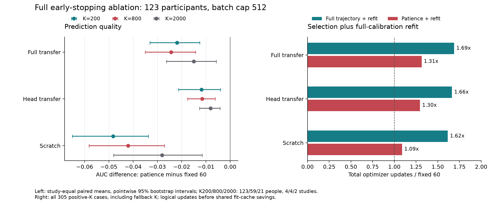

# 目标早停全量结果

2026-09-08。123人完整矩阵已完成并复核。结论是：当前验证CE选轮、patience6与全K重训方案
不适合替代固定60遍。全网、头微调和scratch的三个精确K面板均出现平均AUC下降，计入内层和
重训后的总optimizer更新也未减少。保留早停为实验选项，当前工作基准继续使用固定高预算。

这不证明所有早停策略无效，也没有检验不同指标、patience、最小训练轮数或更可靠的验证数据。
阶段选择和软件实现见[实施记录](target_early_stopping_20260907.zh.md)，当前规范见
[roadmap](../roadmap.zh.md#2026-09-07-目标早停消融)。本次只分析已完成结果，没有新训练或改模型。

## 完整性与口径

- 3173/3173评分成功，0失败；123人、305个唯一实际正K。
- 复用小试218份结果，新执行2955份；无新增source拟合。
- 4880次逻辑拟合请求，3832次实际拟合、1048次精确缓存命中。
- 重算3173份预测的AUC/AP/BACC及raw-sigmoid Brier/NLL，核验3050个保存模型状态。
- 校准/test行、同人共同test标签、评价合同摘要、CE选轮与停止点、全K refit和预算均核对一致。
- 15个配对对比的精确K均值和bootstrap区间从重算后的指标再次计算，与原分析逐项一致。

source/target均单seed20260906，源模型固定为既有六导4000-update基准。目标lr1e-3、最多60遍、
batch上限512。全网/scratch在线BN，头微调冻结源BN buffer/affine；模型内三种停止策略配对。
最终test不参与选轮。所有305个正K都有合法inner划分，本次没有因非法inner而回退的案例。

同人同实际K配对，先库内人均再库间等权；在固定库内重采样participant，10000次bootstrap，
analysis_seed20260907。区间为逐项95%描述性区间，未进行多重比较校正；不作确认性显著声明。
它们条件于本次已拟合source和四个开发库，不覆盖重新训练、新seed或新库的不确定性。

精确K200为123人/4库，K800为59人/4库，K2000为21人/2库（BNCI2014-008、Huebner2017）。
80%回退的实际K、共同三档人群和全部实际K的预算策略面板在完整JSON中单列。
不同K的人群、训练数据量与更新次数不同，不能把跨K均值差当成纯标签量效应。

## AUC主结果

| 模型 | 策略 | K200 | K800 | K2000 |
|---|---|---:|---:|---:|
| 全网迁移 | 固定60遍 | **0.7058** | **0.7673** | **0.8334** |
| 全网迁移 | 完整轨迹选轮+refit | 0.6888 | 0.7562 | 0.8312 |
| 全网迁移 | patience6+refit | 0.6839 | 0.7430 | 0.8184 |
| 头微调 | 固定60遍 | 0.6519 | 0.6924 | 0.7320 |
| 头微调 | 完整轨迹选轮+refit | 0.6462 | 0.6835 | 0.7278 |
| 头微调 | patience6+refit | 0.6401 | 0.6809 | 0.7239 |
| Scratch | 固定60遍 | 0.6564 | 0.7425 | 0.8290 |
| Scratch | 完整轨迹选轮+refit | 0.6202 | 0.7280 | 0.8194 |
| Scratch | patience6+refit | 0.6081 | 0.7004 | 0.8009 |
| 原波形LDA | 不适用早停 | 0.6918 | 0.7518 | 0.8175 |

全网patience在K200/K800低于LDA，K2000与LDA接近；未显示替代固定高预算的价值。

| 全网配对AUC差 | K200 | K800 | K2000 |
|---|---|---|---|
| 完整轨迹选轮 - fixed | -0.0170 | -0.0112 | -0.0021 |
| 95%区间 | [-0.0279,-0.0081] | [-0.0183,-0.0051] | [-0.0032,-0.0011] |
| patience - fixed | -0.0219 | -0.0243 | -0.0150 |
| 95%区间 | [-0.0331,-0.0125] | [-0.0350,-0.0143] | [-0.0262,-0.0058] |
| patience - 完整轨迹选轮 | -0.0049 | -0.0132 | -0.0129 |
| 较fixed退步比例，库等权 | 57.6% | 59.5% | 84.6% |

这些退步比例是早停相对固定训练，不能称为迁移相对scratch的负迁移率。
全网patience在K200的四库差均为负：BI2014a -0.0403、BI2015a -0.0147、BNCI -0.0215、
Huebner -0.0112；K800也均为负。现象不是仅由某一个库的均值方向造成。
各模型其他对比、逐人差值、p10/最差、回退K与真正迁移-minus-scratch差均见`analysis.json`。

## 为什么不能只归咎于patience

即使不提前停止、跑满60遍后再按验证CE选轮，full仍然下降。所以上述结果不能只归因于
patience太小；校准内划分、CE选轮以及选中轮数迁移到全K重训的整体策略同样未带来收益。
验证集较小带来的噪声、验证CE与目标AUC不一致、inner与全K训练条件不同，是待单独检验的
解释，当前矩阵不能确认唯一原因。

此外，K200/K800/K2000分别有28/123、16/59、8/21个full案例，其完整轨迹选择的最佳CE轮数
晚于patience实际停止点。这支持过早截断也是一部分问题，但这里比较的是配对训练轨迹，
不是用final test寻找理想停止时点。

概率诊断没有显示用AUC换取更好概率误差的收益：full patience相对fixed的AP下降
0.0262/0.0296/0.0258，BACC下降0.0210/0.0179/0.0135；raw-sigmoid Brier增加
0.0341/0.0249/0.0082，NLL增加0.0676/0.0572/0.0205。Brier/NLL越低越好，且本次未作外部概率校准。

Scratch受早停影响更大，因此迁移-minus-scratch差反而变大。以K200为例，该差从固定训练
约+0.0494增至patience约+0.0758，但迁移本身AUC已经从0.7058降到0.6839。
不能把削弱scratch后扩大的差距解释为迁移方法得到改善。

## 成本与停止轮数

以下汇总全部305个实际正K，含回退档，按相同请求队列累计；更新数包括inner与全K refit。

| 模型 | fixed总更新 | 完整轨迹+refit | patience+refit | patience相对fixed |
|---|---:|---:|---:|---:|
| 全网迁移 | 32220 | 54424 | 42359 | +31.5% |
| 头微调 | 32220 | 53632 | 41755 | +29.6% |
| Scratch | 32220 | 52071 | 35107 | +9.0% |

| 模型 | patience提前停止比例 | inner轮数中位数 | 选中/refit轮数中位数 |
|---|---:|---:|---:|
| 全网迁移 | 59.7% | 50 | 44 |
| 头微调 | 55.1% | 54 | 48 |
| Scratch | 65.9% | 38 | 32 |

patience确实使部分inner提前结束，但还要再用完整校准集拟合，因此总体优化工作并没有减少。
上述更新数不含验证forward，不能直接等同于GPU FLOPs或墙钟比例。
同一矩阵复用了其他策略已经完成的相同refit，full patience物理更新降为27542、累计cell耗时
237.81秒，而fixed为32220更新、272.86秒。前者包含缓存及执行顺序收益，不能证明独立运行
patience比fixed快。当前没有无跨策略缓存的独立墙钟对照，不把31.5%更新增幅写成31.5%耗时增幅。

续跑从2026-09-07 23:55:25到2026-09-08 00:01:59，墙钟393.96秒；这是115人新任务及最终
全队列分析的时间，不含此前8人试跑。8个CUDA进程，启动采样GPU100%；完成后GPU0%、2 MiB。

## 保存与后续

继续以固定60遍的全网迁移作为当前工作基准，保留同K scratch和LDA。ES实现保留为显式消融
能力，当前不启用为产品默认，也不通过这次test成绩逐人挑选停止方案。今后另改指标或停止规则
须独立声明，再按完整队列验证；本次未触及source早停、Mainsah、额外seed或成人九选一确认。

原始分析与审计位于`experiments/runs/early_stopping_full512_20260907/`：
`analysis.json`是完整15对比，`diagnostics.json`是多指标差及停止点诊断，`integrity.json`
是复核结论。解压后的`current/verified_cells.json`包含逐人指标及实际/物理成本。
模型、预测、记录和执行源码归档在`full_results.tar.gz`，127464582字节、6255成员，
SHA为`7e03b2aaafa292cc9d06998a2304aab6e7df45b457b12e02e9a2ca759dc5c835`。
每个归档成员已从压缩流重算，云端/本地整体SHA一致；原小试文件和来源不改写。
完整[归档清单](../../frozen/early_stopping_20260907/full_results.manifest.json)保存在Git分发范围，
结果包、模型和预测仍仅保留在本地结果目录。
评价源码仍为8f92f87c完整快照，未混入后续并发QC实现。审计脚本SHA为
`185675674bb1d9398dcff047bed162a99eb79e55b76a350c015d0dce8801f6cc`。
本次相关统计测试11项通过，全仓Ruff和`git diff --check`通过；效应图已检查文字与图例布局。
