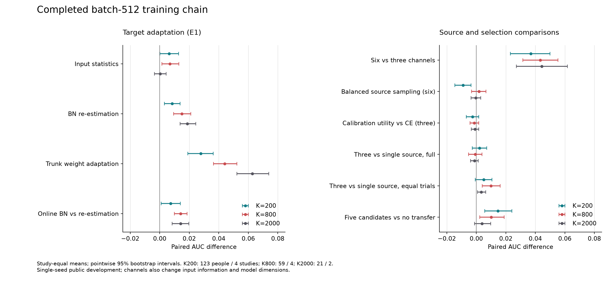

# batch512训练链条完成结果

2026-09-07，公开开发，source/target单seed20260906。有效实验范围见
[执行计划](../roadmap.zh.md#2026-09-07训练链条验证方案)，实现与历次续跑见
[实施记录](training_chain_implementation_20260907.zh.md)。本次分析没有重新训练或修改模型。

## 结论与建议

当前证据支持保留六导实测输入、目标校准统计、在线BN及完整trunk微调。迁移主要在小校准预算
下有价值；高K相对scratch的平均收益很小，不能保证逐人受益。更复杂的源统计加权、域/人采样
和校准效用选模没有稳定的额外收益，不建议继续把它们全部放进默认大矩阵。

建议下一轮以六导`observed_rows + uniform_rows`、固定4000 source updates为工作基准，保留
scratch和原波形LDA。S1复杂统计/采样、E2完整校准效用网格、S2全量单源遍历暂不重复排程。
固定剂量多源的小幅收益可留作一个针对性复核；这不是宣布其机制等效或无效。
E3五候选有容纳无迁移方案的作用，但未稳定超过仅迁移选择器；是否采用取决于是否需要个体化
退回scratch/LDA。以上是看过开发成绩后的建议，没有修改产品默认值或启动新实验。

## 完成度与复核

| 项目 | 完成结果 |
|---|---|
| E1 | 6528/6528外层评分，0失败 |
| E3 | 1038/1038外层评分，0失败 |
| S1/E2/S2源任务 | 95/95，含选后refit；0失败 |
| 本次续跑新增物理拟合 | 41次、189500 optimizer updates |
| 本次源任务复用 | 54次，其中45个已完成任务、9个相同轨迹复用 |
| E2源内评分 | 7050/7050，8组选模曲线及CE/校准效用/零校准选择全部重算一致 |
| S1/E2/S2外层 | 90个计划、720个分片、37568/37568评分，0失败；16966个评分记录精确复用 |
| 完成后的预测审计 | 45134外层+7050内层，共52184份预测逐项复算通过 |

审计重算AUC/AP/BACC、原始sigmoid Brier/NLL；对原记录已有指标逐项核对。重算校准/test行摘要、
evaluation合同摘要、内层加权CE；确认校准与测试无交集、各臂及两布局的同人test行/标签完全一致。
source账本中的整库排他及真实通道覆盖也已核对。未通过重新拟合来验证每个checkpoint的生成过程，
训练来源依据原始执行快照和账本，不把本次审计说成独立重复实验。

最后一次自动并发续跑从20:40:09到21:48:14，墙钟4085.16秒，即68分05秒；包括源链和末尾E1/E3
分析，不含此前完成的E1/E3和45个源任务，不能当作从零执行整矩阵的耗时。完成后GPU利用率0%、
显存2 MiB，无训练上下文残留。实际源码为235成员快照
`5aa716346e2e15bd39665620cd9e6b33d361a60b6b95e9524be31ba236ec544b`。

## 统计口径

以真实participant为配对单位，同人同实际K、同校准与test摘要比较；先库内人均，再库间等权。
固定库内重采样participant，10000次bootstrap，analysis_seed20260907。下列区间为逐项95%区间，
未作多重比较校正；用于探索性开发与效应量判断，不作为多重检验后的确认结论。

| 精确预算 | 人数 | 可估计库数 |
|---|---:|---:|
| K200 | 123 | 4 |
| K800 | 59 | 4 |
| K2000 | 21 | 2，仅BNCI2014-008和Huebner2017 |

80%回退的实际K分别保留在分析JSON，不能混进精确K800/2000。共同三档队列、完整请求分母、
各回退档及同人可用正K平均的预算策略面板均已输出。跨K人群与更新次数同时变化，不能直接解释
为纯标签剂量效应。区间条件于已拟合source及固定开发库，不包含新source抽样、新库和seed不确定性。

## 基准迁移收益

本表是新S1六导基准源模型：`observed_rows + uniform_rows`、source固定4000 updates；目标
完整微调采用batch上限512、60遍历及既定recipe。它与E1/E3使用的历史b版source分开记账。

| 方法/差值 | K200 | K800 | K2000 |
|---|---:|---:|---:|
| Source full AUC | 0.7057 | 0.7671 | 0.8335 |
| Scratch AUC | 0.6564 | 0.7425 | 0.8290 |
| 原波形LDA AUC | 0.6918 | 0.7518 | 0.8175 |
| Full - scratch | +0.0493 | +0.0246 | +0.0045 |
| 配对95%区间 | [0.0368,0.0620] | [0.0153,0.0339] | [-0.0015,0.0114] |
| Full - LDA | +0.0140 | +0.0153 | +0.0160 |
| 配对95%区间 | [0.0051,0.0229] | [0.0024,0.0297] | [0.0059,0.0288] |
| 相对scratch负迁移率，库等权 | 18.7% | 27.5% | 51.0% |

四库K200相对scratch的平均差均为正，但相对LDA并非如此：BI2015a的差为-0.0106，K800为
-0.0045。不能用总平均抹掉某库或某个人的劣化。六导源模型零校准AUC仅0.5789，仍依赖本人校准。

辅助指标同样从逐预测重算。BACC以原始score>0为阈值；LDA与加权NN的分数尺度/阈值含义不同，
不能把AUC收益解释成概率已校准。

| 方法 | K200 AP/BACC | K800 AP/BACC | K2000 AP/BACC |
|---|---|---|---|
| Source full | 0.3874 / 0.6508 | 0.4764 / 0.6987 | 0.6061 / 0.7593 |
| Scratch | 0.3301 / 0.6120 | 0.4468 / 0.6839 | 0.6001 / 0.7551 |
| LDA | 0.3774 / 0.5888 | 0.4573 / 0.6066 | 0.5722 / 0.6641 |

NN原始sigmoid Brier为0.2109/0.1749/0.1570，LDA为0.1581/0.1277/0.1178。
LDA在该概率误差读数更低；这里未增加概率校准程序，也不跨指标挑选“万能赢家”。

## E1：哪些适配起作用

以下是原定I×B×W因素对比：I为目标输入统计，B为逐层校准BN重估后冻结，W为允许非BN的
trunk权重更新；主矩阵BN affine冻结、dropout关闭。主效应是对其他两个轴平均后的条件对比。

| 效应，AUC差 | K200 | K800 | K2000 |
|---|---:|---:|---:|
| I：目标输入统计 | +0.0064 | +0.0069 | +0.0003 |
| B：BN重估 | +0.0084 | +0.0151 | +0.0187 |
| W：trunk权重更新 | +0.0278 | +0.0441 | +0.0627 |
| 在线BN - 一次重估冻结，affine可训练配对 | +0.0074 | +0.0141 | +0.0142 |

W贡献最大，B其次；只调整输入统计不能替代学习参数适配。I×B在K800/2000为+0.0079/+0.0234，
B×W在K2000为-0.0189，说明因素作用有交互，不把三个主效应简单相加解释完整配方。
在线BN对一次重估的对比为补充开发分析；一次BN重估不应凭实现复杂度自动成为默认。

dropout桥接的差为+0.0003/+0.0017/+0.0087，前两档不支持稳定增益；BN affine的额外学习
在不同B/K下方向不一致。统计诊断模型K200约0.59 AUC，单靠替换统计未解决表征适配。
E1原定全部主效应、交互、桥接、失败分母与逐人尾部均保留于`E1.json`。

## S1：布局比复杂源统计更重要

目标均采用full fine，布局内严格配对：

| 对比，AUC差 | K200 | K800 | K2000 |
|---|---:|---:|---:|
| 六导 - 三导，基准统计/采样 | +0.0370 | +0.0434 | +0.0444 |
| 六导：层级统计主效应 | +0.0004 | -0.0007 | +0.0007 |
| 六导：域/人采样主效应 | -0.0089 | +0.0018 | -0.0004 |
| 六导：统计/采样同时更换 - 基准 | -0.0086 | +0.0011 | +0.0003 |
| 三导：层级统计主效应 | -0.0023 | +0.0002 | +0.0007 |
| 三导：域/人采样主效应 | +0.0026 | +0.0027 | -0.0014 |

六导优势的配对区间为[0.0231,0.0499]/[0.0315,0.0554]/[0.0271,0.0617]。
这里同时改变真实输入信息和输入维数/模型容量，不能称为纯粹的“缺导mask机制收益”。
六导域/人采样在K200的区间为[-0.0145,-0.0036]，本轮没有理由默认替换uniform_rows。
层级源统计的效应小且不一致；更复杂不等于更适合当前目标。

## E2：大量校准效用选模回报有限

共同三导上按source内被试/整库留出比较；更新数只由源内数据选择，然后从头refit。

| 外层留出库 | 被试留出 CE / 校准效用 | 整库留出 CE / 校准效用 |
|---|---|---|
| BI2014a | 8000 / 1000 | 1000 / 500 |
| BI2015a | 8000 / 500 | 8000 / 2000 |
| BNCI2014-008 | 8000 / 4000 | 1000 / 2000 |
| Huebner2017 | 8000 / 500 | 8000 / 4000 |

| 外层full fine对比，AUC差 | K200 | K800 | K2000 |
|---|---:|---:|---:|
| 被试留出：校准效用 - CE | -0.0056 | -0.0023 | +0.0018 |
| 整库留出：校准效用 - CE | -0.0026 | -0.0013 | -0.0009 |
| 整库校准效用 - 固定4000 | +0.0033 | +0.0038 | +0.0008 |
| 整库 - 被试留出，校准效用选择 | +0.0070 | +0.0012 | -0.0011 |

在K200，整库校准效用较被试留出有+0.0070的读数，但较固定4000仅+0.0033，区间
[-0.0003,0.0068]；校准效用没有稳定胜过CE。7050个源内评分不能因此视为必要默认成本。
本轮没有评估“删掉这些计算后的训练准确率”，建议来自已执行对比，而不是新训练结果。
零校准选择U_zero及完整候选曲线另存`source_selection.json`，与正K校准效用分开。

## S2：全量多源无稳定优势，等剂量有小信号

均为共同三导；“单源平均”按每个外折允许的三个单源等权，未用外层test挑最好单源。

| 对比，AUC差 | K200 | K800 | K2000 |
|---|---:|---:|---:|
| 三源全量 - 三个单源平均 | +0.0021 | -0.0006 | -0.0011 |
| 固定trial剂量三源 - 单源平均 | +0.0050 | +0.0099 | +0.0034 |
| 同时排除BI两库 - 普通整库排除 | -0.0033 | -0.0010 | 不可估计 |

全量差的区间均跨0；K200在BI2014a/BI2015a为正，在BNCI/Huebner为负。
等剂量各臂3072个唯一trial：三源每库8人×128，单源8人×384；优化更新相同，但人数24与8不同，
因此不能把收益完全归因为域数。K800差+0.0099，区间[0.0041,0.0162]，四库方向均为正，
可作为一个后续复核候选，尚不足以支持反复运行完整多源网格。
整族排除只有BI两库102人/38人的K200/K800可比较，区间均跨0；没有合法K2000结果。

## E3：五候选提供退路，未稳定超过仅迁移

这是历史b版source上的校准内选择，不与新S1六导source拼作严格单因素比较。

| 选择器/差值 | K200 | K800 | K2000 |
|---|---:|---:|---:|
| 五候选AUC | 0.6861 | 0.7669 | 0.8322 |
| 不迁移候选AUC | 0.6714 | 0.7567 | 0.8283 |
| 仅迁移候选AUC | 0.6893 | 0.7657 | 0.8339 |
| 五候选 - 不迁移 | +0.0147 | +0.0101 | +0.0039 |
| 五候选 - 仅迁移 | -0.0032 | +0.0012 | -0.0017 |
| 五候选选择非迁移方案比例，库等权 | 62.3% | 55.7% | 51.0% |

五候选较不迁移的区间为[0.0058,0.0241]/[0.0023,0.0188]/[-0.0011,0.0097]；
较仅迁移的三个区间都跨0。选择非迁移不等于证明该人迁移有害，inner选择也会有噪声。
候选程序共用完全一致的拟合缓存，记录耗时含命中成本；不能用五候选的增量计时声称它独立执行
比仅迁移更快。新默认如何取舍应同时看部署成本与外层验证，不能按每个人test选候选。

## 图与可复核产物

本地结果：`experiments/runs/training_chain_auto_20260907/completed_analysis/`。
`verified_cells.json`包含逐人、实际K、五个重算指标、预测路径与SHA；各阶段JSON保留完整
配对、分库、共同队列、p10/最差及回退K。`readout.json`提供精简视图，`primary_metrics.json`
补充基准AP/BACC/原始概率误差。图的SVG同目录可导出。

分析程序及其依赖源码归档在结果包；analysis脚本SHA为
`43d88bcd364ebb7793e07123434b0dd26ee97d5ed33e6e46fd775a4b5acc87d4`。
分析包`completed_analysis.tar.gz`的SHA为
`454b2517e4b5fedfb3fcd017f8a0e7923906f1ee90760df4334721b1fad5ee64`。
预测证据包`completed_prediction_evidence.tar.gz`包含52937成员，逐成员从压缩流重新计算SHA通过，
整体SHA为`8fb587823468319174baa7d393d7b7bbe52401dc7113755c75914e7372eb774b`。
两个包均已回传，云端/本地SHA一致，见[归档摘要](../../frozen/training_chain_auto_20260907/completed_results.manifest.json)。
成员原路径及摘要见结果目录的`completed_evidence.manifest.json`；输入cache和源checkpoint
仍保留在原云端目录，未混入本次预测包，也未删除或改写。

本次分析相关统计测试11项通过，Ruff与`git diff --check`通过；没有更改训练实现。

本次没有Mainsah、额外seed或新的成人/设备确认。公开binary AUC不能替代BrainSync九选一
hit@R5；这里的开发建议不能继承“对新数据未见”的确认身份。
