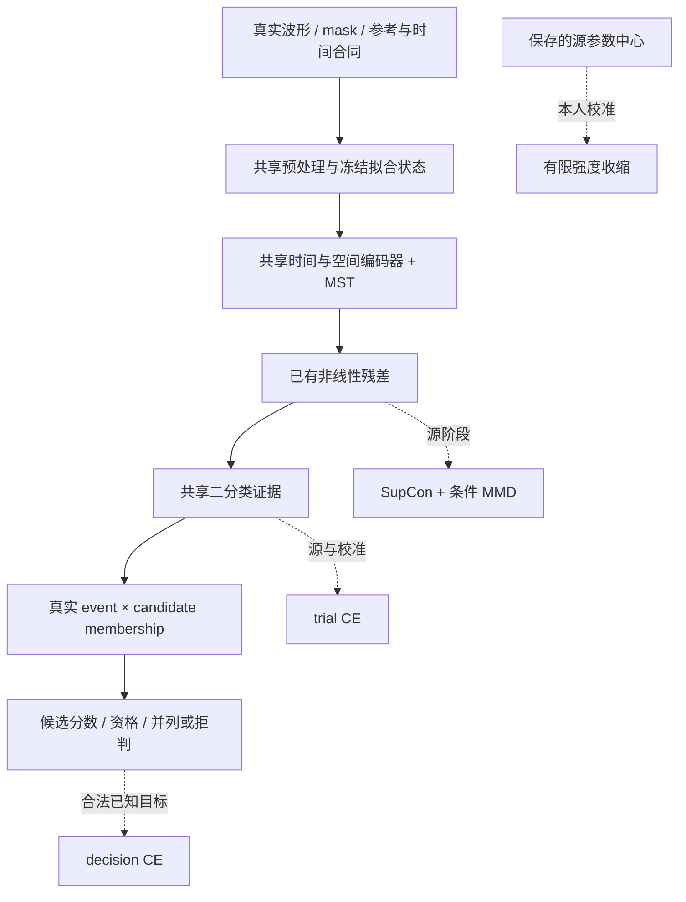

# 统一 P300 模型：科研裁决、数学合同与实施方案

日期：2026-09-16。共享模型、raw作用域、联合损失和保存链已实现，软件验收见[实施记录](unified_model_implementation_20260916.zh.md)。用户随后允许按阶段选择停止方法，当前排程改为[精简训练方案](unified_compact_training_20260916.zh.md)：源内参考选轮、共享源预算、个人固定90轮及两包2×2。执行器差异已落实，见[预算与性能验收](unified_budget_execution_20260916.zh.md)；未运行新真实矩阵。
本次检查当前源码、前轮修复、历史开发证据，并联网核查原始资料，执行独立数学反例。
既有 P1/P2 云端实验仍有独立执行身份；本方案不改写其模型、预处理或结果含义。

## 1. 研究问题与本次决定

目标是交付一个自足的个人模型：同一物理输入合同、同一编码器和个人适配机制、同一候选决策公式，
在源预训练、本人校准、未知目标推理三个阶段连续使用。模块之间由联合目标传递梯度，
产品不再以“每次挑一个完整模型”作为长期算法主体。

本次推荐的首个实现为：**N2P3Net 共享编码器＋已有非线性特征残差＋源参数中心的有限收缩适配＋真实 membership 决策层**。
源阶段开放 CE、SupCon、条件 MMD 的显式组合；本人阶段开放 trial CE、真实 decision 损失和收缩项。
先提供这一可独立验收的统一程序，再研究保持原生参考信息与源内 episodic 训练。
推荐的是待证伪的完整候选，尚没有证据证明所有附加项都应成为部署默认。

三个改变有直接依据：

1. 当前六导主网仅 **1202 参数**，全网适配不天然需要庞大的个人模型。有限收缩允许各层连续调整，
   可以替代大量永久冻结组合在产品路径中的角色；强度由合法源内开发决定。
2. direct9 与 row/column 都可写成同一个候选归属矩阵。固定的物理聚合本身完全可微，
   decision 梯度可以直接训练已有编码器，不必先添加一个高容量“猜数字网络”。
3. SupCon、MMD 是训练目标，残差是结构，BN 是拟合状态；它们没有必须互斥的数学原因。
   联合接口现已统一批次、风险和单次更新语义；实际剂量由共同早停程序决定并分别记录。

方案成立的边界也要清楚：统一模型不能恢复从未测到的 EEG、凭 binary 标签创造真实候选组，
或让只读推理获得重新拟合的权限。质量和时间资格检查继续由数据合同负责。

## 2. 当前链条究竟做了什么

代码核验入口：`src/models/n2p3net.py`、`src/models/adapters.py`、
`src/transfer/source_objective.py`、`src/transfer/subject_adapter.py`、
`src/transfer/recipes.py`、`src/transfer/calibration_candidates.py`、`src/transfer/calibrated.py`。

当前 core 的计算是时间卷积→空间卷积→多尺度时间支路→展开→两 logit 读出。
六导、179 点配置中，空间/时间/BN affine/readout 参数分别为 **96/696/56/354**。
七导 core 为 1218 参数。当前 transfer wrapper 为 1344，其中 target residual 77，其他源扩展 65。
新首版仅复用所需的 residual 子模块，六导候选总计 **1279**，不把 1344 的旧 wrapper 冒称成这个结构。

| 当前机制 | 已核验事实 | 本次定位 |
|---|---|---|
| P1 空间、时间、affine、残差、head 配方 | 控制谁更新；冻结层仍在前向图中 | 参数适配机制的研究对照 |
| P2 CE / SupCon / MMD | 历史P2仍为三套独立源拟合；新配置支持显式SupCon＋MMD | 统一源阶段共享实际head输入特征，位置写入checkpoint |
| 产品 `legacy_product` | 保留既有比较流程 | 已实现入口消费明确配方及固定目标预算；详见精简训练方案 |
| 显式 five_candidates | 比较后选择一整个模型 | 作为独立研究对照；`unified`不执行完整模型择优 |
| decision loss | direct与row/column共用真实membership语义 | 授权校准完整组进入联合训练，推理共用评分核 |
| 联合更新与预算 | row/decision损失同一步回传，旧额外candidate step已移除 | 联合更新已经实现；现行科研排程使用源内参考选轮、共享源预算与个人固定90轮 |

因此，用户担心的“用配方分支代替统一学习”在长期架构上有依据；但冻结并不等于删除该层，
未启用也不等于模块已被证伪。联合训练程序现已接通，模块交互和真实效能仍需完整开发矩阵验证。

## 3. 一个前向图和三个阶段

设输入为实际观测波形、物理 mask、通道/参考描述和执行凭证：

\[
X\in\mathbb R^{B\times C\times T},\quad M\in\{0,1\}^{B\times C},\quad
\widetilde X=\mathcal P_\eta(X,M;\mathcal C).
\]

\(\mathcal C\) 是输入合同，\(\eta\) 是有拟合范围的 QC、normalizer、BN 等状态。
主图为

\[
H=E_\theta(\widetilde X,M),\qquad
Z=H+\rho\tanh(a)R_\phi(H),\qquad
e_i=\ell_{i,1}-\ell_{i,0},\quad \ell_i=W\operatorname{vec}(Z_i)+b.
\]

式中 \(R_\phi(H)\) 对应已有 `FeatureResidualAdapter.residual(H)`，
其 `forward(H)` 已完成 identity＋gate 的相加，实际复用调用为 `Z=adapter(H)`，不得再包一次残差。
首次加入时 gate 为零、内部随机投影非零；
完成源训练后，个人初始化复制全部源状态，不重新清零已学 gate。
所有模块在本人的每次推理中按保存的固定图工作，不依据其当前预测临时挑选 full、affine 或 LDA。

| 阶段 | 可消费的证据 | 学习内容 | 退出状态 |
|---|---|---|---|
| S：源预训练 | 排除目标研究/人员后的合法源 | 同一图的 encoder、residual、head；源端拟合状态 | 源权重与完整合同 |
| E：可选源内 episodic | 源参与者内部隔离的 support/query | 为后续个人适配训练初始化；后续实验因子 | 同一结构的新初始化 |
| C：本人校准 | 明确授权的已知目标记录 | 各参数组有限收缩更新；合法 support 内状态 | 一份个人模型 |
| I：未知目标推理 | 一次完成的测试记录 | 参数和所有拟合状态只读 | 结果与全部请求账本 |

E 不改变部署网络结构。S/C 的损失资格不同，也不意味着需要两个部署模型。
K0 使用合法源状态，不拟合目标 normalizer、BN、温度或 EA；没有真实支持的 K0 能力如实标记不可用。

### 3.1 为何首选有限收缩

把实际可训练参数分为不重叠的组 \(g\)：空间、时间、读出、normalization affine、残差。
在固定参数化下定义

\[
\Omega(\vartheta;\vartheta_0)
=\frac12\sum_g\frac{\lambda_g(K)}{n_g}
\left\|D_g(\vartheta_g-\vartheta_{0,g})\right\|_2^2,
\qquad 0\leq\lambda_g(K)<\infty.
\]

\(n_g\) 为实际参数数；\(D_g\) 为源内预声明、之后冻结的尺度。具体首版采用逐tensor均值、再按角色组均值：

\[
s_l^2=\begin{cases}
\operatorname{mean}(W_{l,0}^2)+1/(3\,\mathrm{fan\_in}_l),&\text{Linear/Conv普通weight},\\
1,&\text{bias、BN affine、gate等其余参数},
\end{cases}\quad
R_l=\frac{\|W_l-W_{l,0}\|_F^2}{2n_l s_l^2},\quad
\Omega=\lambda\sum_g\frac1{|\mathcal T_g|}\sum_{l\in\mathcal T_g}R_l.
\]

这是上式对角\(D_g\)和组权重的具体实例。普通weight由实际Linear/Conv模块类型识别，
\(1/(3\,\mathrm{fan\_in}_l)\)是预声明的扇入参考方差，不声称还原每个历史tensor的初始化分布。
结构参数组再区分weight/bias等角色；BN affine、bias及gate采用单位尺度。
`SourceParameterPrior`从进入个人拟合的源状态复制中心、计算尺度并冻结，inner和fresh refit均绑定同一源中心及尺度摘要。
E若后续启用，也须独立冻结其尺度规则，不能随outer参数暗中重算。
空间MaxNorm首版明确采用raw参数规范的收缩，不宣称它是函数空间距离。
当前源内选择采用\(\lambda\in\{0,10^{-3},10^{-2},10^{-1}\}\)，每来源库预先声明2名开发人员。
参考源训练和早停均排除这些人；其C200按固定90轮适配，独立query按库/人员逐级等权选择λ。
每外折仅选一次，冻结到两个源目标包；允许λ=0，失败不缩小选择分母。参考预算、划分、默认seed与成本
见[精简训练方案第4节](unified_compact_training_20260916.zh.md#4-源参考共享预算和λ选择)。
当前选择器已采用四λ含0、固定目标轮数和每折一个开发seed，并保留范围与摘要绑定。

\[
\nabla_{\vartheta_g}\Omega
=\frac{\lambda_g(K)}{n_g}D_g^\top D_g(\vartheta_g-\vartheta_{0,g}).
\]

所有组都有机会适配；\(\lambda=0\) 是完整微调对照。
硬冻结可作为解析极限或实验控制，代码中用显式冻结，禁止用巨大浮点常数模拟。
对局部二次任务损失 \(\tfrac12(\vartheta-\widehat\vartheta)^TH(\vartheta-\widehat\vartheta)\)，
在\(H=H^T\)且\(H+\Lambda\succ0\)时，唯一极小值为

\[
\vartheta^*=(H+\Lambda)^{-1}(H\widehat\vartheta+\Lambda\vartheta_0).
\]

奇异半正定时须讨论解集，非凸Hessian即使可逆也未必给极小值；上式不是任意神经网络的全局解。
这展示了连续偏移控制；源初始化错误时过强收缩也会造成负迁移，不能预设越强越稳健。
L2-SP 原文 Eq.(2) 提供这一源中心罚项的依据 [1]，并不提供本项目的最优强度。

称“MAP 式收缩”须附带限制：CE 均值加罚项与 CE 总和加同数值罚项不相同。
若独立样本似然有固定先验精度 \(\Lambda\)，均值损失的精度为 \(\Lambda/N\)。
本项目重复 EEG 和多目标损失不是自动成立的独立完整似然，首版将其定义为预声明的正则化经验风险，
不把 flash 数宣称为独立样本量。是否令 \(\lambda(K)\propto1/K\) 是源内开发的固定程序，
不得用外层目标表现逐人调强度。普通 AdamW 的对零衰减与本项独立记账。

参数距离还依赖参数化：BN/相邻权重、MaxNorm 出界径向、gate 与 up 投影都可产生等函数不同参数。
首版固定一种表示并保存尺度，诊断实际函数变化；不将小参数位移、gate 小或罚值下降当作迁移机制的证明。

### 3.2 FiLM、残差与元学习的具体取舍

末端 FiLM 满足

\[
W(\Gamma z+\beta)+b=(W\Gamma)z+(b+W\beta),
\]

在自由线性 head 下不扩大函数集合。BN 后/ELU 前 affine 可改变非线性，但与同位置已有 BN affine 等价。
因此复用 affine 参数组，不同时新增一套自由 FiLM。拟议三个非线性前位置的FiLM＋head需394个可训练参数；
当前`p1_affine_head`包含全部56个BN affine，实际为410。首版复用410的既有控制，
394的子集若需要另行声明组选择，不能把两者互换。
残差＋head 为 431，不能把这些方案称为只有几十个个人自由度。

残差的梯度为

\[
\partial_\phi L=\rho\tanh(a)J_R^T\nabla_ZL,\quad
\partial_aL=\rho\operatorname{sech}^2(a)\langle\nabla_ZL,R_\phi(H)\rangle.
\]

gate=0 且内部非零时有学习入口；再将输出投影置零会让整个支路停在零梯度。
gate 的幅度有界不保证实际残差幅度有界，应记录 \(\|Z-H\|/(\|H\|+\epsilon)\)，
不在未验证条件下承诺输出扰动上界。

首版直接完成 S→C；随后 E 阶段比较

\[
\vartheta_e^{0}=\vartheta_0,\quad
\vartheta_e^{k+1}=U(\vartheta_e^k,\nabla[L_{S_e}+\Omega]),\quad
\min_{\vartheta_0}\mathbb E_e L_{Q_e}(\vartheta_e^J).
\]

MAML/ANIL 提供训练初始化和控制 inner 自由度的方法来源 [2,3]，不能据图像结果预判 EEG 胜负。
当前实际 core 已通过一/两步 functional 二阶梯度和 MaxNorm 激活边界外的状态隔离探针。
正式实现仍需有限差分、可复现 RNG、episode 参数/optimizer/buffer 隔离和吞吐验收。
尤其本方案C含support BN重估：E若声称对该完整适配过程求exact梯度，
还须把\(\eta_S(\vartheta_0)\)的support统计映射纳入functional计算和链式法则。
现有BN buffer的`no_grad`重估不能直接承担这一证明；应提供可微的显式归一化算术核，
或将“统计stop-gradient”的做法如实命名为状态梯度近似并作对照。
当前probe固定BN buffers，仅证明参数路径可微，尚未验证这条完整状态超梯度。
普通显式梯度 inner 从源中心起步时，收缩首步梯度为零；**一步 episode 无法学习该收缩强度**。
至少两步才可能有超梯度；真正 proximal 更新是另一个算法，不能混称。
多步 iMAML 的驻点及线性求解条件尚无本项目收益依据，首版不加入。

## 4. 统一决策层及训练公式

### 4.1 物理归属矩阵

一个 decision 有 \(n\) 个真实物理事件、\(J\) 个完整候选。
定义 \(A\in\{0,1\}^{n\times J}\)，\(A_{ic}=1\) 表示第 i 次刺激包含候选 c。
训练时真实 trial 标签必须满足 \(y_i=A_{i,c^*}\)。
direct9 的每行一个 1；row/column 的一行覆盖对应整行或整列字符。
候选词表、排程、物理事件 ID、重复轮次、时间和 mask 由现有 metadata owner 持有。

令 r 为冻结的事件可用性，\(\pi\) 为显式先验，\(\tau>0\) 为固定分数温度：

\[
s_c=\log\pi_c+\frac1\tau\sum_i A_{ic}r_i\widetilde e_i,
\quad p_c=\operatorname{softmax}(s)_c,
\quad L_{dec}=-\log p_{c^*}.
\]

\(\widetilde e_i=e_i-b_i\) 可包含有依据的训练先验/类权重校正。
首版完整等覆盖对照允许 b=0，但必须记录分数类型，不能自动声称是校准后的似然比。
在事件条件独立且二分类类条件密度正确时，\(\tau=1\)、真实 LLR 可导出 Bayes 后验；
重叠 ERP、重复索引、状态相关会破坏该解释 [4–6]。

固定聚合的任务梯度是

\[
\frac{\partial L_{dec}}{\partial e_i}
=\frac{r_i}{\tau}\sum_c A_{ic}(p_c-\mathbf1[c=c^*]).
\]

它直接回传到编码器、残差与读出。行列先验可分解时，联合候选 NLL 精确等于行 CE＋列 CE，
两者不是独立创新机制。多个协议共用 A 的计算，不按库名重新编写 scorer。

### 4.2 概率、覆盖和拒判不可混淆

- 完整等覆盖、均匀先验下，sum 与 mean 的 argmax 一致，概率和停止条件不同。
  row/column 旧两轴均值是 \((u+v)/R\)，逐字符 membership 均值是 \((u+v)/(2R)\)，不能直接替换。
- weighted CE 的理想二分类最优分数含 \(b=\operatorname{logit}(\rho)+\log(w_1/w_0)\)。
  忽略该偏置的充分且必要的候选共同平移条件为 \(A^T(r\odot b)=k\mathbf1\)。
  多源类别条件分布改变时，一个全局 b 也不能恢复目标域 LLR。
- 质量 mask 必须先消除无效数值再聚合，`NaN*0` 不构成屏蔽。
  两候选的有效 A 列相同则不可辨识；无观测的内部数学结果为 prior，操作输出为没有 EEG 证据。
- 标签盲 QC 仍可能更常拒掉大目标 ERP。缺失非随机时，正确观测模型包含
  \(P(r_i=0\mid y_i,a_i)\)；中性补零不自动是概率边缘化 [7]。
  首版不从稀少本人数据估计 MNAR 补偿，不用质量/次数捷径猜目标。
- 训练资格 \(g_d\) 来自冻结合同，与模型参数无关。固定失败罚也阻止不了模型学习拒绝难样本：
  两个 NLL 为 0.1 和 5 时，拒掉后者并罚 log9，可把均值从 2.55 降至 1.1486。
  主指标保留全部请求分母，另报覆盖、有效条件准确率和失败类型。
- 首版产品坚持strict R5：九个候选各有五次符合输入资格的真实事件，任一次不可用即拒绝该R5判定。
  训练\(g_{d,5}\)、推理资格与统计消费同一规则；仅“每个候选至少出现一次”不足以放行。
  row/column按其真实协议要求相应每个行/列的完整轮次。部分覆盖判定另立研究端点。
- \(\tau\) 或低维相关修正只在合法校准内估计并冻结 [8]。双向完整记录得到的 R1–R5 是回顾性读数，
  不能声称已经实现在线提前停止。真正停止需要按截止时间重建可用 raw 支持。

候选等变 set residual 可在该头留下扩展点，首次不强加容量。若将来加入，须跨候选共享参数、
零初始化输出增量、禁止数字/字符槽的独立 bias，并通过候选重标和次数反事实。
Deep Sets 支持结构的置换性质 [9]，不证明其对现有小样本 P300 的效能。

### 4.3 一次联合更新、两种明确风险

首个源目标为

\[
L_S=L_{row}+\alpha L_{SupCon}(Z)+\beta L_{cMMD}(Z),
\]

两个辅助目标共享已校验的真实源行身份、同次特征前向、无参数投影和一个 optimizer step。
首版投影作用在**实际送入 head 的残差后特征**；R=0 时退化为原 post-MST 特征，
位置必须进入配置和 checkpoint，不能将新 R=1 结果归入旧 P2 同一处理。
SupCon 的同类跨域/跨人正对、异类负对及物理行去重继续复用；条件 MMD 复用现有按类/域估计和批量实现。
对去重且L2投影后的\(z_i\)，记
\(P(i)=\{j:y_j=y_i,d_j\ne d_i,p_j\ne p_i\}\)，
\(N(i)=\{j:y_j\ne y_i\}\)，\(I_+=\{i:|P(i)|>0\}\)，具体为

\[
L_{SupCon}=\frac1{|I_+|}\sum_{i\in I_+}
\left[\log\sum_{j\in P(i)\cup N(i)}\exp(z_i^Tz_j/t)
-\frac1{|P(i)|}\sum_{j\in P(i)}z_i^Tz_j/t\right].
\]

同人/同域同类不充当假负对。每个合法类内域对U/V、样本量n/m均至少2时，

\[
\widehat{MMD}_u^2(U,V)=\frac{\sum_{i\ne j}k(u_i,u_j)}{n(n-1)}
+\frac{\sum_{i\ne j}k(v_i,v_j)}{m(m-1)}
-\frac{2\sum_{ij}k(u_i,v_j)}{nm},\quad
L_{cMMD}=\frac1{|\mathcal V|}\sum_{(d,d',y)\in\mathcal V}\widehat{MMD}_u^2.
\]

RBF带宽继续复用当前每个cell的正距离中位数及detach规则；原始feature/索引有限性先于normalize/dedup检查。
SupCon原文支持监督类别聚合的机制[14]；本项目额外限制跨域/跨人正对及分母集合，属于明确的项目变体，
不冒称复现了原文全部设定。MMD公式与现有实现的独立数学oracle对齐；本轮JMLR原站连接失败，
不将该访问记录写成已读原始论文。
首轮S/M开启权重均为0.05，沿用当前P2量级作为固定机制比较起点，不声称是新组合最优权重。
无合格正对/域对时是有诊断的连通零，不是该模块无效的证据；全训练无暴露时报告不可估计。
U-statistic MMD 可为负，不能为“看起来合理”无条件截成零。

本人目标为

\[
L_C=L_{row}+\gamma L_{decision}+\Omega(\vartheta;\vartheta_0).
\]

\(L_{row}=\sum_iw_i\ell_i/\sum_iw_i\)，
\(L_{decision}=\sum_dv_d\sum_R q_R g_{d,R}L_{d,R}/\sum_dv_d\)，
其中 \(q_R\ge0,\sum_Rq_R=1\)；R5 单一目标与多前缀目标是显式可比较程序。
初始首选产品 R5，前缀扩展另记，避免一次重复目标获得未声明的额外权重。
首轮D开启时\(\gamma=1\)，对应两个分别归一化的任务风险相加；它不是由标签数量推出的最优系数。
在机制矩阵后若调权，使用共同源内候选数据和预声明有限集合，不从外层test逐处理选最有利权重。
\(w_i\) 和 \(v_d\) 分别定义行风险和 decision/参与者风险，不能把行权重求和后当作同一种风险。

BrainSync长校准按真实`45-flash block`形成非重叠R5 group，不只取整session第一个R5，
也不自行滑窗制造高度重复的额外decision。先参与者等权、再授权session等权、最后session内
**全部已请求且在标签预算内的完整排程block**等权；QC失败block不从分母消失。
同一session多个固定目标block不成为独立参与者。K不整除45时，预算内完整block参与decision项，
剩余合法行仍参与CE，不补读预算外标签。GTN/row-column依其真实task合同构造group，不套用45。
完整排程但QC失败、预算截断、物理metadata缺失分别记录；只有前者属于原决策请求失败。

实施采用一个更新工作集内的 row 流和完整 decision 流：按照各自固定风险分布抽样，
如采样分布与风险分布不同则采用已知概率的重要性权重；不能把随机批次自归一化比值称作一般无偏估计。
同一个物理行被 row 流重复抽中可以按次数贡献 CE；decision 聚合中真实事件只出现一次，
SupCon/MMD 仍按物理行去重。decision 附带行不自动增加一份 CE，避免改变类别先验。

\[
\widehat L=\widehat L_{row}+\gamma\widehat L_{decision}
+\alpha\widehat L_{SupCon}+\beta\widehat L_{cMMD}+\Omega;
\qquad \text{backward 一次；optimizer.step 一次。}
\]

源端首轮 D 因素设为 calibration-only，保证辅助机制没有混入新候选数据来源。
二阶段再比较源端联合 decision：只接入真实 membership，所有对照同时加入相同数据池和工作集。
没有 membership 的源继续参与二分类及合法辅助项；决策项 unavailable，不伪造 group。

为隔离 loss 效应，\(\gamma=0\) 对照仍使用同一工作集、前向顺序、BN/dropout 状态和抽样 RNG；
不能只给 D=1 增加完整组、额外训练遍数或新数据。
单个完整 decision 的 CE 完全合法，不再以 `min_decisions=2` 作为数学准入。
batch 上限512继续约束每次物理前向；大组按固定冻结 BN 的微批前向保留可微分数，整组损失后统一反传，
不截断决策事件。在线 BN 下拆分不是等价操作，须另有明确训练程序和同处理对照。
所有 batch 条件记录 rows/draws/unique rows/groups/active pairs/steps/forward-backward 次数与时间。

当前停止方案按阶段确定，详见[精简训练方案](unified_compact_training_20260916.zh.md)。
每外折仅一个A1参考源使用participant验证CE、patience3、min_delta1e-4和最多12曝光周期。
选出e*后，参考重训及该折两个源目标包的三个seed均消费这个周期预算；源主矩阵不重复内部选轮。
个人迁移和scratch固定90轮，完整C直接拟合。源优化器Adam、个人AdamW，lr=1e-3、weight decay=1e-4；
源batch上限512且dropout=0.25，个人dropout关闭。参考选出的周期数由源码、合法源范围和策略摘要绑定。

源一个曝光周期为ceil(n_fit/512)次有放回更新；不同fit范围的周期可有不同更新数，选择及重训成本分别报告。
个人row与decision共享一次更新，大组按冻结BN的micro-forward处理，物理前向仍不超过512。
固定目标预算使所有数据进入个人拟合，避免小验证集反复选轮和第二次refit；这由既有开发结果支持，尚非新联合模型的最优性证明。

主校准程序先在合法support按`bn_buffers=calibration`重估一次BN，再冻结running buffers完成优化和推理；
BN affine进入收缩更新。源迁移与scratch各从自身初始化完成同一流程；scratch不借用源buffers。
normalizer先在同一support拟合并冻结，BN重估时dropout关闭；多层统计重估复用现有owner及明确批顺序。
initial-copy恒等测试发生在任何个人统计重估之前。当前固定目标程序从源初始化在全C拟合状态一次。
早停对照若另行启用，inner只消费T，final须在全C重拟合状态。源buffer直接冻结或在线BN作为另外的状态对照。
如扩展SplitBN，仍不得由query/test更新状态。
源阶段 BN 的实际批语义单列；“辅助 loss 不改抽样”必须由轨迹核验而非配置声明保证。
点式风险的重要性加权无偏性以单项损失不依赖其他抽样行等条件为前提。
在线源BN按**完整batch计划分布上的期望损失**定义方法；重要性权重不恢复旧row-only BN的风险。
初轮源D关闭，沿用同一源batch计划；后续源D对照同时迁移两臂batch语义，明确这是新共同程序。

## 5. 输入统一与信息保留

当前因果公共源与 BrainSync 默认完整记录双向＋50Hz/Q30并非同一数值程序。
新源训练须从 raw 重建共同产品 profile，按当前 `PreprocessingSpec` 和唯一执行器落实，
不可解除 checkpoint 门禁后继续用旧缓存冒充一致输入。
同一50Hz处理不说明每个公开源的工频相同；源的采集参考/硬件/filter provenance 继续独立保存。

**先切 raw 拟合/验证/测试范围，再在各范围执行双向滤波。**
按 session/记录优先隔离；单记录 prefix 必须构造明确互斥 raw scope 和边界 purge，
QC/EOG/统计只从合法 fit scope 学习。若整个记录先被 filtfilt 消费，随后切 epoch 并不足以保证隔离。
已有 sample-support/receipt 机制继续表达不同 N、padding、切段和 epoch 真正依赖。
长校准会话与45闪烁测试的边界分布需用真实短记录重放比较；过滤长记录后裁窗不冒充短记录过滤。

raw范围的确定算法在W0/W1冻结为以下规则，边界不参考分类结果：

1. 从原始事件账本和实际采样率，以现有epoch时基owner导出每事件闭端源支持，统一记成整数半开区间
   \(I_i^0=[l_i,r_i)\)，r包含原闭端最后一个样本。先核对唯一物理事件和原始连续record边界。
2. 沿原时间顺序分配名义标签prefix；复用既有80%回退和固定后缀原则。原record的绝对样本区间为
   \([f_0,f_0+N_{raw})\)，其中\(f_0=\texttt{raw.first\_samp}\)。给定正的最大分配\(K_{max}\)，
   定义\(b_{max}=\max_{i\le K_{max}}r_i\)，所有K共用测试raw范围\([b_{max},f_0+N_{raw})\)。
   测试事件须完整满足\(I_i^0\subseteq[b_{max},f_0+N_{raw})\)并通过重建后的边界资格。
   若只剩K0，则完整原record为只读test，校准范围为空。
3. 正K的校准raw范围独立为\([f_0,b_K)\)，\(b_K=\max_{i\le K}r_i\)。允许记录起点到该范围内的
   无标签背景和epoch必要尾部上下文，曝光样本数单列；只消费前K个授权标签。
   \([b_K,b_{max})\)在小K任务中既不拟合也不测试；K0不消费任何目标fit范围。
4. 原协议有独立session则先按协议固定test session，C仅在较早授权record内上述截断；
   不能把不同record拼接成一条无reset时间轴。inner优先完整record末20%验证；只有一个record时
   在当前K内部按相同规则重新建立80/20的raw边界，T/V分别处理。
5. 每个scope从自身原始样本执行滤波/参考/QC，不读scope外padding。自然边界及恢复证书产生的额外无效事件
   进入固定purge账本；不靠向未来延长范围补足K。名义标签预算、purge后可用标签数、实际fit行数分开保存。
   与旧cache K读数的差别明确标注；方法配对必须同时匹配这些范围和实际行，而非仅匹配一个K字符串。
6. final refit使用从完整授权C独立处理并认证的视图，重新拟合normalizer/BN/模型；可复用该C缓存，
   不沿用inner的已截断滤波结果。receipt保存绝对样本范围、
   时间原点、事件映射、group资格、QC/EOG实际fit范围和字节摘要。替换所有scope外EEG/标签后，
   scope内输入及拟合状态必须逐值不变（允许被明确忽略的外部文件摘要改变），作为防泄漏反例。

上述新profile的有效组数尚须实际重建才能确定；现有processed epoch数不能代替它。
未满足边界/完整组的任务显式pending或unsupported，不回落到旧缓存来填满矩阵。
单record及`last_session_holdout`的准备/恢复链现已实现；NPZ与`.record.json`摘要、完整profile、
scope声明和原record身份共同准入。operator receipt相同不表示两个物理raw相同；
多record视图另存有序cache组合身份，`target_raw_record_scopes`把每个原raw绑定到其实际receipt。

首个机制锚点为相同 Cz6 产品 profile，下述保信息扩展安排在同一实施计划内，避免 Cz6 永久成为数据删减结论：

\[
u=Qx=\begin{bmatrix}Dx\\x_{Cz}\end{bmatrix},\quad
Q=\begin{bmatrix}D\\e_{Cz}^T\end{bmatrix},\quad
\operatorname{rank}D=6,\quad D\mathbf1=0,\quad\operatorname{rank}Q=7.
\]

点态逆为 \(x_{Cz}=u_7,\ x_c=u_c+u_7\)。第七维是**参考敏感的实测 Cz 分量**，
包含脑活动与参考影响，不能直接命名成噪声；共同 ERP 分量可能恰好被 D 消去。
这是空间线性变换的可逆性，不保证经历基线、滤波、重采样、QC 后能还原原始全时序。

具体边界：

- 从 raw 获取第七维；旧 Cz6 缓存无法恢复。七导模型重新训练，不能改 checkpoint 通道数字。
- 不同公共采集参考与左耳垂仍不同。metadata 说明差别，不把它们变成同一物理参考；
  陌生参考下的 K0 能力由真实证据判断，不通过猜别名放行。
- 差分有效性 \(m_{u,c}=m_{x,c}\land m_{x,Cz}\)，anchor 有效性 \(m_{u,7}=m_{x,Cz}\)。
  坏 Cz 仍使差分失效；GTN三导最多贡献两差分＋一个 anchor。
- 缺导零值在空间混合前须重新施加 mask；早期 BN 的矩估计也要有真实 mask 语义，
  不能让缺导经 bias 复活后影响其他导。该问题先于选择集合 encoder。
- 先比较相同任务程序的 Cz6 与 Q7，并为二者分别配置同输入 scratch/LDA。
  \(\Delta_{transfer}(Q7)-\Delta_{transfer}(Cz6)\) 才回答是否改善迁移。
  Q7首个实验明确选用七导空间卷积后的**全融合对齐**，S/M也会约束包含anchor的表示；
  保留的是输入信息，不能宣称已保证该信息在学习后不被抹去。其利弊由Q7×S/M交互判别。
  如需保护独立anchor任务通路，再增加contrast/anchor分开编码后融合、辅助仅作用contrast的位置对照，
  它是新结构，不暗中混入第一组Q7比较；位置写入checkpoint。

早期masked BN的首版统计合同固定如下。空间混合前\(H\in\mathbb R^{B\times F\times C\times L}\)，
\(N=L\sum_{b,c}M_{bc}\)，各latent feature f按真实观测slot/time等权：

\[
\mu_f=N^{-1}\sum_{bct}M_{bc}H_{bfct},\quad
v_f=N^{-1}\sum_{bct}M_{bc}(H_{bfct}-\mu_f)^2,\quad
Y_{bfct}=M_{bc}\left[\gamma_f\frac{H_{bfct}-\mu_f}{\sqrt{v_f+\epsilon}}+\beta_f\right].
\]

实现先`where`清除缺失位置后求和，不能依赖上式乘法吞掉NaN。
原始模型输入进入temporal卷积前也必须`where`清除缺失位置，否则反向权重梯度仍可能出现`0*NaN`；
合法观测位置的非有限激活则拒绝，不把它临时变成缺失。
running mean沿用已声明momentum；running variance按当前PyTorch约定存\(Nv_f/(N-1)\)，
只在N>1的fit阶段detach更新。这个计数约定不把相关时点解释成独立样本。
`num_batches_tracked`只在有效更新递增；momentum=None时按其累计平均约定执行并保存。
SplitBN扩展对每域\(N_d\)分别校验，不能拿全批N代替某个域的样本数。
无观测trial在模型入口拒绝，N≤1的fit显式失败；query/inference用冻结buffers和同一末端mask。
post-spatial的latent BN沿用其定义，不能广播物理电极mask。
全观测时与标准BN前向/梯度/buffer在容差内一致，并测试任意缺失填充值不改变有效输出。
所有当前处理共享这一定义，新的normalization身份写入架构/模型，不能冒充旧BN矩阵的单loss对照。

电极集合 stem、EA 和 shared/private 分解可保留后续机制接口，当前先复用固定有符号波形 backbone。
BIOT 的全文支持异构通道 token 思路，但其频谱能量表示满足
\(|FFT(x)|^2=|FFT(-x)|^2\)，不能直接照搬成保持 ERP 极性的证据 [10]。
EA 的可逆对齐只在真实共同观测协方差子空间中有定义，缺导补零不创造可观测性 [11]。
分解的零协方差不意味着独立或脑/伪迹分离；\(z_I=x,z_P=x^2\) 已构成反例。
不同标签/条件分布下，域不变目标也不保证迁移成功 [12,13]。

## 6. 模块保留与组合实验

判断单位是“完整程序在给定组合和输入下的条件贡献”。不要求模块单独超过基线后才允许与其他模块组合。
合成反例：基线0.70、单开A/B均0.69、A+B为0.76，交互为0.08；
按单开成绩删除A/B会错失组合。上述数字只用于逻辑反证。

### 6.1 当前两包2×2与必要基线

首轮固定R=1，共享图保持1279参数。A={源CE,CE+SupCon+条件MMD}，Q={本人full,有限源中心收缩+真实decision}，
运行A0Q0、A1Q0、A0Q1、A1Q1，以及同结构/同decision监督scratch和波形LDA。
四个组合保留A×Q交互，减少到30个主源checkpoint；5个源内参考另计。首轮K0/200/800，实际回退档保留。
完整表、数学、资格、风险/复用账本与计时见[当前训练方案](unified_compact_training_20260916.zh.md)。

\[
I_{A,Q}=Y_{11}-Y_{10}-Y_{01}+Y_{00},\qquad
\Delta_{unified}=Y_{11}-Y_{00}.
\]

本表估计两个处理包及其交互，不能单独识别SC、MMD、prior、decision或残差的细分贡献。
这不是原四因素的低分辨率抽样；不将包内混合效应冒称单模块主效应。
缺少membership时D为N/A；λ=0且D不适用使Q两级程序重合，复用实际拟合并记录退化。
原16格CSV及旧排程已移出活动目录，保留于[物理归档](../../frozen/unified_compact_training_20260916_before/previous_program.manifest.json)。

### 6.2 后续独立问题的候选扩展（不计入本轮）

只有出现明确未决问题并另立排程时执行以下扩展；单模块独立负效应仍不构成取消组合的依据：

| 实验 | 最小成对条件 | 回答的问题 |
|---|---|---|
| 收缩本身 | 固定A1/R1/D1，比较λ*与0；λ*臂复用主表完整程序 | 同一完整组合中收缩的条件贡献与负迁移尾部 |
| 保留anchor | {Cz6,Q7}×{CE,SC+MMD}，固定R=D=1并含同信息scratch | 新信息与域对齐是否协同/冲突；额外信息与迁移分开 |
| BN与分解 | 固定共同输入上{现有BN,明确SplitBN}×{无,shared/private} | 两项会否互相补偿；主图consensus是否受到训练 |
| 合法EA | {无,合法观察子空间EA}×{现有BN,明确SplitBN} | 输入几何与层内统计交互，不能改用全test协方差 |
| 源decision | 相同扩展源池、相同组工作集，source D=0/1 | gain来自决策监督还是加入了新数据 |
| 源内episodic | 同结构和数据，普通源/少步exact；另列head-only与FO控制 | 初始化是否更适合本人校准；含完整计算成本 |

EA首组固定为经manifest证实共同实测的`P3/Pz/P4-Cz`三差分子布局，四格使用完全相同的行集合、
参考、K和三导模型；Cz6另作信息量锚点。任一库实际没有该布局则本子研究标记unsupported，
不猜通道别名或拿三导EA比六导raw。协方差只在合法source或个人support拟合并冻结；
首版不实现未知mask的逐子空间白化，缺完整三导的记录按共同资格保留请求/失败账本。
EA混合输出的lead类型单独保存，不再把混合行冒称原物理电极。

只添加预声明交互所需单元并复用真正相同的基线，不机械做全部因素大笛卡尔积。
如果采用输入支线提出的13项全组合/移除设计，须单独登记它估计的是高阶背景下的条件交互，
不能与当前两包2×2混成同一个主效应表。

source-private残差等源支路不是默认删除对象；若目标使用consensus路径，源训练必须真实训练该路径，
如既有drop-to-consensus。source与target残差能否共存是生命周期和损失接口问题，
不能仅因当前代码有互斥判断就宣布数学不相容。
AS-MMD、EA、SplitBN、分解、重建预训练等保留明确研究角色；只有错误合同、重复参数化与死接口在迁移后删除。
取消蒸馏的既有用户决定继续执行。

### 6.3 开发、统计与成人确认

本轮主开发预算为K0/200/800及既有实际K回退规则；K2000不在本轮排程；校准/test物理行与完整决策保持配对。
精确K与回退K单列；K2000覆盖不足不代表四库全体。源和目标seed一一配对，
seed是优化重复，不能充当独立参与者。

公共binary报告逐人AUC与迁移-scratch差、负迁移比例/尾部、失败；候选数据增加完整请求 hit@R、NLL/Brier和覆盖。
成人BrainSync主终点仍为未知目标45闪烁的 **operational hit@R5**，并列、拒判、缺组、拟合失败保留分母。
机制分析可另报共同可评估交集，但不得替代操作主终点。
统计以参与者/研究为独立层级，paired seed在其内平均或显式建模；先逐库，再给预声明库等权读数。
全库缺项显示不可估计或既有识别界，不用成功子集代表完整矩阵。

程序和超参数仅由源内开发/合法校准选择；四个已多次查看的研究库和P001均为开发证据。
候选多重比较给配对区间和预声明对比族，必要时校正；“效应未确定”和“实践等效”分开。
等效界需在确认前按最小有用R5提升/校准成本制定，不能看结果后设置。

成人确认采用冻结程序后的新参与者、跨日会话和真实目标切换；已知目标只属于校准。
同一批新测试记录离线配对比较候选程序；如要证明校准量减少，再随机分配/平衡校准预算并计算参与者级功效。
当前资料不足以给可信样本量数值。实施时据参与者差值方差及最小有用效应计算功效，
不能把一个人的90个decision当成90个独立成人；27个测试decision仅是采集开发起点。

## 7. 逐项工程实施与验收

W0现时资格盘点已完成，见[逐库依据与待办](../assets/unified_model_research_20260916/eligibility_inventory.md)
及其JSON。读取既有索引/sidecar/adapter，六个代表性raw路径均存在；没有重读EEG或认证全库字节。
已有raw SHA按历史声明保留，BNCI/BrainSync本次所读字段没有摘要，明确unknown。

| 数据源 | 当前声明中可用的Cz差分槽位 | 候选语义现状 | 新共同profile资格 |
|---|---|---|---|
| BI2014a | P3/Pz/P4/Oz，缺Fz/PO8 | 候选adapter存在，旧binary不能认证新完整组 | raw范围/sidecar/新K与group待重建 |
| BI2015a | P3/Pz/P4/PO8/Oz，缺Fz | 本次未确认可执行membership | binary可规划；D pending |
| BNCI2014-008 | 六槽 | strict MAT→真实row/column→独立raw prefix/inner接口已接通，合成MAT通过 | 全库raw字节认证、新profile实际组数待重建 |
| Huebner2017 | Fz/P3/Pz/P4，缺PO8/Oz | 本次只确认binary parser | sidecar、新scope与K pending |
| GTN | Fz/Pz两槽 | direct9 adapter | 三原生导限制；不自动加入四库矩阵 |
| BrainSync | 六槽＋可保留原生Cz | session v4/direct9 | 历史P001用于开发；新成人队列尚未建立 |

参考声明分别包含right-earlobe、nose与left-earlobe，详细依据见盘点；这些是已读索引的声明，
不能自动认证每个新raw文件。**本方案尚未给任何整库授予新profile的ready状态**；
其余因素/资格可执行设计已确定，实际K和完整组数须在W1真实处理后生成。
新profile全库准备和执行器预算联动完成后才能启动当前精简排程。

全部优先修改现有owner。只在functional episode等独立职责确实需要时新增小模块，
不再建立另一套训练runner、候选注册器或数据合同。

| 顺序 | 现有owner与操作 | 必须同步的调用链 | 通过条件 |
|---|---|---|---|
| W0 固定设计 | 资格manifest、输入版本、因素、风险权重、数据/代码摘要 | 六指南、source/target任务身份、源内开发范围 | 每条声明可枚举，无目标test统计参与 |
| W1 输入与mask | `data.contract/epochs/preprocess/source_records/brainsync/domain` | raw隔离、QC/EOG、缓存receipt、normalizer、model early mask | 实测mask数值传播、短/长记录、坏Cz、双向支持反例通过 |
| W2 模型与适配 | `models.n2p3net/adapters/parameter_groups`；`SubjectAdapter` | 所有参数归属、源中心快照、BN策略、initial/inner/refit | 初始源/个人预测一致；残差可学；强度0退化等价；失败不提交个人模型 |
| W3 决策与目标 | `data.candidate_task`；`models.candidate_evidence`；`decision_loss/candidate_set_loss/source_objective` | 同一A、NumPy/torch核、组合配置、batch plan、单次联合更新 | 两协议概率/梯度oracle一致；严格一次step；资格/分母固定 |
| W4 全调用链 | `baselines.deep`、`recipes`、`calibration_candidates/target_experiments`；现有源/目标runner | inner/final同程序、源目标组合、真实预算、K0、日志 | 取消互斥前，新合同覆盖其原保护目的；无静默退回另一方法 |
| W5 保存与恢复 | `checkpoint/calibrated/result_reuse`；`research.source_selection/source_execution/source_resume/source_matrix` | 架构、loss、风险/采样、BN、收缩中心/尺度、决策score版本、seed | 污染/缺字段拒绝旧结果复用；保存/重载预测与拒判一致 |
| W6 开发矩阵 | `run_domain_transfer_matrix.py`、分析器和既有并发worker | 实际任务枚举、paired contrasts、active loss暴露、完整失败账本 | 两包2×2及scratch/LDA按资格完整执行；吞吐/资源实测 |
| W7 扩展机制 | Q7、SplitBN/分解/EA交互；必要时functional episode | 同结构/数据对照、fit状态生命周期、重新签名 | 通过各自反例及成本门槛，不以单项负效应提前取消组合 |
| W8 部署默认 | `brainsync_model_task.py` 与独立采集项目接口 | 个人包自足、操作结果、只读测试、成人确认计划 | 固定一个通过开发验收的统一程序；效果主张限于实际证据 |

个人推理包包含最终图/权重、输入和实际拟合状态、候选/score语义、适用范围及来源摘要。
普通推理不依赖源EEG、calibration原始行、源域索引或训练矩阵。
继续校准所需源中心/尺度可作为独立保存的训练状态，不能让普通预测隐式读取训练数据。
推理结果中的evidence不自动称为概率/认知程度；P300检测与认知判定的外推需任务和成人数据支持。

### 7.1 必过反例，不以旧全套替代

| 类别 | 具体攻击 | 期望行为 |
|---|---|---|
| 信息 | 公共ERP落在D的零空间；缺Cz；GTN三导 | 明确保信息差异；不造anchor/观测导 |
| 状态 | 改query/test内容、顺序或分批 | 不改变support拟合轨迹/源和个人状态；同记录推理一致 |
| 原始时间 | 先整记录filtfilt再切prefix；真实短记录对长crop | 泄漏路径拒绝；不同有限记录算子分别凭证 |
| mask | 缺导NaN/大值、BN bias复活、无观测 | 缺失数值不能污染其他导；完全无证据拒判 |
| 决策 | A重排/候选重标、行列与联合公式、并列列、重复事件 | 等变/不变性质和梯度成立；保留完整词表与事件身份 |
| 概率 | 不等覆盖加常数偏置、复制同证据、MNAR | 不宣称无条件Bayes；覆盖和校准诊断独立 |
| loss | 同步启用SC+MMD+D；只有一个完整group；全无aux支持 | loss组合可微；无额外step；空项有限、连通且有原因 |
| 收缩 | lambda=0、零scale、source中心误绑、分组重叠 | 退化等价或显式拒绝；中心/尺度进入身份 |
| 残差 | 单零/双零初始化、gate有界但输出变大 | 有学习入口；不承诺错误幅度界 |
| meta | 两步有限差分、MaxNorm活跃、跨episode参数/BN污染 | 非零正确梯度；shared状态逐值未变；FO不掩盖污染 |
| 选择/报告 | 学会拒绝难样本、只完成部分库/seed、相同scratch复用 | 资格冻结；固定请求分母；复用不新增统计重复 |
| 产物 | 更换loss/采样/预处理/score后尝试resume | 身份不同拒绝复用；新目录保留旧物理归档 |

正的原始梯度夹角也不保证 Adam 等预条件更新改善任务风险；已构造正内积而实际预条件方向使任务损失上升的反例。
首版不引入未经验证的自动梯度裁决器；记录真实更新方向、各任务loss和最终校准效用。
需要优化组合权重时只在合法源内开发执行，避免多加一个能靠关闭困难目标获利的学习型选择器。

实现每一段先跑对应数学/合同/反例，Ruff和diff检查；只有跨多条主链的最终集成才跑一次完整套件。
GPU/compile/缓存/多进程行为在对应变化时验证。正式云端启动或恢复按工程指南加载性能/资源skill，
先做短吞吐探针、再直接执行约定全矩阵；探针不替代研究，也不因先导不利而缩小已定处理。

## 8. 本轮实际完成的核验与交付

最初方案阶段的文档与数学证据保留于 [研究资产](../assets/unified_model_research_20260916/)；
其中源码摘要和验证JSON绑定当时的设计核验状态。随后授权实施已完成共享模型、联合目标、raw范围、
全局早停、源内λ选择及个人保存链，并有分模块物理快照和定向反例，详见[实施记录](unified_model_implementation_20260916.zh.md)
及[源/运行时实施记录](../assets/unified_model_research_20260916/source_runtime_implementation.md)。
真实新矩阵尚未执行；此前1936通过/4跳过属于前轮算法链修复，不能替代本方案的新软件或效能证据。
原设计资产包括：

- `architecture_audit.md` / `architecture_math.py`：真实参数量、FiLM折叠、BN位置、残差梯度、MaxNorm与functional meta状态；
- `decision_design.md` / `decision_math.py`：两种协议的似然、联合梯度、置换、先验偏置、相关、MNAR和拒绝逃避，8组；
- `input_design.md` / `input_math.py`：Q的秩/逆、频谱极性、门控和交互反例；
- `synthesis_math.py`：有限收缩二次解、一步/两步强度超梯度、mean/sum精度、预条件梯度反例、16格设计秩、标签熵及masked BN公式，7组；
- 原`factorial_design.csv`已随旧排程压缩，现行四格与计数反例见`unified_compact_training_20260916/`；原数学验证JSON保留其生成时含义。

已加载 P300研究、架构裁决、迁移、科学批判、文献检索与实验设计 skills。
其中“45个trial标签比1个decision含更多独立监督bits，所以decision必须采用某个固定小权重”的说法不成立：
给定排程，九个目标最多产生九种完整标签向量，熵上界为 \(\log_2 9\)，不是45个独立bit。
本方案初期保留CE用于二分类源覆盖和优化稳定性；权重依据经验风险、梯度量级及合法验证，
不沿用skill中的硬性0.1–0.5范围或FiLM预设排名。

修改前八份活动文档已压缩并逐成员验证，见
[guides快照清单](../../frozen/unified_model_plan_20260916_before/manifest.json)。
支线文档保存备选推导；本综合方案与六份活动指南决定本次实施顺序，支线中的替代矩阵不会自动触发训练。

## 9. 原始资料与证据等级

本轮三条支线各8次定向请求，综合补充6次（共30次，含JMLR两次连接失败）；请求数不等于论文数。
错误ID、404和连接失败有记录且不作为已读全文。公式/反例是本次独立推导，
以下文献支持相应机制与问题存在，不保证本项目跨库或成人九选一效能。

1. Li X, Grandvalet Y, Davoine F. **Explicit Inductive Bias for Transfer Learning with Convolutional Networks** (2018).
   [原文全文](https://arxiv.org/html/1802.01483v2)。本轮读取§3及Eq.(1)–(6)：L2-SP、Fisher和group正则；原实验为视觉任务。
2. Finn C, Abbeel P, Levine S. **Model-Agnostic Meta-Learning for Fast Adaptation of Deep Networks** (ICML2017).
   [PMLR原站](https://proceedings.mlr.press/v70/finn17a.html)。官方摘要已核验；少步适配目标的先例。
3. Raghu A et al. **Rapid Learning or Feature Reuse? Towards Understanding the Effectiveness of MAML** (2020).
   [arXiv:1909.09157](https://arxiv.org/abs/1909.09157)。官方摘要；head-only inner控制的依据。
4. Throckmorton CS et al. **Bayesian Approach to Dynamically Controlling Data Collection in P300 Spellers** (2013).
   [DOI:10.1109/TNSRE.2013.2253125](https://doi.org/10.1109/TNSRE.2013.2253125)。Crossref/Europe PMC元数据与摘要；候选证据与Bayesian停止先例，全文接口404。
5. Mainsah BO et al. **Increasing BCI communication rates with dynamic stopping towards more practical use: an ALS study** (2015).
   [DOI:10.1088/1741-2560/12/1/016013](https://doi.org/10.1088/1741-2560/12/1/016013)。摘要；在线因果输入、人群不同。
6. Mainsah BO et al. **Optimizing the stimulus presentation paradigm design for the P300-based brain-computer interface using performance prediction** (2017).
   [DOI:10.1088/1741-2552/aa7525](https://doi.org/10.1088/1741-2552/aa7525)。摘要；刺激时序/不应期影响证据可靠性。
7. Rubin DB. **Inference and missing data** (1976).
   [DOI:10.1093/biomet/63.3.581](https://doi.org/10.1093/biomet/63.3.581)。本论文元数据与相关原报告摘要；缺失模型反例为本次独立推导。
8. Guo C et al. **On Calibration of Modern Neural Networks** (ICML2017).
   [arXiv:1706.04599](https://arxiv.org/abs/1706.04599)。官方摘要；温度缩放和概率校准，不是EEG效能认证。
9. Zaheer M et al. **Deep Sets** (NeurIPS2017).
   [arXiv:1703.06114](https://arxiv.org/abs/1703.06114)。官方摘要；集合不变/等变结构先例。
10. Yang C, Westover MB, Sun J. **BIOT: Cross-data Biosignal Learning in the Wild** (2023).
    [全文](https://arxiv.org/html/2305.10351v1)。核验tokenizer和缺导/片段实验；其energy表示不能直接保留ERP符号。
11. He H, Wu D. **Transfer Learning for Brain-Computer Interfaces: A Euclidean Space Data Alignment Approach** (2019).
    [arXiv:1808.05464](https://arxiv.org/abs/1808.05464)。官方摘要；ERP/MI的EA先例，不授权使用全部未知测试统计。
12. Zhao H et al. **On Learning Invariant Representations for Domain Adaptation** (ICML2019).
    [arXiv:1901.09453](https://arxiv.org/abs/1901.09453)。官方摘要；域不变与任务误差的取舍，全文URL404。
13. Bousmalis K et al. **Domain Separation Networks** (2016).
    [arXiv:1608.06019](https://arxiv.org/abs/1608.06019)。官方摘要；shared/private和联合训练先例，无P300生理分离保证。
14. Khosla P et al. **Supervised Contrastive Learning** (NeurIPS2020).
    [官方摘要](https://proceedings.neurips.cc/paper/2020/hash/d89a66c7c80a29b1bdbab0f2a1a94af8-Abstract.html)。
    核验标题、作者与摘要；同类聚合/异类分离的先例，原图像性能不移植为P300预期效果。

其他已核验的EEGNet、FiLM、iMAML、睡眠/MEG等资料和具体限制见支线文件。
全文阅读仅按实际已读章节声明；没有把领域相近论文的指标移植成本项目预期准确率。
