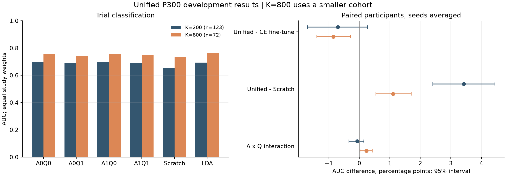
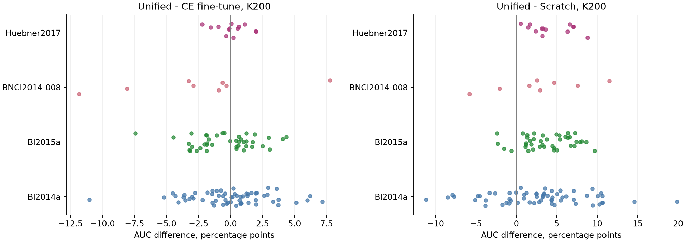
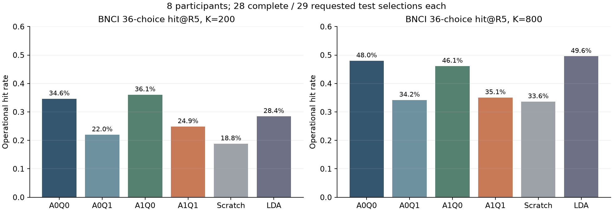

# 统一模型完整矩阵：结果、核验与下一步

2026-09-16。对应[精简训练方案](domain_transfer_major_20260920.zh.md)及[云端执行记录](unified_cloud_20260916.zh.md)。
本轮支持公开数据上的迁移收益，但不支持将当前完整A1Q1包替换A0Q0作为默认程序。
主要问题集中在BNCI的个人适配包；固定残差结构和缺导处理不是本轮消融因素，不能据此否定它们。

## 1. 执行和结果完整性

源码归档SHA-256为`d888db506ceba2885eafdeaa33463739ef30536d251b153f971d4dbbf0b099a5`，
计划SHA-256为`53f79490038e2a57703a022f470dd16c16c4f49c9691e56c69f68a33e9e9921b`。
本地统计和评分owner与执行快照逐字节一致；没有改写原训练或预测结果。

| 项目 | 实际结果 |
|---|---:|
| 源artifact | 35：30个正式源、5个参考源 |
| 物理源拟合 | 40：每参考inner选轮和refit各一次 |
| 正式目标神经网络拟合 | 6138 |
| 确定性LDA拟合 | 246 |
| 复用的正K拟合请求 | 4416 |
| 源内λ开发拟合 | 136：计划112，加提前源折在总执行器中的24次重算 |
| K0评分请求 | 1350 |
| 全部评分单元 | 12150，失败0 |
| 目标分片／调度组 | 288／32，全部完成 |
| 总执行器墙钟 | 3126.78秒，约52.1分钟，退出码0 |

52.1分钟包含总执行器的源阶段及目标阶段，不含前期补传和提前完成的首折；提前源折与补传重叠，
不能把各阶段CPU/GPU时间简单相加为墙钟。总执行器复用了首折7个源artifact；
主源程序及提前源折合计148162次物理源更新。原1.5–3.5小时是执行前排期估计，现由实际墙钟替代。

288个分片全部完成独立保存模型重放，核验12150份预测及10800份保存模型文件，后者包含复用副本，
不能当成10800次独立训练。核验包括实际raw范围重建、人员排除、输入/文件摘要、90轮预算、
每个预测及AUC/AP/平衡准确率/Brier/NLL重算。预测容差为`atol=rtol=1e-4`；
最大绝对差为0.0003662，仍满足原相对及绝对组合容差，没有放宽阈值。

初版分析重放器沿用了旧程序两项数值假设：Q0关闭决策损失即无额外decision工作集、LDA标准化可用一次float64表达式替代。
前者与新D0/D1匹配工作集相冲突；后者与执行时sklearn的float32就地标准化和分类运算不完全相同。
已按实际执行算子修正重放器，仅重试未通过的分片，原228个通过分片按摘要复用。训练产物未修改。

## 2. 比较定义与统计边界

- A0：源CE；A1：源CE＋0.05 SupCon＋0.05条件MMD。
- Q0：完整个人微调，源收缩系数0、决策损失系数0，保留匹配工作集。
- Q1：个人微调＋源内选出的参数收缩；有真实membership时再加决策CE。
- Scratch：同结构随机初始化，和Q1匹配决策监督；LDA：独立波形收缩LDA。

四个普通整库留出包含123名不同参与者：BI2014a 61、BI2015a 41、BNCI2014-008 8、Huebner2017 13。
三个配对seed先在人内平均，再做库内人员平均和四库等权平均：

\[
\bar Y_{dq}(K)=\frac1{n_d}\sum_p\frac13\sum_{s=1}^3Y_{dpsq}(K),\qquad
\hat\Delta(K)=\frac14\sum_{d=1}^{4}\frac1{n_d}\sum_p\frac13\sum_s\sum_qc_qY_{dpsq}(K).
\]

95%区间使用10000次库内参与者bootstrap，固定研究库、已拟合模型和三个seed；
它不覆盖重采样源数据、重新选择预算/λ或新研究库的不确定性。没有按trial、seed或复用模型增加独立样本数。
三个预声明K200主对比为A1Q1−A0Q0、A1Q1−Scratch及交互A1Q1−A1Q0−A0Q1＋A0Q0。
额外提供50000次人员差值符号翻转及该三项的Holm校正作为条件敏感性分析；
符号交换性不是自动成立的。交互差值明显偏斜（skew约−3.74），不依赖其翻转p值作肯定推断。
逐人分布、异常尾部全部保留，未根据正态性检验删人或选择更有利的统计方法。

精确K200覆盖123人；精确K800覆盖72人（20/31/8/13）。其余51人的最高实际K为355–796，
按实际K单列在完整JSON/CSV，未混入K800，也未把失败或不足预算隐去。

## 3. 主要AUC结果

以下是库等权participant-macro AUC，数值不是九选一准确率。

| 程序 | 精确K200，123人 | 精确K800，72人 |
|---|---:|---:|
| A0Q0：源CE＋完整微调 | 0.6947 | 0.7564 |
| A0Q1：源CE＋个人适配包 | 0.6887 | 0.7436 |
| A1Q0：联合源损失＋完整微调 | 0.6944 | 0.7582 |
| A1Q1：完整统一程序 | 0.6877 | 0.7478 |
| Scratch | 0.6534 | 0.7368 |
| 波形LDA | 0.6925 | 0.7616 |

| 预声明对比 | K200差值及95%区间，AUC百分点 | K800差值及95%区间，AUC百分点 |
|---|---:|---:|
| 完整统一−A0Q0 | −0.71 [−1.69, +0.27] | −0.85 [−1.40, −0.29] |
| 完整统一−Scratch | +3.42 [+2.41, +4.45] | +1.11 [+0.54, +1.70] |
| A×Q交互 | −0.07 [−0.34, +0.15] | +0.24 [+0.02, +0.43] |

K200没有支持正协同的证据；K800交互虽有小正值，仍不足以抵消完整程序相对A0Q0的下降。
K800属于次要分析，不能拿它替代预声明的K200结论。
完整统一相对LDA的差为K200 −0.49百分点、K800 −1.38百分点；经典基线应继续保留。

完整统一相对Scratch的库等权负迁移比例为K200 16.1%、K800 28.3%，
最差个人差值分别为−0.1117及−0.0542。平均收益不等于每个人都受益。
在同一72人的配对子集中，K200→K800使完整统一AUC平均提高7.41百分点，Scratch提高9.57百分点；
这比直接比较两个不同人数的表格列更适合说明标签增加后的变化。

零校准AUC为A0 0.5762、A1 0.5653，Huebner分别仅0.5139、0.5072。
本轮不支持把未经个人校准的源模型直接当可靠推理模型。

## 4. 差异集中在哪里

| 目标库 | A0Q0 K200 | A1Q0 K200 | A1Q1 K200 | 完整统一−A0Q0 |
|---|---:|---:|---:|---:|
| BI2014a | 0.6616 | 0.6612 | 0.6618 | +0.02百分点 |
| BI2015a | 0.7395 | 0.7345 | 0.7353 | −0.42百分点 |
| BNCI2014-008 | 0.6783 | 0.6820 | 0.6530 | −2.52百分点 |
| Huebner2017 | 0.6995 | 0.6999 | 0.7005 | +0.10百分点 |

联合源包在Q0下的K200增量仅−0.035百分点，95%区间[−0.432,+0.358]，未显示稳定收益。
20个带联合源目标的artifact（15正式＋5参考）均有活跃SupCon锚点和MMD项，inactive batch为0，
所以不能用“模块没有执行”解释接近零的平均效果。SupCon、MMD绑定为一个包，本轮不能分开归因。
两项损失值量级明显不同，系数同为0.05不代表梯度贡献相同；目前没有梯度范数/方向证据来判断哪项主导。

BI2014a、BI2015a、Huebner没有可用的真实决策membership，Q1只增加收缩，平均变化很小且多数略正。
BNCI是唯一实际训练决策损失的库。这里A1Q1−A1Q0为K200 −2.90百分点、K800 −4.60百分点。
这将排查重点指向决策项或它与收缩的交互，但四格程序没有提供“仅收缩／仅决策项”的因果分离。

## 5. 真实决策核验：下降不只发生在trial AUC

复用既有membership评分核，对BNCI原始row/column的36候选词表重算。
每人固定测试中有29个物理selection，其中28个完整，1个跨预算边界不足原生10轮；
operational分母保留该不完整selection，覆盖率为28/29=96.55%，所有程序无并列。
R5取完整selection的前5个物理重复，R10取原生全部重复。
双向输入已按完整测试范围处理，这些是回顾性评分，不是在线提前停止实验。

| 程序 | K200 hit@R5 | K800 hit@R5 | K800 hit@R10 |
|---|---:|---:|---:|
| A0Q0 | 34.63% | 47.99% | 68.39% |
| A0Q1 | 21.98% | 34.20% | 48.85% |
| A1Q0 | 36.06% | 46.12% | 67.24% |
| A1Q1 | 24.86% | 35.06% | 52.16% |
| Scratch | 18.82% | 33.62% | 50.43% |
| LDA | 28.45% | 49.57% | 74.57% |

同一A1源下Q1−Q0的R5差为K200 −11.21百分点，参与者bootstrap区间[−21.26,−1.87]；
K800 −11.06百分点，区间[−18.25,−3.74]。仅8名参与者，按人平均三个seed后重采样，
不能将其672份重复评分当成672个独立样本。R10也下降，不能只用训练10轮、评估5轮的差别解释。

与此同时，A1Q1的完整决策NLL较A1Q0改善：K200 8.393→3.738，K800 4.587→2.698。
该分数使用固定温度1，并无外部概率校准。它说明降低错误置信度与提高选中率可能发生分离；
NLL改善本身不足以满足主要hit目标。

K200实际仅1个完整校准决策，K800仅6个。决策训练目标为
\(L=L_{trial}+1\cdot L_{decision}+0.1\Omega\)，其中decision logit是多个flash的证据和。
不同项在数值及梯度上的尺度不因三个系数为常量就自动匹配；极少完整组又限制了决策泛化。
这些是下一轮应检验的机制假设，现有结果尚不能证明单一根因。

## 6. 家族排除、预算与解释限制

BI家族同时排除的102人敏感性中，K200 A1Q1为0.7008、A0Q0为0.6960、Scratch为0.6657、LDA为0.7125。
完整统一−A0Q0为+0.48百分点，95%区间[−0.03,+1.02]；−Scratch为+3.52百分点[+2.65,+4.39]。
敏感性支持迁移程序仍有收益，但不证明完整新增包稳定优于普通微调。
这102人是主分析中的相同BI参与者，不能叠加成新的独立样本或第五个研究库。

| 外折排除 | 参考选中轮数 | 停止原因 | λ |
|---|---:|---|---:|
| BI2014a | 12 | 达12轮上限 | 0.1 |
| BI2015a | 4 | patience | 0.1 |
| BNCI2014-008 | 6 | patience | 0.1 |
| Huebner2017 | 12 | 达12轮上限 | 0.1 |
| BI2014a＋BI2015a | 11 | 运行至12轮上限，最佳为11 | 0.1 |

两源包共享A1参考选出的曝光预算；不是分别充分调优后的性能上限。
三折触及轮数上限，五折λ均在候选上界，不能宣称预算或收缩已优化到最优。
四库均为已反复观察的开发资料，结论不构成成人BrainSync九选一确认。

## 7. 建议的最小下一步

保留同一个共享网络、残差和观测mask，暂以A0Q0作为神经网络比较锚点，同时保留LDA。
这只是后续研究基准，不是按外层测试分数给不同数据集加推理开关，也没有在本轮分析中修改活动训练代码。

优先复用已完成的BNCI留出A0源检查点，在相同8人×2预算×3seed上增加两项个人处理：
仅prior（λ=0.1、γ=0）与仅decision（λ=0、γ=1），共96次小拟合。
现有A0Q0和A0Q1分别给出两项均关闭、两项均开启，四格可识别prior、decision及交互，源模型无需重训。
同时核验共同工作集、trial/decision梯度范数及方向，检查NLL下降却hit下降是否来自尺度或校准决策不足。
之后只对被证据定位的环节调整统一目标函数；不要先扩展全部源×模块×预算网格。

BNCI的Scratch本轮带决策监督，所以A0Q0−Scratch在该库同时改变了初始化和决策损失，不能称纯预训练效应。
若后续要比较CE-only迁移与CE-only scratch，还需补48个匹配scratch拟合；它与上述96项回答不同问题，不强制合并扩大首轮定位。

## 8. 证据与归档

精简表格、区间、假设检查和图在`doc/assets/unified_cloud_20260916/results_summary.json`及同目录PNG/SVG/CSV。
完整逐单元数据、回退K、各seed、模型重放及分析脚本在本地`experiments/runs/unified_cloud_20260916/`。
结果压缩包`export/verified_results.tar.gz`包含36411个成员，10800个目标模型文件和12150份预测；
云端及本地均已检查整包及逐成员摘要，SHA-256为
`59a7a982a000cd9ef83cfa4f46dc7309658ffb962bb722feb9a742e39700dbbb`，大小1097847401字节。
输入另保留云端持久压缩包6187878006字节，SHA-256为
`8d2259a6ba025d02af68e322d2a67bcf9278555638fec31ac6548988f1d33f49`。
本轮分析没有重训神经网络，没有覆盖冻结结果，也没有删除当前数据。
