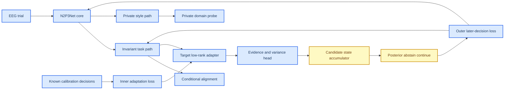

# 特征域迁移科研报告：从 pooled CE 到条件不变证据表示

_研究日期：2026-09-02 · 范围：N2P3-Net EEG/P300 域迁移与候选决策 · 文档角色：研究依据与机制假设，不是活动规范或系统综述_

> 📌 **当前使用方式：** 本报告的文献与机制推理仍可复核，但 P0/P1/P2 的实现状态、开放
> 门禁和下一步由 [`research_program.zh.md`](research_program.zh.md) 控制。代码验收见
> [`framework_acceptance_20260903.zh.md`](framework_acceptance_20260903.zh.md)。不得把本报告中
> 的历史路线图或候选实验写成当前已验证结果。

## 摘要

本报告在当前 N2P3-Net 结果和新增文献材料基础上，重新定义“理想的特征域迁移”问题。结论不是再选择一个更大的 adapter，而是把模型拆成四个相互受约束的层次：保留的 N2P3Net 核心时空编码器、可验证的任务相关不变表示、显式的域/被试私有表示、以及只在合法 calibration episode 中更新的低容量目标适配器。候选决策不再是训练后对 binary logit 做启发式平均，而是一个有固定 candidate vocabulary、覆盖状态、重复证据和 abstention 语义的集合状态模型。

本轮检索覆盖 OpenAlex 八个主题查询、Crossref 定向查询、仓库已有 P300/ERP 文献和新增 OA 下载。OpenAlex 返回的候选是检索线索，不等于已读全文；本轮实际下载并通过 PDF magic-byte、页数和 SHA-256 校验的新增全文为 9 篇，另有 53 篇已存在于 `Paper/` 并在先前 manifest 中验证。Parallel/Exa 认证不可用，因此没有声称完成 60 篇 Parallel verified packet。

对架构的主裁决如下：

1. `N2P3Net` 核心保留为纯 source/target-compatible trunk，不把 domain bank 嵌入核心。
2. 特征迁移采用 `shared invariant path + private style path + target low-rank residual`，而不是所有 source domain 共用一个 pooled classifier 或每个 source domain 永久绑定一个推理 adapter。
3. 对齐必须是 class-conditional、结构化、强度受限的；只对齐边缘 `P(Z)` 或只让 domain discriminator 失效都可能删除 P300 判别信号。
4. 真正的双层学习是外层 held-out decision/domain objective 加内层 target calibration adaptation；同一个 batch 上加两个损失仍是 single-level training。
5. 目标域没有观测时，不能声称已对齐到目标域；只能报告 domain-generalization/LODO。目标域有无标签观测时，才进入 UDA；有独立 calibration labels 时，才进入 supervised inner adaptation。

## 1. 研究问题与证据边界

### 1.1 研究问题

本报告回答：

1. 什么样的表示才同时保留 P300 判别信息和跨域可迁移性？
2. 如何避免 domain alignment 的典型负迁移：类别混合、目标域不存在、域标签捷径、BN 混合统计、伪标签自强化和 source selection 失败？
3. 如何把目标域适配和候选决策放进一个可微、可审计但不泄漏的训练链？
4. 在当前数据规模、3/5/8 通道和 target-switch 证据边界下，哪些方法只能作为实验臂？

### 1.2 证据分层

| 层级 | 允许的陈述 | 例子 |
|---|---|---|
| E1 代码事实 | 当前实现确实执行了什么 | 纯 N2P3Net ST/MST trunk、FeatureDomainTransfer、candidate-evidence core |
| E2 运行事实 | 当前数据和合同下观察到什么 | BNCI-target 中 `B0 > J1 >= J2 > J0` |
| E3 文献机制 | 外部工作在其协议下报告了什么 | MMD、Split-BN、invariant/private decomposition、Riemannian recentering |
| E4 研究假设 | 尚未在本项目中验证 | 条件 covariance/MMD、private-conditioned residual 消融、bilevel adapter、learned abstention |

E3 不能替代本项目 E2；E4 不能写成已验证性能。所有未来实验必须保留 no-transfer 和 domain-ceiling 对照。

## 2. 当前仓库与现有结果的审计

### 2.1 核心 N2P3Net

当前核心保留：

```text
EEG (B,C,T)
  -> temporal convolution + BatchNorm
  -> depthwise spatial convolution + BatchNorm + ELU
  -> average pooling
  -> MST branches (default kernel 5 and 17 at feature rate)
  -> full_unfold / ms_flatten / other explicit readout
  -> binary classifier
```

默认 causal-v3 输入为 128 Hz、`[-200,1200] ms`、0.1--30 Hz、mean-only baseline、volts、forward IIR steady-state initial state。`N2P3Net` 的时空核和物理 receptive-field 计算保留在 [`src/models/n2p3net.py`](../src/models/n2p3net.py)。

核心模型不应知道：

- source domain vocabulary；
- target participant identity；
- calibration/test split；
- candidate accumulation；
- domain alignment coefficient。

这些属于 transfer wrapper、training protocol 和 decision layer，必须与核心参数空间隔离。

### 2.2 目前已存在的迁移原型及其准确定位

当前工作树已提供：

| 组件 | 当前实现 | 正确定位 | 主要不足 |
|---|---|---|---|
| `FeatureDomainTransfer` | shared invariant/private paths + target residual | 当前活动 wrapper | candidate-set outer objective 尚未接入 |
| `FeatureResidualAdapter` | MST 后 `(B,C_f,T_f)` 有界残差 | 低容量 feature residual | 默认 private path 不直接注入 task residual |
| `conditional_mean_alignment_loss` | source 域按 binary label 对齐 invariant feature mean | 一阶条件均值对齐 | covariance/高阶结构仍是独立消融 |
| `SubjectAdapter(head_kind=adapter)` | 直接更新 wrapper 的 `target_adapter` | supervised target inner-loop | 尚未由 outer later-decision meta-objective 学到初始化 |
| `candidate_evidence.py` | 统一 score/coverage/tie/fail-closed core | 正确的通用接口 | 仍是后处理，尚无可学习 candidate state |

当前测试证明了 identity initialization、无 source routing、稀疏 cell 处理、target-only parameter update 和 state roundtrip；它们**不证明**跨域准确率提升。当前仓库仍未把 feature adapter、alignment、target inner loop、outer meta-learning 和目标决策 loss 闭合成一个端到端科研 protocol。

### 2.3 当前负迁移事实

BNCI-target causal-v3 CAR5 运行结果：

| Arm | AUC | hit@8 |
|---|---:|---:|
| `bnci_only` | 0.6641 | **0.3417** |
| `joint_natural` | 0.5679 | 0.1222 |
| `joint_bnci80_epoch` | 0.6474 | 0.2736 |
| `joint_bnci80_participant` | 0.6496 | 0.2667 |

自然联合相对单域为 `-21.94 pp` hit@8；80/20 域质量权重恢复 `+15.14 pp`，但仍低于 B0。J2 与 J1 基本相同。归档 BI-target 方向同样观察到联合源负迁移。输入 mean/std 单独更换只恢复约 `+0.07 pp`，因此公共统计不是主因。

当前最合理的机制推断是：不同域的 class-conditional ERP direction 不一致，shared temporal/spatial filters 和 shared classifier 被迫选择折中面。该推断仍需 matched per-domain gradient cosine 直接验证；ERP waveform cosine 不能代替梯度实验。

## 3. 文献科研结论

### 3.1 条件对齐优于无条件对齐的理由

经典 MMD 约束的是特征分布均值嵌入：

\[
\operatorname{MMD}^2(P_s,P_t)
=\left\|\mathbb E_{P_s}[\phi(z)]-\mathbb E_{P_t}[\phi(z)]\right\|_\mathcal H^2.
\]

若直接使用 `P(Z)`，target 和 non-target 的质量可能互相抵消。对于 P300，更合理的 source-supervised 约束是：

\[
\mathcal L_{\mathrm{cMMD}}
=\sum_{c\in\{0,1\}}
\operatorname{MMD}^2(P_s(Z\mid Y=c),P_t(Z\mid Y=c)).
\]

新增的 Split-MMD P300 预印本把 target-weighted CE、Split-BN 和 logit-level RBF-MMD 结合起来，并在两个视觉 oddball 数据集报告优于 target-only/naive pooling；但其交叉验证按同一批 subjects 内 trial 划分，不能直接证明 unknown-subject 或 unknown-decision transfer。它的有价值机制是：目标权重、域专属 BN 统计和 alignment 必须分别做 ablation，而不是只报告完整模型[^1]。

MS-MDA 在 EEG 中采用 common feature extractor、domain-specific extractor、domain-specific classifiers、MMD 和 classifier discrepancy loss；该设计说明多源场景不必把所有 domain 直接压进一个 classifier，但它的实验是 emotion EEG，不能直接外推到 P300 candidate decision[^2]。

### 3.2 invariant/private 双表示

跨域表示完全不变也可能损失个体相关的 task signal。CST-TVA-DRTL 同时学习 domain-specific representation 和 domain-invariant representation，再用 domain-specific 表示对 invariant 表示做 rectification；其 cross-subject RSVP 实验报告了相对 DANN/ATLDCN/SFSA 的改进，但任务、通道和数据量与本项目不同[^3]。

因此理想目标不是

\[
I(Z;D)=0
\]

而是把信息分解为：

\[
Z_{\mathrm{inv}}=f_{\theta}(X),
\qquad
Z_{\mathrm{priv}}=q_{\psi}(X,D),
\]

并要求：

\[
I(Z_{\mathrm{inv}};D\mid Y)\ \text{低},
\qquad
I(Z_{\mathrm{priv}};D)\ \text{高},
\qquad
I(Z_{\mathrm{inv}};Y)\ \text{高}.
\]

`Z_priv` 不是为了让 classifier 依赖 domain，而是为了吸收采集/被试 style，避免 invariant path 被迫解释所有变化。对 `Z_inv` 做 conditional alignment，对 `Z_priv` 做 domain reconstruction/classification，对二者加 cross-covariance penalty，才比单一 GRL 更可诊断。

### 3.3 domain-specific normalization

MS-MDA 的 normalization study 显示 electrode-wise normalization 和 normalization order 会显著影响结果[^2]。新增 Split-MMD P300 预印本采用共享 affine 参数、source/target 独立 running statistics 的 Split-BN，并在 target inference 使用 target buffers[^1]。

但本项目的目标域可能是新 participant、甚至新设备，不能预先拥有稳定 target BN buffer。当前建议：

- 核心 N2P3Net BN 使用 source-frozen statistics；
- transfer wrapper 不新增 target BatchNorm；
- target adaptation 只更新 adapter 的 convolution/scale；
- 若引入 Split-BN，必须作为单独 arm，并记录 buffer 来源和 target sample 数；
- 不把 BN adaptation 和 feature adapter、pseudo-label、dynamic stopping 同时打开。

### 3.4 对抗不变学习的边界

Adversarial EEG work 的基本 min-max 目标是：

\[
\min_{\theta_e,\theta_c}\max_{\theta_a}
\mathbb E[-\log q_{\theta_c}(Y\mid Z)]
 +\lambda\mathbb E[\log q_{\theta_a}(D\mid Z)].
\]

它可以减少 subject/domain information，但高 \(\lambda\) 会删除与 domain 共线的真实 task signal。该风险在 P300 尤其重要：电极位置、刺激显示和目标相关 ERP 可能与 domain 一起变化。Adversarial EEG 论文使用 subject-disjoint cross-subject transfer 才能支持其 invariant claim；本项目不能用 domain probe 的下降代替 target decision 的改善[^4]。

### 3.5 source selection 与 no-transfer fallback

Bayesian Signal Matching 将 source participant 是否与新 participant 匹配建模为 latent indicator，并在没有 source 满足阈值时退回 reference model，而不是强行借用所有 source。其 P300/ALS 实验强调 source target ERP matching、posterior uncertainty 和 mixture fallback[^5]。

这直接对应当前负迁移问题：多源适配器必须有 `borrow` 和 `no-borrow` 两条路径。一个候选 source/domain 只有在 calibration-only similarity、source validation improvement 和 uncertainty gate 同时支持时才可进入目标 inner loop。

### 3.6 Riemannian prealignment 的启示

Riemannian transfer 通过 recentering、stretching 和 rotation 对 covariance geometry 做对齐；online prealignment 还使用递归 Riemannian mean 更新，使新 trial 在进入 classifier 前得到 subject-adaptive normalization[^6]。这类方法说明：目标域无标签时仍可能利用 covariance/style 统计，但它们对 reference、channel geometry、可用 trial 数和 causal 更新顺序高度敏感。

因此它适合作为 feature transfer 的 classical ceiling/control，不应被简单等同于 Euclidean mean/std 或 CAR。

### 3.7 decision-level evidence

P300 文献普遍把 trial detection 和 character/candidate decision 分开，但训练/评估的 repetition、candidate ordering、score aggregation 和 target selection 语义不统一。SpellerSSL 在 downstream 中使用 lightweight ERP head、grouped repetition aggregation 和 code-aligned canonical ordering；多 trial P300 工作也明确将重复 trial 组合后再做 character prediction[^7][^8]。

这支持本项目把 candidate state 设为显式模型对象，但不支持直接照搬外部的 repetition 数、采样率或 character accuracy。

## 4. 新活动架构

### 4.1 总体结构



### 4.2 Core path

设 N2P3Net 输出结构化特征：

\[
H=f_\theta(X)\in\mathbb R^{B\times C_f\times T_f}.
\]

不要在 `full_unfold` 后把 \(B\times D\) 伪装成 1D 时间序列。迁移模块必须在 pooling 前处理结构化 `H`。

### 4.3 Invariant task path

第一版使用 identity-initialized shared residual map：

\[
Z_{\mathrm{inv}}
=H+\alpha_{\mathrm{inv}}
W_{\mathrm{up}}
\operatorname{ELU}
(W_{\mathrm{down}}(\operatorname{DWConv}(H))),
\]

\[
\alpha_{\mathrm{inv}}=\rho_{\mathrm{inv}}\tanh(a_{\mathrm{inv}}),
\qquad a_{\mathrm{inv}}=0.
\]

这样 source core 的初始函数严格不变，且 alignment loss 的梯度可以进入 shared map。它不是 domain-specific function；它不接收 source domain ID。

### 4.4 Private style path

private path 采用小容量 projection：

\[
Z_{\mathrm{priv}}=\operatorname{ELU}(W_{\mathrm{priv}}H).
\]

它接受 domain/subject supervision 只用于记录或辅助 domain loss：

\[
\mathcal L_{\mathrm{priv-domain}}
=\operatorname{CE}(d_{\mathrm{priv}},D).
\]

同时加分解约束：

\[
\mathcal L_{\mathrm{orth}}
=\left\|\operatorname{Cov}(Z_{\mathrm{inv}},Z_{\mathrm{priv}})\right\|_F^2.
\]

classifier 不应直接依赖完整 `Z_priv`。当前主实现把 `Z_priv` 限定为
style/domain probe 与 orthogonality 的辅助路径；target adapter 只接收
`Z_inv`。这样不会在小样本 inner-loop 中凭空增加一组难以辨识的
style-to-task 参数。将 private summary 条件化 target residual 只能作为独立消融，
不能冒充默认特征迁移结果。

### 4.5 Target adapter

目标适配器只从 invariant path 接收输入：

\[
\Delta_\eta(Z_{\mathrm{inv}})=W_{\mathrm{up}}
\operatorname{ELU}(W_{\mathrm{down}}(\operatorname{DWConv}(Z_{\mathrm{inv}}))),
\]

\[
H_t=Z_{\mathrm{inv}}+
\rho_t\tanh(a_t)\Delta_\eta(Z_{\mathrm{inv}}).
\]

其中 `a_t=0`，`rho_t` 受限，且 target inner loop 只更新 \(\eta,a_t\) 和允许的 evidence calibration 参数。核心、shared invariant map、private path 和 source classifier 在 inner loop 冻结。private 条件化 residual 是后续独立消融，不属于当前默认实现。

这比 source-domain bank 更适合 unseen target：部署时不需要知道目标是否等于某个已训练 source domain。

### 4.6 Feature alignment objective

source-supervised 时对 invariant path 使用 class-conditional alignment：

\[
\mathcal L_{\mathrm{align}}
=\frac{1}{|\mathcal P|}
\sum_{(d_1,d_2)\in\mathcal P}
\sum_{c\in\{0,1\}}
\left\|
\mu_{d_1,c}-\mu_{d_2,c}
\right\|_2^2
 +\kappa\left\|
C_{d_1,c}-C_{d_2,c}
\right\|_F^2.
\]

第一版只启用 mean term；CORAL covariance term 是单独消融。每个 `(domain,class)` cell 需要预声明最小样本数；稀疏 cell 不应被当成零距离。

总 source objective：

\[
\mathcal L_{\mathrm{source}}
=\lambda_{\mathrm{trial}}\mathcal L_{\mathrm{trial}}
 +\lambda_{\mathrm{set}}\mathcal L_{\mathrm{set}}
 +\lambda_{\mathrm{align}}\mathcal L_{\mathrm{align}}
 +\lambda_{\mathrm{priv}}\mathcal L_{\mathrm{priv-domain}}
 +\lambda_{\mathrm{orth}}\mathcal L_{\mathrm{orth}}
 +\lambda_{\mathrm{reg}}\|\eta\|^2.
\]

如果 `lambda_align > 0` 却没有至少两个有效 domain/class cells，必须 fail-closed 或把该 run 标成 alignment-inactive；不能把它写成完成了对齐。

### 4.7 三种数据 regime

| Regime | 可用数据 | 允许的训练目标 | 不能声称 |
|---|---|---|---|
| DG | source labeled only | source CE + source conditional alignment + private separation | 已对齐到真实 target |
| UDA | source labeled + target unlabeled | source loss + gated marginal/conditional surrogate alignment | target labels 已被使用 |
| supervised few-shot | source labeled + target calibration labels | inner target adapter + calibration/set loss | later test 被用于适配 |

目标标签不可见时不能计算真实 target class-conditional alignment。pseudo-label 只能作为独立、低权重、可失败的研究臂，并必须保留 no-adapt。

## 5. 双层学习协议

### 5.1 Episode 定义

对每个 meta episode (v)：

- source/meta-train subjects/domains：学习共享初始化；
- calibration decisions (C_v)：内层有标签适配；
- later decisions (T_v)：外层只用于评估/训练 outer objective；
- final held-out subjects/domains：不参与任何选择。

内层：

\[
\eta_v^*
=\operatorname{Unroll}_K
\left(
\eta_0,
\nabla_\eta
\mathcal L_{\mathrm{cal}}(C_v)
\right).
\]

外层：

\[
\min_{\theta,\eta_0,\omega}
\sum_v
\mathcal L_{\mathrm{decision}}
\left(
\operatorname{Decision}_\omega
\left[
g_{\phi_v^*}(a_{\eta_v^*}(f_\theta(X_{T_v})))
\right],D_{T_v}
\right).
\]

第一版使用固定 `K=1..5` 的 unroll ablation 和 first-order approximation；若报告 exact bilevel，需要记录二阶梯度/Hessian-vector solve 是否执行。

### 5.2 不同目标域信息的防泄漏规则

1. target calibration labels 只能进入 inner loop；
2. later target decision labels 只能进入 outer meta-train/meta-validation，不能进入 final test；
3. temperature、reliability weighting、abstain threshold 和 stopping cost 只能由 calibration/meta-validation 冻结；
4. target normalization 与 adapter 参数必须保存来源、行数和时间边界；
5. 一个 target participant 的所有 decisions 必须使用同一 outer split 规则，不能按结果挑选 episode。

### 5.3 为什么不能直接 inner full-fine

当前 target calibration 只有少量 decisions。inner full-fine 会让数千个 trunk 参数适配一个很小的目标集，产生：

- target label memorization；
- BN running-statistics drift；
- source classifier compatibility loss；
- outer decision variance 激增。

因此 inner trainable set 默认只包含 target residual adapter 和低容量 evidence calibration。解冻 shared map 或 trunk 必须是单独高风险 arm。

## 6. 决策层重构原则

### 6.1 Trial evidence 不再等同 binary logit

模型应输出：

\[
(e_i,\log v_i, q_i)=g_\phi(z_i),
\]

其中 (e_i) 是 evidence，(v_i>0) 是 train-only variance，(q_i) 是质量/可用性 gate。`e_i` 只有在通过校准后才可命名为 LLR；否则叫 discriminative evidence score。

### 6.2 CandidateAccumulator

对 candidate (d) 和 evidence prefix (r) 保存：

\[
A_{d,r}=\sum_{i\in(d,r)}w_i e_i,
\quad
B_{d,r}=\sum_{i\in(d,r)}w_i,
\quad
Q_{d,r}=\sum_{i\in(d,r)}w_i^2,
\quad
N_{d,r}=\#\{i\in(d,r):q_i=1\}.
\]

候选 posterior 使用统一 frozen vocabulary：

\[
P(d\mid E_{1:r})
=\operatorname{softmax}_{d\in V}
\left(
\rho_\omega(A_{d,r},B_{d,r},Q_{d,r},N_{d,r},\operatorname{coverage}_{d,r})
\right).
\]

这里的温度必须显式进入 `rho` 或其外部参数化：\(\rho_\omega=\tilde\rho_\omega/\tau_r\)，
\(\tau_r>0\)；不能在梯度推导中省略对应的 \(1/\tau_r\) 因子。

第一版 `rho` 应是线性/温度模型，避免小数据下任意 MLP 学会 candidate code。`mean` 可以作为 count-neutral score，但不得继续把它写成严格 LLR。若引入 Split-BN，unseen target 的 buffer 来源必须预注册为 `pooled_source`、`source_weighted` 或 `target_calibration`，并记录各自 estimand；buffer-swap 仅检验推理 buffer 选择，不能否定训练期统计对梯度、优化轨迹和正则化的作用。

覆盖门禁先于 posterior：
\[
C_{j,r}=\mathbb 1[\forall d\in V:B_{j,d,r}>0].
\]
若 `C=0`，空桶可在诊断表中记为 `-inf`，但整个 decision 状态为 `incomplete`，
posterior 记为未定义 `\bot`，不执行 softmax、CE、argmax 或 stopping；该状态进入
完整 ledger。只有 `C=1` 才允许计算上式。

### 6.3 Candidate-set loss

完整 candidate set 的每个真实 prefix 都计算：

\[
\mathcal L_{\mathrm{set},r}
=-\log P(d^*\mid E_{1:r}).
\]

若训练整条 repetition 曲线，使用
\[
\mathcal L_{\mathrm{prefix}}=\sum_{r=1}^{R_{max}}\alpha_r\mathcal L_{\mathrm{set},r},
\quad \alpha_r\ge0,\quad\sum_r\alpha_r=1,
\]
并预注册固定预算 `alpha_8=1` 或曲线 arm `alpha_r=1/R_max`。mean 聚合不自动
表达 evidence 数量；evidence-aware arm 需预注册 `n_eff=B^2/Q`、
`s_r=(A/B)*n_eff^beta`（`beta=0.5`；mean 对照 `beta=0`）或
`tau_r=tau_0/r^beta`，参数仅由 calibration/meta-validation 冻结。

row/column 任务有两个选择，必须由 contract 固定：

\[
\mathcal L_{\mathrm{row-col}}
=\mathcal L_{\mathrm{row}}+\mathcal L_{\mathrm{column}}
\]

或 36-class joint softmax。不能训练一种、评估另一种，却只写“candidate loss”。

### 6.4 Abstention 和 sequential policy

每个 prefix 输出：

\[
(P_r,\ m_r,\ \mathcal E_r,\ c_r,\ a_r),
\]

其中 (m_r) 是 top-1 margin，(\mathcal E_r) 是 entropy，(c_r) 是 coverage，(a_r) 是 abstain/continue 状态。状态机至少区分：

```text
incomplete -> wait/abstain
complete + low confidence -> abstain/continue
complete + unique confident winner -> accept
fit failure -> evaluation_failed
```

dynamic stopping 只有在有足够独立 decisions 时进入；停止轮数必须定义为：

\[
\tau_j=\min\left(\{r\in[1,R_{\max}]:
C_{j,r}=1\land g(P_{j,r},M_{j,r},\mathcal E_{j,r})=1\}\cup\{R_{\max}\}\right),
\]

没有 prefix 满足条件时取 `tau_j=R_max`，并保留 unresolved/abstain 状态。
`C_{j,r}=1` 表示冻结 vocabulary 中每个 candidate 都有有效 evidence；缺失
candidate 不能通过把 posterior 分母缩小来提前接受。

动态停止同时报告固定请求分母下的：

\[
\bar\tau=\frac{1}{N_{\mathrm{requested}}}\sum_j\tau_j,
\quad
\bar T=\frac{1}{N_{\mathrm{requested}}}\sum_jT_j,
\quad
\bar S=\frac{1}{N_{\mathrm{requested}}}\sum_jS_j,
\quad
H^{\mathrm{op}}_{\mathrm{stop}}
=\frac{1}{N_{\mathrm{requested}}}\sum_j1[\text{final status=correct}].
\]

另报不依赖对称错误假设的真实吞吐：

\[
\mathrm{selections/min}=\frac{60N_{\mathrm{requested}}}{\sum_jT_j},
\qquad
\mathrm{correct\ selections/min}
=\frac{60\sum_j1[\text{final status=correct}]}{\sum_jT_j}.
\]

可选的 cost-sensitive 训练/分析目标为：

\[
\mathcal L_{\mathrm{stop}}
=\mathbb 1[\text{wrong}] + \lambda_t\,\text{seconds}
 +\lambda_s\,\text{stimuli}+\lambda_a\mathbb 1[\text{abstain}].
\]

若向传统 P300 文献报告 bitrate，使用统一候选数 `K=|V|` 和真实平均决策时间：

\[
\mathrm{ITR}=\frac{60}{\bar T}
\left[\log_2K+P\log_2P
+(1-P)\log_2\frac{1-P}{K-1}\right],
\qquad P=H^{\mathrm{op}}_{\mathrm{stop}}.
\]

ITR、character/selection accuracy、trial AUC 和 `hit@R` 是不同 estimand；
其中约定 `0 log 0 = 0`。Wolpaw 型 ITR 假设固定候选数和平稳、近似对称的
K-class channel；有 abstain 或非均匀混淆时只能标为 nominal ITR，并与真实
吞吐分开报告。不同候选数、刺激间隔和时间口径的文献不能直接横比。阈值、temperature、
abstain cost 和 stopping policy 只能由 calibration/meta-validation 冻结。

### 6.5 五轨道报告矩阵

行业对齐边界：固定 repetition 后报告 character/selection accuracy 曲线，见
Lee 等的真实在线 zero-training P300 研究以及 multi-trial P300 工作[^8][^9]；
动态停止论文通常同时报告 accuracy、平均 iterations 和 bitrate[^10]。本项目在此
基础上增加 requested-denominator、tie/abstain/incomplete/failure ledger、
participant-macro 和严格 calibration/test 分离；这些是更严格的 operational
扩展，不应误称为所有论文已经统一采用的标准。

| 轨道 | 主指标 | 必报辅助指标 | 解释边界 |
|---|---|---|---|
| 固定预算选择 | subject-macro operational `H^op_r` | `H^cond_r`、完整 `r=1..R_max` 曲线 | `hit@R` 是固定重复后的 top-1 selection accuracy |
| 动态停止 | operational stop accuracy | `tau`、seconds、stimuli、early-stop、selections/min、correct selections/min、ITR | 不能只以 accuracy 比较速度策略 |
| 可靠性/覆盖 | coverage、failure ledger | NLL、Brier、ECE、margin、entropy、tie、abstain | 不得删除低覆盖或失败 decision |
| 机制 | conditional distance、gradient cosine、residual ratio | trial AUC/BACC、invariant/private probes、ERP morphology | 机制改善不等于 task gain |
| 统计/证据 | paired delta vs B0、cluster CI | requested/eligible/success counts、multiplicity | participant 是主要 cluster，不是 trial |

## 7. 实施路线与门禁

### Phase 0：清理与基线（已完成代码切换）

- 保留纯 `N2P3Net` 核心和统一 `candidate_evidence` 接口；
- 旧 source-domain bank、旧 S1/A1/AS1 结果不进入新活动 recipe；
- 新 checkpoint schema 记录 `feature_transfer`，旧 `domain_adapters` checkpoint fail-closed；
- 固定 B0、domain ceiling、domain LODO 和 target cross-decision 对照。

### Phase 1：新 wrapper（已完成第一版）

- `FeatureDomainTransfer(core=N2P3Net)`；
- shared invariant residual map；
- private style projection + domain probe；
- target low-rank residual adapter；
- no target BN；
- identity-at-init 和 parameter-scope tests。

当前实现还明确了一个边界：private path 只作为 style/domain probe 和
orthogonality auxiliary path，默认不向 target residual 注入额外的
style-to-task 参数；后者必须另立消融实验。

### Phase 2：条件 feature alignment（已接入 source trainer，待跨域性能验证）

- source labeled conditional mean alignment；
- CORAL covariance 单轴；
- optional RBF-MMD 单轴；
- alignment active-cell ledger；
- per-domain gradient cosine diagnosis；
- domain probe、ERP morphology、target hit@R 一起报告。

### Phase 3：目标 inner loop（target-only residual 已接入；candidate-set loss 的 direct source-training 组件已实现，目标 inner-loop 仍未闭合）

- `target_adapter` only；
- calibration decision CE + candidate-set loss；
- 1/3/5 step unroll；
- source classifier/core frozen；
- target-switch later decisions independent。

### Phase 4：outer bilevel

- held-out source subjects/domains 组成 meta episodes；
- outer loss 使用 later independent decisions；
- first-order 与 exact unroll 对照；
- final BrainSync participants 完全隔离。

### Phase 5：sequential decision

- unified candidate accumulator；
- posterior/margin/entropy calibration；
- abstention state；
- dynamic stopping 作为独立 cost-sensitive arm。

每一 phase 都必须满足：

\[
\text{target hit@R}_{\mathrm{operational}}
\geq
\text{no-transfer baseline}
\]

且不能以 coverage、失败 decision 或目标域 outlier 删除换取提升。

## 8. 实验矩阵

| 组 | 表征 | 对齐 | 目标适配 | 决策 | 目的 |
|---|---|---|---|---|---|
| B0 | N2P3Net | 无 | 无 | frozen candidate core | no-transfer baseline |
| C0 | N2P3Net | 无 | 无 | candidate-set model | 决策层增益单独测量 |
| F1 | shared invariant residual | conditional mean | 无 | C0 | feature alignment 单轴 |
| F2 | invariant + private | mean + orthogonality | 无 | C0 | decomposition 单轴 |
| F3 | invariant + private | mean + CORAL | 无 | C0 | 二阶统计单轴 |
| T1 | F2 | source only | target adapter inner | C0 | supervised target adaptation |
| T2 | F2 | source + confidence-gated target | target adapter inner | C0 | UDA/weak target alignment |
| M1 | F2 | source conditional | 1-step bilevel | C0 | first-order meta adaptation |
| M2 | F2 | source conditional | 3/5-step bilevel | C0 | unroll sensitivity |
| S1 | F2 | source conditional | adapter + sequential state | learned decision | final architecture candidate |

每个组至少进行：

- target-domain AUC/BACC；
- operational/conditional hit@R；
- complete coverage、tie、abstain、fit failure；
- stimuli/seconds；
- source/domain/subject cluster CI；
- domain probe accuracy；
- gradient cosine；
- invariant/private covariance；
- ERP morphology and channel saliency；
- parameter count、latency、peak memory。

## 9. 反例和拒绝条件

1. **Alignment collapse**：domain distance 降而 target hit@R/AUC 降，拒绝该 alignment。
2. **Label mixing**：只对齐 marginal `P(Z)` 导致 target/non-target means 合并，拒绝。
3. **Unknown target**：目标域没有任何观测却报告 target-aligned，拒绝。
4. **Source bank bypass**：模型训练用了 source adapter，推理没有显式 route，拒绝该结果。
5. **Pseudo-label self-training**：任意指定 pseudo target 也能提高结果，拒绝。
6. **Domain shortcut**：domain probe 高但 task gain 只出现在同域 trial split，降级为 within-subject evidence。
7. **BN contamination**：改变 target batch 顺序导致 prediction 改变，拒绝当前 BN arm。
8. **Decision mismatch**：trial AUC 提升而 candidate hit@R 下降，不能称为 decision gain。
9. **Coverage gaming**：删除缺 candidate/tie/failure 后提升，拒绝。
10. **Candidate permutation**：同时重命名 candidate 与 truth 后结果变化，拒绝。
11. **Constant bias**：加入 classifier constant offset 后不等 candidate counts 改变预测，拒绝。
12. **Causal leakage**：outer loss、target stats 或 filter state 读取 later evidence，拒绝。

## 10. 最终科研裁决

### 已接受

- `N2P3Net` 核心保留；
- 迁移模块与核心参数空间隔离；
- feature alignment 必须在结构化 pre-pooling feature 上执行；
- class-conditional alignment 优先于 marginal alignment；
- invariant/private decomposition 优先于全量 domain confusion；
- target adaptation 采用低容量 residual adapter；
- no-transfer、domain ceiling、LODO、cross-decision 都是强制对照；
- candidate evidence、coverage、abstain、cost 必须统一。

### 暂不接受

- 当前 source-domain adapter bank 作为最终架构；
- 只使用 source-source mean alignment 就宣称 target feature alignment；
- 只使用 domain probe accuracy 证明域不变；
- target prefix 上 full-fine 作为默认；
- synthetic perturbation reconstruction 作为真实 target adaptation 证据；
- 同一 selection 的 prefix/suffix 作为未知目标个性化确认；
- 用 trial AUC 或 conditional eligible hit 替代 operational candidate hit@R。

### 目标

“理想结果”不是某个固定 AUC 或某个单 seed hit@R，而是：在合法目标域数据边界下，新的 feature-transfer arm 在 operational candidate hit@R 上稳定不低于 B0，且 feature alignment、domain/private decomposition、target adapter、decision posterior 和成本指标方向一致；如果不能达到，系统应可靠地退回 B0/no-borrow，而不是强行迁移。

## 11. 资料与可复核制品

### 新增研究资料

- `tmp/feature_transfer_research_20260902/openalex_*.json`：八个主题查询原始结果。
- `tmp/feature_transfer_research_20260902/crossref_domain.json`：Crossref 定向结果。
- `tmp/feature_transfer_research_20260902/selected_papers.tsv`：17 个高相关 OA 候选。
- `tmp/feature_transfer_research_20260902/download_manifest.tsv`：下载状态、Content-Type、bytes、SHA-256 和失败原因。
- `tmp/feature_transfer_research_20260902/downloads/`：9 个经 PDF magic-byte 校验的新增全文。
- `tmp/feature_transfer_research_20260902/text/`：新增全文的本地文本抽取。
- `Paper/literature_manifest_20260828.md`：先前 68 个去重来源、53 个本地 PDF 和边界说明。

### 参考文献

[^1]: Chen W, Delorme A. Adaptive Split-MMD Training for Small-Sample Cross-Dataset P300 EEG Classification. arXiv:2510.21969. 本地全文：`Paper/Adaptive_Split_MMD_P300_arXiv_2510.21969.pdf`。

[^2]: Chen T, et al. MS-MDA: Multisource Marginal Distribution Adaptation for Cross-Subject and Cross-Session EEG Emotion Recognition. Frontiers in Neuroscience, 2021. DOI: <https://doi.org/10.3389/fnins.2021.778488>。本地全文：`tmp/feature_transfer_research_20260902/downloads/02_ms_mda_multisource_marginal_distribution_adaptation_for_cross_subject_and_cross_session_eeg_emotion_.pdf`。

[^3]: A Cross-Scale Transformer and Triple-View Attention based Domain-Rectified Transfer Learning for EEG Classification in RSVP Tasks. IEEE TNSRE, 2024. DOI: <https://doi.org/10.1109/TNSRE.2024.3359191>。本地全文：`Paper/CrossScale_Transformer_Domain_Rectified_RSVP_TNSRE_2024.pdf`。

[^4]: Özdenizci O, et al. Learning Invariant Representations From EEG via Adversarial Inference. IEEE Access, 2020. DOI: <https://doi.org/10.1109/ACCESS.2020.2971600>。本地全文：`tmp/feature_transfer_research_20260902/downloads/06_learning_invariant_representations_from_eeg_via_adversarial_inference.pdf`。

[^5]: Ma T, Huggins JE, Kang J. Bayesian Signal Matching for Transfer Learning in ERP-Based Brain Computer Interface. Journal of the American Statistical Association, 2025 version. DOI: <https://doi.org/10.1080/01621459.2025.2563189>。本地全文：`Paper/Bayesian_Signal_Matching_ERP_Transfer_arXiv_2401.07111.pdf`。

[^6]: Xu L, et al. Cross-Dataset Variability Problem in EEG Decoding With Deep Learning. Frontiers in Human Neuroscience, 2020. DOI: <https://doi.org/10.3389/fnhum.2020.00103>。本地全文：`tmp/feature_transfer_research_20260902/downloads/04_cross_dataset_variability_problem_in_eeg_decoding_with_deep_learning.pdf`。

[^7]: Hong J, et al. SpellerSSL: Self-Supervised Learning with P300 Aggregation for Speller BCIs. arXiv:2509.19401. 本地全文：`Paper/SpellerSSL_arXiv_2509.19401.pdf`。

[^8]: Shukla PK, Cecotti H, Meena YK. Towards Effective Deep Neural Network Approach for Multi-Trial P300-based Character Recognition in Brain-Computer Interfaces. arXiv:2410.08561. 本地全文：`Paper/MultiTrial_P300_Character_arXiv_2410.08561.pdf`。

[^9]: Lee J, Won K, Kwon M, et al. CNN With Large Data Achieves True Zero-Training in Online P300 Brain-Computer Interface. IEEE Access, 2020. DOI: <https://doi.org/10.1109/ACCESS.2020.2988057>。本地全文：`Paper/Zero_Training_Online_P300_CNN_ACCESS_2020.pdf`。

[^10]: Vo K, Nguyen DN, Kha HH, Dutkiewicz E. Subject-Independent P300 BCI Using Ensemble Classifier, Dynamic Stopping and Adaptive Learning. IEEE GLOBECOM, 2017. DOI: <https://doi.org/10.1109/GLOCOM.2017.8255030>。本地全文：`Paper/Dynamic_Stopping_Subject_Independent_P300_GLOBECOM_2017.pdf`。

_本报告是研究依据与机制假设记录，不是活动规范；不把新增文献的结果写成本项目结果，也不把当前 framework 代码写成最终性能结论。P0/P1/P2 的状态以 [`research_program.zh.md`](research_program.zh.md) 和 [`framework_acceptance_20260903.zh.md`](framework_acceptance_20260903.zh.md) 为准。_
