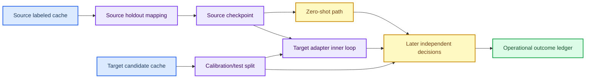

# 特征域迁移云端实验设计与启动门禁

_版本：2026-09-02 · 绑定源提交 `c7bf860` · 用途：云端开发验证，不是产品确认实验_

---

## 🎯 研究问题

本轮只回答一个可证伪问题：在同一 source/target 数据合同、同一 participant holdout 和同一 seed 集合下，`FeatureDomainTransfer` 的 target-only residual adapter 是否能在 later independent target-changing decisions 上不低于 zero-shot 基线。

不把 latent distance、trial AUC 或 calibration suffix 命中率当作主要结论。主要估计量是 operational subject-macro `hit@R`，其中 incomplete candidate coverage、tie、abstain、fit failure 和 participant exclusion 都进入固定请求分母。

## 🧪 实验矩阵

### 主比较

| Arm | Source training | Target calibration | Later test | 作用 |
|---|---|---|---|---|
| `Z0` | Feature-transfer source checkpoint | 无标签更新 | unknown target-changing decisions | zero-shot floor |
| `T1` | 同一 feature-transfer checkpoint | 只更新 target adapter | 独立 later decisions | supervised inner adaptation |

`configs/feature_transfer_cloud_20260902.example.json` 是 `T1` 计划模板。`Z0` 与 `T1` 共用 source cache、target cache、holdout mapping、checkpoint seed 和 preprocessing contract；唯一允许变化是 target calibration inner-loop。

### 必须补跑的结构性对照

主计划之外，使用同一输入和 seed 再生成三份独立计划：

| 对照 | invariant bottleneck | Alignment | Private loss | Target adapter |
|---|---:|---:|---:|---:|
| `B0` plain core | `0` | `0` | `0` | 不可用 |
| `F0` wrapper control | `4` | `0` | `0` | 关闭 |
| `F1` conditional alignment | `4` | `0.05` | `0` | 关闭 |
| `F2` private auxiliary | `4` | `0.05` | `0.05 + 0.01` | 关闭 |
| `T1` target adapter | `4` | `0.05` | `0.05 + 0.01` | 只在 calibration 更新 |

`B0`、`F0`、`F1`、`F2`、`T1` 不能合并成一个模糊的“迁移 arm”。当前 promotion schema 的 training 配置是整份计划级别；因此这些对照应使用同一模板复制后分别修改，而不是在运行时隐式改变参数。

## 🔗 数据和切分



必须满足：

- source/target channel order、geometry、reference、sample rate、filter、baseline、units 和 causal state 完全一致；
- source holdout 与 target participant 使用相同 authority identity contract；
- calibration decisions 是已知 target-changing decisions；
- later test decisions 的 target 在 calibration 时不可见；
- `max(calibration evidence_available_time) < min(test epoch_start_time)`；
- source/domain cache、checkpoint、environment、seed 和计划文件全部保存 SHA-256；
- 当前本地没有 active cache，模板中的 `cloud_inputs/` 和 target IDs 必须在云端 staging 时替换并重新 preflight。

## 📐 统计与停止规则

每个 participant 使用固定 `test_reps=8`，主报告为 evidence level 8 的 operational `hit@R`。同时报告 levels 1--8 的轨迹、coverage、tie、abstain、fit failure、stimuli、seconds 和 latency。

三枚训练 seed 是开发阶段最小重复，不构成确认性 power 证明。分析单位是 participant/decision，不是 trial。跨 seed 的模型不做事后挑选；选择规则在计划文件中冻结。

判定规则：

1. `T1 - Z0` 的 subject-macro operational `hit@8` 不低于 0，且 95% cluster bootstrap 区间记录；
2. `T1` 不能通过删除 incomplete、tie 或 fit-failure participant 提高结果；
3. 如果 invariant distance 下降而 operational `hit@8` 下降，判为 negative transfer；
4. 如果 `T1` 只提高 trial AUC、没有提高 candidate `hit@R`，不得称为 decision gain；
5. 任何 checkpoint、cache、identity 或 preprocessing mismatch 都是 preflight failure，不进入结果分母外的“成功样本”。

## ☁️ 云端 staging 和 dry-run

在云端新建干净目录，先传输 source snapshot、manifest、计划和数据；不要从当前脏 checkout 直接启动：

```bash
mkdir -p n2p3_feature_transfer/{source,cloud_inputs,configs}
tar -xzf source_feature_transfer_c7bf860.source-only.tar.gz -C n2p3_feature_transfer/source
cp source_feature_transfer_c7bf860.manifest.json n2p3_feature_transfer/
cp feature_transfer_cloud_20260902.example.json n2p3_feature_transfer/configs/
```

在 `configs/feature_transfer_cloud_20260902.example.json` 中替换：

- `target_cache`；
- `source_arms[0].cache`；
- `target_subjects[*].target_subject`；
- `target_subjects[*].source_holdout_subject`；
- `output_root`。

然后在 source snapshot 根目录执行：

```bash
python -m pip install -e ".[signals,baselines,dev]"
python -m compileall -q src experiments tests
python experiments/run_candidate_promotion_matrix.py \
  --plan configs/feature_transfer_cloud_20260902.example.json \
  --device cuda \
  --max-workers 1 \
  --dry-run > dry_run.json
```

`dry_run.json` 必须显示：

- source archive commit `c7bf8605d4aa676a5e86be9457fdc8cfabc94aa8`；
- archive SHA-256 `fe2e4ccdf7ffd3cbc8c1a1a7a7d4b4dba8fc9cdce61893689fec7e62d0040a9d`；
- checkpoint argv 含全部 `feature-transfer-*`、`feature-alignment-weight`、`private-domain-weight` 和 `orthogonality-weight`；
- evaluation argv 含 `--head adapter`；
- source/target cache attestation、decoded dataset digest 和 identity mapping 均已解析；
- 任何 target placeholder、缺 cache 或 authority mismatch 都导致 dry-run 非零退出。

通过 dry-run 后才允许执行：

```bash
python experiments/run_candidate_promotion_matrix.py \
  --plan configs/feature_transfer_cloud_20260902.example.json \
  --device cuda \
  --max-workers 1
```

第一轮固定 `--max-workers 1`，先观察 CUDA 可用性、compile warm-up、峰值显存和 checkpoint 产物。只有真实云端设备验证过并且没有 OOM/数据竞争后，才提高并发；不能把历史 RTX 5090 运行记录当作当前云端硬件证明。

## 🧾 产物门禁

每个云端 run 必须保留：

- source archive 和 manifest；
- plan、resolved input record、DAG digest；
- checkpoint batch record 和每个 checkpoint SHA-256；
- per-task stdout/stderr logs；
- candidate result、analysis、decision failure ledger；
- package/dependency/environment record；
- resource record，包括 effective device、precision、batch size、compile/fused 状态和 OOM retry。

不得保留或使用：

- 当前脏工作树中的未提交源文件；
- legacy/pre-v3 cache；
- 未绑定 source snapshot 的 checkpoint；
- target test truth 驱动的 pseudo-label、temperature、threshold 或 source selection；
- 只报告 eligible/complete participant 的结果。

## ⚠️ 当前阻塞与证据边界

本地资源探针显示当前环境是 Windows、Python 3.14、CPU-only，不能验证云端 CUDA。历史资料中 RTX 5090/Torch 2.8/CUDA 12.8 只可作为启动参数参考，不能替代本次云端 runtime probe。

当前 source snapshot 和计划已准备，但真实 active cache、target participant mapping、云端地址和认证信息尚未提供，因此本轮没有执行真实训练，也没有产生 target hit@R 结果。

直到 `dry-run` 和单 worker CUDA smoke 完成，`T1` 只表示“可执行实验臂”，不表示“迁移有效”。
