# N2P3-Net 框架合同验收记录

_版本：2026-09-03 · 绑定提交：`ef7a40e` · 文档角色：代码链与测试验收，不是性能或产品确认报告_

---

## 📋 验收结论

`ef7a40e` 已把 P0 Split-BN、P1 drop-to-consensus 和 P2 direct-decision loss 的**软件与合同层**接入当前 source-training/checkpoint 链。验收证据来自本地 `.venv` 的 focused/full tests、Ruff、编译和 diff 检查。

这份记录不证明跨域性能、真实 CUDA 行为、成人 BrainSync target-switch 结果或 `hit@R >= 0.90`。这些结论仍须在活动规范定义的数据边界和物理冻结产物上重新验证。

## 🔗 代码链

```mermaid
flowchart LR
    accTitle: Framework Contract Chain
    accDescr: The committed source and configuration contracts flow through model training, checkpoint validation, and target evaluation, with explicit fail-closed gates for unsupported or incomplete states.

    plan[📋 Plan and CLI] --> axis[⚙️ Typed domain and decision axis]
    axis --> trainer[🧠 Model and trainer]
    trainer --> checkpoint[📦 Bound checkpoint]
    checkpoint --> target[🔍 Target evaluation]
    target --> ledger[📝 Requested outcome ledger]
    ledger --> gate{✅ Contract valid?}
    gate -->|Yes| evidence[📊 Framework evidence]
    gate -->|No| invalid[❌ Invalid run]

    classDef process fill:#dbeafe,stroke:#2563eb,stroke-width:2px,color:#1e3a5f
    classDef output fill:#dcfce7,stroke:#16a34a,stroke-width:2px,color:#14532d
    classDef warning fill:#fef9c3,stroke:#ca8a04,stroke-width:2px,color:#713f12
    classDef danger fill:#fee2e2,stroke:#dc2626,stroke-width:2px,color:#7f1d1d

    class plan,axis,trainer,checkpoint,target,ledger process
    class gate warning
    class evidence output
    class invalid danger
```

## 📊 已验收机制

| 机制 | 当前链路 | 关键门禁 |
|---|---|---|
| P0 Split-BN | source-domain axis -> `N2P3NetBaseline` -> temporal/spatial/MST buffers -> architecture/checkpoint -> declared target selector | domain index、ordered vocabulary、buffer source 和 weights 必须一致；评估不更新 buffer；`target_calibration` 未安装时失败 |
| P1 drop-to-consensus | source-only residual -> Bernoulli drop -> counterfactual `m=0/m=1` loss ledger -> ratio contract -> checkpoint | target/评估不 route source residual；ratio 固定以 feature 非 batch 维计算，`eps_res=1e-6`、`r_max=0.5`；超限整次 run invalid |
| P2 direct decision | scheduled direct timeline -> `DirectDecisionMetadata` -> complete-decision batch plan -> `DecisionLevelLoss` -> training contract | frozen vocabulary、coverage 和 `y_i=1[c_i=d*]` 必须成立；每 batch 至少 128 rows；`lambda_candidate=0` 也不能绕过 grouped contract；row/column 不可伪装为 direct |

## 🧪 验证证据

| 检查 | 结果 |
|---|---|
| `.venv/Scripts/python.exe -m pytest --collect-only` | 774 tests collected |
| `.venv/Scripts/python.exe -m pytest -q --disable-warnings` | exit 0; 2 skips; no failures |
| focused P0/P1/P2 tests | passed: `test_decision_loss.py`, `test_domain_adapters.py`, `test_splitbn.py`, `test_splitbn_subject_adapter.py`, `test_pretrain_supervised.py`, `test_transfer.py` |
| `.venv/Scripts/ruff.exe check src tests experiments` | passed |
| `.venv/Scripts/python.exe -m compileall -q src experiments` | passed |
| `git diff --check` | passed after the framework commit and will be rerun after this documentation update |

## ⚠️ 测试环境边界

独立总监复跑记录了 9 次全量对照：空闲运行 4 次均全绿；高负载运行 5 次中有 3 次出现
1--2 个 `F`。受控实验已经把失败归因到 WorkBuddy 会话环境，而不是 EEG/契约源码：
bulk-delete guard 的 `SystemExit(1)`、genie-trash 并发 abort、symlink shim 劫持，以及被
系统负载放大的 15ms 并发测试窗口。首个可见失败为
`test_load_synthetic_bnci_candidate_schedule`，回溯显示进程终止源是 WorkBuddy guard；
具体证据见 [`research_evidence_ledger_20260903.zh.md`](research_evidence_ledger_20260903.zh.md) 和
`tmp/flaky_hunt1.log`、`tmp/flaky_hunt2.log`。

当前验收规则是：WorkBuddy 会话内的高负载 pytest 结果不作为代码验收信号；使用云端/独立
shell，或按审计记录 unset `CODEBUDDY_SAFE_DELETE_BULK_STATE_DIR`、
`CODEBUDDY_TOOL_CALL_ID`、`CODEBUDDY_SAFE_DELETE_BULK_GUARD` 后再复跑。15ms 并发窗口的
测试改进仍是可选的测试设计维护，不是产品代码修复。仓库外的
`%TEMP%\pytest-of-chent`（约 556MB、8000+ 文件）和本地 hunt 目录由人工决定是否清理，
不影响 WorkBuddy 故障“不归责于项目代码”的判定。

## ⚠️ 开放边界

- 当前只有 framework/contract evidence；没有 active real source/target cache、CUDA smoke、真实 target-calibration collector 或成人 BrainSync multi-session/target-switch confirmation
- P2 实现仅覆盖 direct candidate membership。row/column 需要独立的 factorized objective 和 typed protocol dispatch，不能复用 direct 9-choice CE
- target result/manifest 尚未完整重复记录 effective Split-BN buffer source、estimand、buffer digest、executed-source identity、environment digest 和 target OOM requested-denominator outcomes
- `ef7a40e` 是 Git 提交，不是物理 source freeze。真实运行前必须在 `frozen/` 生成与 manifest 配对的新 archive，并绑定 cache、environment、plan 和 checkpoint

## 🗂️ 关联记录

- 活动规范：[`research_program.zh.md`](research_program.zh.md)
- 文档控制索引：[`README.md`](README.md)
- 实施与数学记录：[`implementation_plan_20260902.zh.md`](implementation_plan_20260902.zh.md)、[`math_verification_20260902.zh.md`](math_verification_20260902.zh.md)
- 架构与实证依据：[`architecture_decision_20260902.zh.md`](architecture_decision_20260902.zh.md)、[`research_evidence_ledger_20260903.zh.md`](research_evidence_ledger_20260903.zh.md)
- 历史审计/派工/云端计划归档：[`../frozen/document_history_through_ef7a40e_20260903.manifest.json`](../frozen/document_history_through_ef7a40e_20260903.manifest.json)
