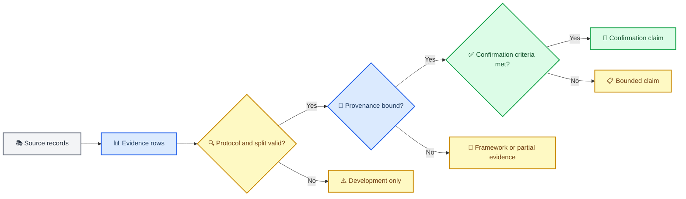

# N2P3-Net 实证与外部依据台账

_版本：2026-09-03 · 文档角色：历史实测、机制依据、工程审计与证据边界的唯一汇总台账；不授权新的实验设计_

---

## 📋 台账定位

本文把原先分散在 dated status report、特征域研究报告、合同依据和全量审计中的有效信息
收敛到一个可引用入口。它是证据记录，不是活动规范；新的研究设计、代码变更和晋升门禁
仍只由 [`research_program.zh.md`](research_program.zh.md) 控制，当前代码验收见
[`framework_acceptance_20260903.zh.md`](framework_acceptance_20260903.zh.md)。

证据按强度分层：

| 层级 | 本项目含义 | 当前状态 |
|---|---|---|
| `confirmation` | 成人 BrainSync、多 session、多 target-switch、预声明分母和完整 bundle | 尚无 |
| `development` | GTN、BI/BNCI 真实数据上的 subject/cross-decision 开发结果 | 有，协议受限 |
| `framework` | `ef7a40e` 的代码、合同、反例和本地测试 | 已有 |
| `external` | 文献和方法先例 | 仅支持假设，不是本项目复现 |

项目章程仍由 [`mission.md`](mission.md) 维护，运行时/依赖约定由 [`techstack.md`](techstack.md)、
[`device-portability.md`](device-portability.md) 和 [`CODING_WORKFLOW.md`](CODING_WORKFLOW.md)
维护；这些活动工程文档没有被历史报告归档或替换。

### 证据链

## 📊 实测结果

### 输入与主干基线

当前工程主线是 causal-v3：`full_unfold + K35`、128 Hz、0.1--30 Hz、`[-200,1200) ms`、
179 samples、forward steady-state 和 source QC 100 uV。归档的早期 BI2014a 跨-decision
结果仍含 causal-v2；不同 causal contract 不能直接合并数值。输入合同与当前活动合同的
关系见 [`input_contract_math.zh.md`](input_contract_math.zh.md)；硬件采集率、模型张量率和
causal/offline filter 状态不能混写。

GTN 是儿童、3 通道、每人一个固定 thought digit 和一次 selection 的 development cohort，
不能产生成人 BrainSync 9-choice confirmation。旧合同和结果已在
`frozen/research_evidence_through_20260901-d1db8e4.tar.gz` 物理隔离。

### GTN 与 BI development 结果

#### 信号与 QC

旧主干 `ms_flatten + K65` 的固定 `R=5` 对照中，0.1 Hz/1200 ms 的 conditional hit@5 为
`0.578`、operational hit@5 为 `0.543`、AUC 为 `0.709`；source QC100 相对 no-QC 的
operational hit@5 提升 `+0.118`，95% CI `[+0.053,+0.184]`。因此 source QC100 是冻结的
开发合同，target-prefix QC 不作为零样本默认。

#### BI2014a 跨 decision 校准

64 人 causal-v2 cache 以前 5 个已知 character decisions 校准，后续未知 decisions 取
每个 row/column 的前 2 repetitions。requested decisions 为 `1416`，eligible 为 `964`，
失败的 `452` 保留在 operational 分母。

| Arm | subject-macro hit@2 |
|---|---:|
| zero-shot + source stats | **0.1941** |
| classifier fine + source/shrinkage | 0.1952 / 0.1958 |
| full fine + source/shrinkage | 0.1994 / 0.1989 |
| linear scratch + source/shrinkage | 0.1524 / 0.1518 |
| MLP16 scratch + source/shrinkage | 0.1831 / 0.1774 |
| classifier/full/linear/MLP16 + target stats | 0.1569 / 0.1590 / 0.1148 / 0.1294 |

`classifier_fine_shrinkage - zero_shot_source` 为 `+0.18 pp`，95% CI `[-0.78,+1.04] pp`；
`full_fine_shrinkage - zero_shot_source` 为 `+0.45 pp`，95% CI `[-0.52,+1.33] pp`，均不
支持晋升。target stats 在 classifier/full 上约低 `-3.83/-4.04 pp`；linear scratch
shrinkage 相对 zero-shot 低 `-4.22 pp`。该结果只说明 BI2014a 的跨 decision 校准边界，
不能外推 BrainSync。

#### BI+BNCI 多源联合

相同 BI target blocks、5 导 common-CAR、causal-v2、`full_unfold + K35`、100 epoch、3 seeds
和 operational hit@2 的开发矩阵如下：

| Source arm | subject-macro hit@2 | 相对 BI-only |
|---|---:|---:|
| BI-only CAR5 | **0.1300** | reference |
| BI+BNCI uniform CAR5 | 0.0967 | `-3.33 pp` |
| BI+BNCI, BI 3x / BNCI 1x | 0.1239 | `-0.61 pp` |

uniform joint 相对 BI-only 的 95% CI 为 `[-5.90,-1.28] pp`，三个 seed 同号；3x/1x
相对 uniform 恢复 `+2.72 pp`，但仍未超过 BI-only。固定 optimizer rows、batch 和 steps，
只更换为 BI-source input stats 后只恢复 `+0.07 pp`，95% CI `[-0.36,+0.62] pp`，
`p=0.837`。因此这批证据不支持把负迁移主因归为 mean/std 污染，更符合域梯度暴露和
判别方向冲突；BNCI 并未被证明“必然有害”。

#### 核长与端到端微调

在同一 full-unfold 链路下，三种 ST kernel 的开发结果为：

| Kernel | balanced-all | raw-all | AUC | hit@5 | hit@8 |
|---|---:|---:|---:|---:|---:|
| **K35** | **0.6694** | **0.6871** | **0.6938** | **0.4571** | **0.4490** |
| K65 | 0.6544 | 0.6694 | 0.6862 | 0.4340 | 0.4177 |
| K33 | 0.6231 | 0.6231 | 0.6807 | 0.4095 | 0.4027 |

K35 三 seed 稳定优于 K33，但 K35-K65 的 CI 跨 0，因此 K35 是临时工程默认，不是统计
确认的唯一赢家。all-evidence count-neutral mean 为 K35 `0.7143`、K65 `0.6830`；
sqrt-count 和 raw sum 均较低，说明 `hit@R`、all-evidence 和 evidence count 是不同估计量。

2 kernels x 3 seeds x 4 target blocks 的 30-epoch 端到端微调中，K35 learned-tempered 为
`0.6884`，仍低于同一 backbone 的 no-fine mean `0.7143`；主要损失来自 backbone 联合
微调，而不是训练未跑满。因此当前不把全参数 listwise/端到端微调设为默认。

### 历史裁决

| 旧假设 | 当前证据支持的裁决 |
|---|---|
| zero-state forward IIR 可用于 prefix/suffix | 否；startup transient 会污染时序比较，采用 steady-state first sample |
| 同一 GTN selection 的 labelled prefix 是个人校准 | 否；只能记为 O5 oracle proxy |
| K33 应替代 K35 | 否；K35 三 seed 稳定胜 K33，但 K35 与 K65 尚未统计分离 |
| `hit@5` 是自然主指标 | 否；它只是固定预算切片，主报告保留完整 `hit@R` 曲线与成本 |
| tiny Platt 可直接校准候选排序 | 否；负 slope 可能反转排序，采用解析 offset 与正温度约束 |
| all-evidence 必须 balanced 截断或 raw sum | 否；开发结果支持 count-neutral candidate mean |
| 全参数 listwise 联合训练应默认提升 | 否；30-epoch 微调的 backbone 负迁移超过决策头回收 |

### 证据成本

历史 GTN/BI 结果同时保存准确率和刺激成本；不同 repetition 预算不能只按 accuracy 排序：

| Endpoint | 有效 trials | scheduled stimuli | elapsed time |
|---|---:|---:|---:|
| balanced-all | 145.51 | 195.07 | 295.63 s |
| raw-all | 205.40 | 205.40 | 311.22 s |
| `R=5` | 45 | 78.74 | 118.62 s |
| `R=8` | 72 | 111.88 | 168.67 s |

固定预算的 operational accuracy 同时受模型命中和 coverage 影响；动态 stopping 必须另报
实际 repetition、秒数、刺激数、abstain/failure 和正确选择/分钟，不能用 eligible-only
accuracy 替代 requested-denominator 结果。

### BNCI-target 多源矩阵

`295942e` causal-v3 CAR5 运行包含 4 arms x 3 seeds x 8 名 ALS 被试，目标为 6x6
row/column、5 个已知 calibration decisions 加 30 个未知 later decisions。subject-macro
主表如下；它是 development/evidence，不是 BrainSync 9-choice confirmation。

| Arm | AUC | hit@1 | hit@2 | hit@8 |
|---|---:|---:|---:|---:|
| B0 `bnci_only` | **0.6641** | **0.1125** | 0.1986 | **0.3417** |
| J0 `joint_natural` | 0.5679 | 0.0347 | 0.0486 | 0.1222 |
| J1 `joint_bnci80_epoch` | 0.6474 | 0.0750 | 0.1583 | 0.2736 |
| J2 `joint_bnci80_participant` | 0.6496 | 0.0806 | 0.1681 | 0.2667 |

预注册 subject-cluster 对照：J0-B0 hit@8 为 `-21.94 pp`，CI `[-37.50,-6.25]`；J1-J0
为 `+15.14 pp`，CI `[+4.17,+27.36]`；J2-J1 为 `-0.69 pp`，CI `[-1.94,+0.97]`。
三个 seed 的 arm 顺序一致，支持“当前联合源不晋升”，但 n=8 的 hit@8 检验欠功效，不能
写成普遍性定理。该方向触发了继续做梯度冲突/结构隔离的预注册门禁。

## 🧠 机制与外部依据

### P300 模型与域迁移

EEGNet 和 MS-EEGNet 提供紧凑时空卷积、多尺度 temporal receptive field 和 subject-held-out
的可复核基线；MS-EEGNet 在不同 P300 数据集上的结果并不统一，不能写成总是优于 EEGNet[^1][^2]。
跨数据集 variability 研究支持把采样率、通道、参考、设备和刺激设计作为显式 domain shift，
而不是静默通道替换[^3]。因此当前实现保持 plain N2P3Net core，把 invariant/private、
Split-BN、source residual、target residual 和 decision loss 分置于明确合同中。

### 少校准适配

MAML、Reptile、FiLM、原型网络和 LoRA 的证据主要来自睡眠、运动想象、语音 MEG 或大模型，
不是本项目匹配的 P300 LOSO/cross-decision 证据。它们只能作为后续候选假设；当前不能把
“FiLM + Reptile 最优”写成已验证结论。现行实现选择低容量 residual adapter，是为了
identity initialization、target-only update、no-borrow fallback 和可审计回退，不是由文献
直接证明其性能最优。

### 自监督与 EEG foundation model

LaBraM、BENDR、EEGPT、BIOT 和 EEG foundation-model benchmark 没有提供与本项目相同的
3--8 通道、P300 trial、subject-disjoint、candidate-decision 匹配证据。EEG-FM-Bench 的
目标对齐、身份捷径和重构梯度冲突提醒，不能用模型规模替代任务合同[^4][^5][^6]。
SpellerSSL 的 94% 字符识别结果属于其自身的 domain/protocol，支持任务导向 SSL 和分阶段
适配作为候选机制，但不是 N2P3-Net 或 BrainSync 结果[^7]。

| 候选方向 | 可迁移的外部信息 | 当前项目裁决 |
|---|---|---|
| FiLM 条件化 | 语音 MEG/EEG 的条件调制先例 | 可作为低容量候选；没有匹配 P300 LOSO 证据 |
| MAML / Reptile | 睡眠或运动想象的少样本适配先例 | 可作为 meta-learning 候选；不能写成 P300 已验证优势 |
| 原型网络 | 极少样本的无梯度 prototype 机制 | P300 latency/morphology 变化未解决，暂不作默认 |
| LoRA / low-rank | 大模型参数高效微调 | N2P3Net 本身紧凑，EEG/P300 直接证据不足 |
| MoE / source experts | 多专家容量与域隔离的概念 | 计算与方差成本高，当前不采纳 |

当前接受的 target 适配仍是低容量 residual adapter：identity initialization、target-only
update、显式 ratio gate、无 target BN 漂移和 no-borrow fallback。任何候选都必须在匹配的
P300 cross-decision protocol 中相对 B0 验证，外部任务的结果不能直接换算。

### provenance 与统计合同

BIDS 将 participant、session、task 和 run 分开建模；本项目进一步强制
`Session != Decision != Block != StimulusEvent`，避免从 block 猜 decision[^8]。BIDS Derivatives
和 W3C PROV-DM 的来源/活动关系支持把 identity、lineage、operation 和参数 digest 分开记录[^9]。
Model Cards 与 Datasheets 支持把用途、来源、限制和评估范围绑定到机器可读制品[^10][^11]。
模型选择偏差、小样本误差条和 cross-validation 的条件 estimand 需要分开记录；因此项目把
固定 checkpoint 的 participant interval 与 training-procedure interval 分开实现[^12][^13][^14]。

## ⚠️ 工程审计与运行纪律

### WorkBuddy 测试故障

对同一代码的 9 次全量复跑中，空闲运行 4 次全绿，高负载运行 5 次中 3 次异常。受控实验
已定位四种责任层：

| 模式 | 责任层 | 判定 |
|---|---|---|
| bulk-delete guard `SystemExit(1)` | WorkBuddy safe-delete guard | 项目代码无责 |
| genie-trash concurrent abort | WorkBuddy trash shim | 项目代码无责 |
| symlink 被 shim 静默降级 | WorkBuddy symlink shim | 防护代码无责 |
| 15 ms 并发窗口在负载下 `peak=1` | 测试设计的计时敏感性 | 非产品代码缺陷 |

首个可见失败为 `test_load_synthetic_bnci_candidate_schedule`，回溯显示进程被 guard 终止。
因此 WorkBuddy 会话内的高负载 pytest 不能作为代码验收信号；使用独立 shell/云端，或 unset
`CODEBUDDY_SAFE_DELETE_BULK_STATE_DIR`、`CODEBUDDY_TOOL_CALL_ID`、
`CODEBUDDY_SAFE_DELETE_BULK_GUARD` 后复跑。`%TEMP%\pytest-of-chent` 的约 556 MB、8000+
文件及本地 hunt 目录属于人工清理项，不是项目源码缺陷。

## 🎯 当前裁决与下一步

### 已支持的判断

- 当前 pooled multi-source CE 在 BI-target 和 BNCI-target development 方向均未胜过对应单域 baseline；
- mean/std 更换不能解释主要负迁移，下一步应保持 row、batch、step 不变，隔离域梯度质量或结构参数空间；
- `hit@R` 是重复前缀后的 top-1 selection，不是 top-R ranking；trial AUC、candidate hit、character accuracy、ITR 不能互换；
- P0/P1/P2 的 framework/contract 已提交，但真实效果仍需新 source/cache/environment/plan bundle；
- 目标 calibration 必须低容量、target-only、可回退，并保留 no-borrow 对照。

### 尚未支持的判断

- feature transfer、decision learning 或 bilevel adaptation 已有效；
- 任一 foundation model、FiLM、Reptile、LoRA 或 MoE 已优于 B0；
- 成人 BrainSync 9-choice 达到 `hit@R >= 0.90`；
- `target_calibration` 已有 model-wide collector、buffer provenance 和结果 ledger；
- 高负载 WorkBuddy pytest 的失败来自项目源码。

### 下一步科研优先级

1. 从 raw 重建 causal-v3 BI/BNCI/GTN source/target cache，并为当前 `ef7a40e` 生成 source-only archive
2. 采集 analysis-ready 的成人 BrainSync multi-session/multi-decision/target-switch 数据
3. 在 matched row、batch、step、seed 和 fold 下做 pooled-BN、P0、P1 以及允许的 direct P2 对照
4. 先完成 executed-source identity、environment digest、target-calibration collector 和 target failure ledger
5. 在统一 prediction ledger 上研究 evidence efficiency、dynamic stopping、latency tolerance 和 cost

## 🗂️ 来源映射与物理归档

| 已收敛来源 | 有效内容去向 | 当前文件状态 |
|---|---|---|
| `research_status_report_20260831.zh.md` | GTN/BI 输入、QC、校准、核长和微调数字 | 已纳入本台账；原件归档 |
| `research_status_report_20260902.zh.md` | BNCI-target 295942e 矩阵和下一轮优先级 | 已纳入本台账；原件归档 |
| `feature_domain_transfer_research_20260902.zh.md` | 域迁移机制、few-shot 与 foundation-model 边界 | 已纳入本台账；原件归档 |
| `contract_hardening_basis_20260901.zh.md` | BIDS/PROV、Model Cards、统计合同依据 | 已纳入本台账；原件归档 |
| `supervisor_full_audit_20260903.zh.md` | WorkBuddy 根因、责任判定和复跑纪律 | 已纳入本台账；原件归档 |
| `doc/literature/literature_review_*.md` | foundation/few-shot 候选边界 | 已纳入本台账；原件归档 |

上述 7 份原件位于 [`../frozen/document_reports_through_6c4abe8_20260903.manifest.json`](../frozen/document_reports_through_6c4abe8_20260903.manifest.json)
和配套压缩包中。归档 SHA-256：
`7ffe7bde08508c903a5310532c967cd479545ec57d341e93f21debd4a5c72556`。

当前活动文档集合见 [`README.md`](README.md)。论文写作使用
[`../Paper/literature_review_n2p3net_20260903.zh.md`](../Paper/literature_review_n2p3net_20260903.zh.md)，
而非已归档的候选稿。

## 🔗 参考文献

[^1]: Lawhern et al. (2018). EEGNet: a compact convolutional neural network for EEG-based brain-computer interfaces. https://doi.org/10.1088/1741-2552/aace8c
[^2]: Borra et al. (2021). MS-EEGNet: a novel deep learning model for P300 signal classification. https://doi.org/10.3389/fnhum.2021.655840
[^3]: Xu et al. (2020). Cross-Dataset Variability Problem in EEG Decoding With Deep Learning. https://doi.org/10.3389/fnhum.2020.00103
[^4]: Xiong et al. (2025). EEG-FM-Bench. https://arxiv.org/abs/2508.17742
[^5]: Lin et al. (2026). The Identity Trap in EEG Foundation Models. https://arxiv.org/abs/2606.06647
[^6]: Understanding and Correcting Low-Frequency Bias in EEG Foundation Models. https://arxiv.org/abs/2608.01898
[^7]: Hong et al. (2025). SpellerSSL. https://arxiv.org/abs/2509.19401
[^8]: Gorgolewski et al. (2016). The brain imaging data structure. https://doi.org/10.1038/sdata.2016.44
[^9]: W3C. PROV-DM: The PROV Data Model. https://www.w3.org/TR/prov-dm/
[^10]: Mitchell et al. (2019). Model Cards for Model Reporting. https://doi.org/10.1145/3287560.3287596
[^11]: Gebru et al. (2021). Datasheets for Datasets. https://doi.org/10.1145/3458723
[^12]: Varma and Simon (2006). Bias in error estimation when using cross-validation for model selection. https://doi.org/10.1186/1471-2105-7-91
[^13]: Varoquaux (2018). Cross-validation failure: Small sample sizes lead to large error bars. https://doi.org/10.1016/j.neuroimage.2017.06.061
[^14]: Bates et al. (2023). Cross-validation: what does it estimate and how well does it do it? https://doi.org/10.1080/01621459.2023.2197686
