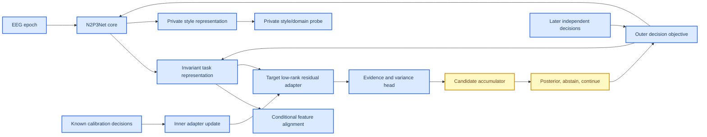

# N2P3-Net 特征域迁移活动科研规范

_版本：2026-09-02 · 唯一活动指导文件 · 适用范围：N2P3-Net P300/ERP 域迁移、目标校准与候选决策_

## 1. 目标与不可偷换的估计量

最终产品目标是成人 BrainSync：同一被试完成预声明的已知 calibration decisions，随后在目标数字未知且目标发生变化的 later independent decisions 中，以固定最大证据预算完成 9 选 1。主指标是 subject-macro operational `hit@R`；缺 candidate、tie、abstain、fit failure 和 participant selection failure 都必须进入预声明分母。

下面三个估计量严格分开：

| 估计量 | calibration | test | 允许结论 |
|---|---|---|---|
| `Z0` | 0 target labels | target-excluded session-start suffix | zero-shot/domain-generalization |
| `S` | early known target-changing decisions | later unknown target-changing decisions | 合法 supervised personalization |
| `O5` | same-selection prefix labels | same-selection suffix | oracle proxy，不是未知目标确认 |

GTN 只有一个固定 thought digit/selection，不能产生产品 90% 证据。BI2014a 可用于跨 decision 机制；成人 BrainSync multi-session/target-switch 才能裁决产品目标。

## 2. 活动架构



### 2.1 N2P3Net core

`N2P3Net` 是纯核心模型，只负责 EEG 时空编码和原有 readout：

```text
(B,C,T) -> temporal conv/BN -> spatial conv/BN/ELU -> pooling
         -> existing MST branches -> declared pooling -> classifier
```

核心不得知道 domain vocabulary、target subject、calibration/test mask、candidate state 或 alignment coefficient。其架构、通道、采样率和 receptive field 必须继续由 [`src/models/n2p3net.py`](../src/models/n2p3net.py) 维护。

### 2.2 Invariant/private decomposition

核心 structured feature 为：

\[
H=f_\theta(X)\in\mathbb R^{B\times C_f\times T_f}.
\]

活动迁移 wrapper 产生：

\[
Z_{inv}=H+\rho_{inv}\tanh(a_{inv})A_{inv}(H),
\]

\[
Z_{priv}=A_{priv}(H).
\]

`Z_inv` 负责跨域可迁移的 P300 evidence；`Z_priv` 只吸收采集、被试、设备和 session style，当前主路径仅用于 style/domain probe 与正交辅助损失，不直接进入 classifier 或 target residual。禁止把“domain probe 下降”单独解释为迁移成功；`Z_inv` 的 task performance 必须不下降。

### 2.3 Target adapter

目标 adapter 为：

\[
H_t=Z_{inv}+\rho_t\tanh(a_t)A_t(Z_{inv}),
\qquad a_t=0.
\]

它必须满足：

- 零初始化时输出与 source path 逐位一致；
- 只在 target calibration inner loop 中更新；
- 不含 target BatchNorm running state；
- 默认不解冻 core、invariant map 或 source classifier；
- 低秩、低容量、有 residual norm bound；
- unseen target 不依赖 source-domain ID；
- 没有合适 source 时允许 no-borrow/no-adapt 回退。

### 2.4 Feature alignment

source 有真实 binary labels 时，对 `Z_inv` 做 class-conditional alignment：

\[
\mathcal L_{c-align}
=\sum_{c=0}^{1}\sum_{d_1<d_2}
\left\|\mu_{d_1,c}-\mu_{d_2,c}\right\|_2^2
 +\kappa\left\|C_{d_1,c}-C_{d_2,c}\right\|_F^2.
\]

第一版只启用均值项，CORAL covariance 项作为独立 ablation。marginal `P(Z)` alignment、无条件 GRL 和伪标签 alignment 不得进入默认 recipe。

有效 cell 数、样本数、每域质量、alignment distance 和 task loss 必须保存。cell 不足时标记 `alignment_inactive` 或 fail-closed，不能把缺项当零距离。

## 3. 三种训练 regime

### 3.1 Domain generalization（DG）

只有 source labeled data：

\[
L_{DG}=L_{trial}+\lambda_{set}L_{candidate}
 +\lambda_{align}L_{c-align}
 +\lambda_{priv}L_{priv-domain}
 +\lambda_{orth}L_{orth}.
\]

它只能证明 held-out domain generalization，不能声称已经对齐到一个未观测 target。

### 3.2 Unsupervised domain adaptation（UDA）

source labeled + target unlabeled：

\[
L_{UDA}=L_{source}+\lambda_{target}L_{target-style}
 +\lambda_{align}L_{gated-target-align}.
\]

target alignment 必须有 confidence/coverage gate 和 no-adapt 对照。不能用 target test truth 选择 pseudo-label、temperature 或 alignment weight。

### 3.3 Supervised few-shot transfer

source labeled + target calibration labels：

内层只更新 target adapter/evidence calibration：

\[
\eta_v^*=operatorname{Unroll}_K\left(
\eta_0,\nabla_\eta L_{cal}(C_v)
\right).
\]

外层在 later independent target-changing decisions 上：

\[
L_{outer}=L_{decision}(T_v;\theta,\eta_v^*,\omega).
\]

如果内外层使用同一 decisions 或同一 suffix，则不是合法 bilevel evidence。

## 4. 决策核心

所有 runner 只能使用统一 candidate-evidence 接口。`models/candidate_evidence.py` 是当前通用 score/coverage/tie/fail-closed 核心；后续可扩展，但不能重新创建 runner 私有聚合实现。

### 4.1 Evidence head

模型输出：

\[
(e_i,\log v_i,q_i)=g_\phi(Z_i),
\quad v_i>0.
\]

`e_i` 只有经过合法校准才可称 LLR；否则称 evidence score。`v_i` 和 `q_i` 只能由训练/calibration 观察估计，不能由 test correctness 反推。

### 4.2 Candidate state

对 candidate (d) 和 evidence level (r) 保存：

\[
A_{d,r}=\sum w_i e_i,\quad
B_{d,r}=\sum w_i,\quad
Q_{d,r}=\sum w_i^2,\quad
N_{d,r}=\#\{q_i=1\}.
\]

candidate posterior 使用冻结 vocabulary：

\[
P(d\mid E_{1:r})=\operatorname{softmax}_{d\in V}
\rho_\omega(A_{d,r},B_{d,r},Q_{d,r},N_{d,r},coverage_{d,r}).
\]

第一版 `rho` 为线性/温度参数；不能用小样本任意 MLP 学 candidate code。

### 4.3 状态机

```text
incomplete -> wait or abstain
complete + low posterior/margin -> abstain or continue
complete + unique confident winner -> accept
fit failure -> evaluation_failed
```

`tie`、`abstain`、`incomplete`、`fit_failure` 是不同状态；所有状态都进入结果 ledger。dynamic stopping 另设 cost-sensitive arm：

\[
L_{stop}=1[wrong]+\lambda_t seconds+\lambda_s stimuli.
\]

## 5. 评估协议

### 5.1 必须同时运行的对照

| 对照 | 作用 |
|---|---|
| B0 single-domain/no-adapt | no-transfer floor |
| domain ceiling | 同域 subject holdout 上限 |
| domain LODO | 完整 held-out domain 泛化 |
| pooled source | 复现当前自然联合负迁移 |
| invariant-only | 分解模块的 task control |
| private-enabled | 检查 style 分支是否泄漏 task |
| target adapter | 合法 calibration inner loop |
| no-borrow fallback | source selection 失败控制 |

`domain_lodo` 与 `domain_ceiling` 当前只定义并校验外层 fold 的域/被试隔离，
不会自动把 domain ID 注入模型损失或推理路径。只有显式传入 source-domain
axis 并启用相应 auxiliary weight 时，训练器才计算条件 alignment 或
private-domain loss；因此 fold 合法性不应被误报为已经完成特征域对齐。

### 5.2 主指标和支持指标

主指标：

- subject-macro operational `hit@R`；
- requested participant/decision denominator；
- coverage、tie、abstain、fit failure；
- stimuli、seconds、latency。

支持指标：

- trial AUC/BACC；
- candidate NLL/ECE/Brier；
- posterior margin/entropy；
- invariant/private domain probe；
- per-domain gradient cosine；
- class-conditional feature distance；
- ERP morphology、channel saliency；
- parameter count、peak memory、batch-1 latency。

latent distance 下降而 target hit@R 下降时，必须判为 negative transfer。

### 5.3 训练和测试边界

- source/domain cache、checkpoint、environment、seed、channel order、reference、causal state 固定；
- target calibration/test decisions 严格按时间和目标变化切分；
- `max(calibration evidence_available) < min(test epoch_start)`；
- normalization、QC、temperature、adapter initialization 和 stopping threshold 的来源逐项记录；
- final test 不参与模型、域权重、source selection、pseudo-label 或 threshold 选择。

## 6. 实施门禁

### Gate A：核心和 wrapper

- 纯 N2P3Net core 与 transfer wrapper 参数空间分离；
- old `domain_adapters` checkpoint 不进入活动路径；
- transfer architecture record 可严格重建；
- identity-at-init、target-only parameter update、unknown target/no-borrow 反例通过。

### Gate B：conditional alignment

- source labeled conditional mean alignment；
- source-domain gradient cosine diagnosis；
- invariant/private orthogonality；
- single-axis CORAL 或 RBF-MMD；
- no alignment、marginal alignment、conditional alignment 对照齐全。

### Gate C：target inner adaptation

- BI early-known -> later-unknown 机制先行；
- target adapter 1/3/5-step unroll；
- source classifier/core frozen；
- no-borrow/no-adapt fallback；
- 不把 same-selection O5 晋升为产品 personalization。

### Gate D：outer bilevel

- held-out source subject/domain meta episodes；
- outer later decision objective；
- first-order vs exact unroll；
- training-procedure uncertainty 与 participant-cluster uncertainty 分开。

### Gate E：BrainSync 产品裁决

- 成人、多 session、多 target-switch decisions；
- 固定绝对 calibration budget 和最大 R；
- operational denominator 包含失败；
- 只有这一门可以产生 90% 产品结论。

## 7. 强制反例

1. candidate/truth 同步置换不改变命中；
2. constant logit bias 不应在 unequal candidate counts 下改变正确排序；
3. candidate outside vocabulary 必须 fail-closed；
4. missing candidate 不能缩小 vocabulary 后继续 argmax；
5. exact tie 不能按数字编码破局；
6. arbitrary pseudo-target 不能获得同样增益；
7. domain probe 降低但 task hit 降低时不得晋升；
8. source adapter 在训练启用而推理未 route 时不得产生有效结果；
9. BN buffer 不能随 target batch 顺序产生未记录的预测差异；
10. adapter residual 超过声明 bound 或 zero-init 不等价时 fail；
11. inner loop 不能访问 outer later decision；
12. dynamic stopping 必须显示额外刺激和秒数；
13. source/domain fold 必须覆盖且不泄漏 participant；
14. trial AUC 提升不能替代 candidate hit@R 提升。

## 8. 历史原型处置

以下内容不再是活动指导，也不应生成新的实验：

- source-domain `DomainAdapterBank`；
- S1/A1/AS1 原型组合；
- 仅 source-source conditional mean 就宣称 target feature alignment；
- pooled natural CE 作为默认迁移方法；
- target prefix full-fine 作为默认个性化；
- 只靠 source/target mean/std 或 CAR 声称完成特征域对齐；
- 旧的多套 decision aggregator、旧 LLR/mean 混合命名和未使用的 z-score 置信度解释。

历史运行结果和论文 PDF 可以保留在 `Paper/`、`tmp/` 或物理冻结归档中，但只能作为 evidence，不得复制成活动 checkpoint、cache 或指导默认。

## 9. 当前状态

截至 2026-09-02：

- N2P3Net core、causal-v3 输入合同和统一 candidate-evidence core 保留；
- `FeatureDomainTransfer` 已接入 N2P3NetBaseline、source pretraining、checkpoint 和 target inner-loop；
- source 域 ID 仅用于风险/条件对齐/private-style 监督，不再进行 source adapter routing；
- private path 已接入可选 domain probe 与正交辅助损失；target inner-loop 只更新 target residual adapter；
- candidate runner 的 evidence/coverage 核心仍沿用统一接口，但 learned evidence head、candidate-set outer bilevel 与动态停止尚未完成端到端实现；
- 295942e BNCI-target 结果只能证明当前 pooled multi-source 负迁移和其机制方向；
- 所有“特征域迁移有效”“双层学习有效”“产品达到 90%”均暂未成立。

新架构科研报告见 [`feature_domain_transfer_research_20260902.zh.md`](feature_domain_transfer_research_20260902.zh.md)。
