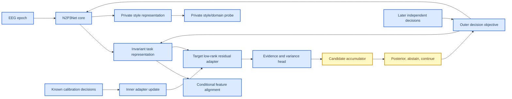

# N2P3-Net 特征域迁移活动科研规范

_版本：2026-09-04 · 活动基线：`352932b`（分支 `main`，v2 主线首轮实施；历史集成基线 `6fc1df1` 保留）· 唯一活动指导文件 · 适用范围：N2P3-Net P300/ERP 域迁移、目标校准与候选决策_

> 2026-09-02b 架构裁决（见 [`architecture_decision_20260902.zh.md`](architecture_decision_20260902.zh.md)）：
> 横向嵌套（多个 N2P3Net 当外层网络神经元）被否决；活动方向改为纵向分层——
> 共享 trunk + 可丢弃源域残差 + invariant/private 分解 + target 残差 + 可微决策集合层。
> 三项新增强制机制：Split-BN 诊断（P0）、drop-to-consensus 域残差（P1）、决策级可微损失（P2）。
>
> 2026-09-04 域迁移主线裁决（已批准）：主线改为 **EA 默认数据对齐 → N2P3Net trunk →
> faithful AS-MMD（target-weighted CE + logit marginal RBF-MMD + Split-BN）→ TSD 选样**；
> 本地 “GALIA” 实现更名 **AJD congruence whitening (ACW)** 并只作辅助坐标/经典解码，
> 真 GALIA 与 Dense PDS 为可选对照。实施、arm 命名与门禁以
> [`domain_transfer_mainline_v2_plan_20260904.zh.md`](domain_transfer_mainline_v2_plan_20260904.zh.md) 为准。

## 📋 0. 文档控制与活动基线

本文是唯一可以改变新研究设计、代码任务和结论边界的活动规范。文档导航与角色见
[`README.md`](README.md)；输入时间轴、单位和分组的绑定补充合同见
[`input_contract_math.zh.md`](input_contract_math.zh.md)。架构裁决、数学推导、实施计划和
审计记录只能解释或验证本规范，不能以旧状态覆盖它。

当前活动基线是 `ef7a40e feat: add split-bn residual and decision-loss contracts`。
P0/P1/P2 的 framework/contract 链已落地并通过本地测试，但没有 active real cache、CUDA
运行、matched fold/seed paired CI 或成人 BrainSync target-switch confirmation。因此所有
机制仍只具有软件与合同证据，不具有跨域疗效、产品性能或 confirmation 证据。

总监复跑的 9 次全量测试已将高负载异常定性为 WorkBuddy 会话环境故障，而不是源码缺陷：
bulk-delete、trash、symlink shim 和一个被负载放大的 15ms 并发测试窗口共同造成异常。
WorkBuddy 会话内的高负载 pytest 结果不作为验收信号；应使用独立 shell/云端，或按验收记录
unset 守卫变量后复跑。详见 [`framework_acceptance_20260903.zh.md`](framework_acceptance_20260903.zh.md)
和 [`research_evidence_ledger_20260903.zh.md`](research_evidence_ledger_20260903.zh.md)。

## 1. 目标与不可偷换的估计量

最终产品目标是成人 BrainSync：同一被试完成预声明的已知 calibration decisions，随后在目标数字未知且目标发生变化的 later independent decisions 中，以固定最大证据预算完成 9 选 1。方法学主指标是 subject-macro valid-subject `hit@R`：每个被试的分母只含状态为 correct/incorrect/tie 的判定，无有效判定的被试整体排除；部署口径 requested-participant operational `hit@R`（缺 candidate、tie、abstain、fit failure、selection failure 都计入失败）必须作为诊断轨道同时报告，不得删除。

下面三个估计量严格分开：

| 估计量 | calibration | test | 允许结论 |
|---|---|---|---|
| `Z0` | 0 target labels | target-excluded session-start suffix | zero-shot/domain-generalization |
| `S` | early known target-changing decisions | later unknown target-changing decisions | 合法 supervised personalization |
| `O5` | same-selection prefix labels | same-selection suffix | oracle proxy，不是未知目标确认 |

GTN 只有一个固定 thought digit/selection，不能产生产品 90% 证据。BI2014a 可用于跨 decision 机制；成人 BrainSync multi-session/target-switch 才能裁决产品目标。

## 2. 活动架构



### 2.1 N2P3Net core

`N2P3Net` 是纯核心模型，只负责 EEG 时空编码和原有 readout：

```text
(B,C,T) -> temporal conv/BN -> spatial conv/BN/ELU -> pooling
         -> existing MST branches -> declared pooling -> classifier
```

核心不得知道 domain vocabulary、target subject、calibration/test mask、candidate state 或 alignment coefficient。其架构、通道、采样率和 receptive field 必须继续由 [`src/models/n2p3net.py`](../src/models/n2p3net.py) 维护。

**Split-BN 诊断（P0 强制）**：`st_temporal_norm`、`st_spatial_norm` 和 MST branch BN 当前用 batch 统计。当一个 batch 混合多域时，每个域被混合分布的均值方差归一化，该失配发生在输入标准化之后，无法被输入层 mean/std 更换修正。输入 mean/std 单独更换仅恢复 +0.07pp 负迁移，而 BN 混合统计可能吃掉更大部分。Split-BN（共享 affine 参数、per-domain running statistics）在跨域适配中有方法学先例（Chang et al., CVPR 2019, DOI `10.1109/CVPR.2019.00753`）。实验臂必须与 pooled-BN 基线做同 fold、同 seed 的成对比较（报告成对差值与 cluster bootstrap CI），domain count、buffer 来源和 target buffer 构建方式都记录在案；unseen target 的 buffer 来源预注册为 `pooled_source`、`source_weighted` 或 `target_calibration`，分别对应 source-mixture、声明 source composition 或 calibration-defined target estimand。任何提升门槛都只是工程采纳标准，因果归因需 buffer-swap 等机制证据链共同支持；swap 不变不能否定训练期 Split-BN 的梯度/优化/正则化作用。

### 2.2 Invariant/private decomposition

核心 structured feature 为：

\[
H=f_\theta(X)\in\mathbb R^{B\times C_f\times T_f}.
\]

活动迁移 wrapper 产生：

\[
Z_{inv}=H+\rho_{inv}\tanh(a_{inv})A_{inv}(H),
\]

\[
Z_{priv}=A_{priv}(H).
\]

`Z_inv` 负责跨域可迁移的 P300 evidence；`Z_priv` 只吸收采集、被试、设备和 session style，当前主路径仅用于 style/domain probe 与正交辅助损失，不直接进入 classifier 或 target residual。禁止把“domain probe 下降”单独解释为迁移成功；`Z_inv` 的 task performance 必须不下降。

可识别性边界（2026-09-02b 明确）：\(I(Z_{inv};D\mid Y)\) 低、\(I(Z_{priv};D)\) 高、\(I(Z_{inv};Y)\) 高是**目标约束，不是当前损失自动保证的定理**。domain probe、orthogonality 与 conditional alignment 均不能保证该分解唯一或语义正确：`Z_priv` 可能携带 task signal（private-enabled 对照就是为此而设）、`Z_inv` 可能残留 domain 信息（probe 只有有限容量）、任意可逆旋转可产生等损失的不同分解、private 分支在约束不足时可能塌缩。因此任何“分解成功”的陈述必须同时给出：invariant-only task control 不降、private path 的 task-probe（防泄漏）、private domain probe 不塌缩（非平凡精度）、以及 held-out hit@R；缺一项则只能记作机制观察。

### 2.3 Target adapter

目标 adapter 为：

\[
H_t=Z_{inv}+\rho_t\tanh(a_t)A_t(Z_{inv}),
\qquad a_t=0.
\]

它必须满足：

- 零初始化时输出与 source path 逐位一致；
- 只在 target calibration inner loop 中更新；
- 不含 target BatchNorm running state；
- 默认不解冻 core、invariant map 或 source classifier；
- 低秩、低容量；residual bound 按统一样本级契约声明：`max_residual` 只限标量门 \(|\rho\tanh(a)|\)，不限 \(\|\Delta(Z)\|\)。使用 feature 非 batch 维度的 L2 范数、\(\epsilon_{res}=10^{-6}\) 和 \(r_j=\|\delta_j\|_2/\max(\|Z_j\|_2,\epsilon_{res})\)，以 max 与 `r_max=0.5` 判定；超限整次 run fail-closed，零 mask 不得稀释 source 检查；零分母零分子定义为 0，零分母非零分子必超限；
- unseen target 不依赖 source-domain ID；
- 没有合适 source 时允许 no-borrow/no-adapt 回退。

### 2.4 Source domain residual（drop-to-consensus，P1 新增）

源域训练期为每个 source domain d 配一个与 target adapter 同形状的低秩残差：

\[
H_{d}=Z_{inv}+m\,\rho_d\tanh(a_d)\Delta_d(Z_{inv}),
\qquad m\sim\operatorname{Bernoulli}(1-p),\ p\in[0.2,0.5].
\]

裁决理由：旧 `DomainAdapterBank`（历史/已退役）被退役的直接原因（反例 8：训练启用 source adapter、推理未 route 则无效）证明的是旧实现缺陷，不是方向错误。旧实现在未见目标上取 Δ=0，而 trunk 从未在 Δ=0 下训练过，Δ=0 是 off-manifold 操作点。drop-to-consensus 用随机置零使 m=0 路径进入训练分布，消除"推理操作点从未被训练"这一缺陷。

效力边界：训练目标是混合 \((1-p)\mathbb E[L\mid m{=}1]+p\,\mathbb E[L\mid m{=}0]\)，推理只用 m=0 分量；"路径被训练过"不等于训练/推理分布一致，也不保证 trunk 收敛到最优共识。p 只控制共识路径被训练的频率，不控制残差幅度（幅度由 \(\rho_d\tanh(a_d)\|\Delta_d(Z)\|\) 决定）。

约束：

- 域残差只在源域训练期存在；目标推理路径永远不 route 任何 Δ_d；
- p 是预声明超参数，不得用 target test 调；
- 每个 run 记录 p、每域残差 scale、丢弃实现方式，并分别报告 \(L(m{=}0)\)、\(L(m{=}1)\) 及其差值；
- 域残差范数比与 target adapter 同规：按样本计算 \(r_j\)，source residual 检查固定 \(m_j=1\) counterfactual；报告 mean/q50/q95/q99/max，任一超限则整次 run invalid；
- 反例 8 仍然有效：推理路径必须显式验证不含 source Δ_d。

### 2.5 数据级对齐与深度适配

**数据级默认对齐为 Euclidean Alignment（EA）**：

\[
\tilde X_n=\bar R^{-1/2}X_n,\qquad
\bar R=\frac1N\sum_n X_n X_n^\top.
\]

该式按 He & Wu 2020 / Wu 2025 **不减均值**，输出保持 `(N,C,T)`，N2P3Net 可直接消费。
EA reference 只能由声明的 source scope 或 `target_calibration`/unlabelled buffer 估计，
`target test` 不得进入；消融臂为 `none`（原 cache）、`ea_source`、`ea_target_calibration`。

本地 “GALIA” 实现不是 Altındış et al. 2023 的论文 GALIA，已更名为
**AJD congruence whitening（ACW）**。它输出 `(N,P)` 特征矩阵、当前没有 N2P3Net
消费端，因此不作为模型输入对齐，只作 TSD source-selection 坐标与经典特征解码
（xDAWN/LDA/Ridge）的辅助。真 GALIA（论文式 3–10）为可选 feature-decoder 对照，不进入主线。

**深度适配默认是 faithful AS-MMD**：source 与 target calibration joint training 中，

\[
w_T=1+\alpha_e\left(\operatorname{clip}\left(\sqrt{N_s/N_t},1,6\right)-1\right),
\qquad
\alpha_e=\min(1,e/W),
\qquad
\lambda_{MMD}(e)=\alpha_e\lambda_0,
\]

并在 **logits** 上做 **marginal** RBF-MMD，配合 Split-BN source/target 双 buffer
（eval 只用 target buffer）。每个 epoch 的 `w_T(e)`、`λ_MMD(e)`、MMD²、负值计数、
bandwidth 与 buffer digest 必须写 ledger；负 MMD 不 clamp（保持无偏定义），只记账与诊断。

本地已有 source-source conditional feature MMD **仅保留为安全对照**（防 marginal 类别塌缩），
不得再称 AS-MMD。source 有真实 binary labels 时，class-conditional alignment 继续作为
安全诊断与消融：

\[
\mathcal L_{c-align}
=\sum_{c=0}^{1}\sum_{d_1<d_2}
\left\|\mu_{d_1,c}-\mu_{d_2,c}\right\|_2^2
 +\kappa\left\|C_{d_1,c}-C_{d_2,c}\right\|_F^2.
\]

均值项继续作为默认；`conditional_rbf_mmd` 作为显式安全对照 arm 接入 runner。runner
暴露 `--feature-alignment-min-cell-count` 与 `--feature-alignment-inactive-policy`；
`record` 把 inactive 批次写入 ledger 后继续（开发默认），`fail_closed` 在含 alignment
weight 的 batch 没有 active cell 时终止本 fold。两者都不允许把缺项写成零距离。
bandwidth、active cells 和 MMD diagnostics 必须写入 ledger。CORAL covariance 项作为独立
ablation。marginal `P(Z)` alignment、无条件 GRL 和伪标签
alignment 不得进入默认 recipe；任何 MMD 下降都不能仅凭数值降低晋升。

有效 cell 数、样本数、每域质量、alignment distance 和 task loss 必须保存。cell 不足时标记 `alignment_inactive` 或 fail-closed，不能把缺项当零距离。


### 2.5b Source-row selection（TSD 选样，PDS-inspired）

TSD（Target-Similarity Diverse sampling）是**训练数据子集控制**，不是 alignment。它只用声明的
target calibration 或 target unlabelled buffer 计算 source 行与 target prototype 的相似度与行间
排斥项；`target test` 永远不得进入 sampler。本地实现合同（`509946c`）的旧 schema
`n2p3_pds_source_selection/1` 已退役为只读兼容；v2 计划 WP3 正式化 TSD 合同如下：

- `experiments/prepare_domain_features.py` 先把 `EpochDataset` 构造为显式同维 feature matrix（默认 identity flatten，可选 spatial/temporal basis），并写 feature-matrix record；
- `experiments/prepare_source_selection.py` 输出 `n2p3_source_selection/2` JSON（WP3 目标合同），字段 `sampler_kind="target_similarity_diverse"`：selection scope、seed、`target_temperature`、`diversity_weight`、bandwidth 与 bandwidth estimator、source/target/selected 三个 digest、label/group quota 必须落盘；
- `run_pretrain_supervised.py --source-selection-record` 绑定 source cache SHA-256；selected rows 与 holdout/QC mask 取交集；checkpoint 携带 `source_selection_contract`、`tsd_dropped_source_epochs[_by_label]`（旧 `pds_dropped_source_epochs` 字段名保留只读兼容，不用于新声明）；
- 批量 LOSO 必须为全部 job 共用同一个 selection record。按单个 target subject 拟合的 per-target selection 会让 source training procedure 在 fold 间不同，arm manifest 必须拒绝；此类设计只能作为独立 per-participant 方案另行预注册，不能伪装为统一 arm；
- bandwidth 默认估计在小池为 all-pairs median，大池为确定性 512 行 subsample median（record 显式声明 estimator）；diversity 排斥项用增量 O(N·P) 更新替代 O(N²·P) 全 kernel，避免真实 cache 尺寸下 OOM；
- Dense PDS（Flores et al. 2024 的 mingling-index + disk-radius 拒绝采样）是**独立可选忠实复现臂**，命名/schema 与 TSD 分开，只与 `uniform`/TSD 对照，不进入主线声明。


## 3. 三种训练 regime

### 3.1 Domain generalization（DG）

只有 source labeled data：

\[
L_{DG}=L_{trial}+\lambda_{set}L_{candidate}
 +\lambda_{align}L_{c-align}
 +\lambda_{priv}L_{priv-domain}
 +\lambda_{orth}L_{orth}.
\]

`L_candidate` 自 2026-09-02b 起是可微决策级损失（P2），不再只是训练后聚合的评估读数。对每个训练 decision，epoch i 的证据 \(e_i=f_\theta(x_i)\) 按归属候选 \(c_i\) 聚合（温度 \(\tau>0\)）：

\[
s_d=\frac{1}{n_d}\sum_{i:c_i=d}e_i,\qquad
L_{candidate}=-\log\operatorname{softmax}_{d\in V}(s_d/\tau)\big|_{d=d^*}.
\]

若方案报告完整的 repetition 曲线或训练 dynamic stopping，必须在 repetition 轴显式定义
prefix loss：
\[
L_{\mathrm{prefix}}=\sum_{r=1}^{R_{\max}}\alpha_r L_{candidate,r},
\qquad \alpha_r\ge0,\quad \sum_r\alpha_r=1.
\]
固定预算 `hit@8` 的 surrogate 预注册为 \(\alpha_8=1\)；整条曲线 arm 预注册为
\(\alpha_r=1/R_{\max}\)。count-neutral mean 本身不会随 evidence 数量产生 posterior
sharpening，因此 evidence-aware arm 另预注册
\(n^{eff}_{d,r}=B_{d,r}^2/Q_{d,r}\)、
\(s_{d,r}=\bar e_{d,r}(n^{eff}_{d,r})^{\beta}\)，其中
\(\bar e=A/B\)、\(\beta=0.5\)（\(\beta=0\) 为主 arm 的 mean 对照）；也可等价地
使用预声明的 \(\tau_r=\tau_0/r^{\beta}\)。\(\alpha_r\)、\(\beta\) 或 \(\tau_r\) 均只能由
calibration/meta-validation 冻结，不能用 target test truth 选择。

其梯度

\[
\frac{\partial L_{candidate}}{\partial e_i}
=\frac{P(c_i\mid E)-\mathbb 1[c_i=d^*]}{\tau\,n_{c_i}}
\]

对错误候选该偏导为正，梯度下降因此把其 evidence 压低，且压低幅度正比其当前 posterior；这是 per-trial CE 不具备的性质。`hit@R` 的含义必须与此区分：它是使用前缀 `r=R` 的固定重复预算后，每个 decision 做一次 9 选 1 **top-1 selection** 的 0-1 准确率，不是“真候选是否进入前 R 名”。因此概率损失与 0-1 决策损失可以反向。例如在一个示意性 9-way posterior 集合中，模型 A 有 60% decision 判对且真类概率 0.60、40% 判错且真类概率 0.40，平均 NLL 约为 0.673；模型 B 有 59% 判对且真类概率 0.99、41% 判错且真类概率 0.20（错误样本的非真类最大概率为 0.30），平均 NLL 约为 0.665，但 top-1 命中率从 0.60 降到 0.59。这里的反向关系来自 proper probabilistic loss 与 0-1 loss 的不等价，而不是 rank 8/9 的排名事件。

给定 candidate membership 和目标候选，trial binary label 满足
\[
y_i=\mathbb 1[c_i=d^*],
\]
因此一个 decision label 与 membership 一起会确定全部 trial labels；“decision 标签较少所以 `L_candidate` 数学上只能加项”并非信息论定理。保留 `L_trial` 的理由是预注册的优化稳定性、局部监督、有限样本正则化和 trial-level 校准需求；`L_candidate` 仍不得单独作为晋升 arm。\(\lambda_{set}\in[0.1,0.5]\) 是预注册搜索范围而非理论上界，实际比例还取决于 temperature、pos_weight、candidate count、logit 尺度、decision 间方差与 batch 组成。聚合算子第一版固定为 count-neutral mean（与 `candidate_evidence` 的冻结语义一致），可学习 ρ_ω 仍限线性/温度参数。

命名纪律：`L_candidate` 是 candidate top-1 ranking surrogate，不是 hit@R 的直接可微形式；任何 arm 的晋升只看 valid-subject `hit@R`，并同时报告 operational `hit@R`（反例 14），surrogate 改善只作机制证据。

它只能证明 held-out domain generalization，不能声称已经对齐到一个未观测 target。

### 3.2 Unsupervised domain adaptation（UDA）

source labeled + target unlabeled：

\[
L_{UDA}=L_{source}+\lambda_{target}L_{target-style}
 +\lambda_{align}L_{gated-target-align}.
\]

target alignment 必须有 confidence/coverage gate 和 no-adapt 对照。不能用 target test truth 选择 pseudo-label、temperature 或 alignment weight。

### 3.3 Supervised few-shot transfer

source labeled + target calibration labels：

内层只更新 target adapter/evidence calibration：

\[
\eta_v^*=operatorname{Unroll}_K\left(
\eta_0,\nabla_\eta L_{cal}(C_v)
\right).
\]

外层在 later independent target-changing decisions 上：

\[
L_{outer}=L_{decision}(T_v;\theta,\eta_v^*,\omega).
\]

如果内外层使用同一 decisions 或同一 suffix，则不是合法 bilevel evidence。

## 4. 决策核心

所有 runner 只能使用统一 candidate-evidence 接口。`models/candidate_evidence.py` 是当前通用 score/coverage/tie/fail-closed 核心；后续可扩展，但不能重新创建 runner 私有聚合实现。

### 4.1 Evidence head

模型输出：

\[
(e_i,\log v_i,q_i)=g_\phi(Z_i),
\quad v_i>0.
\]

`e_i` 只有经过合法校准才可称 LLR；否则称 evidence score。`v_i` 和 `q_i` 只能由训练/calibration 观察估计，不能由 test correctness 反推。

### 4.2 Candidate state

对 candidate (d) 和 evidence level (r) 保存：

\[
A_{d,r}=\sum w_i e_i,\quad
B_{d,r}=\sum w_i,\quad
Q_{d,r}=\sum w_i^2,\quad
N_{d,r}=\#\{q_i=1\}.
\]

candidate posterior 使用冻结 vocabulary：

\[
P(d\mid E_{1:r})=\operatorname{softmax}_{d\in V}
\rho_\omega(A_{d,r},B_{d,r},Q_{d,r},N_{d,r},coverage_{d,r}).
\]

第一版 `rho` 为线性/温度参数；不能用小样本任意 MLP 学 candidate code。定义覆盖指示量
\[
C_{j,r}=\mathbb 1[\forall d\in V:B_{j,d,r}>0].
\]
若 \(C_{j,r}=0\)，候选评分表可以把空桶记为 \(-\infty\) 以便审计，但这**不是** fail-closed：整个 decision 状态必须为 `incomplete`，posterior 记为未定义 `\bot`，不得对剩余候选执行 softmax、CE、argmax 或提前停止。该 decision 进入完整 ledger，直到后续 prefix 覆盖恢复或最终 `wait/abstain`。只有 \(C_{j,r}=1\) 时才计算
\[
P(d\mid E_{1:r})=\operatorname{softmax}_{d\in V}\rho_\omega(A_{d,r},B_{d,r},Q_{d,r},N_{d,r},coverage_{d,r}).
\]
屏蔽逻辑属于聚合诊断，状态门禁属于 decision contract；两者不可混为“赋 `-\infty` 后继续决策”。

### 4.3 状态机

```text
incomplete -> wait or abstain
complete + low posterior/margin -> abstain or continue
complete + unique confident winner -> accept
fit failure -> evaluation_failed
```

`tie`、`abstain`、`incomplete`、`fit_failure` 是不同状态；所有状态都进入结果 ledger。dynamic stopping 另设 cost-sensitive arm：

\[
L_{stop}=1[wrong]+\lambda_t seconds+\lambda_s stimuli.
\]

## 5. 评估协议

### 5.1 必须同时运行的对照

| 对照 | 作用 |
|---|---|
| B0 single-domain/no-adapt | no-transfer floor |
| domain ceiling | 同域 subject holdout 上限 |
| domain LODO | 完整 held-out domain 泛化 |
| pooled source | 复现当前自然联合负迁移 |
| invariant-only | 分解模块的 task control |
| private-enabled | 检查 style 分支是否泄漏 task |
| target adapter | 合法 calibration inner loop |
| no-borrow fallback | source selection 失败控制 |
| EA data alignment | 默认数据对齐；`none`/`ea_source`/`ea_target_calibration` 消融 |
| faithful AS-MMD | 首选深度适配；`no_mmd` 与 conditional feature MMD 安全对照 |
| TSD source selection | 目标相似 + 多样性选样；`uniform` 与 `dense_pds` 忠实对照 |
| ACW（auxiliary） | 仅作 TSD 坐标/经典特征解码辅助，不得称 GALIA |

域迁移主线按 [`domain_transfer_mainline_v2_plan_20260904.zh.md`](domain_transfer_mainline_v2_plan_20260904.zh.md)
的 arm 矩阵执行：EA 默认、faithful AS-MMD、TSD 为主线；旧 “GALIA/PDS/conditional AS-MMD”
链及旧 G1–G6 arm 名只作历史记录。主指标保持 `valid_subject_operational_hit_rate`，
operational `hit@R` 是部署诊断，两者必须同时报告。

`domain_lodo` 与 `domain_ceiling` 当前只定义并校验外层 fold 的域/被试隔离，
不会自动把 domain ID 注入模型损失或推理路径。只有显式传入 source-domain
axis 并启用相应 auxiliary weight 时，训练器才计算条件 alignment 或
private-domain loss；因此 fold 合法性不应被误报为已经完成特征域对齐。

### 5.2 五条评价轨道和指标公式

评价必须同时保留五条轨道。固定预算选择准确率是模型主比较；动态停止是
在线策略评价；可靠性、机制和统计轨道不能被压缩成一个分数。记
`\mathcal U` 为预请求 participant 集合（包含 participant selection failure），
`\mathcal J_u` 为 participant `u` 的预请求 decision 集合。`V` 为冻结 candidate
vocabulary，`R_max` 为最大 evidence budget。对每个 decision `j` 和 prefix `r`，
`I^correct_{j,r}` 仅在状态为 `correct` 时取 1。

#### 轨道 1：固定证据预算的选择准确率

每个 prefix 的候选选择为：

\[
\hat d_{j,r}=\arg\max_{d\in V} S_{j,d,r},
\qquad
S_{j,d,r}=\operatorname{Aggregate}\{e_i:q_i=1,\ c_i=d,\ \operatorname{rep}_i\le r\}.
\]

若是 row/column 协议，`d` 必须由 contract 指定为 row-column 交点，不能把
row accuracy 当成 character accuracy。

**valid-subject 口径（方法学主指标）**：valid decision 状态集合只含
`correct`、`incorrect`、`tie`；incomplete、abstain、fit failure 和 participant
selection failure 都不进入该被试的分母。

\[
\mathcal J^{val}_{u,r}=\{j\in\mathcal J_u:\ \text{status}_{j,r}\in\{correct, incorrect, tie\}\},
\]

\[
H^{\mathrm{val}}_{u,r}
=\frac{1}{|\mathcal J^{val}_{u,r}|}\sum_{j\in\mathcal J^{val}_{u,r}}
I^{\mathrm{correct}}_{j,r}
\quad(|\mathcal J^{val}_{u,r}|>0),
\qquad
H^{\mathrm{val}}_r
=\frac{1}{|\{u:|\mathcal J^{val}_{u,r}|>0\}|}
\sum_{u:|\mathcal J^{val}_{u,r}|>0}H^{\mathrm{val}}_{u,r}.
\]

`H^val_r` 是 subject-macro 主指标；没有任何 valid decision 的被试整体剔除。
paired contrast 只使用两侧 arm 都有 valid 率的被试。

**operational 口径（部署诊断，必须同时报告）**：

\[
H^{\mathrm{op}}_{u,r}
=\begin{cases}
\frac{1}{|\mathcal J_u|}\sum_{j\in\mathcal J_u} I^{\mathrm{correct}}_{j,r},&|\mathcal J_u|>0,\\
0,&|\mathcal J_u|=0,
\end{cases}
\qquad
H^{\mathrm{op}}_r
=\frac{1}{|\mathcal U|}\sum_{u\in\mathcal U}H^{\mathrm{op}}_{u,r}.
\]

`H^op_r` 的 decision-level 请求分母固定为 `N_requested = sum_u |J_u|`，
participant-level 分母为 `N_participant_requested=|U|`；不能删除失败 decision
或 participant，也不能用 `H^val_r` 替代部署诊断。主报告预先指定 `r=R_max`，
同时保存 `r=1,...,R_max` 的整条曲线；这里的 `hit@R` 是固定重复预算后的
top-1 selection accuracy，不是 top-R ranking accuracy。

#### 轨道 2：动态停止和在线成本

每轮都先检查 coverage、posterior、margin 和 entropy，再决定继续或停止：

\[
\tau_j=\min\left(\{r\in[1,R_{\max}]:
C_{j,r}=1\land g(P_{j,r},M_{j,r},H_{j,r})=1\}\cup\{R_{\max}\}\right),
\]

若没有 prefix 满足停止条件，则 `tau_j=R_max` 并保留 unresolved/abstain
状态。每个 decision 报告：

\[
\bar\tau=\frac{1}{N_{\mathrm{requested}}}\sum_j\tau_j,
\quad
\mathrm{early\_stop}=\frac{\sum_j1[\tau_j<R_{\max}]}{N_{\mathrm{requested}}},
\quad
\bar T=\frac{1}{N_{\mathrm{requested}}}\sum_jT_j,
\quad
\bar S=\frac{1}{N_{\mathrm{requested}}}\sum_jS_j.
\]

`T_j` 是从首个刺激到最终状态的真实秒数，`S_j` 是实际刺激数，失败和
abstain 也保留其实际成本。可选的预声明 cost-sensitive 目标为：

\[
\mathcal L_{\mathrm{stop},j}
=1[\mathrm{wrong}]
 +\lambda_tT_j+\lambda_sS_j+\lambda_a1[\mathrm{abstain}].
\]

真实在线吞吐至少报告：

\[
\mathrm{selections/min}=\frac{60N_{\mathrm{requested}}}{\sum_jT_j},
\qquad
\mathrm{correct\ selections/min}
=\frac{60\sum_j I^{\mathrm{correct}}_{j,\tau_j}}{\sum_jT_j}.
\]

后者直接反映单位时间内产生多少个正确选择，不依赖错误均匀分布假设。

若需要与传统 P300 文献的 bitrate 对照，使用固定候选数 `K=|V|` 和统一时间
口径：

\[
\mathrm{ITR}
=\frac{60}{\bar T}\left[
\log_2K+P\log_2P
+(1-P)\log_2\frac{1-P}{K-1}\right],
\qquad P=H^{\mathrm{op}}_{\mathrm{stop}}.
\]

其中约定 `0 log 0 = 0`。该 Wolpaw 型 ITR 只在固定 `K`、近似平稳且错误
可按对称 K-class channel 解释时报告；有 abstain、非均匀混淆或动态候选集时
标记为 `nominal ITR`，不能替代 confusion-aware 信息率或真实吞吐。ITR 只作
辅助指标；不同候选数、刺激间隔、反馈和时间口径的论文不能直接横比。

#### 轨道 3：可靠性、覆盖和校准

候选覆盖率、tie 和 abstain 必须按请求分母记录。对 candidate state 的
`B_{j,d,r}` 定义：

\[
C_{j,r}=1\left[\forall d\in V:B_{j,d,r}>0\right],
\qquad
\mathrm{coverage}_r
=\frac{1}{N_{\mathrm{requested}}}\sum_j C_{j,r}.
\]

完整 decision 才允许产生 posterior。对 eligible decision 报告：

\[
\mathrm{NLL}_r
=-\frac{1}{N_{\mathrm{eligible},r}}
\sum_{j:I^{\mathrm{eligible}}_{j,r}=1}\log P_{j,r}(d_j^*),
\]

\[
\mathrm{Brier}_r
=\frac{1}{N_{\mathrm{eligible},r}}
\sum_{j:I^{\mathrm{eligible}}_{j,r}=1}
\sum_{d\in V}(P_{j,r}(d)-1[d=d_j^*])^2.
\]

以 `p_j=max_d P_{j,r}(d)`、`y_j=1[\hat d_{j,r}=d_j^*]` 分箱时：

\[
\mathrm{ECE}_r=\sum_b\frac{|B_b|}{N_{\mathrm{eligible},r}}
\left|\operatorname{mean}_{B_b}(y_j)-\operatorname{mean}_{B_b}(p_j)\right|.
\]

同时保存 margin `M_{j,r}=P_{(1)}-P_{(2)}`、entropy
`-sum_d P(d)log P(d)`、tie rate、abstain rate、incomplete rate 和 fit-failure
rate；这些是可靠性诊断，不能用删除低置信 decision 来提高主指标。
当 `N_eligible,r=0` 时，NLL、Brier 和 ECE 必须记为 `NA` 并报告零分母，
不能写成 0 或从报告中消失。

#### 轨道 4：机制和表示诊断

机制指标只用于解释，不单独证明迁移有效。对 source domain `a,b` 和 binary
class `c`，报告 conditional mean/covariance distance：

\[
D_\mu=\sum_c\sum_{a<b}\|\mu_{a,c}-\mu_{b,c}\|_2^2,
\qquad
D_C=\sum_c\sum_{a<b}\|C_{a,c}-C_{b,c}\|_F^2.
\]

对 domain gradient `g_a=\nabla_\theta L_a` 报告：

\[
\operatorname{cos}(g_a,g_b)=
\frac{g_a^\top g_b}{\|g_a\|_2\|g_b\|_2+\epsilon}.
\]

trial-level 判别能力仍按 P300 论文惯例报告 AUC 与 balanced accuracy。令
`s_i` 为 trial score、`y_i in {0,1}`：

\[
\mathrm{AUC}
=\frac{1}{n_+n_-}\sum_{i:y_i=1}\sum_{k:y_k=0}
\left(1[s_i>s_k]+\frac{1}{2}1[s_i=s_k]\right),
\]

\[
\mathrm{BACC}
=\frac{1}{2}\left(
\frac{TP}{TP+FN}+\frac{TN}{TN+FP}
\right).
\]

AUC/BACC 的阈值、trial 分母和 macro 层级必须预声明；它们是支持指标，
不能替代固定 repetition 后的 operational candidate-selection accuracy。

同时报告 invariant-only task control、private-domain probe、private-task probe、
ERP morphology/saliency，以及 residual-to-feature ratio。对第 j 个样本，范数只在
feature 的非 batch 维度上计算（例如 `(C,T)`），并固定
\(\epsilon_{res}=10^{-6}\) 与
\[
r_j=\frac{\|\delta_j\|_2}{\max(\|Z_j\|_2,\epsilon_{res})},
\qquad
\delta_j=m_j\rho\tanh(a)\Delta(Z_j).
\]
source residual 的门禁检查强制使用 \(m_j=1\) 的 counterfactual，不得让 dropout 零 mask
稀释超限比例。每个 forward 记录逐样本 `r_j`，报告 mean、q50、q95、q99 和 max；
run contract 以 max 判定，默认 `r_max=0.5`。任一样本 `r_j>r_max` 时整次 run
进入 `evaluation_failed`/invalid ledger，禁止删除该样本后继续汇报；\(Z_j=0\) 且
\(\delta_j\ne0\) 自动超限，\(Z_j=\delta_j=0\) 的比值定义为 0。

`r_j` 的 reduction、范数、分位数和超限处理必须在 run contract 中冻结；
`D_\mu` 下降或 domain probe 下降而 `H^val_r` 下降（并核对 `H^op_r`）时，判为 negative transfer。

#### 轨道 5：统计推断和证据边界

所有新 arm 都相对同一 B0 做 participant-paired 比较：

\[
\Delta_{u,r}=H^{\mathrm{op,new}}_{u,r}-H^{\mathrm{op,B0}}_{u,r},
\qquad
\bar\Delta_r=\frac{1}{|\mathcal U|}\sum_{u\in\mathcal U}\Delta_{u,r}.
\]

95% CI 必须按 participant（必要时 participant/session）cluster bootstrap：

\[
\mathrm{CI}_{95\%}(\bar\Delta_r)=
\left[q_{0.025}(\bar\Delta_r^*),q_{0.975}(\bar\Delta_r^*)\right].
\]

主 endpoint、`R_max`、aggregation、停止阈值、seed 集合和比较 arm 必须在
看到 test 结果前冻结。多 repetition、多 arm 的其余比较标记为 exploratory，
并进行预声明的 multiplicity control。每份结果同时保存
`N_requested`、`N_eligible`、`N_success`、coverage/failure ledger、participant
cluster CI，以及 source/cache/checkpoint/environment/plan 的 digest。

### 5.3 训练和测试边界

- source/domain cache、checkpoint、environment、seed、channel order、reference、causal state 固定；
- target calibration/test decisions 严格按时间和目标变化切分；
- `max(calibration evidence_available) < min(test epoch_start)`；
- normalization、QC、temperature、adapter initialization 和 stopping threshold 的来源逐项记录；
- final test 不参与模型、域权重、source selection、pseudo-label 或 threshold 选择。

## 6. 实施门禁

### Gate A：核心和 wrapper

- 纯 N2P3Net core 与 transfer wrapper 参数空间分离；
- old `domain_adapters` checkpoint 不进入活动路径；
- transfer architecture record 可严格重建；
- identity-at-init、target-only parameter update、unknown target/no-borrow 反例通过。

### Gate B：conditional alignment

- source labeled conditional mean alignment；
- source-domain gradient cosine diagnosis；
- invariant/private orthogonality；
- single-axis CORAL 或 RBF-MMD；
- no alignment、marginal alignment、conditional alignment 对照齐全。

### Gate C：target inner adaptation

- BI early-known -> later-unknown 机制先行；
- target adapter 1/3/5-step unroll；
- source classifier/core frozen；
- no-borrow/no-adapt fallback；
- 不把 same-selection O5 晋升为产品 personalization。

### Gate D：outer bilevel

- held-out source subject/domain meta episodes；
- outer later decision objective；
- first-order vs exact unroll；
- training-procedure uncertainty 与 participant-cluster uncertainty 分开。

### Gate E：BrainSync 产品裁决

- 成人、多 session、多 target-switch decisions；
- 固定绝对 calibration budget 和最大 R；
- operational denominator 包含失败；
- 只有这一门可以产生 90% 产品结论。

## 7. 强制反例

1. candidate/truth 同步置换不改变命中；
2. constant logit bias 不应在 unequal candidate counts 下改变正确排序；
3. candidate outside vocabulary 必须 fail-closed；
4. missing candidate 不能缩小 vocabulary 后继续 argmax；
5. exact tie 不能按数字编码破局；
6. arbitrary pseudo-target 不能获得同样增益；
7. domain probe 降低但 task hit 降低时不得晋升；
8. source adapter 在训练启用而推理未 route 时不得产生有效结果；
9. BN buffer 不能随 target batch 顺序产生未记录的预测差异；
10. adapter residual 超过声明 bound 或 zero-init 不等价时 fail；
11. inner loop 不能访问 outer later decision；
12. dynamic stopping 必须显示额外刺激和秒数；
13. source/domain fold 必须覆盖且不泄漏 participant；
14. trial AUC 提升不能替代 candidate hit@R 提升；
15. drop-to-consensus 下 trunk 单独路径（全部 Δ_d 置零）必须与推理路径逐位一致，否则该 run 无效；
16. `L_candidate` 单独训练（λ_trial=0）不得作为可晋升 arm；
17. Split-BN 的 per-domain buffer 与 pooled buffer 交换后结果不变时，不得声称 BN 失配是负迁移主因（该反例是必要条件；swap 后结果变化也不能单独确认主因，归因需成对 seed/fold 比较 + CI + 机制证据链）。

## 8. 历史原型处置

以下内容不再是活动指导，也不应生成新的实验：

- source-domain `DomainAdapterBank`（历史/已退役：永久绑定、无置零训练的旧实现；drop-to-consensus 域残差是其修正后继，不受此条限制）；
- S1/A1/AS1 原型组合；
- 旧 “P3 GALIA/AS-MMD” 链与旧 “PDS 选样” 命名（历史/已退役）：本地 GALIA 更名 ACW、旧 PDS 更名 TSD、旧 source-source conditional feature MMD 降级为安全对照；真 GALIA 与 Dense PDS 只作可选对照臂；
- 旧 G1–G6 arm 名（`G1_galia`、`G2_fast`、`G3_galia_splitbn`、`G4_galia_cond_mmd`、`G5_galia_pds`、`G6_latency`，源自 [`domain_alignment_replacement_20260904.zh.md`](domain_alignment_replacement_20260904.zh.md)）（历史/已退役）；
- 横向嵌套网络（多个 N2P3Net 作为外层网络的隐藏神经元）：2026-09-02b 暂不采纳，理由是参数/推理成本、few-shot 方差和缺少预注册专家多样性约束；其函数表达力与是否塌缩必须以独立实验检验，不能写成数学否证；
- 仅 source-source conditional mean 就宣称 target feature alignment；
- pooled natural CE 作为默认迁移方法；
- target prefix full-fine 作为默认个性化；
- 只靠 source/target mean/std 或 CAR 声称完成特征域对齐；
- 通用 masked reconstruction 作为默认预训练目标（EEG-FM-Bench 梯度冲突与低频偏置证据；任务导向目标优先）；
- 旧的多套 decision aggregator、旧 LLR/mean 混合命名和未使用的 z-score 置信度解释。

历史运行结果和论文 PDF 可以保留在 `Paper/`、`tmp/` 或物理冻结归档中，但只能作为 evidence，不得复制成活动 checkpoint、cache 或指导默认。

## 9. 当前状态

### 9.1 已闭合的框架合同

截至 2026-09-04，`6fc1df1`（`main`，集成工作区）在 `ef7a40e` 框架基础上闭合
历史 P3 链：feature-matrix 构造、standalone local-AJD/fast-alignment fit、conditional
RBF-MMD inactive policy、checkpoint batch 分块、source selection 的
prepare/runner/contract 全链，并把 hit 主口径切换为 plan 可选的
`valid_subject_operational_hit_rate`（requested operational 保留为部署诊断），
adaptation 的 `epoch_selection` 归入 adaptation procedure；同时合并
result-optimization 的 partition 级 result batching、zero-shot feature memo
与 CPU result-phase worker 预算。完整链和反例测试见
[`framework_acceptance_20260903.zh.md`](framework_acceptance_20260903.zh.md)。

该历史 P3 链中的旧 “GALIA/AS-MMD/PDS” 命名已退役（文档/账本层；代码 schema 迁移已完成，见 WP0）：本地 AJD 白化更名为 **ACW**（仅辅助），
本地 target-prototype + RBF repulsion 采样更名 **TSD**，旧 source-source conditional
feature MMD 只作安全对照。2026-09-04 已批准的新主线为 **EA 默认数据对齐 → N2P3Net trunk →
faithful AS-MMD → TSD**，实施方案、arm 矩阵与门禁见
[`domain_transfer_mainline_v2_plan_20260904.zh.md`](domain_transfer_mainline_v2_plan_20260904.zh.md)；
该计划 WP0/WP1 已完成，WP2–WP4 部分完成（进度见计划头部）；在全部 WP 与云端验收闭合前，不得声称新主线已实现或具有性能证据。

| 机制 | 当前实现 | 不可静默降级的规则 |
|---|---|---|
| M0 hit 口径 | manifest/plan 显式 `metric_name`；analyzer 同时支持 `valid_subject_operational_hit_rate` 与 `requested_participant_operational_hit_rate`；builder 默认 valid-subject，旧 plan 缺省保持 requested | valid 分母只含 correct/incorrect/tie；无 valid 被试时 arm 不估值并失败；requested 分母不得删除任何失败；plan/metric/power-plan 三者不一致时 fail-closed |
| P0 Split-BN | ordered source-domain axis、temporal/spatial/MST 三处 buffer、checkpoint 和 target selector 已贯通 | 训练缺 domain index、评估缺 buffer source、buffer/axis/weight 不一致均失败；target eval 不更新 buffer |
| P1 drop-to-consensus | source-only residual、Bernoulli drop、`m=0/m=1` counterfactual ledger 与 checkpoint record 已贯通 | target/评估永不 route source residual；固定 `m=1` ratio gate 超过 `r_max=0.5` 时整次 run invalid |
| P2 direct-decision loss | direct-membership metadata、完整 decision sampler、prefix loss 与 training contract 已贯通 | vocabulary/coverage/membership 不完整时失败；每 batch 至少 128 rows；即使 `lambda_candidate=0` 也不得回退 flat batching |
| P3 域迁移主线（EA + ACW + AS-MMD + TSD） | 历史 P3 实现（`prepare_domain_features.py`、`fit_galia_alignment.py`、`conditional_rbf_mmd`、旧 PDS sampler 等）已按新命名继续审计：本地 AJD 白化=ACW 辅助、旧 sampler=TSD、conditional feature MMD=安全对照；新主线已实现 EA 模块/EA cache（WP1）、faithful AS-MMD 公式组件与 SubjectAdapter 冻结源 logits 适配路径（WP2 部分）、TSD `n2p3_source_selection/2` + row-identity digest（WP3 部分）；live source-stream + SplitBN 双 buffer 完整 joint training 与 Dense PDS 仍未实现 | 只接受显式同维 feature matrices；EA/ACW/MMD bandwidth/TSD 的任何 target 统计只能来自 `target_calibration` 或 unlabelled buffer；`rank/condition/offdiag residual`、row-identity digest、buffer digest 缺失或篡改时 fail-closed；旧 “GALIA/PDS/conditional AS-MMD” 名称不得用于新 arm；无真实跨域性能证据 |

N2P3Net core、causal-v3 输入合同和统一 candidate-evidence core 继续保留。
`FeatureDomainTransfer` 仍负责 invariant/private、目标 residual 与 source residual；source-domain
axis 只在 source training 中驱动 P0/P1 等声明机制，未知 target 永不伪装为 source domain。
域迁移主线的默认数据对齐为 EA；reference policy 保持 native 默认 + CAR 显式 opt-in，
CAR 不是活动跨域默认变换，旧 CAR cache 只能留在冻结历史层。

### 9.2 未闭合的科研与产物门禁

- `target_calibration` 只有 per-layer frozen install API；未实现 model-wide calibration collector、buffer digest/provenance 和 target runner 写入路径，必须保持 fail-closed
- P2 只接受 direct candidate membership；row/column promotion runner 不能把 9-choice direct loss 伪装为 row/column 任务，需先实现 typed protocol dispatch
- target result/manifest 尚未重复写入 P0/P1 effective buffer source、estimand 与 buffer digest；executed-source identity、lockfile/environment digest 与 target OOM requested-denominator 也未闭合
- 尚无 active real source/target cache、真实 CUDA、成人 BrainSync multi-session/target-switch 或 matched fold/seed paired CI
- 新主线部分闭合：EA cache/provenance（WP1）、faithful AS-MMD 公式组件与 adapter-level 冻结源 logits 适配（WP2 部分）、`n2p3_source_selection/2`（TSD）row-identity digest（WP3 部分）已实现并测试；**未闭合**：live source-stream + SplitBN 双 buffer 完整 joint training、Dense PDS、matrix plan 的 EA/`as_mmd`/`sampler_kind` 字段与 result_batch 下传，以及 `as_mmd`/`cond_mmd_features`/`no_mmd` 正式 arm
- 历史本地 AJD 白化（旧名 GALIA，已更名 ACW）的默认 lift 是 identity flatten 并可选 spatial/temporal basis；原始异构 `EpochDataset` 的逐域语义 lift（xDAWN/CSP 等）尚未默认自动构建，真实缓存上的 rank/condition/offdiag residual 验收也未完成；ACW 只允许作为 TSD 坐标/经典解码辅助
- WorkBuddy 会话内的高负载测试异常已定性为环境层故障，不归责于项目代码；独立 shell/云端复跑纪律仍是开放工程门禁，15ms 并发测试窗口改进属于可选测试维护

因此，当前只能声称 framework/contract 已实现。不得声称 feature transfer、decision learning、
双层学习或产品 `hit@R >= 0.90` 已成立。

### 9.3 下一步执行顺序

1. ✅ 集成工作区（`main`）最新冻结为 `frozen/active_source_352932b.*`（source_commit `352932b`，archive SHA-256 `a762a9ae…`，冻结对提交 `ab25c96`；历史 `active_source_6fc1df1.*` 保留）；任何后续代码变更都要求新 archive+manifest，且不得覆盖 E1 训练使用的 `b96a6af` / `b86d558`
2. 对 active cache 做 protocol 和 identity attestation；direct 与 row/column 数据不得混用 P2 合同
3. ✅ 按 v2 计划 WP0 已修 B1–B5 与命名/合同/provenance 项：本地 GALIA→ACW、旧 PDS→TSD、conditional feature MMD 降级为安全对照，solver 版本/offdiag residual/row-identity digest 纳入记录（测试随本次变更入库）
4. ✅ 按 WP1 已建立 EA 数据对齐 cache（`none`/`ea_source`/`ea_target_calibration` 消融入口）并过 reference covariance≈I、条件数与 provenance 门；GTN 3 导路线暂不绕过 rank gate
5. 🟡 按 WP2 已实现 faithful AS-MMD 公式组件（target-weighted CE + logit marginal RBF-MMD）与 SubjectAdapter 冻结源 logits 适配路径；**剩余**：live source-stream + SplitBN 双 buffer 完整 joint training 与 `as_mmd`/`cond_mmd_features`/`no_mmd` 正式 arm
6. 🟡 按 WP3 已正式化 TSD（`sampler_kind="target_similarity_diverse"`）；ACW 只作 TSD 坐标/经典解码辅助；**剩余**：Dense PDS 独立忠实对照臂，per-target 动态 selection 必须另行预注册
7. 🟡 按 WP4 已解析 matrix plan `source_selection_record` 并下传 checkpoint batch；**剩余**：EA/AS-MMD/TSD/ACW 的 plan 字段、`prepare_ea`/`prepare_selection` DAG 节点、result_batch 下传后再做 attestation/dry-run 与单 worker CUDA smoke
8. 仅在预声明的 matched fold/seed 下运行 pooled-BN、P0、P1、EA/AS-MMD/TSD 主线和允许的 P2 direct arms，并报告 participant-cluster CI
9. 在 target-calibration、row/column dispatch 与 target failure ledger 各自闭合前，不扩大主张或启动不受合同支持的 arm

架构裁决与文献依据见 [`architecture_decision_20260902.zh.md`](architecture_decision_20260902.zh.md)；
实施与数学记录见 [`implementation_plan_20260902.zh.md`](implementation_plan_20260902.zh.md) 和
[`math_verification_20260902.zh.md`](math_verification_20260902.zh.md)；研究背景见
[`research_evidence_ledger_20260903.zh.md`](research_evidence_ledger_20260903.zh.md)。
域迁移新主线实施见
[`domain_transfer_mainline_v2_plan_20260904.zh.md`](domain_transfer_mainline_v2_plan_20260904.zh.md)，
其原始来源核验见
[`domain_transfer_chain_primary_source_audit_20260904.zh.md`](domain_transfer_chain_primary_source_audit_20260904.zh.md)。
