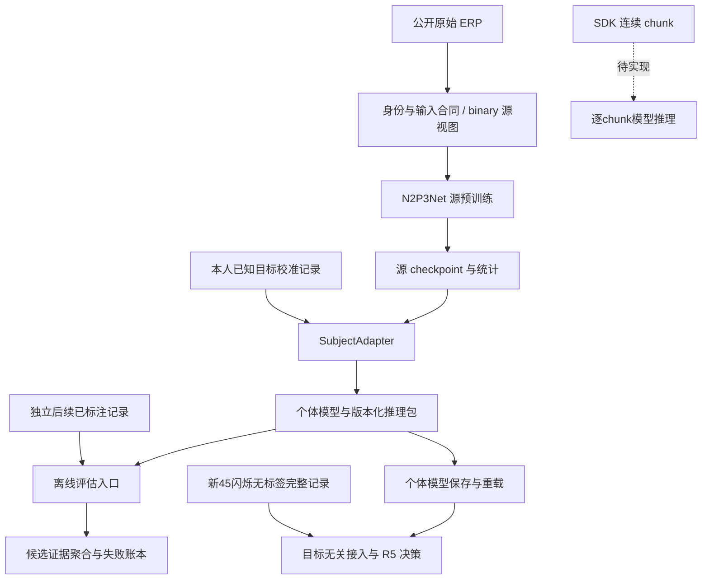

# 当前技术结构与完整链条

更新：2026-09-06。本文件依据实际源码与入口核对，描述现状与尚缺接口；科研目标由
[活动规范](research_program.zh.md)定义，发现和验证见[本次审计](evidence/technical_audit_20260906.zh.md)。
源码目录不因行数大或模块多就拆分；优先保留已经集中实现的合同和算法。

## 主链与接口

| 阶段 | 实际模块与入口 | 交付与边界 |
|---|---|---|
| 原始数据 | `data.raw_artifacts`、`data.moabb`、`data.bids_eeg`、`data.brainsync` | 字节来源、真实participant、时间轴、电极角色；校准要求confirmed，推理只要求completed且raw就绪 |
| 输入张量 | `data.contract`、`data.preprocess`、`data.epochs` | 连续滤波、epoch、基线、观测mask、timeline、attestation；当前是完整记录处理 |
| 源视图 | `data.domain`，`adapt_eeg_domain.py`、`prepare_multidomain_source.py` | 实测通道选择/缺导mask/参考、binary投影；保留父cache和身份 |
| 模型构造 | `models.n2p3net`、`train.factory`、`baselines.deep` | 架构和训练配置；`DeepBaseline`承担训练流程，`train.runtime`承担设备/内存/调度 |
| 源预训练 | `run_pretrain_supervised.py`、`transfer.checkpoint` | 权重、源分类头、训练行统计、架构、输入合同和训练身份账本 |
| 本人校准 | `transfer.subject_adapter.SubjectAdapter.fit`、`transfer.calibrated` | source-head微调、完整session内部验证、显式范围/refit、持久化个体模型 |
| 公共验证 | `run_binary_subject_transfer.py`、`run_candidate_cross_decision.py` | binary固定后缀或合法candidate后续decision；各自声明估计量 |
| BrainSync离线验证 | `run_brainsync_cross_decision.py`、`transfer.within_subject` | 同人早期校准与后续独立session，当前只提供固定训练预算 |
| 决策与分析 | `models.candidate_evidence`、`transfer.outcomes`、`research.evaluation`、`stats.hierarchical` | 完整候选词表、R曲线、失败分母、participant统计与结果身份 |
| 产品block完成推理 | `brainsync_model_task.py`、`data.brainsync.load_brainsync_inference_session`、采集端`decoding.py` | 45闪烁保存后无标签推理、模型重载、R1-R5、事后反馈；模拟端到端已验证 |
| 逐chunk流式推理 | 尚未实现 | 不用完整recording推理冒充每个SDK batch的在线更新 |

图中虚线表示仍缺少的逐chunk接口；实线产品链已通过模拟Qt端到端验证，不能替代实机测试。
旧manifest只注册preprocess，新工作站通过结构化后端任务接校准/inspect/infer。
两个采集端版本的实现、兼容性和候选记录见[源码比较](evidence/brainsync_versions_20260906.zh.md)。
新目录现已合入旧目录的EOG/坐标修正并修复录制并发问题；历史raw没有被静默改写。

## 已有模块应如何复用

- 数据合同：`data.contract`决定时间/滤波/基线；`data.channel`决定物理通道；
  `data.identity`与`data.lineage`决定身份。runner不得自行猜别名、维度或参考。
- 源模型校验：`transfer.checkpoint`统一校验模型结构、输入统计、源训练身份与目标排除。
  描述性来源列表不能替代实际`training_identity_ledger`。
- 校准训练：`SubjectAdapter`统一初始拟合与完整prefix refit的训练损失。
  AS-MMD有独立源上下文，但复用两阶段相同批次规则，不在runner重写弱化版本。
- head对照：`SubjectAdapter.predict_features`输出冻结推理状态下的head输入；
  `transfer.binary`复用scaler/收缩LDA，并提供等价复制到二分类线性头的接口。
  后置LDA与LDA初始化的顺序实验见证据索引，未设为工作站默认方法。
- 候选聚合：`models.candidate_evidence`持有词表、membership和覆盖规则；
  不因缺少候选、校准目标范围或试验的测试队列而缩小解码词表。
- 结果写入：复用`research.execution.atomic_write_json`。失败时保留原结果，
  不在各runner复制不同的JSON writer。
- 训练和评估代码：candidate/within/BrainSync/binary入口分别绑定训练snapshot与评估snapshot。
  candidate的batch、promotion、manifest和analyzer同步该区别，zero-shot缓存也绑定评估hash。
  `verified_source_snapshot`只核验声明的物理归档，不比对正在执行的checkout；
  实际执行身份仍需从归档运行或另行逐文件核对。

`data`对`research.contracts`/`research.execution`的少量依赖目前只是语义哈希和原子写入，
两者自身不依赖EEG训练实现。不能仅凭包名认为发生训练层反向耦合并新增一套工具包。
真正的重复职责应由调用证据及反例证明后合并。

## 产品校准与验证

产品预算、指标和trial/decision定义见[研究规范](research_program.zh.md)，
操作方式见[工作站指南](workstation.zh.md)。配置中的目标顺序是示例，正式采集前须
预声明每人的排列；27个测试decision只是每数字3次的开发起点，不是统计功效结论。
`observed_sequence`保留真实目标顺序，包括相邻相同目标；额外的
`forced_switch`和`unseen_calibration_codes`只回答各自明确声明的研究问题。

校准内部选择的完整目标流程是：内层训练拟合预处理及模型，内层验证选择配方/轮数，
从源初始化在完整校准数据重训，冻结后测试。任何学习型QC、EOG回归或输入统计都必须
服从其阶段范围；仅声明“outer calibration内拟合”不足以证明inner validation独立。
当前BNCI的内部选配方结果是独立保存的公开开发实验。新个体模型模块复用该选择方法，
以完整BrainSync校准session做内部验证；自动EOG只在内部训练session拟合并保持冻结。
个体包的模拟/未声明来源标签、原始校准范围和模型参数都在推理时核对。

## 研究扩展

| 现有实现 | 定位 | 继续运行的条件 |
|---|---|---|
| `models.adapters`、`models.splitbn` | 特征残差、invariant/private、Split-BN对照 | 显式源domain与目标buffer来源，匹配基线 |
| `transfer.asmmd` | 源流/冻结logit联合适配对照 | 两阶段一致损失、源身份校验、批内至少2样本 |
| `data.euclidean_alignment`、`data.domain_alignment`、`transfer.alignment` | EA、ACW、GALIA各自不同合同 | 不互换名称/公式，fit范围和参考可追溯 |
| `train.source_sampling` | TSD与Dense PDS源样本选择 | target选择依据仅来自声明校准，源行账本保留 |
| `transfer.pretraining`、`run_pretrain.py` | 重建式预训练对照 | 不冒充已训练的监督源分类头 |
| `transfer.candidate_set_loss`等 | 合法membership下的决策损失 | 物理候选合同成立，完整词表/覆盖测试通过 |

这些实现不是已证伪模块。删除的是错误或被取代的默认叙述、重复实现与死接口，
不因机制CI含0或未被默认调用而抹去可复用研究能力。

## 目录与数据层级

| 目录 | 所属层 | 处置原则 |
|---|---|---|
| `src/` | 可复用实现 | 不放一次性实验配方、现场路径或历史执行脚本 |
| `experiments/*.py` | 可运行入口 | 编排已实现模块；直接CLI启动应成立 |
| `configs/` | 当前产品声明和通用实验模板 | 不存已退役的日期化主线模板；JSON不自动代表采集器已执行 |
| `tests/` | 当前行为与反例 | 删除退役接口/模板专属断言，保留仍成立的数学与合同测试 |
| `doc/` | 六份当前指导与入口 | `research_program`为研究权威；`roadmap`为统一进度；本文件为实现导航 |
| `doc/evidence/` | 结果、推导、来源与历史审计 | 主题索引；dated状态不覆盖当前指导，旧原文保留于压缩快照 |
| `doc/assets/` | 文档引用的结构化证据 | 与源码分开；已运行审计的JSON不是默认配置 |
| `mne_data/` | 公开原始数据 | 保留来源及校验，不重命名电极或改写原始数据 |
| `experiments/cache/` | 派生训练/评估cache | 凭attestation识别，不凭文件名判有效性 |
| `experiments/runs/`、`experiments/results*/` | 执行记录、预测和研究源码副本 | 旧分数不回写；忽略目录内脚本不当成受支持CLI |
| `cloud_inputs/` | 历史/当前云输入分发 | native、EA、source-selection数据保留，启用前重新核对合同 |
| `experiments/cache/history/` | 保留的历史派生数据 | 数据与sidecar一起保留；启用前重新核对合同 |
| `experiments/results_history/` | 历史结果、日志及迁移索引 | 原始字节/哈希保留，不回写历史分数和内嵌路径 |
| `tmp/` | 当前临时探查 | 旧材料已按索引迁移；新材料先核对用途/哈希再清理 |
| `frozen/` | 物理冻结的源码、旧指导与证据 | Git跟踪manifest，压缩包留本地；不作为可导入源码或默认配置 |
| `Paper/` | 文献原文 | 保留来源，不是模型输入或试验结果 |

2026-09-06审计时工作树包含未提交研究变更，审计前非忽略文件已逐文件校验冻结，
见[manifest](../frozen/technical_audit_before_20260906.manifest.json)。该历史base commit
不等于当时执行源码，后续Git提交整理也不改变旧实验身份。当前提交状态用`git status`核对。

历史`tmp/`的16,389个文件已按[数据保留与清理记录](evidence/workspace_cleanup_20260906.zh.md)
分别移至cache history、results history与物理归档；数据和结果保留，迁移逐文件校验。
这些大型本地材料不随Git提交分发，机器迁移须单独携带索引所列目标。
