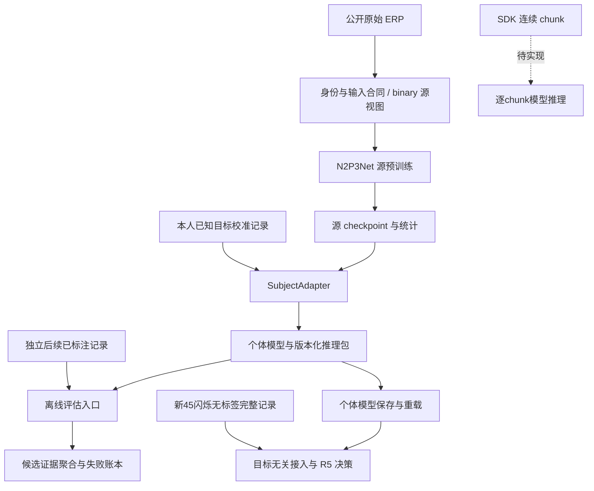

# 当前技术结构与完整链条

更新：2026-09-06。本文件依据实际源码与入口核对，描述现状与尚缺接口；科研目标由
[活动规范](research_program.zh.md)定义，发现和验证见[本次审计](evidence/technical_audit_20260906.zh.md)。
源码目录不因行数大或模块多就拆分；优先保留已经集中实现的合同和算法。

## 主链与接口

| 阶段 | 实际模块与入口 | 交付与边界 |
|---|---|---|
| 原始数据 | `data.raw_artifacts`、`data.moabb`、`data.bids_eeg`、`data.brainsync` | 字节来源、真实participant、时间轴、电极角色；校准要求confirmed，推理只要求completed且raw就绪 |
| 输入张量 | `data.contract`、`data.preprocess`、`data.epochs` | 连续滤波、epoch、基线、观测mask、timeline、attestation；当前是完整记录处理 |
| 源视图 | `data.domain`，`adapt_eeg_domain.py`、`prepare_multidomain_source.py` | 实测通道选择/缺导mask/参考、binary投影；保留父cache和身份 |
| 模型构造 | `models.n2p3net`、`train.factory`、`baselines.deep` | 架构和训练配置；`DeepBaseline`承担训练流程，`train.runtime`承担设备/内存/调度 |
| 源预训练 | `run_pretrain_supervised.py`、`transfer.checkpoint` | 权重、源分类头、训练行统计、架构、输入合同和训练身份账本 |
| 本人校准 | `transfer.subject_adapter.SubjectAdapter.fit`、`transfer.calibrated` | source-head微调、完整session内部验证、显式范围/refit、持久化个体模型 |
| 公共验证 | `run_binary_subject_transfer.py`、`run_candidate_cross_decision.py` | binary固定后缀或合法candidate后续decision；各自声明估计量 |
| BrainSync离线验证 | `run_brainsync_cross_decision.py`、`transfer.within_subject` | 同人早期校准与后续独立session，当前只提供固定训练预算 |
| BrainSync先导模型比较 | `run_brainsync_pilot.py`、`transfer.calibrated` | 预声明完整session划分及匹配scratch；校准内选方、先冻结赢家再test、最后独立保存全数据refit包 |
| 决策与分析 | `models.candidate_evidence`、`transfer.outcomes`、`research.evaluation`、`stats.hierarchical` | 完整候选词表、R曲线、失败分母、participant统计与结果身份 |
| 产品block完成推理 | `brainsync_model_task.py`、`data.brainsync.load_brainsync_inference_session`、采集端`decoding.py` | 45闪烁保存后无标签推理、模型重载、R1-R5、事后反馈；模拟端到端已验证 |
| 逐chunk流式推理 | 尚未实现 | 不用完整recording推理冒充每个SDK batch的在线更新 |

图中虚线表示仍缺少的逐chunk接口；实线产品链已通过模拟Qt端到端验证，不能替代实机测试。
旧manifest只注册preprocess，新工作站通过结构化后端任务接校准/inspect/infer。
采集端`decoding.py`负责选择、任务状态和模型生命周期；`decoding_results.py`使用现有
pyqtgraph展示校准曲线、候选内部AUC及九数字证据。报告消费`brainsync_model_task.py`
已核验的结构化结果，不以相邻目录的summary替代个体包检查。
采集端`theme.py`集中维护工作站配色、Qt控件样式、图表色板和既有图标着色；
`resources/icons/theme/`保存由原图标生成的原生控件位图，不在运行时写入资源。
主体主题不覆盖独立刺激窗口，显示密度保留各布局的基础间距比例。
采集后报告由独立前端`quality_reports.py`排队，通过`report_brainsync_quality.py`调用
`research.recording_quality`生成JSON、HTML和PNG。它复用无标签BrainSync接入、共享预处理及
`transfer.quality.transform_epoch_quality`，零可用epoch也保留完整账本；不执行QC拟合。
个体包报告通过`CalibratedPredictor.validate_input`和时间/身份门禁核对输入，不运行分类器。
前端仅写派生分析目录，报告指针与会话归属交叉核验，取消及应用关闭沿用ModelJobRunner进程树清理。
legacy与候选选择器均保存每个候选的`fit_history`及独立`refit_history`，
通过个体模型的`selection`与任务结果`internal_validation`恢复曲线；旧包不补造历史。
采集参考声明从实际dataset provenance进入`input_request`，与CLI请求逐项校验。
两个采集端版本的实现、兼容性和候选记录见[源码比较](evidence/brainsync_versions_20260906.zh.md)。
新目录现已合入旧目录的EOG/坐标修正并修复录制并发问题；历史raw没有被静默改写。

## 已有模块应如何复用

2026-09-09 `data.preprocess.design_continuous_sos`统一构造“显式陷波→带通”的SOS级联，
实际连续滤波、`data.recovery.filter_sos`与连续QC恢复门禁共用。BrainSync默认50Hz/Q30，
`PreprocessingSpec.notch_freqs_hz/notch_quality_factor`贯穿所有通用raw builder和持久化门禁。
`PreprocessingSpec.record()`统一序列化；历史缺省字段仍表示无陷波，保持原签名，不继承当前默认。
缓存、校准、质量报告的JSON配置通过`load_preprocessing_spec`读取，保存模型的报告/推理恢复其原算子。
MOABB高层离线P300入口未实现显式陷波，遇到该请求明确拒绝；其原生因果raw入口支持。

2026-09-08采集REF合同由`data.contract.brainsync_reference_record()`导出为
`configs/brainsync_acquisition_reference.json`，独立前端从`models/acquisition_reference.json`读取。
session的`montage.reference_details`、BIDS的`EEGReference/EEGReferenceDetails`与EEG通道参考
在接入时交叉校验；EOG保持自身显式导出。模型任务分别保存采集参考和最终软件参考。
`correct_brainsync_reference.py`只在显式旧声明和证言范围内更正元数据，先归档，检查原EDF不变；
连续QC可在全部原拟合EDF摘要一致时生成声明更正副本，系数不重拟合。
原生七导和Cz六导的QC/模型独立；CLI显式native请求不得被QC或EOG配置隐式改成Cz。

2026-09-07连续质量软件接口已实施，见[实施证据](evidence/brainsync_quality_implementation_20260907.zh.md)。
`data.continuous_qc`持有冻结检测与恢复合同，`data.recording_clock`校验前端样本账本，
`data.preprocess`消费完整排除区间。`data.ocular`绑定单HEOG接法和有效fit-sample范围。
`transfer.quality`以真实session/block分组拟合个人信号证据QC或显式历史`data.artifact`，人员身份保持独立；
calibration_candidates执行inner/final生命周期，calibrated保存状态并用NaN显式表示不可用证据。
CLI及缓存记录处理摘要，R5从原始请求账本保留失败分母。没有自动去阶跃或自动认证恢复门限。

2026-09-08`data.recovery.EpochStateRecovery`提供校准经验状态包络，`continuous_qc`通过
`signal_dependency_matrix`投影参考/眼电依赖，`brainsync`输出逐epoch/导的有效mask。
`transfer.quality`统一epoch模型保存/读取、原拟合数据摘要校验和应用；候选、fit复用、个体模型
共用`epoch_quality_model`冻结模式或`epoch_quality_policy`拟合模式，两者互斥。
公开训练入口拒绝预先做过epoch QC的缓存；内部应用一次并将同一质量状态存入个体包。
LDA完整观测行选择和预检共用接口，分别记账请求/实际拟合数据。连续QC的最低有效通道数
在后续epoch QC后仍生效，拒判保持NaN与原450事件账本对齐。
开发对照由`run_brainsync_recovery.py`复用正式拟合/模型保存/预测接口，
`analyze_brainsync_recovery.py`生成同事件波形与可用性图，见[恢复记录](evidence/brainsync_recovery_20260908.zh.md)。
`brainsync_model_task/2`结果分别记录原始排程数、输入epoch、预处理不可用、模型内不可用、
有效证据及总不可用；分层计数必须与完整排程数相等，不能只报告模型内QC损失。

`data.personal_quality`负责逐导物理幅度/STD/差分粗糙度的冻结诊断包络及精确恒值兜底。
`transfer.quality`按method/schema严格分派新旧模型，禁止把旧相对PTP数字解释成新方法。
BrainSync新方法在拟合、读取冻结QC和个体模型加载时均要求已应用匹配的逐导连续QC `/4`，
CLI预检及前端设置同步拒绝缺少参考前恒值检测的配置。连续检测实现仍由`data.continuous_qc`持有。
新个人包写`n2p3_calibrated_predictor/4`，显式兼容通过原合同的 `/3`、`/1`，不接收 `/2`。
fit复用键含训练行QC特征摘要；测试特征不改变拟合身份。冻结fit事件、物理X、mask和特征均核验。
三臂开发runner可在一个worker内复用一次源checkpoint加载和共享合法校准缓存，各臂拟合状态独立。
最终门禁下57模型/114预测只读重放已通过，见[本轮证据](evidence/brainsync_qc_redesign_20260908.zh.md)。

后续四项联动增加`data.slow_trend.analyze_slow_trends`和`FittedContinuousQC.signal_diagnostics`。
loader在原始域计算诊断摘要，写入`continuous_quality_ledger.signal_diagnostics`；完整窗口可由
`include_windows=True`独立导出，不向模型重复写入大型逐窗表，也不据此修改硬mask。
`data.recovery`只读证书接口给出放行成本与持续输入不在认证内的声明，旧恢复模型record不变。
`data.brainsync_contract`交叉核对sample clock与pause/BIDS边界；前端runtime/ui实际样本等待器
覆盖baseline与每block尾窗。跨仓库controller单测必须显式提供模拟等待器，不能冒充真实采样确认。

`IndependentRecordingScope`将已声明的完整校准/测试会话透传所有BrainSync loader入口。
它只替换显式离线实验的时间排序条件，仍检查会话不重叠、fit来源、人员、参考及原始支持。
工作站默认无此scope；新测试仍受校准就绪时间约束。EOG和连续QC的拟合会话均不能超出声明校准集。
`brainsync_model_task --preprocessing-config`传完整`PreprocessingSpec`，fit/preflight的
`declared_preprocessing`显式核对实际输入；未声明仍检查标准因果合同，推理只从个体包恢复算子。
`run_brainsync_recovery`支持无源scratch/LDA，保存实际EOG模型，统计真实源加载次数。
新EOG参考策略由`data.ocular`持有，dependency矩阵、拟合CLI、个体入口、GUI选择和重载共同消费。

离线runner显式支持`evaluation_mode=independent_recording_holdout`：校验会话/事件不重叠、
同participant及同输入合同，按预声明独立会话留出，不按录制时间排序裁定；缺省仍为
`prospective_recording`。工作站新测试的时间门禁保持原产品生命周期。两种协议随结果保存。

- 数据合同：`data.contract`决定时间/滤波/基线；`data.channel`决定物理通道；
  `data.identity`与`data.lineage`决定身份。runner不得自行猜别名、维度或参考。
- 源模型校验：`transfer.checkpoint`统一校验模型结构、输入统计、源训练身份与目标排除。
  描述性来源列表不能替代实际`training_identity_ledger`。
- 校准训练：`SubjectAdapter`统一初始拟合与完整prefix refit的训练损失。
  AS-MMD有独立源上下文，但复用两阶段相同批次规则，不在runner重写弱化版本。
- head对照：`SubjectAdapter.predict_features`输出冻结推理状态下的head输入；
  `transfer.binary`复用scaler/收缩LDA，并提供等价复制到二分类线性头的接口。
  后置LDA与LDA初始化的顺序实验见证据索引，未设为工作站默认方法。
- 候选聚合：`models.candidate_evidence`持有词表、membership和覆盖规则；
  不因缺少候选、校准目标范围或试验的测试队列而缩小解码词表。
- 结果写入：复用`research.execution.atomic_write_json`。失败时保留原结果，
  不在各runner复制不同的JSON writer。
- 训练和评估代码：candidate/within/BrainSync/binary入口分别绑定训练snapshot与评估snapshot。
  candidate的batch、promotion、manifest和analyzer同步该区别，zero-shot缓存也绑定评估hash。
  `verified_source_snapshot`只核验声明的物理归档，不比对正在执行的checkout；
  实际执行身份仍需从归档运行或另行逐文件核对。

`data`对`research.contracts`/`research.execution`的少量依赖目前只是语义哈希和原子写入，
两者自身不依赖EEG训练实现。不能仅凭包名认为发生训练层反向耦合并新增一套工具包。
真正的重复职责应由调用证据及反例证明后合并。

## 产品校准与验证

### 训练链条共享接口（2026-09-07）

`transfer.recipes.TargetRecipe`集中初始化、输入统计、BN buffer/affine、其他权重、dropout、
batch、epochs/updates及seed；公共实验与产品候选调用`calibration_candidates`同一拟合实现。
`binary.dataset_calibration_splits`负责请求K/实际K和共同test，`calibration_split`只在授权
校准范围生成合法inner训练/验证。`target_experiments`通过`--stage compact`编排当前精简矩阵，
复用生产评价builder和候选拟合接口；原binary入口通过`--training-plan --stage`进入同一整库排他程序。
plan声明`target_stage=compact`、`target_batch_size=512`，使用明确的用户固定batch规则；
三类基线和三个组件消融直接拟合当前完整校准，无inner搜索和额外refit。
`weights=head`配合`bn_affine=frozen`冻结学习型trunk；online buffer和checkpoint dropout
仍按声明运行。随后授权的扩展全量通过`include_historical_controls=false`排除E1/E3历史小batch，
源链默认由`research.source_execution`根据实际CPU配额/显存预算调度外折和布局任务组；
spawn隔离CUDA和随机状态，全局GPU信号量协调source、E2候选和外层目标组的并发。
外层组只持有一个attested目标cache，`TargetResultReuse`按完整处理键复用基线或相同源状态评分，
通过`transfer.result_reuse`核对已完成record/cell、预测与完整模型文件的摘要，
从同一份已验证字节解码，重新生成当前消费合同并记录原结果来源。缺少原始完整性声明的
旧产物不进入自动复用；历史分析保持可读。完整性异常独立于被试拟合失败。
公共`target_experiments`直接调用`calibration_candidates`，不再经个体包模块重导出候选接口。

`PreparedTransferCheckpoint`为一个固定checkpoint/目标dataset组合完成一次完整校验，
随后从已验证状态复制每人的独立trunk，并逐人检查训练身份排除。E2与公共外层runner
复用其已验证合同摘要，不在每个K重新递归序列化包含逐行账本的训练合同。
`SourceChainResume`仅从停止后的哈希清单读取已完成源任务/选模预测，核对配方、行、cache与原快照，
保留原checkpoint路径与来源；新训练及新评分绑定新的执行快照。

E3的`CalibrationCandidateFitCache`由单个人/实际K的校准scope持有，切换scope即释放。
缓存绑定完整recipe、训练数据与身份、源参数/BN/输入统计和运行配置，区分inner/full-prefix；
命中返回独立状态，并在当前验证集重新评分。按验证CE选epoch时验证内容也进入键，final test不进入。
四选择器可共享相同候选及相同winner的完整prefix refit；`fit_execution`记录实际拟合和复用次数。

`transfer.epoch_selection.EpochSelectionPolicy`集中目标fixed/full_trajectory/patience策略；
`fit_with_epoch_selection`复用校准内时间划分和候选拟合，丢弃inner状态后从原初始化全K重训。
`SubjectAdapter.validation_behavior=select_epoch_full_trajectory`选轮但不提前停止；既有`select_epoch`
保留patience停止，`diagnostics_only`不选轮。停止参数进入精确fit缓存键，旧TargetRecipe字段/默认值
保持不变。`--stage ES`由两个公共CLI进入同一任务builder；保存模型同时记录停止策略、选中配方与
两阶段账本，分析器配对精确K并汇总完整成本。产品E3默认五候选流程未自动加入早停。
ES的`epoch_selection`还可声明`epochs/treatments/modes/include_baselines`，用于固定轮数的
精简配对矩阵；recipe、任务预算、训练与保存模型使用同一显式轮数。缺省仍为三模型三策略60遍。

`DeepBaseline`固定updates分支复用`GpuPerformanceScheduler`、`MatrixBatchSource`和现有优化器策略；
逐更新在设备端累计loss/梯度有限性，在已有进度点、snapshot及最终发布前检查模型状态。
失败清空候选snapshot并使模型失效。`fitted_input_statistics()`统一导出实际推理仿射变换；
关闭标准化时导出零均值/单位尺度，经验统计保留在诊断账本，两个源导出入口共用该Interface。
`SubjectAdapter.fit`从开始到完整refit均按一个成功状态提交；异常和中断统一清理统计、校准
输出及历史，禁止部分更新状态进入预测，保留重新拟合能力。
`train.source_sampling`的普通概率采样与已有TSD/PDS显式分开。`research.source_selection`
持有源内候选轨迹、身份/观测账本、剂量与选中预算的从头refit；
`run_pretrain_supervised.py --source-chain-plan`和`run_source_training_chain.py`提供生产入口。
source runner的共享trajectory registry仅对有序真实event/person/domain、X/y/mask、
完整训练配方、seed、设备及源码一致的已有update快照复用。原checkpoint不改写，消费方容器
保留自己的父cache/fit ledger，并记录原checkpoint SHA及TrainingRunContract digest；
`physical_optimizer_updates=0`明确表示本次未训练，不把复用伪装成新的随机重复。
登记表按语义签名持有OS级跨进程文件锁，完成训练和哈希发布后才允许相同任务复用。
每组保存独立record及轻量进度，父进程聚合；已完成模型可以从显式哈希清单跨多次续跑复用。
GPU任务结束释放缓存并重置该worker的编译缓存，避免旧optimizer对象累积触发全局重编译上限。
`transfer.mask_probe`仅用固定checkpoint删除实测通道，记录激活和预测，不拟合或生成缺失通道。

`research.evaluation.verified_executed_snapshot`同时核验物理归档、逐文件摘要和执行checkout，
检查新增runtime文件是否也已冻结。只有归档整体hash、或只核对manifest声明的部分旧文件，
不足以绑定新训练入口。`freeze_source_snapshot.py --materialize`可生成隔离执行副本。

产品预算、指标和trial/decision定义见[研究规范](research_program.zh.md)，
操作方式见[工作站指南](workstation.zh.md)。配置中的目标顺序是示例，正式采集前须
预声明每人的排列；27个测试decision只是每数字3次的开发起点，不是统计功效结论。
`observed_sequence`保留真实目标顺序，包括相邻相同目标；额外的
`forced_switch`和`unseen_calibration_codes`只回答各自明确声明的研究问题。

校准内部选择的完整目标流程是：内层训练拟合预处理及模型，内层验证选择配方/轮数，
从源初始化在完整校准数据重训，冻结后测试。任何学习型QC、EOG回归或输入统计都必须
服从其阶段范围；仅声明“outer calibration内拟合”不足以证明inner validation独立。
当前BNCI的内部选配方结果是独立保存的公开开发实验。新个体模型模块复用该选择方法，
以完整BrainSync校准session做内部验证；自动EOG只在内部训练session拟合并保持冻结。
个体包的模拟/未声明来源标签、原始校准范围和模型参数都在推理时核对。

本人固定LDA的QC路径直接调用`fit_calibration_candidate`完成一次全校准拟合，
与preflight的固定配方范围一致，不借内部选模失败进入LDA兜底。
`legacy_product`在QC路径共用源失败判定，不兼容源及全部源候选失败均终止任务。
研究选择器的显式兜底和原有独立会话门禁继续保留；QC不能改变入口声明的方法。

## 研究扩展

| 现有实现 | 定位 | 继续运行的条件 |
|---|---|---|
| `models.adapters`、`models.splitbn` | 特征残差、invariant/private、Split-BN对照 | 显式源domain与目标buffer来源，匹配基线 |
| `transfer.asmmd` | 源流/冻结logit联合适配对照 | 两阶段一致损失、源身份校验、批内至少2样本 |
| `data.euclidean_alignment`、`data.domain_alignment`、`transfer.alignment` | EA、ACW、GALIA各自不同合同 | 不互换名称/公式，fit范围和参考可追溯 |
| `train.source_sampling` | TSD与Dense PDS源样本选择 | target选择依据仅来自声明校准，源行账本保留 |
| `transfer.pretraining`、`run_pretrain.py` | 重建式预训练对照 | 不冒充已训练的监督源分类头 |
| `transfer.candidate_set_loss`等 | 合法membership下的决策损失 | 物理候选合同成立，完整词表/覆盖测试通过 |

这些实现不是已证伪模块。删除的是错误或被取代的默认叙述、重复实现与死接口，
不因机制CI含0或未被默认调用而抹去可复用研究能力。

## 目录与数据层级

| 目录 | 所属层 | 处置原则 |
|---|---|---|
| `src/` | 可复用实现 | 不放一次性实验配方、现场路径或历史执行脚本 |
| `experiments/*.py` | 可运行入口 | 编排已实现模块；直接CLI启动应成立 |
| `configs/` | 当前产品声明和通用实验模板 | 不存已退役的日期化主线模板；JSON不自动代表采集器已执行 |
| `tests/` | 当前行为与反例 | 删除退役接口/模板专属断言，保留仍成立的数学与合同测试 |
| `doc/` | 六份当前指导与入口 | `research_program`为研究权威；`roadmap`为统一进度；本文件为实现导航 |
| `doc/evidence/` | 结果、推导、来源与历史审计 | 主题索引；dated状态不覆盖当前指导，旧原文保留于压缩快照 |
| `doc/assets/` | 文档引用的结构化证据 | 与源码分开；已运行审计的JSON不是默认配置 |
| `mne_data/` | 公开原始数据 | 保留来源及校验，不重命名电极或改写原始数据 |
| `experiments/cache/` | 派生训练/评估cache | 凭attestation识别，不凭文件名判有效性 |
| `experiments/runs/`、`experiments/results*/` | 执行记录、预测和研究源码副本 | 旧分数不回写；忽略目录内脚本不当成受支持CLI |
| `cloud_inputs/` | 历史/当前云输入分发 | native、EA、source-selection数据保留，启用前重新核对合同 |
| `experiments/cache/history/` | 保留的历史派生数据 | 数据与sidecar一起保留；启用前重新核对合同 |
| `experiments/results_history/` | 历史结果、日志及迁移索引 | 原始字节/哈希保留，不回写历史分数和内嵌路径 |
| `tmp/` | 当前临时探查 | 旧材料已按索引迁移；新材料先核对用途/哈希再清理 |
| `frozen/` | 物理冻结的源码、旧指导与证据 | Git跟踪manifest，压缩包留本地；不作为可导入源码或默认配置 |
| `Paper/` | 文献原文 | 保留来源，不是模型输入或试验结果 |

2026-09-06审计时工作树包含未提交研究变更，审计前非忽略文件已逐文件校验冻结，
见[manifest](../frozen/technical_audit_before_20260906.manifest.json)。该历史base commit
不等于当时执行源码，后续Git提交整理也不改变旧实验身份。当前提交状态用`git status`核对。

历史`tmp/`的16,389个文件已按[数据保留与清理记录](evidence/workspace_cleanup_20260906.zh.md)
分别移至cache history、results history与物理归档；数据和结果保留，迁移逐文件校验。
这些大型本地材料不随Git提交分发，机器迁移须单独携带索引所列目标。
