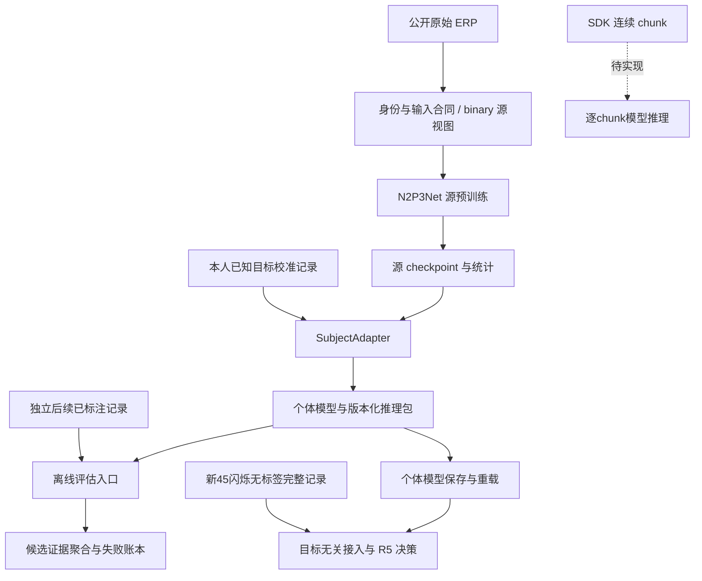

# 当前技术结构与完整链条

`research.source_metadata_store`持有完整原NN source bytes的一次共享发布及每独立ingress的真实准入；typed ref保存source SHA/size、原training contract与当前target identity/geometry/study exclusion。事务首次decode沿原source procedure/metadata门，之后每bind核当前target并生成fresh trunk/BN/C statistics。`FrozenTrialPredictor/3`的K0模型可共享原blob或独立嵌入完整闭包，positive `/2`保持小包；binary report `/3`与pool origins持同dependency，fresh public loader要求完整ref并重新准入。candidate模型、prefix、graph、chunk及parent现也持完整依赖闭包，独立导出后仍核原source，pool退役后最后复核原blob。

`research.selection_graph_store`以`/2`将重复的完整不可变scope单独存一次，逻辑graph仍由原canonical语义定义；physical store SHA与logical graph SHA分别保存。compiler私有owner每次重核原数组/metadata身份，prepared/reducer消费实际store capability，独立ingress重新准入原字节。旧graph通过原raw SHA与token不变的空白精简导入，实际解码先取得资源预留；数字模型及原producer保持。正常parent调用`_validate_nested_prefix_prediction`核最终预测与重放的selected/future evidence，已完成阶段的聚焦反例也直接调用此相同关系。

`data.candidate_input`统一原始record/selection适配接口，Huebner原marker/NEMAR BDF与BI2014a原MAT/CSV各自持有字节、真实clock与parent truth。`RecordCalibrationPrefixCompiler`在同一owner按全局label-K授予各真实record的本地raw scope、trial和完整C组；文件之间保独立时钟。`CalibrationPrefix.calibration_records/fit_receipts`、inner/final replay、prepared capsule及parent truth `/2`消费同一权限。BDF仅在admission做一次完整SHA，延迟range读取前后核原file identity；metadata在入口深freeze、序列化给独立快照。source declaration SHA、adapter digest、每段acquisition SHA与实际consumer源码分别保存。原BNCI路线继续由同owner恢复，root两项兼容合同在组合树通过。完整history/typed ensemble和H/BI四fixed NN/selector是后续纵向交付，当前接受来源见[整合绑定](assets/research_resume_20261012/research_integration_acceptance.json)。

空间后验现由`spatial_signal_prior/6`持有原物理A/D/Z因子及同次source QR/noise生成凭证，exact结构null取因子乘积，数值后验和BLUE沿原算法。`SpatialObservation/3`保存原Q、归一map、scale/volume/诊断，load集中核关系并恢复原态；general可识别reference-free效应也进入同一个source输运入口。

B09结构识别先对每record原joint `[Z D]`取exact rowspace、消其独立nuisance，再stream空间/时间约束到shared beta canonical rowspace；普通fit/load/BLUE按compact结构准入。`transfer.spatial_programme`连接原Continuous baseline噪声、真实source/C raw response refit、BLUE/common effect、source group与target OOF/ensemble。保存模型持有immutable原producer SHA/digest，current consumer另记，`dataclass.replace`与OOF绑定保原身份；root组合旧包零fit/QR重放通过。

B07 `research.multichannel_c_latent`新增明确外部固定参数的finite C producer；原compiler分别颁发C标签/观测权限和截止内未标签history权限，B05中枢复用共同QR/flat chart，保存原prior F及后验R/RHS。`history_artifact`的newmodel capsule直接拷原模型字节，conditional-tail和whole-observed current-q各声明法与完整positive mass保存；旧frozen-C权限由原owner保持。

`research.calibration_selection.transfer_scratch_prefix_plan`仅派生新的四fixed完整程序族：source/scratch单NN及各自NN+xDAWN。实际expert IDs、baseline/output/选择行政策显式传入，原source catalog、匹配architecture、time scope和checkpoint权限由原CLI消费；NN配对同profile，经典专家可保自己声明视图。原prefix selector、graph保存重放和parent核回概率继续持有实际执行。

`transfer.pool_calibration`是exact arithmetic pool之后uniform-contamination的唯一概率owner。fixed-base及strict cross-fitted temperature-base各从真实完整pool OOF学习ε；温度与pool OOF独立保存，nested排除关系及实际temperature subset由同模型/parent核验。ordinary各exact名单/权重组合持有自己的OOF与ε。`FittedEnsemble`、graph、保存包和publicparent统一按原producer与冻结poolstate复算，完整requested失败和原decision tie owner保持。

`transfer.beta_uniform_calibration`持有独立opt-in `forward_beta_uniform`：单joint programme显式声明proper Beta(a,b)，沿真实earlier-C预测序列以正权log-Beta混合学习ε，保存整posterior、原prior、ordered行、实际J及原base lineage。clean/uniform期望质量分别正求和，单decision的完整posterior predictive恰为原概率与uniform的该混合。真正empty OOF返回prior；非空请求中的失败沿完整roster保留。其调用可与fixed共享一次原raw fit/score；旧grouped-temperature和pool ERM各用原独立learner，nested比较继续保留这些候选。新状态独立保存为ensemble科学schema `/5`、programme manifest `/3`；原source、C/P模型、capture及旧非opt-in记录保持自己的身份。

`CalibrationProgramCandidate`和generic CLI只在新策略记录显式prior，actual prefix/prior/ordered OOF共同进入校准身份；每个outer held的完整learner在原`before_group`权限内重新构造。`JointFlatPackageAdmission`和真实parent将原C groups/标签、immutable base fit digest及captured raw OOF数值重放连接，再确定性重建整posterior；校准JSON自洽不能替代这条关系。capsule恢复合法C权限供fit/replay，prediction reader不取得隐藏future truth。缓存只复用原exact C/P输入，首新consumer仍重算原数学组件并逐bit核验；operational tie、requested coverage、NLL/Brier与promotion继续由原owner判定。

`research.joint_readset_transition`持有具名的原5e62/当前b39读取器关系。两个真实issuer各自颁发cap，除明确记录的`source_owner_sha256`外，完整权限及实际C标签/样本/时钟/q轴精确相同；新关系保原cap、capture、model和numeric-input身份，并另记当前readset。scorer仍从实际数组构建operands并逐bit核原组件，memo包含该关系；没有关系的普通入口沿原严格等式。fresh preparation只重颁权限，胶囊携带原reader实体供完整性核验，prepared reader无须访问外部旧路径或执行旧issuer；fresh parent再从原数据实际重颁两端。保存关系自身不授予读取权限。旧温度wrapper若改变model digest，按自身programme取得P measure。

`research.finite_response_law`是新有限delay/width的唯一正规化owner：正binary64原质量按exact rational一次归一，保存全部有效log质量与误差；mean/moment从同一law取权重。source矩控制直接用原factor生成共享global β与每selection局部Gaussian变量，保全一二阶矩、跨selection相关和弱/零方向，compact接口直接收缩state设计。`transfer.native_response_dictionary`显式声明原native阵列的新连续延拓：整数点保原字节，off-grid按exact rational线性插值一次舍入，terminal knot与半开支持明确。它不改历史Gaussian/cosine等dictionary producer；这两个基础模块已有独立实现/保存接受，source→C→history引擎及完整typed/nested/parent另沿当前切片集成。

`transfer.information_bound`持有`/2`完整activation/模型诊断、raw plug-in估计量及不可变JSON报告，`save/load/replay_model`保护全部输出与原producer。`transfer.exact_covariance/2`持有raw传播、resolved SPD/显式identified support及独立ridge诊断，当前是内存诊断接口。二者没有生产调用；来源、反例和完整性验收见[数学整合](assets/research_resume_20261012/diagnostic_mathematics_integration.json)。原D树local-only `run_information_bound.py`保原字节，迁移membership、actual activation和报告schema后才可复用。

2026-10-10[愿望清单整合](evidence/wishlist_progress_20261010.zh.md)继续复用原owner：`CandidateEvidence`在原tie判定处保存赢家索引；`candidate_metrics`持有requested层级的最大置信度、错时置信度、分箱ECE及实际J的uniform NLL contrast，原report consumer自动导出，现阶段只作描述性诊断。`SpatialSignalPrior.expected_whitened_signal_energy/energy_matched_graph`复用原response压缩root，以同C/noise匹配固定graph的centered信号能量；原posterior及B05物理因子继续消费该prior；新BLUE/source-group programme的实际ensemble接点见上文，固定graph与learned测量保持各自来源。

`research.latent_response_reference`只有五个科研入口：状态law、off-grid analytic basis、physical selection design、proper层级prior和有限conditional evidence。它复用`joint_response_scale`的prior/decision factory/联合Gaussian积分；global beta只一次，selection additive deviation独立零均值，full/prefix共同更新离散state权重。没有生产注册、真实产品caller或第二posterior/noise fitter。

`research.joint_flat_response/joint_flat_authority/joint_flat_artifact`持有同record一个Gamma λ、global proper β与原flat漂移测度的完整科研owner。原source/C issuer颁发参数与raw-prefix权限；direct augmented QR保prefix漂移后验及point误差，`/2`包保存原sampling/numeric/noise/parameter来源，load/model-only replay恢复原producer数值。typed ensemble、history capture/refusal、保存重放与generic候选routing已集成`267a50e`，完整公共DAG沿实际执行验收。

`research.joint_source_catalog`独立持有原continuous source导出与当前目标绑定。Huebner原数组准入通过注册factory和`CalibrationPrefixCompiler.from_dataset_source(...).compile(K)`恢复实际C；该入口只编译所需prefix，完整future views由公共目标准备路径持有。live原数据owner授予本次public consumer准入，JSON描述记录保留来源；新进程重新取得实际owner。joint确定性source的seed为null，MCMC链seed由sampling合同单独保存。NN的`SourceSeedCatalog`及多seed合同保持各自语义。

`JointFlatModel.score_history`在完整原权限、实际C/P/T、model/input/capture及consumer/native核验之后，才使用实例私有的verified-components LRU；首次仍重算原数学并byte-match，命中只复用不可变logweights/logdensity，summary/diagnostics/capture逐次新建。8MiB/16项上限独立于科学state，显式NPZ/digest不携带缓存，load/replace从空缓存开始。实际跨worker边界传递plan、artifact与JSON/NPZ，模型在worker内重建。

Generic joint participant持有一份run内原fit缓存与history capture表，贯穿final、forward OOF、future recorder和selector。可选`joint_completed_primitives`通过原ensemble/capture/forward-row的SHA定位原producer；loader直接解码已核payload，重编实际prefix并核source/target/原C及current history，首次评分仍走原数学bit核。CLI、bound plan和recovery共用相对路径normalizer；非joint入口继续传None。此接口复用原数值状态，完整新公共DAG按独立实际producer验收。

`research.joint_flat_lambda_kernel`提供独立single-record/fixed-q数值入口：完整白化压缩根先消去原flat漂移，再对proper响应作一次SVD，保全部零/弱奇异方向及原startup；每个λ点计算标量有理项。残差log平方范数为唯一状态，逐点source/算术估计、raw N、logλ Jacobian、Gamma/物理测度常数与解析外尾各有显式接口。多q归一/record权限由caller持有，旧捕获组件逐bit重放ABI保持。该模块及15个区分性合同已独审接受，完整新32候选消费者在自己的冻结代码中验收。

`ResponseDictionarySpec("bspline", duration, k, endpoint)`编译固定cubic/open-clamped/uniform字典，free或hard-value消费同ambient与interior selector。原`dictionary_artifact`唯一owner的 `/3`核exact rational表达，Gaussian/cosine仍 `/2`；同五数组进入已有prior/geometry/continuous/ensemble/OOF与保存链。cubic非零shift/width及off-grid导数尚unsupported，零状态直接消费保存native矩阵。

`FittedEnsemble.oof_probability_record`持有原grouped温度循环实际返回的完整C-only概率、inner producer identities及final program关联；原ensemble包保存该immutable记录，模型既有fit-binding锚定OOF digest与OOF前base数值身份。fixed/grouped共享同一final专家tuple；actual K与完整OOF标签剂量分开。完整组nested研究入口可显式使用`InnerReplayRecorder`保存同一次run的实际inner模型和评分并零拟合重放；不从final模型回推原inner评分，不将全C OOF改称nested选择。

`_SelectionReplayAdmission`与`_PrefixPackageAdmission`分别持有一次调用内的实际graph、receipt和数值包；parent从原MAT重编输入并独立实评分，全部OOF/future/forbidden-scope/temperature关系继续核验。新调用重新读取原字节并取得独立predictor；完整canonical请求比较允许JSON list与immutable tuple的等价表示，真实字段变化和重复package仍拒绝。`prefix_recovery`独立绑定原failed队列的request/实际exit/原源码、完成participant和精确reviewed transition；八人task_roster保留，已准入原四人不派新fit，仅余四人执行，原/新producer分别入账。公共主入口、remaining actor及programme构造都在写入前复用同owner原输出边界；云端恢复另用经精确复审的subset freeze，见[接受绑定](assets/research_resume_20261011/prefix_cloud_admission_acceptance_binding.json)。

[当前消费者](evidence/current_public_consumers_20261008.zh.md)由class_calibration持有fit风险/分数变换、FrozenTrialPredictor/2持有实际state/来源、ensemble_views持有实测线性空间与选择执行family、checkpoint集中核source/target不同入口的程序族相容。binary_probability复用共同输入比较owner及artifact SHA，确定性seed alias保留完整概率状态；旧/1不被重签proper合同。

[当前source程序](evidence/public_source_pipeline_20261008.zh.md)复用source_selection/source_execution/source_resume/PreparedSourceInventory：manifest SHA一次准入、准备/合并/fit共享预算、每outer一次load后消费实际声明seed、恢复复用原完整view。日常科研声明一个完整seed，三seed只用于重大版本校验。source_config从实际identity authority解析并绑定contract/registry；SourceSeedCatalog和两个公共消费者通过expected_source_config核真实producer，不借程序同名混入历史β8。

[B12独立前缀切片](evidence/independent_prefix_20261008.zh.md)由CalibrationPrefix持有一次验证的不可变授权，fit_calibration_prefix_programs持有共享all-C状态及各温度程序，FittedEnsemble.save_programs/load_programs保存单份数值模型。请求预算、来源选择/refit和matched-control筛选各由共同owner派生。

`prefix_inner_replay`已接该prefix入口及实际independent candidate caller：同run捕获final/inner专家、typed失败与future专家evidence，保存后核原模型fit binding、完整成功OOF与共同test scope，再封prediction。parent按每包一次准入并从捕获专家复算declared mixture，核最终概率/失败；requested alias与seed消费原views ledger。全prefix未来捕获前的中断仍为partial/unknown，不冒称全部已算输出可恢复。该前缀温度重放没有执行候选程序strict nested selection，见[复签范围](evidence/calibration_and_selection.zh.md#calibrationprefix保存重放与调用端复签)。

后续opt-in整程序选择已经接通：`CalibrationPrefixCompiler`从verified原MAT bytes唯一解析，`fit_nested_prefix_selection`在各真实更早P_h/P_v执行完整原A(P)，`prefix_selection_replay`保存并重放同run graph。`prefix_inner_replay/2`将原生raw/trial输入及inner原始operands连回compiler；唯一temperature owner只读复核原OOF有限meta学习结果。公共caller的selected输出在整future保存/实际graph重放后封预测，parent重编scope并重算概率；selector独立持有started/failed/partial账本。当前代码/接口与源绑定见[整程序接线](evidence/calibration_and_selection.zh.md#整程序接线与复签)。

ensemble神经计算的资源接点集中于`_fit_expert`实际神经fitter调用前，覆盖普通final、group-LOO、完整prefix选择及其inner learner。source准备仍在CPU，source-only K0不调用神经fitter；冻结候选评分和保存重放使用CPU。`CloudExecutor`拥有首次CUDA准入及完整进程树的资源释放，科学配方和拟合输入由原ensemble owner持有。

2026-10-11 source cache 与 shared programme score 已接入当前 prefix 调用链（固定源码见[独立复签](evidence/execution_and_integration.zh.md#缓存与共享评分独立复签)）：source prototype 只缓存一次准入的私有 source ledger/model，当前 target 的 physical、identity、execution 与 study proof 每次重核；不缓存 target fit/BN/OOF/temperature。`FittedEnsemble.score_programs` 只在同一 current view、同一实际 experts tuple、fit receipts 与 target contract 下共享 raw expert score，fixed/grouped 仍分别应用自己的概率程序；capture 与 loaded future replay 各自实际计算，C-inner fixed 不改。该接口没有实现 prefix 候选 strict nested 选择，也不改变旧 producer 身份。

paired comparator的`validate_b12_execution_manifest`只持有最终跨阶段账本关系：requested K×arm×seed必须完整，coverage逐项匹配actual terminal status，source catalog保持唯一study/seed键并核plan checkpoint/procedure与producer seed/kind/study exclusion。失败actor缺失authority或source保持显式unresolved；completed NN/scratch cell必须有源凭证。聚合器拒绝同键冲突凭证；统计完成后才绑定最终report，摘要排除顶层binding以保持重复finalize幂等。物理raw/cache/checkpoint门继续由原入口持有，见[修后独立复签](evidence/execution_and_integration.zh.md#b12最终账本修后复签)。

`build_channel_noise_audit_manifest`与`audit_channel_noise_mechanism`的paired `/2`入口复用原public source owner和共享请求/指标：全source participants对应全requested roster，C target/labels对应原CalibrationSelection，modern mean/precision R/原Σ对应保存模型完整fit输入；两noise arm共用物理factor。shared/private AR8与prefix32的八人16格native矩阵已完成，保存态零拟合重现typed数值不可用，见[P1入口与执行](evidence/response_and_noise.zh.md#p1软件入口修后验收)。数值实现继续由B05单一owner持有。

`stationary_noise_artifact`以原stored PARCOR的精确实数step-up和pairwise mixed Yule--Walker持有完整平稳cross-channel law，Decimal96编译一次jointroot；constructor/load以实际root的law pullback证书准入，saved root不重编。`FittedChannelNoise/3`和原`/2`compiled-W模型分别绑定；已完成的16格续评分仍属于原冻结law。作者8e1f和Git CRLF工作树621bad的compiler源码SHA分别记录，后续新模型绑定实际执行字节。

`FittedChannelNoise.from_shared_stationary_factors`是显式新producer入口：完全相同stored PARCOR的shared law由`shared_stationary_factor`编译两个小root及其实际rounded Kronecker乘积，逐小因子exact rational residual/inverse-defect与乘积舍入界共同准入。新`/4`保存原两小因子、完整actual root、证书及producer源码身份；load只核原witness，不重编root。默认constructor/fit与原`/3`仍消费原joint owner，private law保持原pairwise路径。原startup/tail白化和Jacobian直接消费各自实际root；[推导及验证](evidence/response_and_noise.zh.md#shared-parcor平稳启动因子的显式入口)。

`export_frozen_p1_state.py`在原capsule独立进程导出实际response/noise，两个manifest caller显式由JSON字符串转Path。`stationary_panel`持有冻结16格的输入核验、new root/模型/score receipt与同支持reduce；`local_program_control`持有PID/birth、heartbeat、descendant RSS/CPU及退出清理。科学fitter禁止重新拟合；完整cell成功须模型/score/receipt闭合。本地资源终态保partial，新host执行重新绑定路径与资源，见[执行状态](evidence/response_and_noise.zh.md#当前模型与数值任务)。

P1云科学接线已由[修后复签](assets/research_resume_20261011/stationary_cloud_scientific_acceptance_binding.json)接受：新score plan显式消费原Windows export plan056，完整held descriptor/view/array keys及实际解码样本/设计由原authority核验。`run_stationary_cloud_panel`复用共享file lock持整个attempt，PID/birth lease在写入前独占；共享历史树接口成功返回None，live/unknown/接口缺失明确阻止派发。`actual_alive`统一排除PID复用和zombie，仍保实际live后代门。8 subject各顺序两arm，4个native5+interop1 actor与coordinator1共同使用CPU25；main串行准入两arm，全部ACK后归约。实际factory、统一controller和Linux平台门由各自owner另行验收。

云端调度控制器已按最终源码`204304f…`接入：process-private exec环境、PID/birth在execute前闭合、逐pool历史凭证、共享subreaper寿命、journal失败后的完整peer清理和ready工作补位均有独立云/Linux3.12及WSL3.14凭证；同一诊断根的Windows Job成功历史可在第二次零fit marker运行中重新准入。控制器源码、测试和平台分层证据见[controller绑定](assets/research_resume_20261011/controller_execution_acceptance_binding.json)。这组证据只接受执行底座与生命周期，不替代完整科研矩阵吞吐。

更新：2026-09-06。本文件依据实际源码与入口核对，描述现状与尚缺接口；科研目标由
[活动规范](research_program.zh.md)定义，发现和验证见[本次审计](evidence/technical_audit_20260906.zh.md)。
源码目录不因行数大或模块多就拆分；优先保留已经集中实现的合同和算法。

## 主链与接口

`select_epoch_channels` 对已缓存QC的通道子集使用实际选后 `X` 和保留的观测bit，
经唯一 `compute_epoch_qc_features` 重算median PTP、relative PTP和std。
`EpochQCFeatures.select_channels` 要求调用者提供已选数组；float32 ratio/scale无法
精确反推出原PTP，尤其原分母采用 `max(scale,eps)`。原阈值与feature schema保持，
新子集程序写入原lineage/provenance以产生真实派生cache身份。旧cache保持原producer，
需要新子集时从原样本派生；见[QC整合绑定](assets/research_resume_20261012/qc_channel_integration.json)。

`baselines.evaluate.evaluate_candidate_selection` 将 `participant_ids` 作为调用者显式提供的
identity authority key；`fit_group_ids` 与 `domain_ids` 只持有防泄漏划分，不定义参与者。
`run_eeg_loso` 在实际 subject 子集选定后，用 `materialize_dataset_identity(dataset)` 的
`record_for(local).authority_key()` 逐行对齐该键。terminal 与 hit@R 的 participant-macro
先在每人全部 pre-QC requested test decisions 内求均值，再等权平均参与者；不可用记错，
训练组不进入分母。API 未提供 authority 时不产生 macro。
实际 writer 的 `_summary_metric_fields` 验证 `n2p3_eeg_loso_metrics/2`，同时保存原
`primary_decision_hit_rate` / `hit_at_repetition_macro` 值和显式 decision-micro 别名、
participant-macro 与 scope。无 schema 的历史记录按 `/1` 读取原字段，macro 未知；
不补签旧分母。新版候选缺 authority/scope、alias 或 repetition 范围冲突均拒绝写出。
二分类记录的候选指标为 null，scope 为 `not_applicable_binary`。

`install_splitbn_target_calibration_buffers` 按实际前向顺序安装各站点：先在授权C中
合并当前站点的总体均值/方差，再用其target buffer前向到下一站点。原
`N2P3Net._observed_temporal_features` 将已观测电极打包，temporal每filter的样本数为
`sum(channel_mask)*T`；spatial/MST统计完整混合feature，使用各自实际输入population。
helper向core/wrapper传原mask，站点之间不猜electrode/feature映射。每站点只执行一次，
失败时恢复原target buffers和各module模式。
`n2p3_splitbn_target_install/1` receipt保存实际站点顺序、scope/mask/input摘要、
总体方差约定、计数、统计与源码摘要；`SubjectAdapter.last_history` 分列initial/refit，
两个原CLI的`prefix_refit`保存同一receipt。旧initialized buffer只作只读加载和诊断；
新拟合的安装程序按实际source/consumer/model身份保存，软件接受见
[整合绑定](assets/research_resume_20261012/splitbn_target_integration.json)。

`continuous_decision._conditional_posterior`持有原prefix/full joint QR公式，fit/profile与score消费同一完整kernel和各record diffuse drift。条件score的`_ConditionalRecordWhitening`在本次已准入record内共享`W(Y)`、`W(D0)`、`W(Z)`；各candidate全record白化`D1`后再split prefix/tail并完成独立QR。当前科研fit/posterior/df及load门保持原实现，详见[白化集成](evidence/execution_and_integration.zh.md#条件评分公共白化集成)。

完整episode指标通过`evaluate_candidate_evidence(..., requested_evidence_levels={DecisionKey: actual_R})`接入；其规范化不可变计划包含全部requested keys及缺失输出，并绑定原DecisionPlan digest。`transfer.outcomes`按每key唯一R记账，各R保自身分母，整体和participant风险仍用原episode；paired compare核完整horizon计划。原scalar fixed-R入口继续消费其原cross-product。预算、raw scope与实际R由reader/caller冻结，详见[逐任务horizon](evidence/public_evaluation.zh.md#逐任务horizon接口)。

`research.trial_candidate_programme`是固定三trial专家的共同程序owner：dataset adapter提供
已封存C/future、原raw decision与父truth，程序统一编译逐key实际horizon、调用CloudExecutor、
核逐人模型/概率产物并输出matched-control contrast。BI与BNCI的CLI都调用这一实现，
source整库排除来自显式dataset_id；原参与者目录身份保留，不将A01猜作数字别名。
BNCI episode程序固定前5 selection C600、后30个原selection R10，与label-K prefix selector
分开声明。只读loader重构物理schedule并核整个descriptor，外层R/count/censor不能改变
同一个已封存schedule的解释。旧source/cache/model保持原producer，由各执行快照分别绑定。

BI同样由`_prepared_future_decisions`从label-free timeline构建descriptor；load重建并核其
episode、evidence rows、R/censor及horizon列表。C实际标签/episode、future原key与父truth
key一并相连，未知schedule完整性不推断为完整R。新consumer不重写原prepared数值缓存。

`research.dataset_queue`只拥有逐库声明、独立supervisor、所属进程树、真实退出和恢复绑定；
`experiments/run_dataset_queue.py`是其命令行入口。每库科学CLI继续持有训练合同和数值验收，
共享`CloudExecutor`在单库内部调度就绪准备、拟合与评估。队列不加载EEG、重新拟合模型或
把文件存在视为成功；终态保存独立产物事实，并严格保持原已执行声明的前缀字节。

`research.trial_candidate_execution`复用实际source准备/整库排除、原target fitter和
`FrozenTrialPredictor`完成固定trial专家的逐臂拟合、持久化与loaded重放。每臂独立保存，
恢复核C的X/y/mask/timeline/metadata/provenance、future输入和完整requested；数值模型内
fit binding与actual probability fit再与外层receipt交叉核对。source/scratch共用target配方，
scratch只保架构控制、无source初始化身份。`run_bi2014a_trial_study.py`只编译真实episode请求、
调用共享CloudExecutor并准入每人产物；父层统一用`candidate_metrics`的逐key horizon评价与
直接full-fine减matched-scratch配对contrast。secondary截断诊断不进入主指标分母。

当前[集成骨干](evidence/research_integration_20261008.zh.md)以`dictionary_artifact`持有字典编译/准入，`temporal_noise/5`持有实际startup数组与scales，`continuous_decision`持有全C/prior生产QR后验；load消费原数值态，整模型仍核同implementation字节。B05一般vec冻结响应可通过真实行/列置换消费B09空间后验，评分noise独立，不重新拟合后验。数值不可识别只使对应连续专家/decision不可用，正常peer保留；artifact/输入合同错误继续传播。

`research.input_contamination`复用真实harmonic/finite程序，测完整自适应`T(x+h)-T(x)`及明示扰动分布下的经验矩，接原operator CLI的`audit-clean`。`research.dynamic_identification`只作noise-only Gamma尺度与独立proper Gaussian不确定性的积分参考；prefix条件密度是joint/prefix两个生成积分的比。这些研究参考不新增生产fitter或默认算法，也不签发原始观测授权。`research.response_history_identification`枚举完整公开selection label/response状态，共享同MN response后验；以prefix posterior weights积分direct stable conditional companion计算共同flat-nuisance full/prefix mixture比，保整mask相关、kernel cross terms及原joint质量。`research.continuous_history_adapter.score_authorized_history`消费原decoder持有的history capability、basis/M/R/Σ和stored noise，调用唯一`native_history_marginal_program`；legacy dense小矩阵桥保独立入口。

B07纵向接线已集成：唯一dictionary表达owner持有精确δ/w评价，原decoder的`history_scope`持有截止内事件/权限及有限state支持，`history_authority`按actual C-label-conditioned正joint质量核C-owned状态，`history_artifact`拥有prediction/capsule原字节重放和typed numerical unavailable。current完整coverage与context事件前缀分角色，右删失按原支持执行；full/prefix/conditional及mixture数值记录持久化并保各consumer raw SHA。最终scores经max-centering归一，capsule核原parent/source/protocol和完整结果。软件、合成重放及独立数学接受见[整合绑定](assets/research_resume_20261012/history_central_integration.json)；下一为公共opt-in评价、C-latent新producer和实测fractional时钟authority。

[B07 `transfer.response_dictionary`](evidence/erp_dictionary_20261006.zh.md)拥有analytic spec、actual basis/grid、E/N与immutable数值状态；`ContinuousDecisionModel`仍唯一fit/score owner，kernel prior、精确目标、ensemble/OOF和CLI消费同basis。capacity直接消费actual fit statistics及compiled reference/design，cal-prior三份dict mirror已删除；ridge保存一次真实R/rhs并与precision/M/H/noise或legacyφ关系绑定。字典包声明base_model_schema并保存物理/约束数值，不能仅改metadata换函数或重签容量。

`research.noise_scale_identification`在固定physical noise root、完整声明ERP/state列空间及独立decision尺度模型下生成proper noise contrasts，拟相对τ²和明示ν，并提供完整decision的C内比较及模型内Fisher。actual stored rank与白化resolved rank不一致时拒绝，不把弱ERP方向改名noise；读取区间由caller显式供应，不从flatten维数猜native时间。它是小矩阵reference，不拟freeΣ、未知state或完整新β后验。

`FittedChannelNoise.fit_response_given_frozen_noise`在原B05 owner上消费固定proper `PhysicalCoefficientPrior` 和明确source/C `ResponseFitRecord`，共同白化Y、row-major response design及per-record diffuse nuisance。每record压缩actual augmented QR后加入一次physical prior，返回完整response factor、各drift和跨record关联；noise/Σ替换不重标prior。拟合读全C prefix+tail，不重新拟noise或profile tail噪声目标。原 `FrozenERPResponse`/score 消费该完整后验，持久包认证和真实输入授权由各自owner另验。

`project_diffuse_nuisance`由同B05 owner集中判断源尺度的数值可分辨性，使用完整proper prior factor与noise unit，不以投影后微小残差自己定尺度。C fit和score消费同规则；score保原proper+diffuse prefix/tail与a后验程序。`whitening_logabsdet`只读实际冻结方阵的leading prefix和tail spatial root，不另编噪声或授予读取权限。极端有限输入的原反例、修复范围与未覆盖项见[本轮证据](evidence/research_mechanisms_20261009.zh.md)。

score另外在raw共同intercept坐标中减首个实测样本，原samples身份保持；同full/prefix flat系数平移和tail条件坐标Jacobian皆1。prefix compressed rhs直接进入tail增广QR，不相减巨大a均值。原full相对误差门与raw conditional log-density绝对误差估计分别准入；后者预算为每actual tail scalar行`sqrt(binary64 eps)` nats，不是全输入区间证书。`student_t_numerics`集中有限ν的Gamma整数维递推/半步及径向计算，sampling与projected contrast共用，不用大log-Gamma直接相减或将有限ν重标∞。

B05数值程序进一步使用真实短叶/平衡dot tree和对应gamma；score只对flat nuisance用同一个stored可逆prefix chart，full/prefix测度Jacobian抵消。误差从原raw/完整PARCOR历史按prefix/tail及列传播，经带solve-defect的inverse界和posterior metric计入conditional nats预算；proper prior与两道门保持。公共density offset先减max再归一化，Dekker非有限中间项具名拒绝。dot tree同时进入C-fit，因此新拟合按新数值源码绑定；原状态由原loader与显式新consumer分别留证据，见[数值接受](evidence/response_and_noise.zh.md#当前模型与数值任务)。

`research.joint_response_scale`持有一个proper physical global β prior、各完整decision的noise scale以及明确的external/C-plugin参数程序。正离散scale rule必须显式供应，full/prefix消费同一数值态；tensor积分保β及C/test scale后验关联，有限程序正规与连续Gamma近似精度分开。`research.joint_response_sampling`复用相同prior/hyperparameter/decision类，一次准备统计和测试白化，提供global β↔各λ Gibbs、C后验prefix重加权及caller显式另跑的C+prefix程序。有限经验预测混合正规，Rhat/ESS/MCSE不认证未访问模态或真实后验准确性；二者目前无flat nuisance、默认ν或产品准入。

长记录由同scale owner的`compile_decision/compile_owned_decision`工厂编成不可变`CompiledDecision`，保原scalar行数、完整增广R、actual source/map/chart与full/prefix/tail关系。B05一次白化后，从原白化行分别压缩三根；tail不能引入新Γ轴。原Y/D先于prior/mean变换流式绑定，reader分块不改身份。finite reference和唯一Gibbs/RNG循环共享QR统计，已删除sampling的重复Gram/linear/白化堆栈。`targeted_conditional_beta_predict`由caller显式选择，平均同C+prefix joint λ后验下的proper β解析组件；不自动fallback、不重标旧Gaussian后验。当前工厂只准proper无nuisance likelihood，flat-Z长记录仍是独立参考，不能借相同R高度或schema混入。

[g-prior](evidence/calibration_g_prior_20261006.zh.md)由`transfer.kernel_prior`编译canonical spec与immutable precision root；continuous初始化、NumPy joint QR和Torch objective共享该root。新g `/5`保存prior/reference与actual-C posterior statistics数值载荷，load核root/spec/C/source及actual posterior关系；ensemble raw program与producer匹配。legacy ridge数值路径独立，runner已整合g与same-ridge AR面板隔离及structured rank failure；历史M1续跑仍只准入同src bytes。
compiler保存原design root以重核投影数值rank；同一个`validate_binding`将reference record身份/支持/design SHA与model actual C ledger、basis/input绑定交叉核验，避免两份self-summary各自成立而关系不成立。
[trace控制](evidence/calibration_trace_control_20261006.zh.md)与g共享`uses_calibration_reference`，使用独立model `/6`；scalar precision由compiler数值root派生，callers不重造G。当前fit包保存12个数值数组（原prior/C状态与生产posterior Q/R/response）加metadata，旧九数组包由原执行源重放。runner的`fixed_reference_kernel_prior`面板核完整28格并直接用原requested指标owner产生12组同g形状对照；same-ridge AR面板继续单独归因。
实际矩阵后改`_kernel_fit_statistics`为nuisance-block QR及信息root/正交响应压缩；`score`载荷由method `all_C_actual_noise_per_record_diffuse_QR_response`明确表示`Q_DᵀY`，不再表示`DᵀY`。posterior核验使用`R M=b`后向关系，避免两次normal-equation solve放大病态；旧包由自己的冻结source解释。runner滚动持有最多worker数的participant任务，共享abort signal只在真正合同失败后停下一fit，合法rank/fit failure仍保留requested输出。
随后v2实际失败促成`_kernel_posterior_factors`同一owner：`_fit_fixed_prefix`最终只用原joint程序算conditional scatter/logdet/Σ，再从完整C的一次统计压缩发布M/H，model保存同一统计对象。fit与load使用同precision/root/response求解，未宽阈值、改变先验或重造reference；prefix→tail的条件密度/漂移测度保持原函数。

[固定前缀条件AR](evidence/continuous_fixed_prefix_20261005.zh.md)深化现有`ContinuousDecisionModel`的同一fit/score/save/load Interface：
`conditioning_samples`与`noise_estimator`在recipe、实际noise/model与包内binding一致；model/noise `/4`保存真实初始化、优化和支持来源。
共享B与各record diffuse drift在prefix联合更新，冻结B posterior来自完整授权C；同tail目标独立profile空间Σ。
`continuous_gradient.ConditionalGaussianObjective`只消费已授权、已验证的C数组，拥有不可变常量；record-local lattice与prefix→tail augmented QR给出CPU/float64目标及精确η梯度。
优化器由`continuous_decision`持有线程外的科学边界、初末NumPy目标核对与真实求值账本；`noise_solver`绑定实际gradient源码SHA，Burg/AR0不伪称调用梯度。
旧`/2` clipped AR1与`/3` stationary仍是各自估计量。历史source绑定包继续按原frozen执行源重放，不自动移除implementation门禁。

2026-10-05 [分块科研规格](evidence/deep_research_plan_20261005.zh.md)主线由`transfer.ensemble`
Module组织现有NN/经典trial/raw连续Adapter，`candidate_evidence`继续持有membership数学，
`calibrated`继续持有原个人包和只读推理；后续已通过`ensemble_fit.FittedEnsemble`接真实fit/score/save/load与研究CLI，
见[代码实施](evidence/ensemble_implementation_20261005.zh.md)与[独立质量验收](evidence/ensemble_quality_20261005.zh.md)。共同DecisionViews保存物理支持，
各专家保留自己的数值身份，不要求raw与Toeplitz使用相同预处理。B02–B04的调用链、失败行为、
重放与匹配scratch清单见规格；高阶OperatorGLS目前仍是doc/assets研究helper，不当作src生产能力。
参数量随实际架构、pooling和残差recipe记录，历史1279含残差值不泛化到默认N2P3Net构造。

2026-10-05 `experiments/boundary_state_research.py` 是独立数学/计划框架，无生产调用者：长短有限算子先映射到共同输出网格，ERP 模板行基按样本优先展平，诊断不选择 held penalty；dense Gaussian 参考检验协方差 gauge 而不拟合 AR。完整 E1–E3 与 Kalman 尚未执行，接口边界见[设计核对](evidence/boundary_state_redesign_20261005.zh.md)。
2026-10-06该框架补`FrozenShortBoundaryMap`的不可变K/b、short-only apply、native grid/source支持与公开全T evaluator；affine offset不进入ERP/白噪声增量。未提供真实frozen map时不以oracle delta冒充部署测量，源码与36项定向验证见同一记录。

2026-10-04的[实施记录](evidence/system_implementation_20261004.zh.md)把研究能力放在以下已有职责及新Module中：

- `research.comparison`统一物理证据、fit/score数值输入与显式`ContrastPlan`；executor复用另绑定实际inner输入、完整decision上下文和原执行身份。inline与完整统计共用配对门禁。
- `data.ea_artifact.EAFitPlan`集中授权、算子与reference，fit/save/load核实际attested parent并数值重放；新输入只能用已冻结state transform。普通物理cache与checkpoint拒绝旧EA伪电压。
- `baselines.riemann`提供ERP原型增广；`structured_erp`提供Toeplitz/pooled/temporal等纯数值状态；`temporal_transfer`区别固定cosine与参与者等权源时间基。通过`TargetRecipe`、`fit_calibration_candidate`、`CalibratedPredictor(selector_mode="fixed_erp")`连接个人未知标签推理。
- `data.harmonic`是独立segment的离线自适应工频研究处理；`transfer.noise_model`与`operator_lda`承担联合raw/state协方差和固定A/B传播。后续[B06](evidence/conditional_state_20261006.zh.md)由同noise owner编译identified raw support/gain/Schur，conditional operator同时调整class mean与covariance；`run_operator_decision_study.py`连接实际fit/load/无标签predict。`probe_conditional_operator_native.py`保存真实native maps/absolute支持，state在该验收中为已观察response residual，尚不自动识别未知滤波state的Γ/Ω。
- `transfer.continuous_decision`封装连续ERP核拟合、条件核不确定性、候选似然和冻结重放；`raw_continuous`适配BNCI原始字节与合法C/T，`run_bnci_continuous_study.py`连接requested outcomes、coverage、NLL和真实可用时间。
- `transfer.decision_experiments`在声明的统一scope上扩展prior/decision/head/scratch有限归因，记录独立物理组数；不改变默认Q1配方。

各Module的Interface由fit范围、数值状态与失败行为共同定义，不能只靠metadata自摘要替代关系核验。
R1与R2仍是独立研究路线；将自适应harmonic串到固定A/B之后会遗漏估参不确定性，当前不自动组合。

2026-09-18云端资源预算由`research.source_execution`统一解析并传递至source、源内λ和outer target worker。
`cloud_resource_floor`约束CPU/GPU容量，`HostMemoryAdmission`同时限制嵌套worker占用。
缓存输入的显式只读通道视图、统计分块与`MatrixBatchSource`成功预加载后的CPU释放保持在原owner内。
2026-10-08源吞吐资源算法集中在同一`research.source_execution`：`PreparedSourceStorage`拥有一次分配的最终EEG、
有界source解码与实际snapshot文件系统容量；`SourceInputAdmission`拥有ready NN优先及归一化暂存字节。
`train.source_rows.SourceRows`只负责只读有序行读取，`data.epochs.concatenate_epoch_datasets`核精确shared行关系并合并身份/事件；
实验CLI声明科学adapter与资源，不另写容量算法。`GpuPerformanceScheduler`持有实际RSS常驻转账和失败释放，继续复用`MatrixBatchSource`。
source固定更新的进度复用`baselines.progress`；selection/refit sink分开，显示fold=0不改初始化seed。
跨组snapshot共享磁盘池和当前target消费者的同owner滚动排程仍由统一executor接入验收，不由本软件切片宣称已经完成。

2026-09-18 `SourceCatalog.validate_fold`集中区分evaluation和deployment源组，部署组必须显式完整成员且不得生成外层目标。
`source_prior_development_fold`接受显式development_domains，未选域全量留在源拟合；source链检查开发域与逐域排除原因完整分割实际source。
源内选方记录包含声明及所有prefix摘要，改变开发支持不能沿用原选择身份。`unified_target_recipes`集中产生按监督匹配的scratch，
有真实membership时增加CE-only对照，无membership时保留单个等价scratch。调用者统一从recipe派生处理名和decision因子。

2026-09-17采集端`transport.py`集中串口/BLE连接入口、地址及固件能力差异；
`DeviceAdapter`共用连接所有权、预览、阻抗、回调录制和清理，删除串口SDK原生EDF分支。
采集端数据合同的250 Hz为两传输及模拟模式唯一采样率，SDK回调batch独立为250包的正整数倍。
`LocalEdfRecorder`统一电压/样本时钟检查点，`RecordingSession`继续持有暂停和EDF/BIDS收尾。
BLE回调按连接generation隔离，固件应答后再次核验句柄；关闭等待原生连接请求与迟到句柄清理。
调用链、反例及验证见[连接统一记录](evidence/domain_transfer_major_20260920.zh.md)。

2026-09-20发布层将上述采集端模块封装为PyInstaller onedir `BrainSync.exe`及`_internal`运行时；
发布目录只保留用户配置、默认源模型、空数据/日志目录、运行时和发布说明。开发Python入口、测试、
缓存、历史数据与后端worktree不属于发布结构；算法任务仍通过用户配置的后端环境调用。
发布内容及体积边界见[发布版EXE验收](evidence/brainsync_release_20260920.zh.md)。

2026-09-16统一程序在既有owner内实现：`N2P3Net`先pack实测通道经原temporal Conv/BN，scatter后继续空间/MST，
post-MST直接复用`FeatureResidualAdapter`，六导含残差共1279参数。`models.parameter_groups.SourceParameterPrior`
保存固定源中心/尺度；`SourceObjective`组合CE外的SupCon和条件MMD，`SubjectAdapter`在一次step内联合trial、decision和prior。
`MembershipDecision`保存物理归属、完整词表和缺失证据，NumPy/Torch共享评分核；不另建候选神经网络。
`data.source_records`准备逐K独立raw校准、inner T/V及固定test，`prepare_source_records.py`输出受核验的prefix manifest。
`unified_source`与目标`unified`复用源调度和目标worker；λ由`source_prior_selection`的源内开发manifest选择。
个人`selector_mode=unified`消费单份显式recipe和固定目标预算，保存完整参数、统计、质量状态及membership评分声明。
调用和反例见[实施记录](evidence/domain_transfer_major_20260920.zh.md)。

2026-09-16统一预算由`train.early_stopping.UnifiedTrainingBudget`集中解释，`PatienceStopper`继续负责独立早停计数。
`source_selection.fit_source_trajectory`执行参考源的参与者选轮/refit，source chain每折只调用一次，
正式源训练消费带reference摘要的`source_budget`并按e*换算固定更新。λ开发和目标worker直接全C拟合。
`transfer.epoch_selection`保留其它显式早停研究；新unified默认不消费个人inner视图。
`source_records`可按是否需要inner准备/读取实际视图；新CLI默认只准备C_K/test。
模块、复用和性能记录见[预算执行器](evidence/domain_transfer_major_20260920.zh.md)。

2026-09-16 `run_domain_transfer_matrix.py`组合既有source chain及共享目标worker，统一执行P1/P2
并复用相同输入/配方/权重的结果；不复制训练循环。`SourceObjective`集中source-only配对、
去重与批量条件MMD；`analyze_transfer_contrasts(seed_pairs=...)`显式区分完整流程配对和交叉seed设计。

2026-09-16前端运行时增加单录制启动owner及通用SDK清理worker终态门禁，禁止超时后的迟到操作
影响新会话。任务完成通知在coroutine清理后发送；`RecordingSession`持有暂停幂等和失败收尾，
`SessionStore`用OS租约排除外部修改活动会话，并在成功发布manifest后更新内存。
预览滤波使用SOS实现并消费实际设备采样率；仅作用于显示。
解码结果部分解析失败会撤销可见数字/模型就绪；反馈按请求身份及已保存目标记录，无判定为`correct=null`。
质量报告重试保留原冻结请求，失败显示与进程回收独立。见[逻辑修复](evidence/brainsync_frontend_logic_20260916.zh.md)。

2026-09-15工作站架构修复将采集上下文、样本支持、暂停账本及EDF/BIDS收尾集中到采集端
`recording.RecordingSession`；主窗口处理显示与操作者动作。真实/模拟device adapter共用该interface，
并发finish等待同一次提交。`backend.ModelTask`持有结构化命令和结果准入：schema、状态、请求编号、
会话路径/身份、受试者、模拟声明及模型摘要共同核对；后端从同一次读取的模型字节加载并生成摘要。
`SessionStore`以待提交记录协调确认标签和事件日志，前后端拒绝消费未完成确认；恢复不重复追加事件，
历史前缀冲突则保留现场并拒绝自动恢复。`ModelJobRunner.shutdown()`统一关闭入口和进程树回收，
`MainWindow.shutdown()`及应用退出finally等待它完成。详见[架构实施](evidence/brainsync_architecture_20260915.zh.md)。

device adapter在采集启动取消时保持原生申请Future，由同一清理owner等待其终态后释放资源；
超时保持recovery并阻止与迟到申请并行退订或断开。已有样本仍先通过EDF持久化路径保存。

`data.contract.BRAIN_SYNC_BIDIRECTIONAL_DATA_CONTRACT`与`configs/brainsync_bidirectional_preprocessing.json`
声明BrainSync新默认；`zero_phase_edge_policy`经PreprocessingSpec、raw builder及模型签名传递。
`data.preprocess.filter_bidirectional_segment`统一实际SOS双遍和两端有效状态，
`data.bidirectional.BidirectionalStateRecovery`负责校准包络、参考投影及逐epoch条件界。
固定epoch线性映射和有限段响应采用有界缓存；zero可用时间保守取完整raw结束。
`continuous_qc`保留原始检测及自然/伪迹端点区分；`transfer.quality`检查缓存中的滤波/QC匹配。
个人入口支持新默认、旧模型按冻结合同重放；MOABB高层无法执行新声明时仍拒绝。
比较入口为`run_bidirectional_qc_study.py`，见[联合优化证据](evidence/bidirectional_qc_20260909.zh.md)。

| 阶段 | 实际模块与入口 | 交付与边界 |
|---|---|---|
| 原始数据 | `data.raw_artifacts`、`data.moabb`、`data.bids_eeg`、`data.brainsync` | 字节来源、真实participant、时间轴、电极角色；校准要求confirmed，推理只要求completed且raw就绪 |
| 输入张量 | `data.contract`、`data.preprocess`、`data.epochs` | 连续滤波、epoch、基线、观测mask、timeline、attestation；当前是完整记录处理 |
| 源视图 | `data.domain`，`adapt_eeg_domain.py`、`prepare_multidomain_source.py` | 实测通道选择/缺导mask/参考、binary投影；保留父cache和身份 |
| 模型构造 | `models.n2p3net`、`train.factory`、`baselines.deep` | 架构和训练配置；`DeepBaseline`承担训练流程，`train.runtime`承担设备/内存/调度 |
| 源预训练 | `run_pretrain_supervised.py`、`transfer.checkpoint` | 权重、源分类头、训练行统计、架构、输入合同和训练身份账本 |
| 本人校准 | `transfer.subject_adapter.SubjectAdapter.fit`、`transfer.calibrated` | source-head微调、完整session内部验证、显式范围/refit、持久化个体模型 |
| 公共验证 | `run_binary_subject_transfer.py`、`run_candidate_cross_decision.py` | binary固定后缀或合法candidate后续decision；各自声明估计量 |
| BrainSync离线验证 | `run_brainsync_cross_decision.py`、`transfer.within_subject` | 同人早期校准与后续独立session，当前只提供固定训练预算 |
| BrainSync先导模型比较 | `run_brainsync_pilot.py`、`transfer.calibrated` | 预声明完整session划分及匹配scratch；校准内选方、先冻结赢家再test、最后独立保存全数据refit包 |
| 决策与分析 | `models.candidate_evidence`、`transfer.outcomes`、`research.evaluation`、`stats.hierarchical` | 完整候选词表、R曲线、失败分母、participant统计与结果身份 |
| 产品block完成推理 | `brainsync_model_task.py`、`data.brainsync.load_brainsync_inference_session`、采集端`decoding.py` | 45闪烁保存后无标签推理、模型重载、R1-R5、事后反馈；模拟端到端已验证 |
| 逐chunk流式推理 | 尚未实现 | 不用完整recording推理冒充每个SDK batch的在线更新 |

图中虚线表示仍缺少的逐chunk接口；实线产品链已通过模拟Qt端到端验证，不能替代实机测试。
旧manifest只注册preprocess，新工作站通过结构化后端任务接校准/inspect/infer。
采集端`decoding.py`负责选择、任务状态和模型生命周期；`decoding_results.py`使用现有
pyqtgraph展示校准曲线、候选内部AUC及九数字证据。报告消费`brainsync_model_task.py`
已核验的结构化结果，不以相邻目录的summary替代个体包检查。
采集端`theme.py`集中维护工作站配色、Qt控件样式、图表色板和既有图标着色；
`resources/icons/theme/`保存由原图标生成的原生控件位图，不在运行时写入资源。
主体主题不覆盖独立刺激窗口，显示密度保留各布局的基础间距比例。
采集后报告由独立前端`quality_reports.py`排队，通过`report_brainsync_quality.py`调用
`research.recording_quality`生成JSON、HTML和PNG。它复用无标签BrainSync接入、共享预处理及
`transfer.quality.transform_epoch_quality`，零可用epoch也保留完整账本；不执行QC拟合。
个体包的“冻结输入重放”由`CalibratedPredictor.load_inference_session(session_dir)`持有：
从包内原合同恢复预处理、EOG和连续QC，返回已通过输入与前瞻时间门禁的无标签数据；不拟合、不预测。
推理和个体包质量报告共同使用这个interface，不在CLI重建包内处理步骤。
`data.brainsync`集中参考协调与最终通道选择：EOG/连续QC已执行参考时直接选择保存的通道子集；
epoch后执行参考时先保留实测参考通道，完成相减后再选最终通道。
无标签loader对同一次核验的录制对象执行`recording_validator`，再进入信号处理；个体包先核验
人员、校准会话排除、标签就绪时间、模拟声明及已有采集参考声明，零可用epoch也不能绕过。
软件回归与改动前归档见[冻结输入重放验证](evidence/brainsync_input_replay_20260909.zh.md)。
前端仅写派生分析目录，报告指针与会话归属交叉核验，取消及应用关闭沿用ModelJobRunner进程树清理。
legacy与候选选择器均保存每个候选的`fit_history`及独立`refit_history`，
通过个体模型的`selection`与任务结果`internal_validation`恢复曲线；旧包不补造历史。
采集参考声明从实际dataset provenance进入`input_request`，与CLI请求逐项校验。
两个采集端版本的实现、兼容性和候选记录见[源码比较](evidence/brainsync_versions_20260906.zh.md)。
新目录现已合入旧目录的EOG/坐标修正并修复录制并发问题；历史raw没有被静默改写。

## 已有模块应如何复用

2026-09-16 `validate_calibration_raw_fit_scope`成为个人preflight、旧fit、候选及fit缓存共用的raw拟合范围门禁；
legacy配方在QC路由前统一解析为`TargetRecipe`。`continuous_filter_plan`在原预处理module内同时提供
分段坐标和两侧原因，`continuous_filter_segments`保留坐标投影；滤波、恢复和执行凭证共用该解释。
源adapter在数值处理前排除永久坏非参考导，坏Cz拒绝当前投影；最终通过既有montage接口补mask/零槽。
source preparation `/2`绑定实际raw/sidecar及方法身份，恢复同时核验NPZ和record凭证，轻量准入不解压矩阵。
`analysis_seed_pairs`/`analysis_source_arms`贯穿源任务、目标计划、结果；分析器复用同一配对引擎生成组内及跨源对比。
见[完整调用链验收](evidence/domain_transfer_major_20260920.zh.md)。

2026-09-15 `data.preprocess.execute_preprocessing(raw, events, preprocessing, **layout_options)`
集中完整Spec验证、参数解释、实际源sample支持及执行凭证。BrainSync、MOABB raw、GTN、
BI2014a、BNCI2014-008、manifest及source_records七处已迁移；`build_subject/load_dataset`
用显式`preprocessing`接入，低层`preprocess(n_times=None)`仍可做研究。
`transform_epoch_samples`统一实际FFT→截长→半开基线，恢复矩阵仅开放线性能力，
`recovery.epoch_linear_projection`保留有界缓存与分块构造。
`PreprocessingSpec.record()`只表示声明；`provenance.preprocessing_execution`单独保存实际实现、
模块加载时源码摘要、SOS、分段和源网格。cache合并保留全部父凭证，历史缺失记unverified_inputs。
模型门禁分别绑定可迁移的算子身份和不可混同的数据来源，不比较不同录制长度/原始摘要。
来源、单位、候选含义、QC拟合范围和交付时钟仍归各adapter；MOABB高层保留独立能力门禁。
数学依据见[科研裁决](evidence/preprocessing_contract_research_20260915.zh.md)，
实施和验收见[执行器落地](evidence/preprocessing_execution_20260915.zh.md)。

2026-09-18源接入与排程分为三个Module：`data.source_parsers`持有连续格式Adapter、标签与实际伴随文件；
`data.source_admission.PreparedSourceInventory`核验准备状态、merged NPZ/record摘要、物理研究库与预处理，
返回ready/pending/failed；`research.source_catalog.SourceCatalog`解释源池和整库排除，
`research.source_matrix`编译任务及等量剂量。池成员不是数据准入状态，B0--B7仍保留原153任务，
不存在按“候选库”名称额外禁用已执行B7的开关。新组合通过显式JSON加入，不覆盖既有池名。
source chain可用`source_studies`或`source_pool`声明任意数量的源，逐项与实际cache核对；
旧未声明源集合的计划保留原三源/家族两源约束。S2单源剂量按实际源域数推导，
common-three仍要求逐行真观测，不以补零绕过。选取单个matched任务时保留整折比较池与seed来定配额。
BrainForm原始CSV、Cattan连续MAT及BI2012已经接入同一source preparation Interface；
BrainForm保留Pxx、1245采样裁切坐标、校准标签和显式坏导，Cattan不按block重置滤波，BI2012排除Fz ground。
Chailloux现在同时绑定实际读取的vhdr/eeg/vmrk，替换其中任一文件都会使旧准备记录失效。
source pool入口支持配置预处理、无拟合预检及有截止时间的准备等待，输入摘要绑定后变更必须另开结果目录。
`run_source_pool_matrix.py`调用共享`fit_or_reuse_source_trajectory`；公共目标复用`execute_target_tasks`，个人矩阵复用
`fit_calibration_candidate`/`SubjectAdapter`及`CalibratedPredictor`保存与重载。
`data.source_records.SOURCE_EOG_PREPROCESSING`显式绑定本轮单向陷波合同，与工作站日后默认值分离。
`train.source_sampling`将不变CDF预计算一次，保持NumPy choice相同抽样和RNG流；
大源审计向量用`encode_source_vector`无损编码，消费者通过`decode_source_vector`同时接收旧列表与新摘要绑定编码。
等量源按每个目标留出折选择参与者/正负样本配额，先截取每库实际行再合并，避免将全池常驻复制到每个seed。

2026-09-09 `data.preprocess.design_continuous_sos`统一构造“显式陷波→带通”的SOS级联，
实际连续滤波、`data.recovery.filter_sos`与连续QC恢复门禁共用。BrainSync默认50Hz/Q30，
`PreprocessingSpec.notch_freqs_hz/notch_quality_factor`贯穿所有通用raw builder和持久化门禁。
`PreprocessingSpec.record()`统一序列化；历史缺省字段仍表示无陷波，保持原签名，不继承当前默认。
缓存、校准、质量报告的JSON配置通过`load_preprocessing_spec`读取，保存模型的报告/推理恢复其原算子。
MOABB高层离线P300入口未实现显式陷波，遇到该请求明确拒绝；其原生因果raw入口支持。

2026-09-08采集REF合同由`data.contract.brainsync_reference_record()`导出为
`configs/brainsync_acquisition_reference.json`，独立前端从`models/acquisition_reference.json`读取。
session的`montage.reference_details`、BIDS的`EEGReference/EEGReferenceDetails`与EEG通道参考
在接入时交叉校验；EOG保持自身显式导出。模型任务分别保存采集参考和最终软件参考。
`correct_brainsync_reference.py`只在显式旧声明和证言范围内更正元数据，先归档，检查原EDF不变；
连续QC可在全部原拟合EDF摘要一致时生成声明更正副本，系数不重拟合。
原生七导和Cz六导的QC/模型独立；CLI显式native请求不得被QC或EOG配置隐式改成Cz。

2026-09-07连续质量软件接口已实施，见[实施证据](evidence/brainsync_quality_implementation_20260907.zh.md)。
`data.continuous_qc`持有冻结检测与恢复合同，`data.recording_clock`校验前端样本账本，
`data.preprocess`消费完整排除区间。`data.ocular`绑定单HEOG接法和有效fit-sample范围。
`transfer.quality`以真实session/block分组拟合个人信号证据QC或显式历史`data.artifact`，人员身份保持独立；
calibration_candidates执行inner/final生命周期，calibrated保存状态并用NaN显式表示不可用证据。
`calibration_candidates.replay_calibration_selection`核固定requested支持、评分、tie及refit关系。binary使用缺失pair零credit的固定配对量，legacy CE共用pre-QC训练class cost/完整held mass；产品普通、QC和EOG路径共同调用该owner。公共target-stage `/2`绑定task/manifest、cell、model与选择记录，个人包 `/5`要求`selection_contract`，保存态与actual refit同步。
CLI及缓存记录处理摘要，R5从原始请求账本保留失败分母。没有自动去阶跃或自动认证恢复门限。

2026-09-08`data.recovery.EpochStateRecovery`提供校准经验状态包络，`continuous_qc`通过
`signal_dependency_matrix`投影参考/眼电依赖，`brainsync`输出逐epoch/导的有效mask。
`transfer.quality`统一epoch模型保存/读取、原拟合数据摘要校验和应用；候选、fit复用、个体模型
共用`epoch_quality_model`冻结模式或`epoch_quality_policy`拟合模式，两者互斥。
公开训练入口拒绝预先做过epoch QC的缓存；内部应用一次并将同一质量状态存入个体包。
LDA完整观测行选择和预检共用接口，分别记账请求/实际拟合数据。连续QC的最低有效通道数
在后续epoch QC后仍生效，拒判保持NaN与原450事件账本对齐。
开发对照由`run_brainsync_recovery.py`复用正式拟合/模型保存/预测接口，
`analyze_brainsync_recovery.py`生成同事件波形与可用性图，见[恢复记录](evidence/brainsync_recovery_20260908.zh.md)。
`brainsync_model_task/2`结果分别记录原始排程数、输入epoch、预处理不可用、模型内不可用、
有效证据及总不可用；分层计数必须与完整排程数相等，不能只报告模型内QC损失。

`data.personal_quality`负责逐导物理幅度/STD/差分粗糙度的冻结诊断包络及精确恒值兜底。
`transfer.quality`按method/schema严格分派新旧模型，禁止把旧相对PTP数字解释成新方法。
BrainSync新方法在拟合、读取冻结QC和个体模型加载时均要求已应用匹配的逐导连续QC `/4`，
CLI预检及前端设置同步拒绝缺少参考前恒值检测的配置。连续检测实现仍由`data.continuous_qc`持有。
新个人包写`n2p3_calibrated_predictor/5`，`/4`、`/3`、`/1`按各自原合同读取。
fit复用键含训练行QC特征摘要；测试特征不改变拟合身份。冻结fit事件、物理X、mask和特征均核验。
三臂开发runner可在一个worker内复用一次源checkpoint加载和共享合法校准缓存，各臂拟合状态独立。
最终门禁下57模型/114预测只读重放已通过，见[本轮证据](evidence/brainsync_qc_redesign_20260908.zh.md)。

后续四项联动增加`data.slow_trend.analyze_slow_trends`和`FittedContinuousQC.signal_diagnostics`。
loader在原始域计算诊断摘要，写入`continuous_quality_ledger.signal_diagnostics`；完整窗口可由
`include_windows=True`独立导出，不向模型重复写入大型逐窗表，也不据此修改硬mask。
`data.recovery`只读证书接口给出放行成本与持续输入不在认证内的声明，旧恢复模型record不变。
`data.brainsync_contract`交叉核对sample clock与pause/BIDS边界；前端runtime/ui实际样本等待器
覆盖baseline与每block尾窗。跨仓库controller单测必须显式提供模拟等待器，不能冒充真实采样确认。

`IndependentRecordingScope`将已声明的完整校准/测试会话透传所有BrainSync loader入口。
它只替换显式离线实验的时间排序条件，仍检查会话不重叠、fit来源、人员、参考及原始支持。
工作站默认无此scope；新测试仍受校准就绪时间约束。EOG和连续QC的拟合会话均不能超出声明校准集。
`brainsync_model_task --preprocessing-config`传完整`PreprocessingSpec`，fit/preflight的
`declared_preprocessing`显式核对实际输入；未声明检查当前个人合同，推理只从个体包恢复算子。
`run_brainsync_recovery`支持无源scratch/LDA，保存实际EOG模型，统计真实源加载次数。
新EOG参考策略由`data.ocular`持有，dependency矩阵、拟合CLI、个体入口、GUI选择和重载共同消费。

离线runner显式支持`evaluation_mode=independent_recording_holdout`：校验会话/事件不重叠、
同participant及同输入合同，按预声明独立会话留出，不按录制时间排序裁定；缺省仍为
`prospective_recording`。工作站新测试的时间门禁保持原产品生命周期。两种协议随结果保存。

- 数据合同：`data.contract`决定时间/滤波/基线；`data.channel`决定物理通道；
  `data.identity`与`data.lineage`决定身份。runner不得自行猜别名、维度或参考。
- 源模型校验：`transfer.checkpoint`统一校验模型结构、输入统计、源训练身份与目标排除。
  描述性来源列表不能替代实际`training_identity_ledger`。
- 校准训练：`SubjectAdapter`统一初始拟合与完整prefix refit的训练损失。
  AS-MMD有独立源上下文，但复用两阶段相同批次规则，不在runner重写弱化版本。
- head对照：`SubjectAdapter.predict_features`输出冻结推理状态下的head输入；
  `transfer.binary`复用scaler/收缩LDA，并提供等价复制到二分类线性头的接口。
  后置LDA与LDA初始化的顺序实验见证据索引，未设为工作站默认方法。
- 候选聚合：`models.candidate_evidence`持有词表、membership和覆盖规则；
  不因缺少候选、校准目标范围或试验的测试队列而缩小解码词表。
- 结果写入：复用`research.execution.atomic_write_json`。失败时保留原结果，
  不在各runner复制不同的JSON writer。
- 训练和评估代码：candidate/within/BrainSync/binary入口分别绑定训练snapshot与评估snapshot。
  candidate的batch、promotion、manifest和analyzer同步该区别，zero-shot缓存也绑定评估hash。
  `verified_source_snapshot`只核验声明的物理归档，不比对正在执行的checkout；
  实际执行身份仍需从归档运行或另行逐文件核对。

`data`对`research.contracts`/`research.execution`的少量依赖目前只是语义哈希和原子写入，
两者自身不依赖EEG训练实现。不能仅凭包名认为发生训练层反向耦合并新增一套工具包。
真正的重复职责应由调用证据及反例证明后合并。

## 产品校准与验证

### 训练链条共享接口（2026-09-07）

`transfer.recipes.TargetRecipe`集中初始化、输入统计、BN buffer/affine、其他权重、dropout、
batch、epochs/updates及seed；公共实验与产品候选调用`calibration_candidates`同一拟合实现。
`binary.dataset_calibration_splits`负责请求K/实际K和共同test，`calibration_split`只在授权
校准范围生成合法inner训练/验证。`target_experiments`通过`--stage compact`编排当前精简矩阵，
复用生产评价builder和候选拟合接口；原binary入口通过`--training-plan --stage`进入同一整库排他程序。
plan声明`target_stage=compact`、`target_batch_size=512`，使用明确的用户固定batch规则；
三类基线和三个组件消融直接拟合当前完整校准，无inner搜索和额外refit。
`weights=head`配合`bn_affine=frozen`冻结学习型trunk；online buffer和checkpoint dropout
仍按声明运行。随后授权的扩展全量通过`include_historical_controls=false`排除E1/E3历史小batch，
源链默认由`research.source_execution`根据实际CPU配额/显存预算调度外折和布局任务组；
spawn隔离CUDA和随机状态，全局GPU信号量协调source、E2候选和外层目标组的并发。
池内worker顺序复用，每次拟合仍从声明的seed和初始状态开始；Manager只加载调度合同，
训练与评分依赖在实际调用时导入，N2P3训练不加载未使用的Braindecode对照模型。
外层组只持有一个attested目标cache，`TargetResultReuse`按完整处理键复用基线或相同源状态评分，
通过`transfer.result_reuse`核对已完成record/cell、预测与完整模型文件的摘要，
从同一份已验证字节解码，重新生成当前消费合同并记录原结果来源。缺少原始完整性声明的
旧产物不进入自动复用；历史分析保持可读。完整性异常独立于被试拟合失败。

公共源池与本人EOG矩阵的已完成产物统一通过`transfer.result_reuse.admit_completed_result`准入。
该interface要求生产入口的完整当前声明，内部按公共target run与本人排程结果分别核验。
公共`target_context`与`build_manifest`同时服务执行及续跑：身份、具体行、配方、环境及快照均比较，
再核验`tasks.json`、逐cell记录、模型和预测；保留已完成矩阵中的`fit_failed`及其分母。
本人`personal_result_contract`绑定稳定单任务、完整recipe、测试会话、输入摘要及环境。
生产时封存逐session NPZ和正K个体包，K0没有目标拟合模型；NaN保留为无证据，Inf及行错位被拒绝。
个体包从同一份已验字节调用原加载门禁，任务、配方、历史和原计划声明交叉核对。
`--task`子集改变本次队列但不改变单任务科学声明；队列计划追加保存，原`plan.json`和原模型来源保留。
`SourceChainResume`继续持有历史源清单；`verify_pool_matrix.py`继续承担独立预测重放，不代替当前文件核验。
实现和反例见[完成产物准入](evidence/completed_result_admission_20260909.zh.md)。
公共`target_experiments`直接调用`calibration_candidates`，不再经个体包模块重导出候选接口。

`PreparedTransferCheckpoint`为一个固定checkpoint/目标dataset组合完成一次完整校验，
随后从已验证状态复制每人的独立trunk，并逐人检查训练身份排除。E2与公共外层runner
复用其已验证合同摘要，不在每个K重新递归序列化包含逐行账本的训练合同。
`SourceChainResume`仅从停止后的哈希清单读取已完成源任务/选模预测，核对配方、行、cache与原快照，
保留原checkpoint路径与来源；新训练及新评分绑定新的执行快照。

E3的`CalibrationCandidateFitCache`由单个人/实际K的校准scope持有，切换scope即释放。
缓存绑定完整recipe、训练数据与身份、源参数/BN/输入统计和运行配置，区分inner/full-prefix；
命中返回独立状态，并在当前验证集重新评分。按验证CE选epoch时验证内容也进入键，final test不进入。
四选择器可共享相同候选及相同winner的完整prefix refit；`fit_execution`记录实际拟合和复用次数。

`transfer.epoch_selection.EpochSelectionPolicy`集中目标fixed/full_trajectory/patience策略；
`fit_with_epoch_selection`复用校准内时间划分和候选拟合，丢弃inner状态后从原初始化全K重训。
`SubjectAdapter.validation_behavior=select_epoch_full_trajectory`选轮但不提前停止；既有`select_epoch`
保留patience停止，`diagnostics_only`不选轮。停止参数进入精确fit缓存键，旧TargetRecipe字段/默认值
保持不变。`--stage ES`由两个公共CLI进入同一任务builder；保存模型同时记录停止策略、选中配方与
两阶段账本，分析器配对精确K并汇总完整成本。产品E3默认五候选流程未自动加入早停。
ES的`epoch_selection`还可声明`epochs/treatments/modes/include_baselines`，用于固定轮数的
精简配对矩阵；recipe、任务预算、训练与保存模型使用同一显式轮数。缺省仍为三模型三策略60遍。

`DeepBaseline`固定updates分支复用`GpuPerformanceScheduler`、`MatrixBatchSource`和现有优化器策略；
逐更新在设备端累计loss/梯度有限性，在已有进度点、snapshot及最终发布前检查模型状态。
失败清空候选snapshot并使模型失效。`fitted_input_statistics()`统一导出实际推理仿射变换；
关闭标准化时导出零均值/单位尺度，经验统计保留在诊断账本，两个源导出入口共用该Interface。
`SubjectAdapter.fit`从开始到完整refit均按一个成功状态提交；异常和中断统一清理统计、校准
输出及历史，禁止部分更新状态进入预测，保留重新拟合能力。
`train.source_sampling`的普通概率采样与已有TSD/PDS显式分开。`research.source_selection`
持有源内候选轨迹、身份/观测账本、剂量与选中预算的从头refit；
`run_pretrain_supervised.py --source-chain-plan`和`run_source_training_chain.py`提供生产入口。
进入训练的PDS/TSD artifact由`load_pds_selection_record`要求明示target feature scope；纯数学record解析由`pds_selection_from_record`持有。N2P3严格warm-start通过`DeepBaseline._apply_pretrained_state_dict`核全部目标parameter/buffer覆盖，缺项或空state在复制前拒绝，完整初始化随后进入原selection/refit。
source runner的共享trajectory registry仅对有序真实event/person/domain、X/y/mask、
完整训练配方、seed、设备及源码一致的已有update快照复用。原checkpoint不改写，消费方容器
保留自己的父cache/fit ledger，并记录原checkpoint SHA及TrainingRunContract digest；
`physical_optimizer_updates=0`明确表示本次未训练，不把复用伪装成新的随机重复。
登记表按语义签名持有OS级跨进程文件锁，完成训练和哈希发布后才允许相同任务复用。
每组保存独立record及轻量进度，父进程聚合；已完成模型可以从显式哈希清单跨多次续跑复用。
GPU任务结束释放缓存并重置该worker的编译缓存，避免旧optimizer对象累积触发全局重编译上限。
`transfer.mask_probe`仅用固定checkpoint删除实测通道，记录激活和预测，不拟合或生成缺失通道。

`research.evaluation.verified_executed_snapshot`同时核验物理归档、逐文件摘要和执行checkout，
检查新增runtime文件是否也已冻结。只有归档整体hash、或只核对manifest声明的部分旧文件，
不足以绑定新训练入口。`freeze_source_snapshot.py --materialize`可生成隔离执行副本。

产品预算、指标和trial/decision定义见[研究规范](research_program.zh.md)，
操作方式见[工作站指南](workstation.zh.md)。配置中的目标顺序是示例，正式采集前须
预声明每人的排列；27个测试decision只是每数字3次的开发起点，不是统计功效结论。
`observed_sequence`保留真实目标顺序，包括相邻相同目标；额外的
`forced_switch`和`unseen_calibration_codes`只回答各自明确声明的研究问题。

校准内部选择的完整目标流程是：内层训练拟合预处理及模型，内层验证选择配方/轮数，
从源初始化在完整校准数据重训，冻结后测试。任何学习型QC、EOG回归或输入统计都必须
服从其阶段范围；仅声明“outer calibration内拟合”不足以证明inner validation独立。
当前BNCI的内部选配方结果是独立保存的公开开发实验。新个体模型模块复用该选择方法，
以完整BrainSync校准session做内部验证；自动EOG只在内部训练session拟合并保持冻结。
个体包的模拟/未声明来源标签、原始校准范围和模型参数都在推理时核对。

本人固定LDA的QC路径直接调用`fit_calibration_candidate`完成一次全校准拟合，
与preflight的固定配方范围一致，不借内部选模失败进入LDA兜底。
`legacy_product`在QC路径共用源失败判定，不兼容源及全部源候选失败均终止任务。
研究选择器的显式兜底和原有独立会话门禁继续保留；QC不能改变入口声明的方法。

## 研究扩展

2026-09-16统一模型设计将现有`N2P3Net`、`FeatureResidualAdapter`、参数组、`SubjectAdapter`和个人包作为复用主体，
计划集中扩展源目标组合、源中心收缩和共同event×candidate membership；每个优化工作集只执行一次联合更新。
`decision_loss/candidate_evidence`需共享物理语义，source/target recipe、固定更新、inner/refit、
checkpoint和resume同步迁移。先补全现有互斥所保护的批次/风险/状态合同，再解除互斥。
逐文件顺序和验收见[统一模型方案](evidence/unified_model_plan_20260916.zh.md#7-逐项工程实施与验收)。
上述为待实施设计；以下P1/P2接口是当前已实现能力，不将两者混称。

2026-09-16首批域迁移实现使用两个集中module。
`models.parameter_groups`验证参数归属完整且不重叠，`N2P3Net/FeatureDomainTransfer.adaptation_parameter_groups()`
由实际module对象声明空间、时间、读出、BN及扩展参数；`SubjectAdapter`统一应用策略并记录训练参数量。
`TargetRecipe.weights`新增`spatial/temporal/adapter`，残差配置显式序列化；个人模型按实际wrapper重建并严格核对架构。
`P1`矩阵、公共runner和分析器共用这些配方，完整校准refit继续使用同一interface。

`transfer.source_objective`持有源目标函数配置、身份准入、批内正负对、重复行处置和诊断。
`DeepConfig.source_objective`仅用于固定更新源轨迹：CE原路径保持原计算，SupCon/MMD复用同一CE批次和优化器。
`source_selection`及监督预训练CLI把实际辅助项写入每个更新点的合同，checkpoint入口核对配置与更新范围。
`P2_source`复用既有源组调度、registry和resume；外层`P2`阶段绑定源臂并复用校验后的scratch/LDA产物。
嵌套配置统一用`asdict`序列化，避免`__dict__`把dataclass实例写进JSON或造成续跑身份不一致。
见[实施与验收](evidence/domain_transfer_implementation_20260916.zh.md)。

| 现有实现 | 定位 | 继续运行的条件 |
|---|---|---|
| `models.adapters`、`models.splitbn` | 特征残差、invariant/private、Split-BN对照 | 显式源domain与目标buffer来源，匹配基线 |
| `transfer.asmmd` | 源流/冻结logit联合适配对照 | 两阶段一致损失、源身份校验、批内至少2样本 |
| `data.euclidean_alignment`、`data.domain_alignment`、`transfer.alignment` | EA、ACW、GALIA各自不同合同 | 不互换名称/公式，fit范围和参考可追溯 |
| `data.ea_artifact` | EA 无量纲特征fit、冻结、变换与数值重放 | EAFitPlan＋actual parent核授权/state/output，缺域拒绝；普通物理入口拒绝EA。完整N2P3双侧源/目标消费者仍未晋升 |
| `train.source_sampling` | TSD与Dense PDS源样本选择 | target选择依据仅来自声明校准，源行账本保留 |
| `transfer.pretraining`、`run_pretrain.py` | 重建式预训练对照 | 不冒充已训练的监督源分类头 |
| `transfer.decision_loss.membership_decision_loss` | 合法membership下的决策损失 | 物理候选合同成立，完整词表/覆盖测试通过 |

这些实现不是已证伪模块。删除的是错误或被取代的默认叙述、重复实现与死接口，
不因机制CI含0或未被默认调用而抹去可复用研究能力。

## 目录与数据层级

| 目录 | 所属层 | 处置原则 |
|---|---|---|
| `src/` | 可复用实现 | 不放一次性实验配方、现场路径或历史执行脚本 |
| `experiments/*.py` | 可运行入口 | 编排已实现模块；直接CLI启动应成立 |
| `configs/` | 当前产品声明和通用实验模板 | 不存已退役的日期化主线模板；JSON不自动代表采集器已执行 |
| `tests/` | 当前行为与反例 | 共享造数归`support/`，测试文件不互相导入；合并重复场景，保留数学与合同反例 |
| `doc/` | 六份当前指导与入口 | `research_program`为研究权威；`roadmap`为统一进度；本文件为实现导航 |
| `doc/evidence/` | 结果、推导、来源与历史审计 | 主题索引；dated状态不覆盖当前指导，旧原文保留于压缩快照 |
| `doc/assets/` | 文档引用的结构化证据 | 与源码分开；已运行审计的JSON不是默认配置 |
| `mne_data/` | 公开原始数据 | 保留来源及校验，不重命名电极或改写原始数据 |
| `experiments/cache/` | 派生训练/评估cache | 凭attestation识别，不凭文件名判有效性 |
| `experiments/runs/`、`experiments/results*/` | 执行记录、预测和研究源码副本 | 旧分数不回写；忽略目录内脚本不当成受支持CLI |
| `cloud_inputs/` | 历史/当前云输入分发 | native、EA、source-selection数据保留，启用前重新核对合同 |
| `experiments/cache/history/` | 保留的历史派生数据 | 数据与sidecar一起保留；启用前重新核对合同 |
| `experiments/results_history/` | 历史结果、日志及迁移索引 | 原始字节/哈希保留，不回写历史分数和内嵌路径 |
| `tmp/` | 当前临时探查 | 旧材料已按索引迁移；新材料先核对用途/哈希再清理 |
| `frozen/` | 物理冻结的源码、旧指导与证据 | Git跟踪manifest，压缩包留本地；不作为可导入源码或默认配置 |
| `Paper/` | 文献原文 | 保留来源，不是模型输入或试验结果 |

2026-09-06审计时工作树包含未提交研究变更，审计前非忽略文件已逐文件校验冻结，
见[manifest](../frozen/major_domain_transfer_20260920/README.zh.md)。该历史base commit
不等于当时执行源码，后续Git提交整理也不改变旧实验身份。当前提交状态用`git status`核对。

历史`tmp/`的16,389个文件已按[数据保留与清理记录](evidence/workspace_cleanup_20260906.zh.md)
分别移至cache history、results history与物理归档；数据和结果保留，迁移逐文件校验。
这些大型本地材料不随Git提交分发，机器迁移须单独携带索引所列目标。
